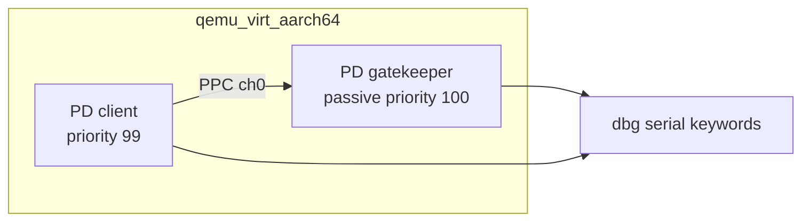
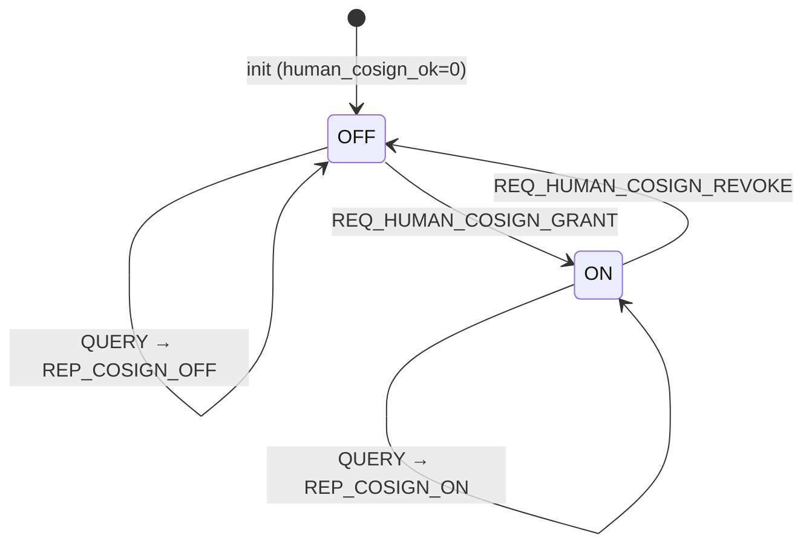

# 软件设计说明书（SDD）

> **仓库化说明（v0.1.0）**：本文为项目过程中的历史文档，按原文收录，仅做去个人化处理：作者本机路径已替换为 `<REPO_ROOT>`（= 本仓库克隆目录，内含 `mission-shell/` 与 `microkit-sdk-2.3.1/`）、`<WORKDIR>`（作者文档目录）或仓库内相对路径；形如 `/workspace/...` 的路径是作者沙箱（box）上的历史路径，在本仓库中分别对应 `mission-shell/`（原 `/workspace/microkit-mission-shell/`）与 `docs/`。文中命令含占位符，**不能直接复制执行**；可直接执行的命令见仓库根目录 `README.md` 与 `docs/REPRODUCE.md`。

**系统名称**：mission-shell（Microkit 使命约束外壳）  
**文档版本**：1.0.0  
**日期**：2026-09-23  
**对应需求**：SRS R1–R7  

---

## 1. 引言

### 1.1 目的

描述体系结构、关键模块、协议、状态机、证据链与设计决策，使实现与测试可对照设计意图，并显式记录「为何默认拒绝、为何只有 ALLOW_SIM」。

### 1.2 设计约束（硬）

- 非临床；无写使能；K=cited only  
- delivery ≠ achievement；不设 ACHIEVE 成功码  
- 共签为 demo stand-in  
- 证据链 FNV-1a32 教学级  

---

## 2. 体系结构

### 2.1 静态结构（两保护域）

`mission.system`：

| PD | priority | passive | 映像 |
|---|---|---|---|
| gatekeeper | 100 | true | gatekeeper.elf |
| client | 99 | false | client.elf |

通道：两端 id=0；client 端 `pp="true"`，使 client 可对 gatekeeper 发起 PPC，进入 `protected()`。

### 2.2 逻辑分层（K/A/M/U）——设计决策 D1

| 层 | 本系统含义 | 设计含义 |
|---|---|---|
| K | seL4 + Microkit | **仅引用**；不导出「应用使命达成」 |
| A | gatekeeper / client 代码 | 演示主体；未形式化验证 |
| M | 共签·禁区·证据纪律 | 必须可测、可日志 |
| U | 真签、真硬件写使能、临床、密码学强度链 | **显式未覆盖** |

### 2.3 动态交互总览

client `init` 按场景脚本顺序 `microkit_ppcall` → gatekeeper `protected` 依 label 分支 → 返回 msginfo label；两侧均 `microkit_dbg_puts` 固定关键词。

---

## 3. 模块设计

### 3.1 gatekeeper（策略与证据）

| 静态状态 | 类型 | 初值 | 含义 |
|---|---|---|---|
| `human_cosign_ok` | int | 0 | 人共签 |
| `evidence_seq` | unsigned | 0 | 证据序号 |
| `chain_tip` | uint32_t | 0 | 链尖（genesis） |

主要入口：

- `init`：打印保证声明；`evidence_append("gate_init")`  
- `protected`：共签三态 / tip / 门闩判定  
- `notified`：非预期通知告警  

辅助：`deny` / `allow_sim` / `evidence_append` / `fnv1a_step`。

### 3.2 client（场景驱动）

由 `DEMO_PROFILE` 选定源文件（见 3.5）。统一 `call(name, req)`：打印 `CLIENT|REQ|…`，PPC，打印 `CLIENT|REP|…`。

### 3.3 协议头 `mission_proto.h`

集中定义 `GATE_CH`、`REQ_*`、`REP_*`，避免魔数散落（接口单一事实来源）。

---

## 4. 共签状态机（D2）

**设计禁令**：启动即视为已托付；顾问/模型路径绕过共签直达使能。

判定顺序（使命关键）：

1. 处理共签 GRANT/REVOKE/QUERY 与 EVIDENCE_TIP（不依赖共签）  
2. 若 `!human_cosign_ok` → DENY `no_human_cosign`  
3. 再按请求做对准/合法分支  

---

## 5. 假使命与合法路径判定（D3）

| label | 共签前提 | 结果 | 证据 event 字符串 |
|---|---|---|---|
| REQ_LEGAL_ENABLE | ON | ALLOW_SIM | `legal_path_sim` |
| REQ_EXPIRED_TRUST | ON | DENY | `expired_entrustment` |
| REQ_FORBIDDEN_ZONE | ON | DENY | `forbidden_zone` |
| REQ_ADVISOR_ENABLE | ON | DENY | `advisor_cannot_enable` |
| REQ_EMPTY_U_ACHIEVE | ON | DENY | `empty_U_no_achieve_tag` |
| 其他未知 | ON | DENY | `unknown_request` |
| 任一使能类 | OFF | DENY | `no_human_cosign` |

成功语义分层：仅有 `DENY` / `ALLOW_SIM` / 控制面 `OK`；**不设计 ACHIEVE**，从设计上阻断「绿=达成」。

`allow_sim` 强制打印：

`GATE|NOTE|sim_only; delivery!=achievement; non-clinical`

---

## 6. 证据链设计（D4）

### 6.1 步进函数

`fnv1a_step(prev, seq, event)`：

1. 以 FNV offset basis `2166136261` 初始化  
2. 混入 `prev` 的 4 字节（小端序逐字节）  
3. 混入 `seq` 的 4 字节  
4. 混入 event 字符串各字节  
5. 质数 `16777619`  

`this = fnv1a_step(prev_tip, new_seq, event)`；更新 `chain_tip`。

### 6.2 日志契约

`EVIDENCE|seq=<dec>|prev=<8hex>|this=<8hex>|<event>`

查询：`GATE|CHAIN|tip=<8hex>|len=<dec>`

### 6.3 设计目标与非目标

- **目标**：可对质的追加顺序痕迹（教学）  
- **非目标**：抗密码学伪造、跨主机可信时间戳、持久化安全存储  

---

## 7. DEMO_PROFILE 切换（D5）

| Profile | Client 源 | 设计意图 |
|---|---|---|
| full | `scenarios/client_full.c` | 共签+合法+假使命+撤销+ tip 全路径（主验收） |
| cosign_only | `scenarios/client_cosign_only.c` | 聚焦共签门闩 |
| false_only | `scenarios/client_false_only.c` | 先 GRANT，再仅假使命 |

Makefile 未知 profile → 构建错误。根目录 `client.c` 与 `client_full.c` 内容对齐，作阅读便利副本；**实际链接对象由 DEMO_PROFILE 决定**。

---

## 8. 时序描述（full）

1. gatekeeper init → EVIDENCE gate_init  
2. client QUERY → STATE=OFF  
3. LEGAL → DENY no_human_cosign（证据）  
4. GRANT → COSIGN GRANT（证据 cosign_grant）  
5. QUERY → STATE=ON  
6. LEGAL → ALLOW_SIM + NOTE（证据 legal_path_sim）  
7. 四假使命 → 四 DENY（各证据）  
8. REVOKE（证据 cosign_revoke）  
9. LEGAL → DENY no_human_cosign  
10. EVIDENCE_TIP → len=10  
11. MISSION_SHELL_DEMO_DONE  

QUERY 与 TIP **不**追加链事件（设计选择：控制查询只读）。

---

## 9. 设计决策一览

| ID | 决策 | 理由 | 关联需求 |
|---|---|---|---|
| D1 | K/A/M/U 分层写入架构 | 防止保证偷渡 | R5 |
| D2 | 共签显式状态机、默认 OFF | 明示托付；禁默许 | R1 |
| D3 | 无 ACHIEVE；仅 ALLOW_SIM | delivery≠achievement | R3 |
| D4 | FNV-1a32 链 + tip 查询 | 可证伪教学痕迹 | R4 |
| D5 | DEMO_PROFILE 三档 | 需求可剖面覆盖 | R6 |
| D6 | 被动 gatekeeper + PPC | 门闩集中、客户端不可绕过本地分支 | R7 |
| D7 | 日志即契约 | 测试/答辩可指认 | NFR2 |

---

## 10. 部署与构建视图

宿主机 Docker 挂载 `microkit_work` → 容器 `/work`；SDK `/work/microkit-sdk-2.3.1`；工作目录 `/work/mission-shell`。产出 `build/loader.img`，QEMU loader 地址 `0x70000000`。

---

## 11. 风险与残留

| 风险 | 缓解 |
|---|---|
| 观众把 ALLOW_SIM 听成达成 | 强制 NOTE 字符串 + 答辩口径 |
| 旧日志无 DEMO_PROFILE | 变更管理规定无效 |
| 链被误解为密码学 | SRS/SDD/PU_BOUNDARY 三重声明 |
