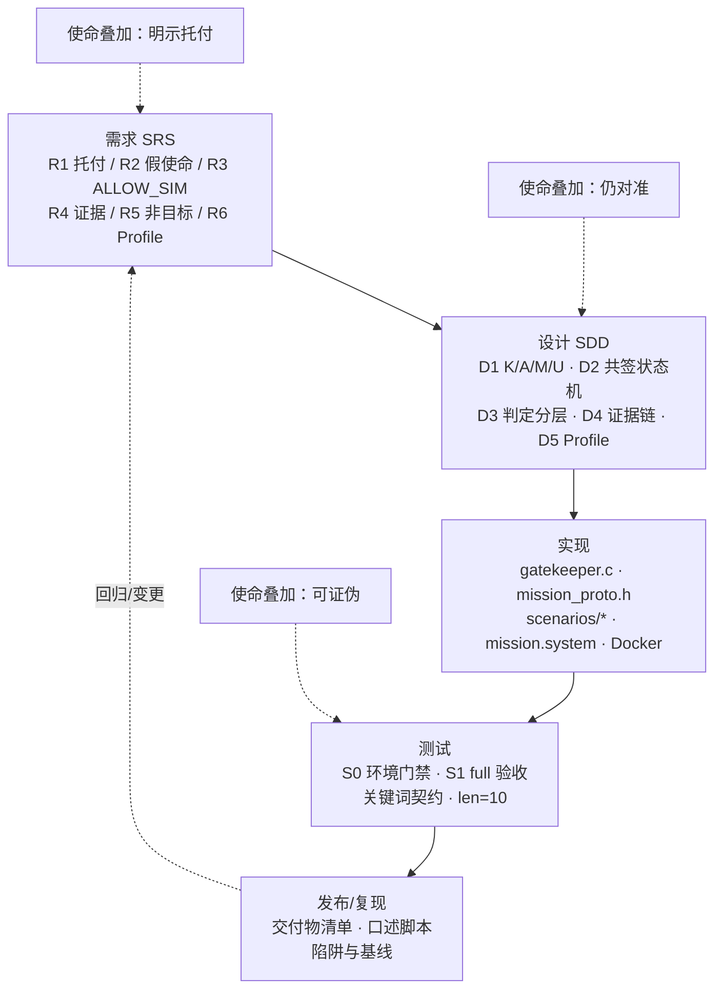

# 生命周期总览

> **仓库化说明（v0.1.0）**：本文为项目过程中的历史文档，按原文收录，仅做去个人化处理：作者本机路径已替换为 `<REPO_ROOT>`（= 本仓库克隆目录，内含 `mission-shell/` 与 `microkit-sdk-2.3.1/`）、`<WORKDIR>`（作者文档目录）或仓库内相对路径；形如 `/workspace/...` 的路径是作者沙箱（box）上的历史路径，在本仓库中分别对应 `mission-shell/`（原 `/workspace/microkit-mission-shell/`）与 `docs/`。文中命令含占位符，**不能直接复制执行**；可直接执行的命令见仓库根目录 `README.md` 与 `docs/REPRODUCE.md`。

**版本**：1.0.0  
**日期**：2026-09-23  
**系统**：Microkit 使命约束外壳（毕设题目1 / S1）

---

## 1. 立场（再声明）

传统软件工程生命周期（需求→设计→实现→测试→发布）**完整在场**。  
使命纪律是叠加在每一阶段上的可机检约束：

> **明示托付 ∧ 仍对准 ∧ 可证伪**

本示例不是「用尖刺替换生命周期」，而是「尖刺嵌在完整微型 SE 流程中」。

---

## 2. 一页流程（Mermaid）

---

## 3. 叙事：同一系统走完全流程

### 3.1 需求（REQ）

写出 R1–R5（及 R6/R7）：谁托付、何谓不准、何谓弱成功、如何证伪、明确不做什么。  
产物：`01-SRS-软件需求规格说明书.md`。

### 3.2 设计（DES）

两 PD + PPC；共签默认 OFF；假使命分支；无 ACHIEVE；FNV-1a32 链；三档 profile。  
产物：`02-SDD-软件设计说明书.md`。

### 3.3 实现（IMP）

落实为 C 与 system 描述、Makefile 与 `docker_build_run.sh`；日志即契约；无写使能。  
产物：源码树 + `03-实现说明与构建指南.md`。

### 3.4 测试（TEST）

S0 只证明工具链；S1 以 `DEMO_PROFILE=full` 关键词合取验收；rc=124 可接受。  
产物：`04-测试计划…`、`05-测试报告-DEMO_PROFILE-full.md`。

### 3.5 发布（RELEASE）

交付源码、文档包、跑通记录；现场口述托付/人审判/禁区/证据；配置项与门闩变更受控。  
产物：`06-发布与复现手册.md`、`08-配置与变更管理.md`。

### 3.6 贯穿

`07-需求追溯矩阵.md` 把 Req↔设计↔符号↔用例↔关键词钉死，防止文档与尖刺脱节。

---

## 4. 与开题报告的衔接

开题给出 S0→S1 分期、创新点与非目标；本包是 S1 的**工程化附件全集**。  
答辩时：开题讲「为何做」；本包讲「如何按 SE 做成可验收」。

---

## 5. 成功判据（工程包级）

- 十份文档齐全且口径互洽  
- 追溯覆盖 R1–R5 与假使命集  
- Docker full 命令书写精确  
- 不出现临床 / seL4 应用证明 / 达成误用  

---

## 6. 收束句

传统软件工程提供把系统做出来的全流程；本包证明该流程可以、也必须承载使命纪律——`DEMO_PROFILE=full` 是测试段尖峰，R1–R5 与 D1–D5 表明尖峰前后需求与设计从未缺席。
