# 使命软件工程：一种可证伪的工程方法及其在 seL4 Microkit 使命约束外壳上的实验管线验证

> **仓库化说明（v0.1.0）**：本文为项目过程中的历史文档，按原文收录，仅做去个人化处理：作者本机路径已替换为 `<REPO_ROOT>`（= 本仓库克隆目录，内含 `mission-shell/` 与 `microkit-sdk-2.3.1/`）、`<WORKDIR>`（作者文档目录）或仓库内相对路径；形如 `/workspace/...` 的路径是作者沙箱（box）上的历史路径，在本仓库中分别对应 `mission-shell/`（原 `/workspace/microkit-mission-shell/`）与 `docs/`。文中命令含占位符，**不能直接复制执行**；可直接执行的命令见仓库根目录 `README.md` 与 `docs/REPRODUCE.md`。


**——项目与实验综合报告（v1.0）**

| 项 | 内容 |
|---|---|
| 作者 | 陈鹏（chen peng） |
| 课题 | 使命软件工程学（Mission Software Engineering）· 毕设题目 1 / S0→S1 及对照实验延伸 |
| 文档版本 | v1.0（综合稿） |
| 日期 | 2026-10-08（Asia/Shanghai） |
| 认识论状态 | **学尚未形成。** 本文把“使命软件工程”作为一种**正在发展中的、可证伪的工程方法**陈述，而非已成立的学科 |
| 证据状态 | 实验结果为**环境自测 / 实验管线验证（setup check）**，**非确证性结论**；S1 原始演示验收已于 2026-10-08 在作者 Windows Docker 复现（`tip=80488a97`，`len=10`），但对照实验语料矩阵尚未在 Windows Docker 复现；尚无独立标注人，人工审查研究推迟，预注册 git 标签未打 |
| 硬约束 | 非临床 · 仅仿真 · 无写使能 · 不宣称 seL4 级应用证明 · Microkit（MCS 配置）构建 ≠ 已验证内核 · 交付 ≠ 达成 · 共签为演示占位 · FNV-1a32 证据链为教学级 |

---

## 摘要

软件系统可能按规格交付、通过全部测试并持续稳定运行，却已不再做人所托付的那件事：授权它的托付已经过期，执行范围悄然漂移，原本只能提供建议的顾问或自动化组件在无人明示同意的情况下成了使能的来源，或者输出被标记为“达成”，而支撑这一结论的未覆盖假设一栏却是空的。本文称这种状态为“交付而未达成”（简称“绿但错”），称引起它的请求为“假使命”。传统软件工程的需求追溯、测试与发布验收主要检查交付时点对规格的符合，运行时监控只检查写入规约的性质；形式化验证（如 seL4、CompCert）在明确假设下给出条件保证 P，而“应用此刻是否仍在做被托付之事”通常落在其未覆盖集 U 之中。针对这一缺口，本文提出并初步检验一种正在发展中的可证伪工程方法——使命软件工程（Mission Software Engineering）；它与美国国防部、INCOSE 及国内国防系统工程界所称的体系级“使命工程”（Mission Engineering）同名不同义（第 2.7.6 节）；需要说明的是，学尚未形成。该方法的最小内核是一个可机检的合取式：**明示托付 ∧ 当前动作仍对准该托付 ∧ 检查可被证伪**，并坚持“交付 ≠ 达成”。它不替代传统软件工程生命周期，而是在需求、设计、实现、测试与发布各阶段叠加可机检的使命约束；底座保证仅作引用（K = cited），并且据 Microkit 手册，Microkit 始终采用的 seL4 MCS 配置尚处于验证之中，因此本案例的 Microkit 构建不能被读作“已验证内核”。

本文以 seL4 Microkit 上的两保护域“使命约束外壳”为案例系统：S0 阶段在 Windows + Docker/QEMU 上复现 sel4test（123 项通过），仅作工具链门禁；S1 阶段实现被动门闩保护域与客户端保护域、默认关闭的人共签通道（GRANT/REVOKE/QUERY，演示占位）、四类假使命拒绝、仅允许带“sim_only; delivery!=achievement; non-clinical”注记的 ALLOW_SIM 弱放行，以及教学级 FNV-1a32 证据链，并配套完整的生命周期文档包（SRS、SDD、测试计划与报告、追溯矩阵、配置与变更管理）。2026-10-08，作者在本人 Windows 主机上以 Docker 镜像 `trustworthysystems/sel4:latest` 复现了 S1 `DEMO_PROFILE=full` 验收（`GATE|CHAIN|tip=80488a97|len=10`，`MISSION_SHELL_DEMO_DONE`），与沙箱 QEMU 回归逐条一致。

为检验方法是否只是“作者自己的检查清单”，本文设计并实现了一项预注册的配对对照实验：以按字段判决的新门闩替代按标签判决的演示门闩，比较传统流程公平基线 B、领域规则强化基线 B+、使命流程 M 及四个消融变体，覆盖 9 类假使命与 5 类合法对照（5 个种子 × 320 用例），附加证据篡改轨道 T1–T7，并预先给出 7 条可证伪条件 X-1…X-7。在沙箱真实 QEMU 上的装置自检（作者语料、草稿真值）中：B 对应拒用例漏检 800/1000（80.0%），M 为 0/1000；B+ 为 128/200（64.0%）；三个单组件消融各只在预测类别上漏检（10.0%），对准消融为 46.5%；所有条件误拒均为 0；B+ 对 M 所拦 F1–F9 用例的覆盖比为 28.9%（X-3 门槛 80%，未触发）；M 检出篡改 T1–T4、T6，并在有外部锚点时检出 T5，T5（无锚点）与 T7 不检出，与预先声明的 U 一致。

**必须强调：**上述数字全部来自作者同时编写规则与语料的“装置自检”，草稿 oracle 与 M 的 100% 一致是同一作者、同一规格的预期结果；验证性终点 X-1（独立留出语料）与 X-6（人工审查）均**未判定**。因此本文的结论限于“实验管线可运行、确定性、可回归，且装置自检未出现反证”，**不构成方法有效的证据**。文末给出对照实验语料矩阵的 Windows Docker 复现、独立标注、留出语料、人工审查研究与第二领域迁移等后续步骤，以及待作者复核的设计决定。此外，本文记录了一次两轮的对抗性辩论（第 8.6 节），据此把方法的适用范围限定为同时满足“具名的人给出有边界的委托、委托之后行为或委托本身发生变化、此后每一动作在形式上仍合规”三个条件的缺陷，承认托付记录本身的错误会产生“假绿灯”，并提出须在预注册打标签之前写入的三级放弃条件；这些修订与相应的人工研究均为计划，尚未实施。文献检索（第 2.7 节）表明，本文的单项要素几乎都有先例，最接近的是 2025—2026 年的 AI 智能体授权研究，“角色合法但不对准即拒绝”并非本文首创；在检索范围内未发现同时具备全部要素的工作，本文主张的只是这一组合，且尚无经验证据。

**关键词：**使命软件工程；交付 ≠ 达成；明示托付；假使命；seL4 Microkit；运行时门闩；证据链；预注册；可证伪性；对照实验

---

## Abstract（英文摘要）

Software can be delivered, pass its tests and keep running while no longer doing what a human entrusted it to do. This report presents Mission Software Engineering, a falsifiable engineering method under development (not an established discipline), which is unrelated to the system-of-systems "Mission Engineering" of the US DoD and INCOSE. Its core claim is a machine-checkable conjunction—explicit entrustment ∧ the current action still aligns with that entrustment ∧ the check is falsifiable—together with the principle that delivery ≠ achievement. The method overlays, rather than replaces, the traditional software lifecycle; formal methods such as seL4 and CompCert are treated as conditional assurance P with an explicit uncovered set U, and kernel guarantees are cited only; according to the Microkit manual, Microkit always uses seL4's MCS configuration, whose verification is still in progress, so a Microkit build must not be read as a verified kernel. A two-protection-domain mission shell on seL4 Microkit serves as the case system, and a pre-registered paired experiment compares a fair baseline (B), a domain-rule baseline (B+), the mission gatekeeper (M) and four ablations. All results reported here are setup checks on the author's own corpus with a draft oracle, run in a sandbox QEMU. The original S1 demo acceptance (DEMO_PROFILE=full, tip=80488a97, len=10) was reproduced on the author's Windows Docker host on 2026-10-08, but the corpus experiment has not yet been reproduced there; no independent labeller exists yet, and the confirmatory hold-out and human-review conditions (X-1, X-6) remain undecided. The results therefore validate the experimental pipeline only and are not evidence that the method works. A two-round adversarial review (Section 8.6) further restricts the method's scope to defects involving a named human's bounded delegation, a subsequent change in behaviour or in the delegation, and formally conformant later actions; it names entrustment-record errors ("false green lights") as an explicit risk and proposes three-tier abandonment conditions to be added to the preregistration before tagging. These amendments and the associated human studies are planned only. A literature survey (Section 2.7) finds precedents for nearly every individual element, the closest being 2025–2026 work on AI-agent authorization; no work combining all elements was found, and only the combination is claimed, without empirical evidence yet.

**Keywords:** mission software engineering; delivery ≠ achievement; false mission; seL4 Microkit; runtime gatekeeper; evidence chain; pre-registration; falsifiability

---

## 目录

- 摘要
- Abstract（英文摘要）
- 1 引言
  - 1.1 问题：交付了，却不再做被托付的那件事
  - 1.2 传统软件工程手段为何不能直接发现这类失败
  - 1.3 形式化验证的贡献与留下的缺口
  - 1.4 研究问题与基本立场
  - 1.5 本文贡献
  - 1.6 证据状态声明
  - 1.7 本文结构
- 2 相关工作与定位
  - 2.1 传统软件工程生命周期与需求追溯
  - 2.2 安全论证与保证案例（GSN）
  - 2.3 运行时验证与运行时监控
  - 2.4 访问控制、授权与双人规则
  - 2.5 形式化验证：seL4 与 CompCert
  - 2.6 定位小结
  - 2.7 国内外研究现状
- 3 方法：使命软件工程
  - 3.1 核心要件：一个可机检的合取式
  - 3.2 交付 ≠ 达成
  - 3.3 四类工件
  - 3.4 假使命测试
  - 3.5 K/A/M/U 保证分层
  - 3.6 与传统生命周期各阶段的叠加
  - 3.7 方法的可证伪性
  - 3.8 更广的背景：MRTDS 旗舰案例（仅作方法参照）
  - 3.9 本章小结
- 4 案例系统：从 S0 到 S1 Microkit 使命约束外壳
  - 4.1 分期与定位
  - 4.2 架构
  - 4.3 人共签状态机
  - 4.4 判定表与弱成功语义
  - 4.5 证据链
  - 4.6 验收：`DEMO_PROFILE=full`
  - 4.7 全生命周期文档包与追溯
  - 4.8 本章小结
- 5 对照实验设计
  - 5.1 研究问题
  - 5.2 假设
  - 5.3 处理条件
  - 5.4 语料
  - 5.5 指标
  - 5.6 证据篡改轨道 T1–T7
  - 5.7 预注册阈值与可证伪条件
  - 5.8 本章小结
- 6 实验实施
  - 6.1 为何必须重写门闩：从按标签判决到按字段判决
  - 6.2 变体与编译期剖面
  - 6.3 流水线与脚本
  - 6.4 确定性与回归保障
  - 6.5 本章小结
- 7 结果（环境自测 / 实验管线验证）
  - 7.1 运行完整性与确定性
  - 7.2 漏检与误拒：各变体、各类别
  - 7.3 配对比较 B vs M
  - 7.4 误拒非劣效
  - 7.5 领域规则强化基线 B+
  - 7.6 消融
  - 7.7 证据篡改轨道
  - 7.8 草稿留出语料（仅演示流水线）
  - 7.9 草稿 oracle 与门闩 M 的一致性
  - 7.10 代码与证据增量成本（E2，探索性）
  - 7.11 可证伪条件状态
  - 7.12 结果小结
- 8 讨论
  - 8.1 结果能说明什么
  - 8.2 结果不能说明什么
  - 8.3 效度威胁
  - 8.4 待作者复核的设计决定
  - 8.5 经验与教训
  - 8.6 反方质疑与正方回应
  - 8.7 本章小结
- 9 边界与非目标
- 10 结论与后续工作
  - 10.1 结论
  - 10.2 后续工作（按依赖顺序）
  - 10.3 分期路线
- 附录 A 复现命令
  - A.1 S1 `full` 剖面验收（Windows，cmd）
  - A.2 对照实验完整矩阵（Windows 一键）
  - A.3 单个剖面示例
  - A.4 Linux / 沙箱与主机模拟
- 附录 B 工件清单与路径
- 附录 C 术语表
- 附录 D 假使命与对照类别表
- 附录 E S1 `full` 剖面 Windows 跑通摘录
- 附录 F 协议与日志标签速查
- 附录 G 规则规格条款摘要
- 附录 H 复现演练
- 参考文献

---

## 1 引言

本章从一个具体的工程现象出发：软件按规格交付、通过测试并持续运行，却已不再做人托付给它的那件事。我们先用几个说明性情境刻画这一现象（1.1），再分析为何传统软件工程的产物与运行时机制不能直接发现它（1.2），以及形式化验证在其中的贡献与留下的缺口（1.3）；在此基础上提出本文的研究问题与基本立场（1.4），最后说明本文的贡献、证据状态与全文结构（1.5–1.7）。

### 1.1 问题：交付了，却不再做被托付的那件事

在许多软件系统中，系统执行的动作最终来源于人的某种托付：一位操作员在某个时间窗内、对某个范围、以某个强度授权系统去做某件事。托付天然带有边界——它由特定的人给出，只在特定时间内有效，只覆盖特定的对象与动作，并且可以被撤销。然而，软件一旦交付并进入运行，这些边界未必仍被软件“记得”。一个请求可以格式合法、发起者角色合规、通过全部功能测试，却已经脱离了授权它的那份托付。

下面三个情境用于说明这一现象。它们都是为说明问题而构造的假设情境，不对应任何真实事件，也不意味着任何特定行业或产品存在此类缺陷。为了使分析可以被逐项检查，每个情境都按同样的五个层次展开：（i）把托付本身写成一份机器可读的记录，列出托付人、受托方、对象与范围、动作、有效期与版本、禁区等要素；（ii）指出核心合取式——明示托付 ∧ 当前动作仍对准该托付 ∧ 检查可被证伪（第 1.4 节、第 3.1 节）——中失败的是哪一项；（iii）说明传统检查为何会放行它；（iv）由此导出使命需求；（v）给出能够证伪这些需求的假使命，并写明仍然留在未覆盖集 U 中的内容。

需要预先说明一个编号约定：本节由情境导出的使命需求记为 MR-1…MR-10（MR 取 mission requirement 之意），它们是方法层面的一般性需求；第 4 章生命周期文档包中的 R1–R7 则是 Microkit 使命约束外壳这一具体系统的软件需求规格条目。两者不是同一套编号，二者之间的对应关系见表 1-2。

#### 1.1.1 情境一：托付过期（时间维度）

某团队授权一个批处理作业在为期一周的试验窗口内对一组测试数据执行批量更新。窗口结束后，调度配置没有被清理，作业继续按计划每晚运行。它使用的账户权限仍然有效，输入格式无误，监控面板一片绿色；但授权它运行的那份托付已经过期，而系统中没有任何一个环节会因此拒绝它。

**托付记录。** 若把这份托付写成机器可读的记录，它大致如代码 1-1 所示。记录中的取值只是为说明而设，没有任何真实含义。

**代码 1-1 情境一的托付记录**（假设情境的示意记录，非源文件摘录）

```text
entrustment:
  entrustor:   测试负责人（具名个人）
  trustee:     批处理作业 batch-update
  scope:       测试数据集 test-dataset
  action:      批量更新 BULK_UPDATE
  valid:       [试验窗口起点, 起点 + 7 天]   版本 v1
  forbidden:   生产数据集
```

**失败的一项。** 失败落在合取式的第二项“当前动作仍对准该托付”的时间维度上：托付记录中的有效期已经结束，而当前动作发生在窗口之外。第一项并未失败——托付确实曾被明示给出；第三项也无从谈起，因为根本没有任何检查发生。

**传统检查为何放行。** 需求规格中写明的是“作业对指定数据集执行批量更新”，追溯矩阵把这一需求链接到调度脚本与相应的测试；测试用例验证更新逻辑在给定输入下是否正确；访问控制确认作业账户拥有写权限；发布验收在作业首次上线时完成。所有这些检查回答的都是“这个请求是否符合规格与权限”，而不是“授权它的那份托付是否仍然有效”。没有任何一份产物要求系统在每次运行前确认“授权窗口仍然有效”，因为“授权窗口”从未被写成需求。换言之，传统产物并没有失职，它们只是在回答另一个问题。

**导出的使命需求。** 由此可以导出三条使命需求。MR-1：托付应作为系统中的一等对象存在，至少记录托付人、范围、动作、有效期与版本。MR-2：每一个受托动作在执行时都应以当前时刻核对所引用托付的有效期，默认拒绝，拒绝理由为“托付已过期”（或“托付尚未生效”）。MR-3：拒绝本身应写入证据链，使“系统确实拒绝过”成为可以事后复核的事实。

**证伪它们的假使命与剩余的 U。** 只要托付的时间窗被写成可查询的记录，并在每次执行前由一个不可绕过的检查点核对，这一失败就会表现为一次可观察的拒绝，而不是一夜又一夜的“绿色”。在窗口结束之后提交的请求（对应实验中的 F1）与在窗口开始之前提交的请求（F2）都必须被拒绝；与此同时，恰好落在窗口端点上的请求必须被放行（L2），否则门闩会以误拒为代价“满足”MR-2。仍然留在 U 中的有两项：时间源本身是否可信，以及托付记录是否如实反映了当初审批的意图——若记录中的窗口被误写为一个月，门闩会忠实地执行一个错误的托付。

#### 1.1.2 情境二：“建议”变成了“使能”（问责、范围与版本维度）

某系统中的推荐组件原本只负责向操作员提出建议，由人决定是否执行。经过一次集成改造，下游自动化开始直接消费推荐组件的输出，并以操作员账户的名义提交执行请求。每一个接口单独看都符合规格，角色检查也都通过，但“由人决定”这一步已经悄然消失；与此同时，执行请求的目标也逐渐越出了最初托付所覆盖的范围。

**托付记录。** 这一情境涉及的托付与情境一的不同之处在于，它明确区分了“谁可以建议”与“谁可以使能”，并且存在多个版本（代码 1-2）。

**代码 1-2 情境二的托付记录**（假设情境的示意记录，非源文件摘录）

```text
entrustment:
  entrustor:   值班操作员（具名个人）
  trustee:     执行子系统；推荐组件仅可建议
  scope:       允许区 {A, B}；强度上限 L_max
  action:      ENABLE 仅限操作员本人发起；RECOMMEND 可由推荐组件发起
  valid:       当班时段   版本 v2（v1 已被取代）
  forbidden:   区 Z
```

**失败的一项。** 这一情境同时触及合取式的第一项与第二项。就第一项而言，“由人决定”这一步消失了：使能请求的意图来自推荐组件，而不是来自一次明示的人类判断。就第二项而言，失败有三种形态：来源不对准（使能的发起者实为顾问组件），范围不对准（目标越出允许区或强度上限），以及版本不对准（若下游缓存了 v1 的参数，请求便以已被取代的托付为依据）。

**传统检查为何放行。** 接口规格、角色检查与集成测试都已通过：下游自动化提交的请求在格式上与操作员手工提交的请求完全相同，并且确实使用了操作员账户。传统检查回答的是“提交者的账户是否有权提交此类请求”，而不是“这个请求的意图来源于谁、是否仍落在当前版本托付的范围之内”。目标在设备能力范围之内，因此范围检查——如果有的话——通常也只核对设备能力，而不核对托付范围。

**导出的使命需求。** 由此导出四条使命需求。MR-4（来源可追溯）：请求应同时携带提交者角色与发起者角色；凡发起者为顾问类组件的使能请求，无论经由哪个账户提交，一律拒绝。MR-5（明示人类判断）：使能必须以人共签为前提，共签绑定到当前托付版本，默认关闭，并且可以撤销。MR-6（托付范围检查）：目标、动作与强度必须落在托付范围之内，而不仅仅是设备能力之内。MR-7（版本对准）：取自已被取代版本的参数一律拒绝，即使请求携带的是一个全新的 nonce。

**证伪它们的假使命与剩余的 U。** 这一情境对应的假使命最多：顾问以自身角色直接请求使能（F4）——这一类传统的角色权限检查本来就能拦下，它在实验中正是用来检验基线公平性的；顾问的建议经操作员账户转述为使能（F5）；区、强度或动作越出托付范围（F7）；以已被取代版本的参数重放（F8）；以及未经明示共签而默认放行（F9）。与之对应的合法对照是顾问提出的合法建议（L3）与撤销之后重新授予新版本再按新版本请求（L4）。仍然留在 U 中的有两项：发起者字段必须由上游如实填写，伪造它需要真实的认证机制才能防范——在本文的案例与实验中，来源只是一个玩具级的自报字段，这恰好说明方法的检查能力受限于它所依赖的信息，而方法的要求是把这种限制明确写出；共签是否伴随了真正的审议，门闩无从判断。

#### 1.1.3 情境三：未覆盖假设为空，却声称“达成”（证据维度）

某仿真流水线在报告中把“仿真通过”写成“目标达成”。支撑这一结论的若干前提——真实硬件、真实数据源、可信的时间源——一个都未被验证，报告中的“未覆盖假设”一栏却是空的。从交付物的角度看，流水线运行成功、报告格式齐全；从托付的角度看，被托付之事并未被证明已经完成。

**托付记录。** 这里的托付对象不是一个物理动作，而是一个关于结论的授权（代码 1-3）：流水线被托付的是“在仿真中检验”，而不是“宣告达成”。

**代码 1-3 情境三的托付记录**（假设情境的示意记录，非源文件摘录）

```text
entrustment:
  entrustor:   项目负责人（具名个人）
  trustee:     仿真流水线
  scope:       仿真环境中的验证
  action:      SIMULATE；报告结论强度不得高于“仿真中允许继续”
  valid:       本轮评审周期   版本 v1
  forbidden:   在未复核 U 的情况下使用“达成”一词
```

**失败的一项。** 失败落在合取式第三项“检查可被证伪”与“交付 ≠ 达成”原则的交汇处：一个空的 U 意味着结论没有给出任何可以被推翻的边界，而“达成”一词则把一次仿真放行升格为一个无法被这次仿真支撑的断言。

**传统检查为何放行。** 流水线的每一步都执行成功，报告格式也符合模板。传统的发布检查清单通常核对报告是否齐全，却不核对报告措辞是否越界，也不核对“未覆盖假设”一栏是否为空。

**导出的使命需求。** 由此导出三条使命需求。MR-8（交付 ≠ 达成）：系统不提供任何“达成”成功码，仿真路径只返回 ALLOW_SIM，并强制附带 sim_only 注记。MR-9（U 非空声明）：声明 U 为空的使能请求，或任何声称达成的请求，一律拒绝。MR-10（结论分层）：结论应按 K/P/U 分层陈述，“达成”一词只能由人在复核 U 之后使用。

**证伪它们的假使命与剩余的 U。** 对应的假使命是 F6 的两种子型：使能时声称 U 为空，以及声称达成；合法对照是名义合法请求（L1），它必须在附带非空 U 的情况下被放行。仍然留在 U 中的是：门闩只能检查 U 是否非空，而不能检查 U 的内容是否正确、是否完整——一个写着“无关紧要的假设”的非空 U，同样可以通过门闩。

#### 1.1.4 三个情境的归纳

表 1-1 把三个情境放在一起比较。可以看到，三者失败的维度不同，但结构相同：传统检查回答的都是“请求是否符合规格与权限”，而使命层追加的问题都是“托付是否仍有效、仍对准、可对质”。

**表 1-1 三个情境的归纳**

| 情境 | 失败的合取项 | 传统检查回答的问题 | 使命层追加的问题 | 导出的使命需求 | 证伪它们的假使命（及合法对照） |
|---|---|---|---|---|---|
| 一 托付过期 | 第二项（时间） | 账户有权、输入合法、作业成功吗 | 托付此刻仍在有效期内吗 | MR-1…MR-3 | F1、F2（L2） |
| 二 建议变使能 | 第一项（明示判断）；第二项（来源、范围、版本） | 提交账户有权提交此类请求吗 | 意图来源于谁；是否在当前版本托付的范围内；人是否明示共签 | MR-4…MR-7 | F4、F5、F7、F8、F9（L3、L4） |
| 三 空 U 贴达成 | 第三项与“交付 ≠ 达成” | 流水线成功、报告齐全吗 | 结论强度是否越界；U 是否非空 | MR-8…MR-10 | F6（L1） |

表 1-2 给出 MR 编号与案例系统各类工件之间的对应。需要注意，S1 演示门闩按请求标签判决，并不持有托付记录，因此不少 MR 在 SRS 中只有部分对应或没有直接对应；它们在对照实验的字段门闩与草稿规则规格中才得到完整的操作化。

**表 1-2 使命需求 MR-1…MR-10 与案例工件的对应**

| 使命需求 | SRS 条目（第 4 章） | SDD 设计决策 | 实验中的假使命 / 合法对照 |
|---|---|---|---|
| MR-1 托付作为一等对象 | 无直接对应（演示门闩不持有托付记录） | 无直接对应 | 各 F 类的共同前提；实验托付表（表 5-3） |
| MR-2 逐动作核对有效期，默认拒绝 | R2.1（按标签判决的过期拒绝） | D3 | F1、F2；L2 |
| MR-3 拒绝写入证据链 | R4.1–R4.4 | D4 | 无对应的 F 类；由篡改轨道 T1–T7 检验 |
| MR-4 来源可追溯 | R2.3（按标签判决的顾问使能拒绝） | D3 | F4、F5；L3 |
| MR-5 明示人类判断（共签） | R1.1–R1.6（演示中共签为布尔量，不绑定版本，属部分对应） | D2 | F9（以及 F8 的共签绑定子型）；L4、L5 |
| MR-6 托付范围检查 | R2.2（仅禁区，属部分对应） | D3（部分） | F3、F7；L2 |
| MR-7 版本对准 | 无直接对应 | 无直接对应 | F8；L4 |
| MR-8 交付 ≠ 达成 | R3.1–R3.4 | D3 | F6（达成声称子型）；L1 |
| MR-9 U 非空声明 | R2.4 | D3 | F6（U 为空子型）；L1 |
| MR-10 结论按 K/P/U 分层 | R5.2（不宣称应用级证明，属部分对应） | D1 | 无直接对应（属报告层，不由门闩判定） |

关于“不提供达成成功码”这一约束，需要明确其作用范围：它只约束门闩的接口，即外壳本身从不产生“达成”，并在每次放行时强制附带注记。下游系统或报告撰写者是否把 ALLOW_SIM 误读为“达成”，不在门闩的控制之内，属于 U。第 10 章把“在应答中加入结构化的结论强度字段、并要求报告模板引用该字段”列为路线图中的扩展方向，它目前只是计划。

三个情境也共同揭示了核心合取式第三项的作用。即使系统在某次请求时做出了正确的拒绝，若这一判定没有留下可复核的记录，事后也无从区分“系统确实拒绝了”与“日志被改写成了拒绝”。因此，本文要求每一次判定都写入顺序追加、可以校验的证据链（MR-3），并预先写明证据链能做到与做不到的事情——例如，教学级哈希链无法抵御知道算法的篡改者。

图 1-1 把三个情境、失败的合取项、导出的使命需求与证伪用的假使命串成一张图。

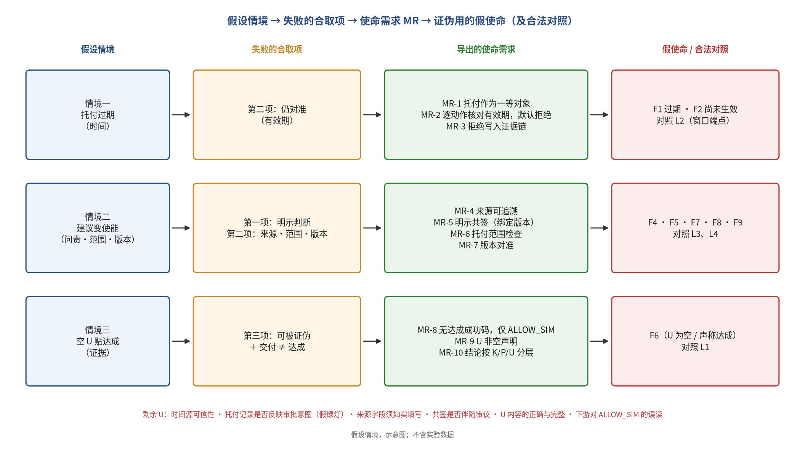

*图 1-1 三个假设情境、失败的合取项、导出的使命需求 MR-1…MR-10 与证伪用的假使命（假设情境，示意图）*

这些情境的共同点是：系统在“交付”意义上是成功的，在“托付”意义上却已经失败。本文把格式合法、角色看似合法、但已不再对准托付的请求称为假使命（false mission），把“系统按规格交付、指标全绿，但人所托付之事并未在被正确地做”的状态称为交付而未达成，简称“绿但错”。假使命的典型形态包括：托付已过期或尚未生效，目标落入禁区，范围漂移，参数取自已被取代的托付版本，顾问建议经转述变成使能，以及在从未获得人明示共签的情况下被默认放行。

### 1.2 传统软件工程手段为何不能直接发现这类失败

上述失败并不是因为传统软件工程缺少某个阶段。瀑布、V 模型、迭代与敏捷等生命周期都包含需求、设计、实现、测试与发布，并以验证（是否正确地构造了系统）与确认（是否构造了正确的系统）组织质量保证。问题在于，这些活动默认的通过准则针对的是交付时点对规格的符合：需求追溯保证需求、设计、代码与测试彼此一致；测试检查系统在给定输入下是否表现出规格要求的行为；发布验收在某一时刻判定交付物可以上线。它们共同回答的是“交付的东西是否符合规格”，而不是“此刻正在执行的这个动作，是否仍落在一份明示、有时限、可撤销的人类托付之内”。如果托付本身没有作为一等对象写进规格——谁托付、何时有效、覆盖什么、如何撤销——那么追溯矩阵再完整、测试再充分，也只是在确认一份不含托付语义的规格被忠实地实现了。

这一缺口还有一个容易被忽视的时间维度。传统的确认活动发生在交付之前或交付之时，它判断的是“在那一刻，规格是否反映了用户的需要”；而托付是时变的：它在某一时刻被给出，在另一时刻到期，期间可能被撤销、被新版本取代，或被转交给另一组件执行。交付时点与动作发生时点之间的这段时间，正是假使命滋生的空间。一份在交付时完全正确的规格，可能在运行数周之后已经不再对应任何有效的托付；系统却没有任何机制意识到这一点，因为“托付是否仍然有效”不是它被要求回答的问题。由此看来，问题的关键不在于增加更多的测试，而在于把托付本身变成系统在运行时可以查询、可以核对的对象。

运行时监控与运行时验证把检查推进到了执行期，这是重要的一步：它们依据规约检查执行轨迹，并在违反时告警或干预。但监控器能检查的只是被写进规约的性质。若托付记录不是运行时可查询的对象，监控器便无从判断一个请求是否已经脱离托付，它所能确认的仍然是格式、身份、角色与通用的安全性质。访问控制面临同样的局限：它回答“谁有权做这类事”，而不回答“这一次的动作是否仍是被托付的那一件”。情境一中的作业权限依然有效，情境二中的请求以合规角色提交，正说明了这一点。

因此，本文关注的缺口可以表述为：传统软件工程产物与运行时机制检查的是对规格的符合，而“当前动作是否仍对准一份有时限的人类托付”这一问题，通常既不在规格之中，也不在运行时检查之中。

### 1.3 形式化验证的贡献与留下的缺口

在高保证场景中，人们常借助形式化验证获得底座层面的强保证。seL4 微内核给出了从抽象规约到 C 实现的机器检查的功能正确性证明（Klein et al., 2009）；CompCert 给出了经形式化验证、保持源程序语义的 C 编译器（Leroy, 2009）。这类成果使“内核按其规约工作”“编译不引入语义偏差”成为在明确假设下成立的命题，大大压缩了底层出错的空间。

然而，证明的对象与假设决定了它的边界。本文把形式化成果给出的保证称为条件保证 P：它在证明所依赖的假设与所覆盖的对象范围内成立。seL4 的证明对象是内核及其明确假设，并不覆盖运行于其上的用户态应用的业务语义；CompCert 保证编译结果忠实于源程序，却不判断源程序本身是否在做被托付之事。于是，“应用此刻是否仍在做人托付的那件事”通常落在这些保证之外，本文把这类明确不被覆盖的内容记为未覆盖集 U。把“内核已验证”外推为“应用使命已达成”，正是“绿但错”在高保证系统中的一种形态。本文的立场是：形式化验证应当被充分利用，但必须与一个显式且非空的 U 一同陈述；在本课题中，底座保证仅作引用（K = cited），既不重做证明，也不宣称任何应用级证明。

以本文的案例系统为例，可以更具体地看到这一分界。案例系统运行于 seL4 Microkit 之上，门闩与客户端分属两个保护域，客户端只能通过受保护过程调用把请求交给门闩。保护域之间的隔离建立在内核保证之上，这一部分本文仅作引用；正是借助这一结构，“客户端不能绕过门闩自行放行”才在架构层面成立。然而，门闩的判定逻辑本身是否正确、门闩所持有的托付表是否反映了真实的托付、请求中自报的来源字段是否可信，都不在内核证明的范围之内。前两项属于应用层（A）与使命纪律层（M），需要通过测试、关键词契约与对照实验来检查；最后一项属于未覆盖集 U，本文明确不作保证。

内核一侧同样需要精确陈述。据作者于 2026-10-09 查阅的 Microkit 用户手册（v2.3.1）[11]，seL4 的形式化验证只适用于特定的内核配置，制作 Microkit 系统的 release 构建并不意味着所用 seL4 内核已经过验证；Microkit 目前总是使用 seL4 的 MCS 配置，而该配置仍在验证之中：其设计层证明已经完成，证明内核代码符合设计的工作仍在进行，计划于 2026 年完成 RISC-V、2027 年完成 AArch64。本案例运行于 AArch64 平台，所用内核配置因此不在现有的代码级功能正确性证明覆盖之内。本文所说的“K 仅引用”应当在这一意义上理解：本文引用 seL4 的设计与已发表的证明作为背景，但既不自证，也不把本案例的 Microkit 构建称为“已验证内核”；这一验证状态本身被列入未覆盖集 U（第 3.5 节、第 9 章）。

### 1.4 研究问题与基本立场

由上述分析，本文提出的研究问题是：能否把“当前动作是否仍对准一份明示的人类托付”变成软件生命周期各阶段可机检、可被证伪的工程对象？这样做相对于传统流程，是否带来了可观测的增量？

在操作层面，这一研究问题被分解为四个可以检验的子问题，它们构成第 5 章对照实验的研究问题：第一，对于格式合法、角色看似合法、但已不再对准托付的请求，传统流程会放行多少，使命层能否拦下，并且这种拦截能否推广到作者未曾预见的假使命（RQ1）；第二，使命层是否以显著提高误拒为代价，又带来多少代码与证据开销（RQ2）；第三，证据链能否让机器检出篡改、让人工审查者更快更准地指出错误放行（RQ3）；第四，假使命分类与检查谓词能否不改结构地迁移到第二个领域（RQ4）。本文所说的“可机检”，是指一项要求能够被写成在给定输入、托付记录与逻辑时刻下取值确定的谓词，并能由程序在运行时求值、由日志在事后复核；它不意味着该谓词已被形式化证明正确。

围绕这一问题，本文持四点立场。其一，叠加而非替换：传统软件工程的需求、设计、实现、测试与发布全部保留，使命约束作为每一阶段必须多回答的问题叠加其上。其二，最小内核：方法的核心只有一个可机检的合取式——**明示托付 ∧ 当前动作仍对准该托付 ∧ 检查可被证伪**——以及“交付 ≠ 达成”这一原则，即交付、测试通过或仿真放行都不等于使命达成。其三，可证伪：方法的主张被写成可以失败的命题，并在对照实验中预先声明反证条件，使“方法无效”成为可以被观察到的结果。其四，审慎定位：本文把使命软件工程（与体系层面的“使命工程”同名不同义，见第 2.7.6 节）作为一种正在发展中的工程方法来陈述，学尚未形成；单个案例与一次装置自检不足以成学。

这些立场还需要一个明确的适用边界，否则“这些失败共享同一结构”就会成为一个无法被反驳的说法（第 8.6 节质疑 4）。本文只对同时满足以下三个条件的缺陷作出预测：（1）存在一位具名的人在某一时刻给出的、有边界的委托；（2）委托之后，系统行为或委托本身发生了变化，例如到期、范围变更或撤销；（3）此后的每一个动作在形式上仍然合规。缓冲区溢出等纯实现错误、没有委托基线可以参照的一般性配置漂移，以及报告口径定义本身的错误，都不在本方法的适用范围之内（第 9 章）。在措辞上，本文把使命软件工程定位为“一种可证伪的候选工程方法”。

这一立场也包含对作者自身主张的警惕。一个由作者同时编写规则与测试语料的门闩，在作者语料上全部拦截，近乎同义反复。正因为如此，本文用相当篇幅设计了一个允许方法失败的对照实验，并始终区分“装置按设计工作”与“方法有效”这两种不同的结论。

### 1.5 本文贡献

本文的贡献是工程性与方法性的，且均在受限范围内成立：

1. 方法陈述：给出使命软件工程的核心合取式、“交付 ≠ 达成”原则、K/A/M/U 保证分层，以及将其叠加到传统生命周期各阶段的操作化方式（第 3 章）；其中各单项机制几乎都有先例，本文主张的只是把它们组合为一个以托付记录为一等制品、与经验证底座以 P + U 融合的生命周期层（第 2.7 节）；
2. 案例系统：在 seL4 Microkit 上实现两保护域使命约束外壳，并以完整的生命周期文档包承载，说明使命纪律可以有需求、设计、实现、测试与复现载体（第 4 章）；
3. 实验设计：设计一个以“方法可能无效”为可观察结果的预注册配对对照实验，包括公平基线、领域规则强化基线、消融、篡改轨道与 7 条可证伪条件（第 5 章）；
4. 实验实施与管线验证：实现按字段判决的门闩、语料生成器、草稿 oracle 以及解析、篡改与统计流水线，并在沙箱真实 QEMU 上完成装置自检，确认确定性、回归门禁与主机模拟一致性（第 6、7 章）；
5. 诚实边界：逐条列出结果能说明与不能说明的内容、效度威胁、待复核的设计决定与非目标（第 8、9 章）；
6. 对抗性检验：以两轮反方质疑与正方回应检验本文主张，据此给出方法的三条件适用边界、托付记录错误导致“假绿灯”的显式风险、带清单对照组的三臂人工研究设计，以及三级放弃条件（第 8.6 节；其中研究与预注册修订均为计划）。

本文不声称使命软件工程已经成学，不声称“角色合法但不对准即拒绝”这一思想为本文首创，不声称方法已被证明有效，不声称门闩达到 seL4 级应用保证，也不声称系统可用于临床。

### 1.6 证据状态声明

> **本文第 7 章的全部实验数字均为“环境自测 / 实验管线验证”（setup check），不构成方法有效的证据。**它们来自：（1）沙箱 box 上的真实 QEMU 运行（qemu-system-aarch64 10.0.13、aarch64-linux-gnu-gcc 14.2.0、Microkit SDK 2.3.1），而非作者 Windows 主机上的 Docker 镜像 `trustworthysystems/sel4`；（2）作者语料 A 与草稿 oracle 真值（规则与语料均由作者编写）；（3）作者手写的草稿留出语料。独立标注人尚未指定，人工审查研究（RQ3b/E1/X-6）推迟，预注册 `git tag prereg-v1` 尚未执行。

与实验结果不同，S1 原始演示的 `full` 剖面验收已于 2026-10-08 由作者在本人 Windows 主机上以 Docker 镜像 `trustworthysystems/sel4:latest` 复现（`GATE|CHAIN|tip=80488a97|len=10`，与沙箱 QEMU 回归逐条一致，见第 4.6 节与附录 E）；对照实验的语料矩阵尚未在该环境复现。

### 1.7 本文结构

第 2 章梳理相邻领域、给出本文的定位，并在第 2.7 节综述国内外研究现状；第 3 章陈述方法；第 4 章介绍 S0→S1 案例系统与生命周期文档包；第 5 章给出对照实验设计；第 6 章描述实验实施；第 7 章报告装置自检结果；第 8 章讨论结果的含义、效度威胁与待复核的设计决定，并在第 8.6 节记录对本文主张的反方质疑与正方回应；第 9 章列出边界与非目标；第 10 章总结全文并给出后续工作。附录依次给出复现命令、工件清单、术语表、假使命与对照类别表，S1 `full` 剖面的 Windows 跑通摘录，以及协议与日志标签速查、规则规格条款摘要与复现演练。

---

## 2 相关工作与定位

本章逐一考察与本文问题相邻的五个方向：传统软件工程生命周期与需求追溯、安全论证与保证案例、运行时验证与运行时监控、访问控制与授权（含双人规则）、形式化验证。对每一方向，我们依次说明它擅长什么、与本文在何处重叠，以及本文所针对的确切缺口，最后以一张对比表作结。第 2.1–2.6 节只陈述有把握的一般性学术共识，仅引用确知存在的代表性文献；第 2.7 节则在一次专题文献检索的基础上，系统梳理国内外研究现状，给出对比矩阵、最接近工作的比较、新意的审慎陈述与命名碰撞说明。

### 2.1 传统软件工程生命周期与需求追溯

生命周期模型（瀑布、V 模型、迭代与敏捷）擅长把复杂系统的交付分解为需求、设计、实现、测试与发布/维护等可管理的活动，并以验证与确认组织质量保证。需求追溯在需求、设计、代码与测试之间建立双向链接，使任何一项变更都能被追踪到其影响范围；Gotel 与 Finkelstein 对需求追溯问题的分析指出，许多追溯困难源于对需求规格形成之前的来源与过程缺乏追溯（Gotel & Finkelstein, 1994）。

本文与这一方向的重叠是全面的：生命周期的各项活动完整保留，追溯矩阵也被直接沿用，并且一直落到源文件符号、测试用例与串口关键词（第 4.7 节）。

本文针对的缺口在于：追溯保证的是“文档、代码与测试彼此一致”，而不是“规格本身捕获了托付”；确认通常针对需求在交付时点是否满足用户需要，而本文关注的是运行中的每一个具体动作是否仍落在一份明示且仍有效的托付之内。为此，本文在需求中增加两类常被省略的条目：一是负面需求与非目标（如“不出束、无写使能、不宣称应用级证明”），二是假使命需求（如“共签开启之后，过期托付仍必须被拒”）。追溯一致与规格正确之间的区别，在第 7.9 节解释 oracle 一致性结果时尤为关键。

### 2.2 安全论证与保证案例（GSN）

保证案例方法擅长以“主张—论证—证据—假设/上下文”的结构组织关于系统性质的论证，使“凭什么相信系统足够安全”成为可审查的对象。目标结构表示法（GSN）是其常用的图示记法，以目标、策略、解决方案（证据）、上下文、假设与理由等元素表达论证结构（Kelly & Weaver, 2004）。

本文与之共享“主张须有证据、假设须显式”的立场；K/A/M/U 分层中的 U，与保证案例中显式记录假设与未覆盖范围的做法在精神上一致。

差别在于，保证案例通常是面向评审的论证文档，其证据多在开发与评估阶段生成；而“当前这一动作是否仍对准托付”需要在每一次请求时被判定，并留下可对质的记录。本文因此把论证收缩为可运行的门闩判定与可校验的证据链，并把未覆盖项写成显式集合 U，而不构建完整的注册级论证。本文不构成任何安全案例。

### 2.3 运行时验证与运行时监控

运行时验证是一类轻量的验证技术：它检查系统的一次实际执行是否满足或违反给定的正确性性质，通常由依据形式化规约生成的监控器在线或离线完成（Leucker & Schallhart, 2009）。与穷尽式验证相比，它可以直接作用于真实运行，并在违反发生时告警或干预。

本文的门闩在形式上正是一种运行时检查点：所有请求经受保护过程调用（PPC）进入被动保护域 `gatekeeper` 判定，判定结果写入证据链，证据链又可以离线校验。

本文的增量不在监控技术本身，而在被检查的对象。监控器只能检查被写进规约的性质；本文的谓词以托付记录为中心——共签绑定的托付版本、时间窗、禁区、范围、来源与 U 声明——而不仅是格式、身份或通用安全属性。同时，放行只允许弱成功语义 `ALLOW_SIM`，任何放行都不被表述为“达成”。

### 2.4 访问控制、授权与双人规则

访问控制擅长回答“谁可以对什么做什么”。Saltzer 与 Schroeder 提出的保护设计原则中，完全仲裁（complete mediation）要求每一次访问都经过权限检查，权限分离（separation of privilege）主张关键操作须在多个独立条件同时满足时才能放行（Saltzer & Schroeder, 1975）。工程实践中的双人规则（two-person rule）要求关键操作由两名有权者共同确认，是权限分离的典型体现；基于角色的访问控制等机制则把权限组织为可管理的策略。

本文的门闩继承了完全仲裁的思路：敏感请求必经不可绕过的检查点（设计决策 D6）。人共签通道在精神上接近双人规则：系统自身不能单方面开启使能，必须经由人的显式确认。第 5 章的公平基线 B 正是“常规访问控制 + 接口规格检查”的操作化，其中包括角色 ACL 与 nonce 去重。

本文针对的缺口在于：访问控制判断的是主体对某一类操作是否有权，而一份托付还带有时间窗、范围、版本与来源，并且可以被撤销。角色合规的请求仍可能是假使命，情境二中的请求即以合规角色提交。本文因此要求共签绑定到具体的托付版本 (ent_id, ver)，并在每次请求时检查时间、禁区、范围、版本新鲜与来源。需要强调的是，本文的共签只是演示占位，既不是电子签名或法规意义上的共签系统，也不提供真实的身份认证。

### 2.5 形式化验证：seL4 与 CompCert

形式化验证擅长给出机器检查的条件保证。seL4 微内核给出了从抽象规约到 C 实现的机器检查的功能正确性证明（Klein et al., 2009）；CompCert 给出了经形式化验证的 C 编译器，其编译结果保持源程序语义（Leroy, 2009）。两者都是“在明确假设下成立的条件保证”的范例，也使在其上构建高保证系统成为可能。

本文的案例系统直接运行于 seL4 Microkit 之上，借助其保护域隔离与受保护过程调用实现“门闩集中、客户端不可绕过”的结构。

缺口在于，证明覆盖的是内核（或编译器）及其假设，而不是用户态应用的业务语义。本文对形式化成果的使用方式是 K = cited：仅引用其已有保证；本文的门闩与客户端属于 A 层演示代码，未经形式化验证；本文不重做 seL4 证明，也不宣称任何应用级 seL4 或 CompCert 保证。在方法层面，形式化产物至多提供条件保证 P，并必须伴随显式的未覆盖集 U；“应用是否仍在做被托付之事”属于 U，需要由使命层（M）以可测、可日志的方式另行处理。

对本案例而言，还有一层更基础的限定。据作者于 2026-10-09 查阅的 Microkit 用户手册（v2.3.1）[11]，seL4 的形式化验证只适用于特定的内核配置，制作 Microkit 系统的 release 构建并不意味着所用 seL4 内核已经过验证；Microkit 目前总是使用 seL4 的 MCS 配置，而该配置仍在验证之中：其设计层证明已经完成，证明内核代码符合设计的工作仍在进行，计划于 2026 年完成 RISC-V、2027 年完成 AArch64。（见手册“SDK”一章 Release 配置下的“Proofs”小节。）因此，即使只就内核本身而言，本案例所用的 Microkit 构建也不能被读作“运行在已验证内核之上”；“K = cited”的含义是引用 seL4 的设计与已发表的证明作为背景，而不是声称本案例的内核配置已被证明。这一点被显式写入 U（第 3.5 节、第 9 章）。

### 2.6 定位小结

把这五个方向放在一起看，可以更清楚地理解本文门闩的“出身”：它借用了访问控制中完全仲裁的结构（敏感请求必经检查点），借用了运行时验证在执行期求值谓词的做法，借用了保证案例对假设与未覆盖范围的显式记录，也借用了需求追溯把需求落到可指认工件的纪律；它与形式化验证的关系则是“站在其上、但不越界”。这些要素各自都不新，本文的增量在于把它们组织到同一个以托付为中心的检查点上，并为这一组织方式设计一个允许其失败的检验。

综合以上讨论，本文并不提出新的验证技术，也不试图替代任何相邻方向。它所做的，是把“明示托付是否仍被对准”这一在各方向中都未被当作一等对象的问题，变成可以在生命周期各阶段落地、在运行时判定、并且可以被证伪的工程对象。表 2-1 对此作一对比；第 2.7 节在更大的文献范围内检验这一定位。

**表 2-1 相邻方向的所长、重叠与本文针对的缺口**

| 方向 | 所长 | 与本文的重叠 | 本文针对的缺口 | 本文不做的 |
|---|---|---|---|---|
| 传统 SE 生命周期与需求追溯 | 分阶段交付；验证与确认；需求 ↔ 设计 ↔ 代码 ↔ 测试的双向追溯 | 全部阶段保留；追溯一直落到串口关键词 | 托付未作为一等需求；交付时点的符合不等于运行时仍对准托付；增列假使命需求与负面需求 | 不另起平行生命周期；不以追溯一致替代规格正确 |
| 保证案例 / GSN | 以主张—论证—证据—假设组织可审查的论证 | 主张须有证据、假设须显式；U 显式成集 | 论证多为评审期文档，缺少逐次请求的判定与可对质记录 | 不构成注册级安全案例 |
| 运行时验证 / 监控 | 对实际执行检查规约性质，违反时告警或干预 | 门闩即运行时检查点；证据链可离线校验 | 谓词以托付记录为中心；放行只允许弱成功语义 ALLOW_SIM | 不提供密码学强度审计 |
| 访问控制、授权与双人规则 | 完全仲裁；权限分离；关键操作须由人共同确认 | 敏感路径必经门闩；人共签默认关闭；B 即常规访问控制的操作化 | 角色合规不等于仍对准托付；共签须绑定托付版本，并检查时间、范围、版本与来源 | 不提供真实身份认证或电子签名（共签为演示占位） |
| 形式化验证（seL4、CompCert） | 机器检查的条件保证 P | 案例运行于 seL4 Microkit，借助保护域隔离 | 应用级“是否仍在做被托付之事”落在 U 中，由 M 层以可测方式处理 | 不重做证明；不宣称应用级证明（K 仅引用）；不把 Microkit（MCS 配置）构建读作已验证内核 |

### 2.7 国内外研究现状

第 2.1–2.6 节按本文问题的需要，逐一考察了五个相邻方向的一般性共识。本节在此基础上，依据作者于 2026-10-09 完成的一次专题文献检索，对国内外相关研究作更系统的梳理。检索的组织线索是本文的核心合取式——明示托付 ∧ 当前动作仍对准该托付 ∧ 检查可被证伪——及其对应的工程制品：托付记录、禁区与未覆盖假设清单 U、逐动作门闩判定与防篡改证据链。本节先说明检索范围与局限，再分九条研究脉络概述现状，随后给出对比矩阵、逐一比较五项最接近的工作，最后给出新意的审慎陈述与命名碰撞说明。本节只陈述文献层面的定位，不构成任何新的经验证据。

#### 2.7.1 检索范围、核验状态与局限

检索以英文学术检索与中文期刊官网为主。完整的检索结果共 117 条有效条目，保存在课题文献综述 `mission-se-related-work.md` 中（作者 Windows 主机路径为 `docs/survey/mission-se-related-work.md`）；本节只引用正文实际讨论的条目。每一条目都带有核验状态标记：【V】表示检索时已打开原始页面核验，【S】表示仅见于检索结果（包括已打开页面中的参考文献列表）。117 条中，【V】16 条，【S】101 条，没有凭记忆补写的条目。另有 40 条的 DOI 已于 2026-10-09 经 Crossref 元数据核对标题与年份一致；由于相应出版方页面拒绝了自动抓取，这些条目的状态仍记为【S】。

这次检索有几处必须如实说明的局限。第一，检索未直接访问中国知网、万方等中文数据库，中文文献依赖通用检索与期刊官网，可能遗漏学位论文与会议论文。第二，IEC、ISO、ASTM、UL 等标准的正文需要付费，只核对到产品页或检索摘要。第三，若干页面访问超时或被拒（例如何积丰等的结题综述 PDF、HACMS 论文页面与 Jacky 等的中子治疗规约页面），相关条目只能标为【S】，另有两篇因无法打开而未纳入。第四，绝大多数经典文献只核对到检索结果，未逐一打开原文，年份与卷期以检索结果为准。因此，下文关于“未检索到”的陈述只在这一检索范围之内成立，不能被读作“不存在”。

#### 2.7.2 九条研究脉络

**脉络一：目标与义务导向的需求工程。** KAOS 把目标逐层精化为可分配给代理的需求与期望 [12]，其障碍分析系统地寻找使目标失效的条件 [13]；Tropos 以“行动者—依赖”建模社会意图 [14]，Secure Tropos 进一步显式区分所有权、许可与执行的委托，并检查信任链 [15]；需求监控在运行时检测假设是否被违反 [16]，RELAX 等工作则让需求成为运行时对象 [17]；需求追溯问题见 [3]。这一脉络与本文的共同点十分明显：障碍大致对应于本文的未覆盖假设 U，Secure Tropos 的许可委托大致对应于托付，需求监控大致对应于“运行时仍对准”。精确的差距在于，托付在这些方法中是设计期的模型元素，而不是运行时带版本、有效期、禁区与撤销语义的记录；它们也没有逐动作门闩、假使命负向测试集，以及与形式化验证底座的条件保证融合。

**脉络二：保证案例及其维护。** GSN [4]、Assurance 2.0 [18]、排除式论证 [19] 等提供结构化论证，其中 Assurance 2.0 强调废止因子、反案例与可辩驳性；动态安全案例主张在运行期更新论证 [20]，ConSerts 在运行时按条件合成认证 [21]，Sorokin 等基于 Evidential Tool Bus 实现持续保证 [22]；UL 4600 [23] 把保证扩展到自主产品。STPA [24] 所说的“不安全控制动作”包括“在错误情境下提供本应正确的动作”，与本文的假使命高度同构。本文“条件保证 P + 显式 U”的表述，与 Assurance 2.0 的“假设与废止因子显式化”以及 ConSerts 的条件化保证一脉相承。差距在于，保证案例论证的是“系统是否安全、可信”，而不是“此刻这一动作是否仍在人的托付之内”；证据大多没有防篡改要求（Evidential Tool Bus 只以哈希作标识），也没有托付人与撤销语义。

**脉络三：运行时验证与运行时强制。** 运行时验证 [5] 依据规约检查执行轨迹；安全自动机 [25] 截断违规执行，编辑自动机 [26] 插入或抑制动作；Simplex [27] 以经验证的安全控制器兜底未验证组件；Shield [28] 为强化学习拦截不安全动作；ModelPlex [29] 把经验证的模型编译为运行时监控器。本文的逐动作门闩在技术上正是一种运行时强制，而 Simplex 一类“经验证组件约束未验证组件”的结构，与 seL4 Microkit 上约束外壳的设计同构。差距在于语义对象：这些监控依据的是形式规约或安全包络，而不是带托付人、有效期、禁区与版本的托付记录；规约本身是否仍对准人的意图，不在其考察范围之内。

**脉络四：授权、委托、策略与人类监督。** 授权方向的工作十分成熟：能力机制 [30] 与保护设计原则 [6]；混淆代理人问题 [31]——合法权限被用于非本意的目的，可以看作“角色合法但不对准”的经典安全版本；speaks-for 委托逻辑 [32]；UCON 的持续授权与义务 [33]；Macaroons 的可衰减 caveat [34]；以及最接近“对准”的基于目的的访问控制 [35]。人类监督方向有“有意义的人类控制”及其追踪与追溯条件 [36]，以及欧盟《人工智能法》第 14 条对高风险系统人类监督的要求 [37]：监督者应能理解系统局限、意识到自动化偏见、决定不使用或推翻输出，并能中断系统；对特定生物识别系统，结果须经至少两名具备能力的自然人分别核验。委托、时限、caveat、撤销以及“理解—干预—停止”，都与托付记录的字段直接对应。差距在于，访问控制判断的是“主体是否有权”，而不是“此动作是否仍服务于托付目的”；基于目的的访问控制只做到部分，且其目的是声明值，不可证伪；《人工智能法》规定的是法律义务，不提供可执行的逐动作门闩或证伪测试。

**脉络五：使命工程与使命保证。** 美国国防部的《使命工程指南》第 2.0 版 [38]、SEBoK 的“Mission Engineering”条目 [39] 以及 Dahmann 与 Parasidis 的综述 [40] 构成这一方向的主干：使命本身成为被关注的系统，在体系层分析“能否达成预期效果”。它区分使命效果度量（MOE）与性能度量（MOP），与本文的“交付 ≠ 达成”完全同向。但使命工程关注的是体系能力组合与作战线程，使命由组织或作战需求给出，既不涉及软件的逐动作授权，也没有托付人、禁区与撤销的记录语义，更未与形式化验证融合。这一方向与本文只是背景关系，却存在严重的命名碰撞（第 2.7.6 节）。

**脉络六：可信验证与防篡改证据。** seL4 的功能正确性证明 [1, 41]、CompCert [2] 等提供强隔离与功能正确性的条件保证；LionsOS [42] 是基于 seL4 与 Microkit 的操作系统；HACMS [43] 在无人机等平台上以 seL4 隔离未验证组件，并经受红队检验。这一脉络中有一项与本文 K 层陈述直接相关的事实：Microkit 手册 [11] 写明，seL4 的形式化验证只适用于特定的内核配置，Microkit 始终使用 seL4 的 MCS 配置，而该配置仍在验证之中（第 2.5 节、第 3.5 节）。防篡改证据方面，有安全审计日志 [44] 与 in-toto [45]，后者由项目所有者签名的布局规定“由谁执行哪一步”，接近托付记录，但限于软件供应链场景。共同点是“已验证底座 + 显式假设”正是 seL4 证明的表述方式，而防篡改证据链可以直接复用这些技术；差距在于，已验证底座保证的是隔离与实现符合规约，不涉及规约是否仍对准人的托付。

**脉络七：针对错配与不对准的测试。** 经典的负向测试方法包括误用用例 [46] 与 XACML 策略变异测试 [47]；后者通过变异策略检验测试集能否区分“应拒”与“应允”，是与假使命测试最接近的经典技术，但它没有“假使命”这一类别。AI 对齐研究中的规约博弈 [48] 与目标误泛化 [49] 都在论证“满足字面目标 ≠ 达成意图”，与“交付 ≠ 达成”同构，但缺少工程制品。最接近本文的是 2025—2026 年的 AI 智能体授权研究：间接提示注入 [50] 揭示了智能体执行“格式合法但非用户本意”的动作；认证委托 [51]、CaMeL [52]、Progent [53]、AgentSentry [54] 与意图治理的工具授权 [55] 分别从委托令牌、能力与数据流策略、可编程权限策略、任务级默认拒绝策略与意图证书等角度，实现了任务或意图范围内的最小权限、到期与撤销、偏离即拒绝以及审计链。按检索所见的归纳，这一组工作的托付来自用户的自然语言请求，没有具名托付人的禁区、版本与 U 清单，没有与形式化验证底座的条件保证融合，面向的是大模型工具调用而非安全关键的信息物理系统，其负向测试也以注入攻击为主。

**脉络八：医疗与放射治疗安全。** Therac-25 事故调查 [56] 揭示了软件联锁失效以及复用旧代码时假设的失效；IEC 62304 [57]、IEC 60601-2-1 [58] 规定了医疗器械软件生命周期与电子加速器的专用安全要求；AAPM TG-100 [59] 提出基于 FMEA 的前瞻风险管理；Jacky 等对中子治疗机控制软件给出了 Z 形式规约，其核心不变式为“出束时机器设置须与处方一致” [60]（该条仅见于检索结果，原页面访问超时）。在这一语境中，处方大致对应于托付记录，联锁大致对应于逐动作门闩，Therac-25 正是未覆盖假设 U 失效的典型。差距在于，标准要求风险控制与可追溯性，却没有把“处方或授权是否仍有效、是否被撤销、是否越出禁区”作为可证伪的运行时一等制品；形式规约案例也很少与已验证内核融合。需要重申，本文是非临床的方法演示，上述文献只提供领域语境，不意味着本文的任何产物可用于临床。

**脉络九：国内研究。** 可信软件方向有国家自然科学基金“可信软件基础研究”重大研究计划及何积丰等的结题综述 [61]（原 PDF 访问超时）。运行时验证与智能系统方向，有陈泽众、邓玉欣的运行时验证工作 [62]，以及卜磊、董威、单云霄关于智能系统可信验证的综述 [63]，后者讨论了运行时监控与 Simplex 类结构。国防系统工程界的使命工程研究——王林尧的综述 [64] 与基于 MBSE 的使命工程方法 [65]——与本文同名不同义。人类监督伦理方向有刘成科、葛燕关于“有意义的人类控制”的研究 [66]。医疗器械标准方面，YY/T 0664-2020 等同采用 IEC 62304 [67]。智能体授权方向的 AgentSentry [54] 出自北京大学团队。在本次检索范围内，没有检索到以“使命软件工程”为学术术语的中文文献，也没有检索到与本文合取一致的中文工作。

#### 2.7.3 对比矩阵

表 2-2 以六个维度比较各研究脉络：E 表示托付或委托是否显式，A 表示是否在运行时检查对准，F 表示是否以负向测试证伪，T 表示证据是否防篡改，V 表示是否与形式化验证融合，H 表示是否有人在回路。● 表示明确具备，◐ 表示部分或间接具备，○ 表示基本不涉及。表中的判断沿用文献综述的原始评定，是基于检索所见材料的定性归纳，而不是逐项打分的结果。最后一行“本文（目标）”是设计目标而不是已被证实的性质：六项合取目前只是设计主张，尚待实证。

**表 2-2 研究脉络对比矩阵**（来源：课题文献综述 `mission-se-related-work.md` §1）

| 研究脉络 | E | A | F | T | V | H | 简要理由 |
|---|---|---|---|---|---|---|---|
| 1a 目标导向需求工程（KAOS / i* / Tropos / Secure Tropos） | ◐ | ○ | ◐ | ○ | ◐ | ◐ | 有职责分配；Secure Tropos 显式建模许可与执行的委托；KAOS 障碍分析是一种反向思考，并有时序逻辑形式化；主要在设计期使用 |
| 1b 需求运行时监控（FLEA、RELAX、Requirements@run.time） | ○ | ● | ○ | ○ | ◐ | ○ | 在运行时监控需求或假设是否被违反；对准的对象是需求，而不是人的托付 |
| 2a 保证案例（GSN / CAE / SACM / Assurance 2.0 / 排除式论证） | ○ | ○ | ◐ | ○ | ◐ | ◐ | 废止因子与反案例接近可证伪；没有托付人、禁区等概念；属于静态论证 |
| 2b 动态 / 条件保证（ConSerts、动态安全案例、ETB、UL 4600 SPI） | ○ | ● | ◐ | ◐ | ◐ | ○ | 在运行时评估保证条件；ETB 用哈希标识证据；不涉及人的托付 |
| 3 运行时验证与强制（安全自动机、编辑自动机、Simplex/RTA、Shield、ModelPlex） | ○ | ● | ◐ | ○ | ● | ○ | 逐动作拦截或替换，监控器可被验证；所依据的是形式规约，不是托付 |
| 4a 授权 / 委托 / 策略（能力、speaks-for、UCON、XACML、Zanzibar、Macaroons、委托撤销） | ● | ◐ | ◐ | ○ | ◐ | ○ | 委托、caveat、时限、撤销都很成熟；UCON 有持续授权；只检查有无权限，不检查是否仍对准目的（基于目的的访问控制是部分例外） |
| 4b 人类监督（有意义的人类控制、自动化等级、EU AI Act 第 14 条） | ◐ | ◐ | ○ | ◐ | ○ | ● | 规范层面要求人能理解、干预、停止，并设双人核验；缺少可执行的逐动作门闩 |
| 5 使命工程与使命保证（DoD MEG、SEBoK、CJA、Aerospace MAG、NIST 800-160v2） | ◐ | ◐ | ○ | ○ | ○ | ◐ | 区分交付与使命效果（MOE 与 MOP）；CJA 把使命映射到资产；对象是体系级任务，不涉及软件动作门闩 |
| 6a 可信验证（seL4 / CompCert / CakeML / CertiKOS / Cogent / PCC / HACMS / LionsOS） | ○ | ○ | ◐ | ○ | ● | ○ | 提供强隔离与功能正确性的条件保证；HACMS 做过红队对抗；不知道“使命”是什么 |
| 6b 防篡改证据（Schneier–Kelsey 日志、历史树、CT、in-toto） | ◐ | ◐ | ○ | ● | ○ | ○ | in-toto 的布局由项目所有者签名、规定谁可执行哪一步，接近托付记录；但针对的是供应链步骤 |
| 7a 误用 / 错配测试（误用用例、变异、蜕变、策略变异测试、规约挖掘） | ○ | ○ | ● | ○ | ○ | ○ | 有成熟的负向测试与测试充分性方法；没有“假使命”这一类别 |
| 7b AI 对齐（规约博弈、目标误泛化） | ◐ | ◐ | ◐ | ○ | ○ | ◐ | 揭示按字面完成 ≠ 达成意图，与交付 ≠ 达成同构；缺少工程制品 |
| 7c AI 智能体授权（委托令牌、CaMeL、Progent、AgentSentry、意图证书） | ● | ● | ◐ | ◐ | ○ | ● | **最接近**：任务或意图范围内的最小权限、到期与撤销，偏离即拒绝，并有审计链；缺 P/U 融合，也不面向安全关键 CPS |
| 8 医疗 / 放疗安全（Therac-25、IEC 62304 / 60601-2-1 / 14971、TG-100、Jacky 的 Z 规约） | ◐ | ● | ◐ | ○ | ◐ | ● | 硬件与软件联锁保证出束状态与处方一致，处方可看作一种托付；FMEA 属于前瞻分析 |
| 9 国内研究（可信软件计划、自适应与运行时验证、使命工程、有意义人类控制、AgentSentry） | ◐ | ◐ | ◐ | ○ | ◐ | ◐ | 各分支都有工作，但没有检索到“使命软件工程”这一合取 |
| **本文（目标）** | ● | ● | ● | ● | ● | ● | 目标是六项合取；目前是设计主张，尚待实证 |

需要特别指出，表中本文一行的“●”只表示设计意图，而非已达到的强度：在本案例中，T 维度的证据链是教学级的 FNV-1a32 顺序哈希链（第 4.5 节），V 维度只是对 seL4 的引用（K = cited），而且所用 MCS 配置尚未被代码级证明覆盖（第 2.5 节），H 维度的人共签只是演示占位。与此相对，7c 一组工作在若干单项上——例如认证委托与真实的身份认证——比本文走得更远。

#### 2.7.4 最接近的五项工作

**Zhu 与 Wang（2026）的意图治理工具授权 [55]。** 该工作为 AI 智能体的工具调用签发“意图证书”，其中包含请求哈希、主体绑定、动作类别、资源与效应边界、置信度、到期与撤销；当一次工具调用在静态授权上被允许、但与当前意图不符，或者出现意图漂移时，系统执行拒绝或澄清，同时维护防篡改的本地审计哈希序列，并给出“不扩权”性质的形式命题；据该文报告，在其实验中，198 份被接受的草案里有 40 份不安全，而它们的执行数为 0。这项工作已经覆盖了“静态授权合法、但与当前意图不符即拒绝”与本地哈希链审计两项内容，因此本文不能声称“角色合法但不对准即拒绝”这一思想为本文首创。二者的区别主要在托付的来源与语境：意图证书的意图来自用户的自然语言请求，而本文的托付记录由具名托付人给出，显式包含禁区、版本与未覆盖清单 U，并要求与经验证底座的条件保证 P + U 一同陈述；前者面向大模型工具调用，后者面向放疗联锁一类安全关键场景的方法演示。还应承认，该工作报告了针对其系统的实验结果，而本文目前只有装置自检。

**AgentSentry [54]。** 这项来自北京大学团队的工作面向计算机使用类智能体，为每项任务生成临时的、默认拒绝的访问策略，任务结束即撤销。它与本文的 MR-1、MR-2（托付作为对象、逐动作核对有效期并默认拒绝）在结构上非常接近：权限的生命周期跟随任务，而不是跟随账户。区别在于，AgentSentry 的策略由任务自动生成，按检索所见的归纳，没有具名托付人、禁区、版本与 U 清单这些一等字段，也没有与形式化验证底座融合；本文则把这些字段写成托付记录，并以系统化的假使命测试作为验收的必要条件。就“任务结束即撤销”这一点而言，本文的托付有效期与之同义，并无更多新意。

**South 等（2025）的认证委托 [51]。** 该工作提出了一个面向 AI 智能体的认证委托框架：用户签发委托令牌，其中包含范围、到期与撤销端点以及审计地址，并支持人在回路的审查。它的委托令牌与本文的托付记录在字段上高度对应——范围、有效期、撤销、审计——可以看作 MR-1 在真实认证环境中的一种实现。在认证这一维度上，它明显领先于本文：本文的来源字段只是玩具级的自报字段，共签只是演示占位，真实认证属于 U。本文与之的区别在于版本对准（MR-7）、禁区、U 非空声明与“交付 ≠ 达成”的接口约束，以及与经验证底座的条件保证融合；这些区别是设计层面的，尚未得到实证支持。

**Secure Tropos 的委托建模、KAOS 障碍分析与需求监控 [15, 13, 16]。** 这三者合在一起，可以视为本文在需求工程中的直接祖先。Secure Tropos 显式区分所有权、许可与执行的委托，并检查信任链；KAOS 的障碍分析系统地寻找使目标失效的条件，并有时序逻辑的形式化；需求监控则在运行时检测假设是否被违反。本文从托付结构推导假使命的“单点违反”规则（第 3.4.1 节），在精神上与障碍分析相近，而后者更成熟、形式化程度也更高。区别在于对象与时点：在这些方法中，委托是设计期的模型元素，而本文要求托付成为运行时带版本、有效期、禁区与撤销语义的记录，由一个不可绕过的门闩逐动作核对，并以假使命测试集验收。第 8.6 节质疑 1 所说的“可归约性”，在这里体现得最为明显。

**ConSerts、动态安全案例与 Assurance 2.0 的废止因子 [21, 20, 18]。** ConSerts 在运行时依据条件合成认证结论，动态安全案例主张在系统全生命周期中持续更新安全论证，Assurance 2.0 则要求把假设、废止因子与反案例显式化，强调论证的可辩驳性。本文的“条件保证 P + 显式未覆盖集 U”与这一思路一脉相承，也是本文 K/A/M/U 分层最直接的参照。区别在于论证的对象：它们论证的是“系统是否安全、可信”，而本文的门闩判定的是“此刻这一动作是否仍在人的托付之内”；此外，它们的证据大多没有防篡改要求，也没有托付人与撤销语义。同样需要承认，本文的 P/U 表述远不如这些论证框架成熟，本文也不构建任何安全案例。

#### 2.7.5 新意的审慎陈述

综合上述比较，本文对新意的陈述必须相当克制。第一，本文的几乎每一个单项要素都有先例：托付与委托见于授权研究、智能体授权研究与 Secure Tropos，运行时对准检查见于需求监控、运行时强制与智能体授权，负向与变异测试见于误用用例与策略变异测试，防篡改日志见于安全审计日志与 in-toto，形式化条件保证见于可信验证与动态保证，人在回路见于人类监督与医疗安全。第二，“角色合法但不对准即拒绝”这一思想已经出现在 2025—2026 年的 AI 智能体授权研究之中 [54, 55]，其安全领域的经典版本可以追溯到混淆代理人问题 [31]，本文不声称首创这一思想。第三，本文主张的只是一种组合：把上述要素提升为贯穿需求、设计、实现、测试、发布与运行的软件工程生命周期层；把托付人、禁区、版本与 U 清单作为一等制品；与经验证的底座以条件保证 P + U 的形式融合；并以放疗联锁一类安全关键语境为方法演示的背景。在本次检索范围内，没有找到在同一框架内同时具备这些要素的工作。第四，这一组合是否带来实际价值，目前没有经验证据：第 7 章的结果只是装置自检，承担验证性负荷的 X-1 与 X-6 尚未判定，第 8.6 节提出的三臂人工研究也只是计划。这一陈述与第 8.6 节采用的定位——“一种可证伪的候选工程方法”——是一致的。

#### 2.7.6 命名碰撞说明

“使命”一词在相关文献中已有确定的用法，需要预先区分。第一，“使命工程”（Mission Engineering）在美国国防部《使命工程指南》[38]、SEBoK [39] 以及国内国防系统工程界的研究 [64, 65] 中，都指体系层面的使命分析与设计，包括使命线程、使命效果度量与体系架构；它与本文“软件动作须对准人的托付”在对象与方法上都不同，是另一个主题。第二，“mission software engineer”只作为工业界的岗位名称出现 [68, 69]，指航天与防务“任务软件”的工程师，不是学科名称。第三，“mission-oriented software engineering”见于合同与服务名称 [70]，属于商业用语，未检索到作为学术方法论的用法。第四，在本次检索范围内，未发现“使命软件工程”作为中文学术术语的用法。因此，本文在摘要与第 1 章首次使用“使命软件工程”时即注明其与“使命工程”同名不同义。为避免英文检索上的混淆，可以考虑采用“Entrustment-Aligned Software Engineering”作为候选英文名称；这只是一个候选，是否更名由作者决定，本文其余部分仍沿用“Mission Software Engineering”。

---

## 3 方法：使命软件工程

第 1、2 章说明了问题所在以及相邻方向留下的缺口，本章给出方法本身。我们先给出核心合取式及其在案例与实验中的两级具体化（3.1），再说明“交付 ≠ 达成”如何在设计上落实（3.2）；随后把方法要求的产物归纳为四类工件（3.3），并依次讨论假使命测试（3.4）、K/A/M/U 保证分层（3.5）、与传统生命周期的逐阶段叠加（3.6）以及方法自身的可证伪性（3.7）；最后简述本课题更广的应用背景（3.8）。

### 3.1 核心要件：一个可机检的合取式

使命软件工程的核心主张是：一个动作“人托付的那件事现在仍在被正确地做”，在软件中只能以如下合取式表达，任一项为假即不得以“功能返回成功”代替：

> **明示托付 ∧ 当前动作仍对准该托付 ∧ 检查可被证伪**

在 S1 使命约束外壳实现中，该合取式被具体化为：

```
有效明示托付（共签 ON 且未撤销）
∧ 当前请求通过禁区 / 过期 / 妄图使能 / 空 U 达成 等对准检查
∧ 判定已写入可查询证据链
```

在对照实验的按字段门闩中，它被进一步细化为草稿规则规格 `rules_spec.md` §1 的“上位法”：格式与取值合法 ∧ 引用存在的托付 ∧ 角色有权 ∧ 非重放 ∧ 有人明示共签且共签绑定到该请求所引用的托付版本 ∧ 该托付版本在当前逻辑时刻有效 ∧ 目标区不在禁区 ∧ 请求落在托付范围内（区、强度、动作）∧ 所引用版本未被取代 ∧ 使能类请求的来源是操作员 ∧ 不声称“达成”且使能时 U 非空。

这一合取式之所以被称为“最小内核”，是因为三项各自回答一个不可省略的问题：第一项回答“是谁、授权了什么”，第二项回答“这一次的动作是否仍是被授权的那一件”，第三项回答“我们凭什么相信前两项确实被检查过”。下面依次给出每一项的定义、设立理由、可机检形式、典型失效方式，以及它在 Microkit 案例中的具体例子；最后讨论三项之间的关系。

#### 3.1.1 第一项：明示托付

**定义。** 托付是人对系统在一定时间、范围与强度内执行某类动作的授权。“明示”要求托付经由显式通道给出，具有确定的给出者、版本与生效状态，可以撤销，并且在未被给出之前默认不存在。

**理由。** 若托付可以被默认、被推断，或由配置文件隐式开启，那么“谁授权了这件事”便无从回答。情境二中“由人决定”这一步之所以能悄然消失，正是因为人的决定从未被表示为系统中的一等对象。把托付做成只能经由显式报文改变的状态，并令其初值为“无”，是让人的决定在系统中留下可检查痕迹的最低要求。

**可机检形式。** 在 S1 演示门闩中，明示托付被表示为一个初值为 0 的状态变量 `human_cosign_ok`，它只能由 GRANT 与 REVOKE 两种控制面报文改变；在字段门闩中，它被细化为共签绑定集合 B，集合的每个元素是一对托付编号与版本。对一个引用托付 (ent_id, ent_ver) 的请求 q，第一项可写为：

$$\mathrm{Explicit}(q)\;\equiv\;B\neq\varnothing\;\wedge\;(q.\mathrm{ent\_id},\,q.\mathrm{ent\_ver})\in B$$

前一个合取项不成立时给出理由码 `no_human_cosign`（条款 S-C1），后一个不成立时给出 `cosign_binding_mismatch`（条款 S-C2）。按草稿规则规格，这两条适用于全部四种动作，包括只读查询；规格同时把“只读查询是否应当要求共签”列为留待独立标注人复核的问题。

**典型失效。** 第一项的失效方式包括：系统启动即视为已托付；配置中存在一个隐式为真的开关；撤销之后仍沿用撤销前的授权；人共签的是另一份托付，却被用来放行这一份请求；共签绑定的是旧版本，请求引用的却是新版本，或者反过来。对照实验中 F9 的三个子型（从未共签、撤销之后、共签绑定到另一托付）正是对这些失效方式的操作化。

**案例示例。** 在 `full` 剖面中，客户端在共签之前先发出一个合法请求（`legal_before_cosign`），门闩返回 DENY，并写入理由 `no_human_cosign`；GRANT 之后，同类合法请求得到 ALLOW_SIM；REVOKE 之后，同类请求再次被拒。三次请求的内容并无实质差别，结果却各不相同，差别只在于明示托付当时是否存在——这正是第一项在系统行为上的可观察后果。

#### 3.1.2 第二项：当前动作仍对准该托付

**定义。** 当前动作落在所引用托付的时间窗、允许区、强度上限与允许动作之内，目标不在禁区，所引用版本未被取代，并且使能类动作的来源是操作员。

**理由。** 托付不是一个一次性的开关，而是一份带边界的授权。有了明示托付并不意味着任何动作都被授权；对准检查要回答的是“这一次的动作是否仍是被托付的那一件”。传统访问控制在这里止步，因为它只关心主体是否有权执行某一类操作，而不关心这一次操作是否落在某份具体授权的边界之内。

**可机检形式。** 字段门闩对每个请求依次计算版本存在、时间、禁区、范围、版本新鲜与来源等谓词（第 6 章图 6-1）。设请求 q 引用托付版本 e，目标区为 z，强度为 ℓ，动作为 a，逻辑时刻为 now，则第二项的主体部分可写为：

$$t_{\mathrm{start}}(e)\leq \mathrm{now}\leq t_{\mathrm{end}}(e)\;\wedge\;z\notin F(e)\;\wedge\;z\in A(e)\;\wedge\;\ell\leq \ell_{\max}(e)\;\wedge\;a\in \mathrm{Act}(e)\;\wedge\;\neg\,\mathrm{superseded}(e)$$

其中 F(e) 与 A(e) 分别为禁区与允许区，Act(e) 为允许动作集合；对使能类动作还须满足来源为操作员。时间窗取闭区间，这是规则规格中明确写出的约定：恰好落在 t_start 或 t_end 的请求是合法的。各子条件依固定优先级求值，首个失败者决定理由码（附录 G）。

**典型失效。** 第二项最常见的失效并不是“完全没有检查”，而是检查得不对：闭区间被实现成开区间，于是边界上的合法请求被误拒；禁区与允许区重叠时让允许区优先，而规格要求禁区优先；只检查工单号存在而不检查版本；参数取自已被取代的旧版本；顾问建议经转述变成使能。它们分别对应假使命 F1、F2、F3、F7、F8 与 F5，而合法边界类 L2 专门用来防止实现“为了不漏检而矫枉过正”。

**案例示例。** 以实验托付表中编号为 1 的托付为例：时间窗 [100, 200]，允许区 {1, 2, 3}，禁区 {7, 15}，强度上限 300，允许动作为 ENABLE_SIM、RECOMMEND 与 QUERY_STATUS。在已共签的前提下，逻辑时刻 201 的使能请求违反时间条件（F1，`expired_entrustment`）；目标区为 7 的请求违反禁区条件（F3，`forbidden_zone`）；目标区为 5 的请求既不在允许区也不在禁区，违反范围条件（F7，`scope_drift_zone`）；强度为 301 的请求违反强度上限（F7，`scope_drift_level`）。与此相对，逻辑时刻恰为 200、强度恰为 300 的请求仍应被放行——这正是 L2 边界对照要守护的情形。

#### 3.1.3 第三项：检查可被证伪

**定义。** 这一项有两层含义。在判定层，每一次判定都写入可查询、可离线校验的证据，使“系统做出了什么判定”成为可以被对质、也可以被推翻的事实。在方法层，方法的主张本身附带预先声明的反证条件。

**理由。** 若判定没有留下记录，就无法区分“系统确实拒绝了”与“记录被改写成了拒绝”；若方法没有反证条件，任何结果都可以被解释为支持方法。前者使检查无从复核，后者使方法无从检验，两者都会让“检查过了”变成一句无法被反驳、因而也没有信息量的话。

**可机检形式。** 在判定层，S1 门闩与字段门闩 M 都把判定写入 FNV-1a32 顺序证据链：每条记录包含序号、前一条记录的哈希与本条哈希，任何一条记录被改动，都会使从该条起的重算结果与记录不符（第 4.5 节给出算法与公式）。链尾值 tip 与长度 len 可以由控制面报文查询，也可以与外部锚点比对。在方法层，第 5.7 节把方法可能失败的方式写成 X-1…X-7 七条反证条件，并冻结了相应阈值。

**典型失效。** 日志只有文本、没有顺序联结，于是改写一行不会留下任何痕迹（对应篡改模型 T1 对基线 B 的情形）；把教学级哈希链当作密码学审计，忽视知道算法的篡改者可以整链重算（T7）；没有外部锚点却声称可以检出截尾（T5）；在看到结果之后调整阈值或改写假设。

**案例示例。** 在篡改轨道 T1 中，一条拒绝记录被改写为放行而哈希未作改动，M 的链校验在重算该行哈希时立即发现不符；而在 T7 中，篡改者修改记录后从修改处起重算整条链，链在内部保持自洽，校验无法发现。方法把后者预先写进未覆盖集 U，而不是在结果出来之后再作辩解——这本身就是第三项在方法层的体现。

#### 3.1.4 三项之间的关系

三项是合取关系，任何一项为假都不得以“功能返回成功”掩盖，而且三项之间不能互相替代。只有明示托付而不检查对准，F1–F8 一类的假使命会被放行；对准检查再完备，若没有明示托付，F9 一类的假使命仍会被放行；判定再正确，若不可证伪，事后便无法对质。对照实验中的消融条件正是对这种不可替代性的检验：每去掉合取式中的一个部件，预注册就预测某些假使命类别的漏检会上升（第 5.3 节与第 7.6 节）。

### 3.2 交付 ≠ 达成

方法从设计层面阻断“绿 = 达成”：系统只区分 `DENY`、`ALLOW_SIM`（仿真弱放行）与控制面 `OK`，不设计任何 ACHIEVE 成功码；每次 `ALLOW_SIM` 必须伴随注记 `GATE|NOTE|sim_only; delivery!=achievement; non-clinical`。在实验规格中，`CLAIM_ACHIEVE` 不是可托付动作，任何托付都不能授权“声称达成”（理由码 `achievement_not_claimable`）。`MAY_PERMIT` 的含义仅为“在本仿真中允许继续”。

弱成功语义看似只是措辞上的谨慎，实际上承担着结构性作用。若系统存在一个“达成”成功码，那么上游任何一个环节——一个脚本、一份报告模板或一个仪表盘——都可能把它当作使命已经完成的依据，“交付 ≠ 达成”便只能停留在文档的告诫之中。取消这一成功码之后，系统输出的最强断言就只是“在本仿真中允许继续”，任何更强的断言都必须在系统之外、由人基于额外证据作出。与此同时，把“声称达成”本身定义为假使命（F6 的子型），使越界的措辞不再只是写作问题，而成为门闩可以拒绝、日志可以记录的事件。

### 3.3 四类工件

为便于在生命周期各阶段落地，本文把方法要求的产物归纳为四类工件（这一归类是本综合报告对源材料中各产物的组织方式）：

**表 3-1 使命软件工程的四类工件**

| 工件类 | 回答的问题 | 在本案例中的载体 |
|---|---|---|
| ① 托付工件 | 谁托付、托付了什么、何时有效、如何撤销 | 共签状态机（默认 OFF，GRANT/REVOKE/QUERY）；实验中的托付表 `entrustments.json`（版本、时间窗、允许/禁止区、强度上限、允许动作、是否被取代）与共签绑定集合 |
| ② 对准工件 | 当前动作是否仍是那一件 | 对准谓词（时间、禁区、范围、版本新鲜、来源、U 非空）与**假使命集**（S1 四类；实验 F1–F9） |
| ③ 证据工件 | 凭什么可以对质“没有做错” | FNV-1a32 顺序证据链 `EVIDENCE\|seq\|prev\|this\|event`、tip/len 查询、稳定日志关键词契约 |
| ④ 边界工件 | 什么明确不被保证 | K/A/M/U 分层表、非目标清单、显式未覆盖集 U、预先声明的预期失败（如篡改 T5 无锚点、T7） |

### 3.4 假使命测试

方法把“假使命必须失败”作为测试的强制组成部分：负面用例未被测到拒绝，即视为使命纪律未被测试。S1 的假使命为四类：过期托付（`expired_entrustment`）、禁区（`forbidden_zone`）、顾问妄图使能（`advisor_cannot_enable`）、空 U 贴达成（`empty_U_no_achieve_tag`），且须在共签 ON 之后仍被拒绝。对照实验将其扩展为 9 类请求级假使命（F1–F9）与 5 类合法对照（L1–L5），并加入格式错误（M1）与精确重放（X1）两类基线公平性对照（附录 D）。

#### 3.4.1 从一份托付推导假使命

假使命测试的核心是一种系统化的负面用例构造方法：负面用例不是从输入域中随意挑选的“坏输入”，而是从托付模型中有针对性地推导出来的。推导可以分四步进行。第一步，逐一列出托付记录的每个要素（时间窗起止、允许区、禁区、强度上限、允许动作、版本与是否被取代）；对每个要素，构造一个只违反该要素、而在其余要素上全部合法的请求，即“单点违反”。第二步，考察托付的生命周期事件（授予、撤销、被新版本取代、重新授予），为每一个事件构造“在错误的生命周期状态下发出”的请求，例如在撤销之后、在绑定到另一托付时、或引用已被取代的版本。第三步，考察请求可能经过的来源路径，为“顾问建议经操作员转述成为使能”一类的转述路径构造请求。第四步，考察“声称”的维度，构造声称达成、或在使能时声称无未覆盖项的请求。

单点违反的价值在于定位：若门闩放行了一个只违反禁区条件的请求，那么问题必定出在禁区检查上，而不是其他地方。实验语料生成器正是按这一思路工作的——每个假使命用例都从一个完全合法的请求出发，只改动一个维度，再由草稿 oracle 复核其真值与预期理由码，不符者最多重抽 200 次（第 5.4 节）。表 3-2 给出托付要素、违反方式与假使命类别之间的对应关系。

单点违反也是把第 1.1 节的三个情境与本节的类别联系起来的机械规则：对托付记录的五个维度——时间、范围、问责、版本与证据——各违反一次，其余维度保持合法，即得到相应的假使命类别。时间维度对应情境一与 MR-2（F1、F2）；范围维度对应 MR-6（F3、F7）；问责维度对应情境二中的 MR-4 与 MR-5（F4、F5、F9）；版本维度对应 MR-7（F8）；证据维度对应情境三中的 MR-8 与 MR-9（F6）。需要承认，这一规则只规定了“沿哪些维度违反”，而 F1–F9 的具体划分、子型、规则优先级与理由码仍是作者的决定（第 8.6 节质疑 7）。由此可以作出一个可检验的预测：独立工程人员从同一托付结构出发，所得类别应当一致，差别只应出现在子型与边界上；这一预测由计划中的类别重合度检验（第 10.2 节）来检验。

**表 3-2 托付要素、单点违反与假使命类别**

| 托付要素 / 生命周期事件 | 单点违反方式 | 假使命类别 | 理由码（首个失败条款） |
|---|---|---|---|
| 时间窗终点 t_end | now > t_end | F1 | `expired_entrustment` |
| 时间窗起点 t_start | now < t_start | F2 | `entrustment_not_yet_valid` |
| 禁区 | 目标区属于禁区 | F3 | `forbidden_zone` |
| 角色权限 | 角色为顾问而请求使能 | F4 | `role_forbidden` |
| 来源 | 来源为顾问、经操作员角色提交使能 | F5 | `advisor_cannot_enable` |
| U 声明与达成声称 | 使能时 U=0，或声称达成 | F6 | `empty_U_no_achieve_tag` / `achievement_not_claimable` |
| 允许区 / 强度上限 / 允许动作 | 区、强度或动作越界 | F7 | `scope_drift_zone` / `scope_drift_level` / `scope_drift_action` |
| 版本取代 | 引用已被取代的版本，或共签与引用版本不一致 | F8 | `stale_entrustment_version` / `cosign_binding_mismatch` |
| 共签生命周期 | 从未共签、撤销之后、共签绑定到另一托付 | F9 | `no_human_cosign` / `cosign_binding_mismatch` |

#### 3.4.2 与负面测试和变异测试的关系

假使命测试可以看作负面测试的一种结构化形式。一般意义上的负面测试检查系统能否正确处理非法输入；假使命测试的特殊之处在于，它针对的是在格式与角色意义上完全合法、只在托付意义上非法的请求，因而能够检验通用输入校验无法触及的那一层。

它与变异测试之间也存在一种有益的对称。变异测试通过对程序施加小的改动来检验测试集能否“杀死”这些变异体；假使命测试则对一个合法请求沿托付的某一维度施加小的改动，检验门闩能否拒绝它。本文的消融实验又把方向反过来：对门闩施加改动（去掉一个部件），检验假使命语料能否发现这一改动所造成的漏检。前者检验门闩，后者检验语料与构念，两者合在一起，才能说明“门闩拦下假使命”不是因为语料恰好只包含门闩能拦的东西。

#### 3.4.3 合法对照不可省略

只有负面用例的测试集无法发现一个“过度拒绝”的门闩：一个拒绝一切请求的门闩会在全部假使命上取得零漏检。因此，假使命测试必须与合法对照成对出现。实验中的 L1–L5 分别覆盖名义合法请求、各类边界（时间窗两端、强度恰为上限或为零、合法区的最小与最大编号）、顾问的合法建议、撤销后重新授予以及多重授予，用以测量误拒；第 7 章报告的误拒率正是在这些用例上计算的。在 S1 演示层面，同样的原则体现为：剖面中既有共签之后被放行的合法请求，也有撤销之后被拒绝的同类请求，两者缺一不可。

### 3.5 K/A/M/U 保证分层

**表 3-3 K/A/M/U 保证分层**

| 层 | 本案例含义 | 是否声称“已证明” | 设计含义 |
|---|---|---|---|
| K | seL4 + Microkit | **仅引用** | 底座能力，不自动导出“应用使命达成”；Microkit 所用 MCS 配置的代码级证明尚未完成，构建不等于已验证内核 |
| A | gatekeeper / client 演示代码 | 否；未形式化验证 | 条件保证范围 P 的主体 |
| M | 托付、共签、禁区、对准、证据纪律 | 可观察、可测；交付 ≠ 达成 | 行为纪律，必须可测、可日志 |
| U | 真签名、真硬件、临床、密码学强度链、时钟可信性、来源认证、MCS 内核配置的验证状态等 | **非空未覆盖** | 禁止偷渡为“已达成” |

形式化方法在本方法中的位置由此确定：它们提供条件保证 P（在其假设与证明范围内），而 U 必须被显式列出且非空。

表 3-3 是按层给出的抽象说明。为了让这一分层在实际使用时更具可操作性，表 3-4 按层列出本案例中的具体例子，以及在每一层上“可以怎样说”与“不可以怎样说”。

**表 3-4 K/A/M/U 各层在本案例中的例子与陈述边界**

| 层 | 本案例中的具体例子 | 可以这样陈述 | 不可以这样陈述 |
|---|---|---|---|
| K | seL4 内核；Microkit 保护域、受保护过程调用、`mission.system` 中的通道 | 引用 seL4 的设计与已发表的证明（引用 [1]），并注明这些证明只适用于特定内核配置，Microkit 所用 MCS 配置的代码级验证尚未完成；客户端只能经 PPC 把请求交给门闩 | “内核已验证，所以应用使命达成”；“本案例运行在已验证内核之上” |
| A | `gatekeeper.c`、`gatekeeper_field.c`、`client_full.c`、`client_corpus.c` | 在给定剖面与语料上，日志出现约定关键词；同一输入下输出逐字节一致 | “门闩经形式化验证”“门闩正确” |
| M | 共签默认 OFF；假使命必须 DENY；ALLOW_SIM 必须附注记；证据链可查询 tip/len | 这些纪律可观察、可测试、可日志，并在装置自检中按设计表现 | “方法已被证明有效”“使命已达成” |
| U | 真实签名与身份认证、来源认证、时钟可信性、密码学强度、外部锚点、真实硬件、临床使用、多客户端与恶意保护域、Microkit 所用 MCS 内核配置的验证状态 | 明确列为未覆盖，并在相应位置预先声明预期失败（如 T5 无锚点、T7） | 以空 U 或沉默暗示这些问题已被处理 |

在这一分层下，“P + U”是一种诚实的陈述格式：P 写明在什么假设下、对什么对象、给出了什么保证，U 写明哪些问题不在保证之内。U 不是一份免责声明，而是方法的工作对象之一——实验中的 T5、T7 两种篡改模型、请求中自报的来源字段、测试专用的逻辑时钟，都是 U 在实验设计中的具体落点，它们被预先写明，因而其“失败”不会被误读为意外。

在 U 中还有一项需要单独强调，因为它不是某个字段或某种篡改模型，而是门闩赖以判定的前提本身：托付记录的正确性。门闩只能检查当前动作是否对准托付记录，而不能检查托付记录是否如实反映了人的审批意图。一份写错的托付记录——例如有效期被写长、允许区被写宽——会使门闩以全部检查通过的形式放行一个错误的动作，即产生“假绿灯”；由于它带着“已检查”的外观，其危险甚至大于没有门闩的情形（第 8.6 节质疑 6）。因此，本文把托付记录的正确性列为显式的 U 风险。方法对此能够提供的只是把失败点集中到一份有限、可评审、可版本化、可与审批记录比对的记录上，并由证据链追溯是哪一个版本导致了某次放行；把记录与调度配置、审批流程等外部来源核对的“外部锚点”属于后续工作。

K 层同样有一项需要写进 U 的内容：内核本身的验证状态。seL4 的形式化验证只适用于特定的内核配置，而 Microkit 始终使用的 MCS 配置据 Microkit 手册仍在验证之中（第 2.5 节）。因此，K 层在本案例中的含义是“引用 seL4 的设计与已发表的证明”，而不是“运行在已验证内核之上”；任何把本案例的 Microkit 构建称为“已验证内核”的表述，都属于把 U 偷渡为 P。

### 3.6 与传统生命周期各阶段的叠加

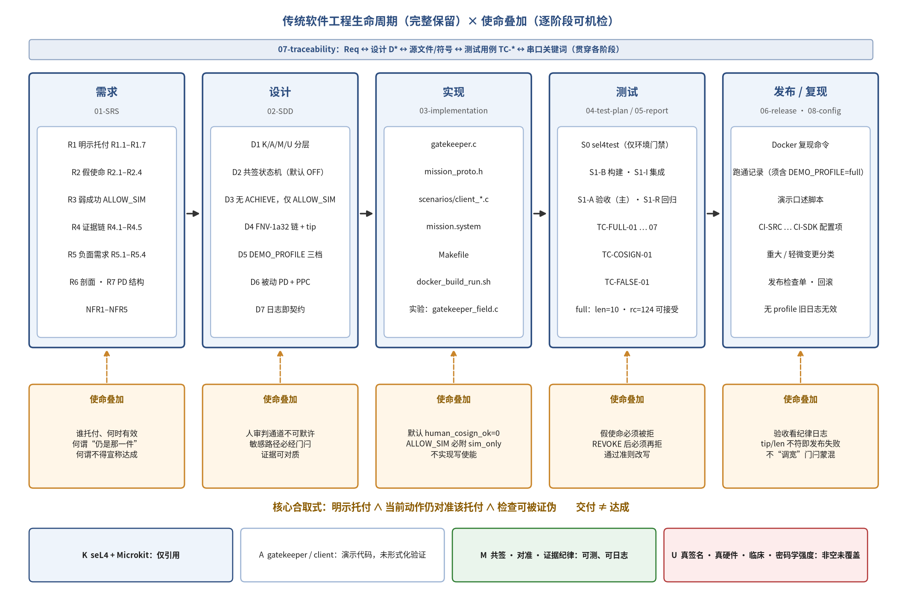

*图 3-1 使命约束对传统生命周期的逐阶段叠加（叠加而非替换；上为传统工件，下为使命叠加，底部为 K/A/M/U 分层；K 层仅引用，Microkit 所用 MCS 配置不视为已验证内核）*

**表 3-5 生命周期各阶段：传统 SE 的问题与使命叠加项**

| 传统阶段 | 本案例产物 | 传统 SE 回答的问题 | 使命叠加（同一阶段必须多答） |
|---|---|---|---|
| 需求 | 托付对象与禁区规格；用例表；非目标清单；K/A/M/U 边界 | 系统应做什么、不做什么 | 托付由谁、何时有效；何谓“仍是那一件”；何谓不得宣称达成 |
| 设计 | `mission.system`；PPC 协议；共签状态机；证据链设计 | 结构如何支撑需求 | 人审判通道不可默许；敏感路径必经门闩；证据可对质 |
| 实现 | `gatekeeper.c`、`client*.c`、`mission_proto.h` | 如何把设计做成可运行代码 | DENY / ALLOW_SIM 语义；sim_only；非临床；无写使能 |
| 测试 | `DEMO_PROFILE=full` 场景；假使命集；共签开关用例 | 是否按规格工作 | 假使命必须失败；REVOKE 后必须再拒；链 tip/len 一致 |
| 发布 / 运维 | Docker 复现命令；跑通记录；口述脚本 | 如何稳定交付与复现 | 验收看纪律日志；tip/len 不符或假使命变放行即视为发布失败 |

测试通过准则的改写是叠加最集中的体现（表 3-6）。

**表 3-6 测试通过准则的改写**

| 若只按传统习惯 | 本案例的通过准则 |
|---|---|
| 编译通过、QEMU 启动、有一条绿灯 | 必须出现完整 DENY / GRANT / REVOKE / 链 tip 序列 |
| 进程退出码 0 | 关键词契约 + 证据 tip/len；QEMU 超时 `rc=124` 可接受 |
| “功能测过了” | 负面用例必须测到拒绝，否则纪律未测 |

表 3-5 说明了每个阶段“多答什么问题”，但在实际评审中，评审者更需要一份可以逐项勾选的清单。表 3-7 按阶段列出必须产出的使命工件与检查要点；其内容归纳自案例的软件需求规格、设计说明、测试计划与配置变更记录。

**表 3-7 生命周期各阶段的使命工件与检查清单**

| 阶段 | 必须产出的使命工件 | 检查要点（评审时逐项确认） |
|---|---|---|
| 需求 | 托付对象定义；假使命需求；负面需求与非目标；K/A/M/U 边界表；验收条件 | 每一类假使命都有对应需求条目；非目标（不出束、无写使能、不宣称应用级证明）写入需求；验收条件中包含“假使命必须被拒”与“撤销后必须再拒” |
| 设计 | 保护域与通道配置；请求协议常量；共签状态机；证据链格式；设计决策表 | 敏感路径必经门闩且客户端无绕过通道；共签初值为 OFF；不存在“达成”成功码；证据格式可离线重算 |
| 实现 | 门闩与客户端源码；协议头文件；稳定日志关键词 | 每个 DENY 都有理由码；每次 ALLOW_SIM 都伴随 NOTE；启动行声明 K 仅引用；证据追加不可跳过 |
| 测试 | 剖面场景；假使命集；共签开关用例；关键词检查表；回归策略 | 假使命在共签 ON 之后仍被拒；REVOKE 之后合法请求再被拒；链 tip/len 与基线一致；负面用例未测到拒绝即视为纪律未测 |
| 发布 / 运维 | 复现命令；跑通记录；配置基线；变更分级 | 验收以纪律日志为准而非退出码；tip/len 不符或假使命变为放行即发布失败；影响判定或证据格式的修改按重大变更处理并重新验收 |

需要说明的是，这份清单不是独立于传统流程的另一套审批，而是附着在原有评审节点上的追加问题。案例的配置与变更管理文档把门闩行为变更分为两级：修改共签初值、DENY/ALLOW 分支条件或理由字符串、`allow_sim` 是否打印注记、证据算法或混入字段、删除或放宽任一假使命，均属重大变更，必须提出变更请求、重新运行全量 `full` 验收并更新测试报告；引入“达成”或写使能类接口则默认拒绝合入，因为它与需求 R5 冲突。注释与文档修改、在合理范围内调整超时秒数、增加不破坏既有关键词的调试日志，属于轻微变更。这样，使命纪律就被纳入了传统的配置管理之中，而不是另起炉灶。

### 3.7 方法的可证伪性

方法的主张被表述为可以失败的命题：若使命层只拦住作者预见到的假使命（留出语料上不推广），或以显著误拒为代价，或其增量可被“多写几条领域规则”替代，或证据链不比普通序号日志更能检出篡改，则方法的相应主张被削弱或推翻。第 5.7 节把这些情形操作化为 X-1…X-7。

可证伪性在本方法中分布在三个层次上。第一是谓词层：每一次门闩判定都是一个可以被单独检查的命题——给定请求、托付表与逻辑时刻，判定应当是什么，可以由独立编写的参考判定器复算，也可以由证据链在事后复核。第二是实现层：门闩实现与草稿 oracle 的一致性、同一输入下两次运行输出逐字节一致、主机模拟与真实 QEMU 运行的一致，这些都是可以失败、也确实被检查过的命题（第 6.4 节、第 7.1 节、第 7.9 节）。第三是方法层：X-1…X-7 把“方法无效”的各种可能形态写成带阈值的条件，并在看到结果之前冻结。三个层次的区分很重要：谓词层与实现层的通过只能说明“装置按设计工作”，只有方法层的反证条件在独立语料与独立真值上未被触发，才能对“方法有效”构成支持，而这正是本文尚未达到的状态。

### 3.8 更广的背景：MRTDS 旗舰案例（仅作方法参照）

在本课题更广的规划中，MRTDS（Mission-Constrained RT Dose & Interlock，以放射治疗剂量上界与联锁使能谓词为方法对象）是方法演示的旗舰案例，其轨道立项只承诺轨道 A（论证/门禁/审计工程真系统，仿真或只读接口）与轨道 B（阴影并行观察与告警，禁止写入使能链），明确排除控束接入与注册/临床路径（轨道 C/D）。本文的 Microkit 使命约束外壳不是 MRTDS 成品，不实现任何临床剂量或联锁业务逻辑；MRTDS 在此仅说明方法预期适用的问题类型。

### 3.9 本章小结

本章把使命软件工程归结为一个最小内核与围绕它的一组工程产物。核心合取式规定了“仍在做被托付之事”的可机检含义；“交付 ≠ 达成”在接口层面排除了把放行等同于达成的可能；四类工件与 K/A/M/U 分层分别回答“托付是什么、是否仍对准、凭什么可对质、什么不被保证”；生命周期叠加则说明这些要求落在传统阶段的何处。与此同时，方法的主张被写成可以失败的命题。下一章以 seL4 Microkit 上的案例系统说明这些要求如何被实现与验收。

---

## 4 案例系统：从 S0 到 S1 Microkit 使命约束外壳

本章介绍方法的案例载体。课题按 S0→S1 分期推进：S0 只确认工具链与底座可用，S1 在 seL4 Microkit 用户态实现一个两保护域的使命约束外壳。以下依次说明分期定位（4.1）、架构（4.2）、人共签状态机（4.3）、判定表与弱成功语义（4.4）、证据链（4.5）、`full` 剖面验收及其 Windows 复现（4.6），以及承载这一切的生命周期文档包与追溯矩阵（4.7）。需要预先说明的是，本章描述的是按请求标签判决的原始演示门闩；对照实验所用的按字段判决门闩将在第 6 章介绍。

### 4.1 分期与定位

课题按分期推进：S0（工具链）→ S1（用户态使命约束外壳），其后为对照实验延伸（第 5–7 章）。S0 只证明底座与工具链可用，不计入对“应用使命”的 V&V，仅作为生命周期中的“环境就绪”门禁。

**表 4-1 分期与证据性质**

| 分期 | 内容 | 环境 | 结果 | 证据性质 |
|---|---|---|---|---|
| S0 | 复现 `sel4test` | Windows + Docker + QEMU | 123 项通过，出现 `All is well in the universe` | 工具链/底座冒烟；不计入应用 V&V |
| S1 | Microkit 两 PD 使命约束外壳，`DEMO_PROFILE=full/cosign_only/false_only` | Windows + Docker（`trustworthysystems/sel4:latest`）；另在沙箱 QEMU 回归 | `full` 关键词契约满足；`GATE\|CHAIN\|tip=80488a97\|len=10`（Windows Docker 2026-10-08 复现，作者报告；沙箱 QEMU 回归一致）；`MISSION_SHELL_DEMO_DONE` | 演示级验收（关键词契约） |
| S1-E | 对照实验装置（第 5–7 章） | 沙箱真实 QEMU；主机模拟 | 装置自检通过；反证条件未触发/未判定 | 环境自测，非确证性 |

### 4.2 架构

系统由 `mission.system` 描述：被动保护域 `gatekeeper`（priority 100，passive）与主动保护域 `client`（priority 99）经 channel id=0 相连，client 端 `pp="true"`，使 client 可对 gatekeeper 发起受保护过程调用（PPC），进入其 `protected()` 入口。门闩逻辑仅在该入口实施（设计决策 D6：门闩集中、客户端不可绕过本地分支）。构建目标为 `qemu_virt_aarch64`，Microkit SDK 2.3.1，config=`debug`；产物 `build/loader.img` 以 QEMU loader 方式加载于 `0x70000000`。需要说明的是，沙箱中该 SDK 的板级内核配置头文件 `board/qemu_virt_aarch64/debug/include/kernel/gen_config.h` 定义了 `CONFIG_KERNEL_MCS 1`，`CONFIG_VERIFICATION_BUILD` 未启用（作者于 2026-10-09 核对），这与 Microkit 手册“总是使用 MCS 配置”的说明一致；按手册，AArch64 上 MCS 配置的代码级验证计划于 2027 年完成。因此，本案例运行的内核属于 K 层的引用对象，而不是已验证内核（第 2.5 节）。

`mission.system` 是整个系统结构的单一描述文件，全文只有十余行（代码 4-1）。其中有三处值得注意。第一，`gatekeeper` 被声明为被动保护域：它没有自己的主动执行流，只在被调用时运行，这使得“门闩只在被请求时做判定、从不自行发起动作”成为结构性质，而不是编码约定。第二，`gatekeeper` 的优先级（100）高于 `client`（99），与 Microkit 对受保护过程调用的优先级约定一致，即被调用方的优先级高于调用方。第三，通道的 client 端带有 `pp="true"`，表示只有 client 可以向 gatekeeper 发起受保护过程调用，反向则不可；client 也没有任何通往其他保护域的通道，因此它不存在绕过门闩直接执行敏感动作的路径。

**代码 4-1 系统描述文件**（来源：`microkit-mission-shell/mission.system`，全文）

```xml
<?xml version="1.0" encoding="UTF-8"?>
<!-- Mission shell demo — non-clinical simulation only. -->
<system>
    <protection_domain name="gatekeeper" priority="100" passive="true">
        <program_image path="gatekeeper.elf" />
    </protection_domain>
    <protection_domain name="client" priority="99">
        <program_image path="client.elf" />
    </protection_domain>
    <channel>
        <end pd="gatekeeper" id="0" />
        <end pd="client" id="0" pp="true" />
    </channel>
</system>
```

门闩的状态只有三个静态变量（代码 4-2）：证据序号、共签状态与链尾哈希。三者都在保护域内部，client 无法直接读写；它们的初值分别为 0、0（共签 OFF）与 0（链的起点）。“共签默认 OFF”这一需求（R1.1）因此直接对应于源码中的一个初值，评审时可以逐字核对。

**代码 4-2 门闩状态变量**（来源：`microkit-mission-shell/gatekeeper.c`，第 10–12 行）

```c
static unsigned evidence_seq = 0;
static int human_cosign_ok = 0;
static uint32_t chain_tip = 0; /* running hash; genesis = 0 */
```

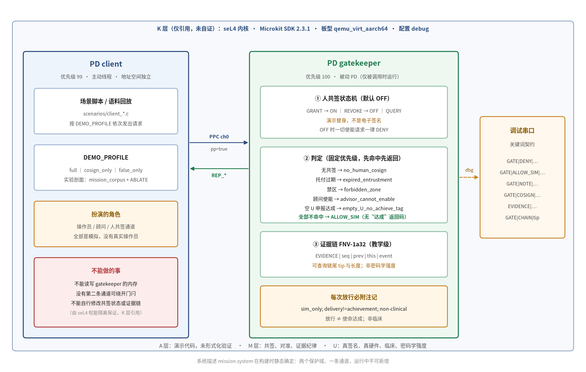

*图 4-1 示例系统分层架构（原始演示版，按请求标签判定；K 层仅引用、未自证，所用 MCS 内核配置不视为已验证内核）*

协议在 `mission_proto.h` 中集中定义（表 4-2），作为接口的单一事实来源。

**表 4-2 S1 协议常量**

| 请求 | 值 | 含义 | 应答 | 值 |
|---|---|---|---|---|
| `REQ_LEGAL_ENABLE` | 1 | 合法仿真使能 | `REP_ALLOW_SIM` | 10 |
| `REQ_EXPIRED_TRUST` | 2 | 过期托付 | `REP_DENY` | 11 |
| `REQ_FORBIDDEN_ZONE` | 3 | 禁区 | `REP_OK` | 12 |
| `REQ_ADVISOR_ENABLE` | 4 | 顾问妄图使能 | `REP_COSIGN_ON` | 13 |
| `REQ_EMPTY_U_ACHIEVE` | 5 | 空 U 贴达成 | `REP_COSIGN_OFF` | 14 |
| `REQ_HUMAN_COSIGN_GRANT` / `REVOKE` / `QUERY` | 20 / 21 / 22 | 共签授予 / 撤销 / 查询 | `REP_EVIDENCE_TIP` | 15 |
| `REQ_EVIDENCE_TIP` | 23 | 证据 tip 查询 | — | — |

需要坦承的是：图 4-1 与表 4-3 描述的是原始演示版门闩 `gatekeeper.c`，它按请求标签判决——在共签为 ON 时对请求标签做 `switch`，`REQ_EXPIRED_TRUST` 这一标签本身就意味着“这是假使命”，其余标签落入 `unknown_request`。这对演示足够，但不能作为实验对象。对照实验改用实验分支中的 `experiment/gatekeeper_field.c`，它按请求字段判决：读取 action、role、origin、ent_id、ent_ver、zone、sim_level、nonce、u_decl 等字段，结合编译期托付表与逻辑时钟逐项计算谓词，不读取任何揭示真值的标签（第 6.1 节，检查顺序见图 6-1）。两者共享 Microkit 两 PD 结构与 PPC 通道，但判决依据不同，本文分别称为“演示门闩”与“字段门闩”。

### 4.3 人共签状态机

共签是显式状态机，初始化 `human_cosign_ok = 0`（OFF），只能经显式消息改变，禁止“启动即视为已托付”或配置文件中的隐式 true。共签在日志中标注为 `GRANT (demo stand-in)`：它是演示占位，不是电子签名或法规意义上的共签系统。

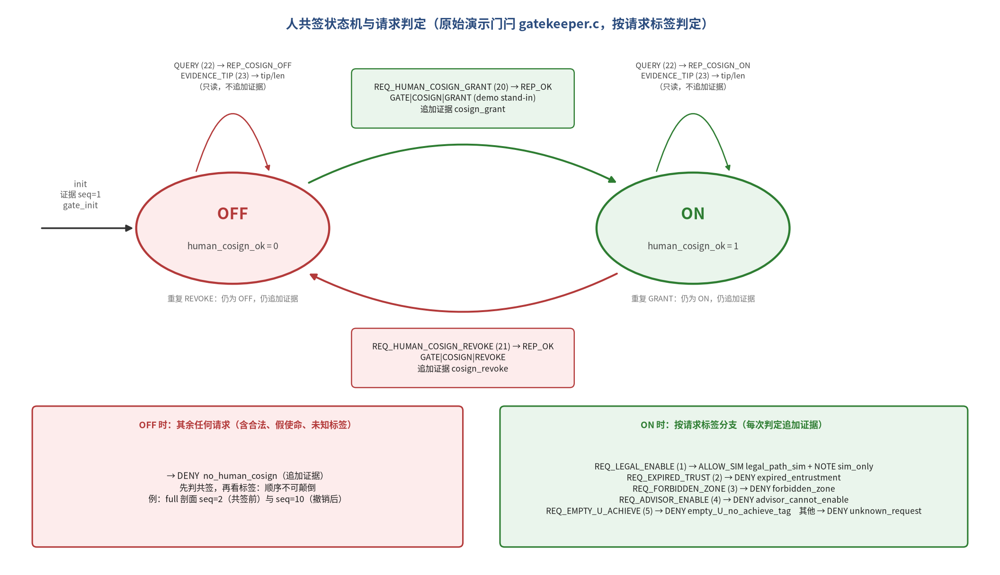

*图 4-2 人共签状态机与请求判定（原始演示门闩 gatekeeper.c，默认 OFF）*

判定顺序是使命关键的：（1）先处理共签 GRANT/REVOKE/QUERY 与 EVIDENCE_TIP；（2）若共签为 OFF，任何使能类请求 DENY `no_human_cosign`；（3）再按请求做对准/合法分支。

代码 4-3 给出门闩入口 `protected()` 的完整实现。它的结构正对应上述三步判定顺序：第一个 `switch` 处理四种控制面报文——GRANT 与 REVOKE 改变共签状态并追加证据事件，QUERY 与 TIP 只读、不追加事件；随后的 `if (!human_cosign_ok)` 是明示托付的总闸，在共签为 OFF 时，任何非控制面请求都在这里被拒绝；第二个 `switch` 才按请求标签分派到合法路径或四类假使命，其 `default` 分支把一切未知标签拒绝为 `unknown_request`，从而满足“未知请求不得默许”（R5.4）。

**代码 4-3 门闩入口 `protected()`**（来源：`microkit-mission-shell/gatekeeper.c`，第 109–166 行）

```c
microkit_msginfo protected(microkit_channel ch, microkit_msginfo msginfo)
{
    seL4_Word label;
    (void)ch;
    label = microkit_msginfo_get_label(msginfo);

    switch (label) {
    case REQ_HUMAN_COSIGN_GRANT:
        human_cosign_ok = 1;
        microkit_dbg_puts("GATE|COSIGN|GRANT (demo stand-in)\n");
        evidence_append("cosign_grant");
        return microkit_msginfo_new(REP_OK, 0);

    case REQ_HUMAN_COSIGN_REVOKE:
        human_cosign_ok = 0;
        microkit_dbg_puts("GATE|COSIGN|REVOKE\n");
        evidence_append("cosign_revoke");
        return microkit_msginfo_new(REP_OK, 0);

    case REQ_HUMAN_COSIGN_QUERY:
        if (human_cosign_ok) {
            microkit_dbg_puts("GATE|COSIGN|STATE=ON\n");
            return microkit_msginfo_new(REP_COSIGN_ON, 0);
        }
        microkit_dbg_puts("GATE|COSIGN|STATE=OFF\n");
        return microkit_msginfo_new(REP_COSIGN_OFF, 0);

    case REQ_EVIDENCE_TIP:
        microkit_dbg_puts("GATE|CHAIN|tip=");
        put_u32_hex(chain_tip);
        microkit_dbg_puts("|len=");
        put_u32_dec(evidence_seq);
        microkit_dbg_puts("\n");
        return microkit_msginfo_new(REP_EVIDENCE_TIP, 0);

    default:
        break;
    }

    if (!human_cosign_ok) {
        return deny("no_human_cosign");
    }

    switch (label) {
    case REQ_LEGAL_ENABLE:
        return allow_sim("legal_path_sim");
    case REQ_EXPIRED_TRUST:
        return deny("expired_entrustment");
    case REQ_FORBIDDEN_ZONE:
        return deny("forbidden_zone");
    case REQ_ADVISOR_ENABLE:
        return deny("advisor_cannot_enable");
    case REQ_EMPTY_U_ACHIEVE:
        return deny("empty_U_no_achieve_tag");
    default:
        return deny("unknown_request");
    }
}
```

这一实现有两点设计上的含义需要指出。其一，共签总闸位于标签分派之前，因此“共签 OFF 时拒绝”不依赖于任何具体分支是否记得检查共签，新增一种请求标签时也不可能遗漏这一检查。其二，正如第 4.2 节所坦承的，第二个 `switch` 是按标签判决的：`REQ_EXPIRED_TRUST` 这一标签本身就宣告了“过期”，门闩并没有真正比较时间。对演示而言，这足以展示“共签开启之后假使命仍须被拒”的纪律；但若把它当作实验对象，门闩在作者语料上的全部拦截就只是同义反复——这正是对照实验必须改用字段门闩的原因。

客户端的场景同样只有数十行。代码 4-4 摘录了 `full` 剖面的请求序列：先在共签 OFF 时查询并尝试一次合法请求，再授予共签、查询、发出合法请求，然后依次发出四类假使命，最后撤销共签、再试一次合法请求并查询链尾。这一序列本身就是验收规格的可执行形式。

**代码 4-4 `full` 剖面的请求序列**（来源：`microkit-mission-shell/scenarios/client_full.c`，第 22–44 行）

```c
void init(void)
{
    microkit_dbg_puts("CLIENT|INFO|profile=full\n");

    call("query_cosign", REQ_HUMAN_COSIGN_QUERY);
    call("legal_before_cosign", REQ_LEGAL_ENABLE);

    call("cosign_grant", REQ_HUMAN_COSIGN_GRANT);
    call("query_cosign", REQ_HUMAN_COSIGN_QUERY);
    call("legal_sim", REQ_LEGAL_ENABLE);

    call("expired_trust", REQ_EXPIRED_TRUST);
    call("forbidden_zone", REQ_FORBIDDEN_ZONE);
    call("advisor_enable", REQ_ADVISOR_ENABLE);
    call("empty_u_achieve", REQ_EMPTY_U_ACHIEVE);

    call("cosign_revoke", REQ_HUMAN_COSIGN_REVOKE);
    call("legal_after_revoke", REQ_LEGAL_ENABLE);

    call("evidence_tip", REQ_EVIDENCE_TIP);

    microkit_dbg_puts("CLIENT|INFO|MISSION_SHELL_DEMO_DONE\n");
}
```

### 4.4 判定表与弱成功语义

**表 4-3 S1 门闩判定表**

| 请求 | 共签前提 | 结果 | 证据事件 |
|---|---|---|---|
| `REQ_LEGAL_ENABLE` | ON | `ALLOW_SIM` + NOTE | `legal_path_sim` |
| `REQ_EXPIRED_TRUST` | ON | DENY | `expired_entrustment` |
| `REQ_FORBIDDEN_ZONE` | ON | DENY | `forbidden_zone` |
| `REQ_ADVISOR_ENABLE` | ON | DENY | `advisor_cannot_enable` |
| `REQ_EMPTY_U_ACHIEVE` | ON | DENY | `empty_U_no_achieve_tag` |
| 其他未知请求 | ON | DENY | `unknown_request` |
| 任一使能类 | OFF | DENY | `no_human_cosign` |

唯一的放行形态 `ALLOW_SIM` 强制打印 `GATE|NOTE|sim_only; delivery!=achievement; non-clinical`；系统不提供 ACHIEVE 类成功码，也不存在出束或设备写使能接口。

两种判定结果在实现上都被收敛到两个小函数中（代码 4-5）。`deny()` 与 `allow_sim()` 的结构几乎相同：先打印判定行，再追加证据事件，最后返回应答标签；唯一的差别在于 `allow_sim()` 无条件地打印注记行。由于注记的打印被写在放行函数内部，而不是交由调用者决定，所以不可能出现“放行了却忘记附注记”的情况；同理，由于每个判定函数都调用 `evidence_append()`，也不可能出现“判定了却没有入链”的情况。这是把纪律放进结构、而不是寄托于编码习惯的一个具体例子。

**代码 4-5 判定函数**（来源：`microkit-mission-shell/gatekeeper.c`，第 90–107 行）

```c
static microkit_msginfo deny(const char *why)
{
    microkit_dbg_puts("GATE|DENY|");
    microkit_dbg_puts(why);
    microkit_dbg_puts("\n");
    evidence_append(why);
    return microkit_msginfo_new(REP_DENY, 0);
}

static microkit_msginfo allow_sim(const char *why)
{
    microkit_dbg_puts("GATE|ALLOW_SIM|");
    microkit_dbg_puts(why);
    microkit_dbg_puts("\n");
    microkit_dbg_puts("GATE|NOTE|sim_only; delivery!=achievement; non-clinical\n");
    evidence_append(why);
    return microkit_msginfo_new(REP_ALLOW_SIM, 0);
}
```

### 4.5 证据链

证据链采用 FNV-1a 32 位演示链：步进函数 `fnv1a_step(prev, seq, event)` 以 FNV offset basis 2166136261 初始化，依次混入 `prev` 的 4 字节（小端）、`seq` 的 4 字节与事件字符串字节，乘以 FNV 质数 16777619；`this = fnv1a_step(prev_tip, new_seq, event)`。日志契约为 `EVIDENCE|seq=<n>|prev=<8hex>|this=<8hex>|<event>`，查询 `REQ_EVIDENCE_TIP` 输出 `GATE|CHAIN|tip=<8hex>|len=<n>`。QUERY 与 TIP 为只读，不追加事件。

记第 i 个事件的字符串为 eᵢ，其链值为 hᵢ，并以 LE₄(·) 表示 32 位整数的 4 字节小端编码、以 ‖ 表示字节串拼接，则链的递推关系可以写为：

$$h_0=0,\qquad h_i=\mathrm{FNV1a}_{32}\left(\mathrm{LE}_4(h_{i-1})\,\|\,\mathrm{LE}_4(i)\,\|\,e_i\right),\quad i=1,\dots,n$$

其中 FNV-1a32 对字节串 b₁b₂…bₘ 的计算为：

$$x_0=2166136261,\qquad x_k=\left(x_{k-1}\oplus b_k\right)\cdot 16777619\ \mathrm{mod}\ 2^{32},\qquad \mathrm{FNV1a}_{32}(b)=x_m$$

查询返回的 tip 即 hₙ，len 即 n。代码 4-6 是这一递推在门闩中的实现，它与上式逐行对应：先混入前一链值的 4 个字节，再混入序号的 4 个字节，最后混入事件字符串的每个字节。

**代码 4-6 证据链步进与追加**（来源：`microkit-mission-shell/gatekeeper.c`，第 49–88 行）

```c
/* FNV-1a 32-bit over prev tip + seq + event string */
static uint32_t fnv1a_step(uint32_t prev, unsigned seq, const char *event)
{
    uint32_t h = 2166136261u;
    const char *p;
    int k;
    /* mix previous tip bytes */
    for (k = 0; k < 4; k++) {
        h ^= (prev >> (8 * k)) & 0xffu;
        h *= 16777619u;
    }
    /* mix seq little-endian */
    for (k = 0; k < 4; k++) {
        h ^= (seq >> (8 * k)) & 0xffu;
        h *= 16777619u;
    }
    for (p = event; *p; p++) {
        h ^= (uint32_t)(unsigned char)(*p);
        h *= 16777619u;
    }
    return h;
}

static void evidence_append(const char *event)
{
    uint32_t prev = chain_tip;
    unsigned seq = ++evidence_seq;
    uint32_t cur = fnv1a_step(prev, seq, event);
    chain_tip = cur;

    microkit_dbg_puts("EVIDENCE|seq=");
    put_u32_dec(seq);
    microkit_dbg_puts("|prev=");
    put_u32_hex(prev);
    microkit_dbg_puts("|this=");
    put_u32_hex(cur);
    microkit_dbg_puts("|");
    microkit_dbg_puts(event);
    microkit_dbg_puts("\n");
}
```

这一构造的三种输入各有作用。混入前一链值，使任何一条记录的改动都会传播到其后的全部链值；混入序号，使同一事件字符串在不同位置产生不同的链值，从而删除、插入或交换记录都会破坏递推；混入事件字符串，则把判定内容本身绑定进链中。正因为如此，只要校验者从起点重算整条链，T1（只改内容）、T2（删除一行）、T3（交换两行）与 T4（插入一行）都会在第一处不一致的位置被发现。

但这一构造的局限同样清楚。FNV-1a32 是公开、无密钥的非密码学哈希，任何知道算法的人都可以在修改记录后从修改处起重算全部后续链值，使链在内部保持自洽（T7）；若删去链尾若干条，剩余部分仍然自洽，只有与外部保存的 tip/len 锚点比对才能发现（T5）。32 位的输出空间也不提供任何抗碰撞意义上的保证。因此，这条链只能说明“在不知道算法、或不能重算的篡改者面前，记录是顺序可对质的”，不能被当作审计级的完整性机制。

该链的设计目标是可对质的顺序追加痕迹（教学语义），不提供密码学抗碰撞或抗伪造保证；这一点在 SRS（R4.5）、SDD（§6.3）与 PU 边界文件中三重声明，并在实验篡改轨道中被预先写成 U（第 5.6 节）。

### 4.6 验收：`DEMO_PROFILE=full`

唯一推荐验收命令见附录 A.1。`full` 剖面的期望序列为：

> cosign OFF → DENY → GRANT → ALLOW_SIM → 4 DENYs → REVOKE → DENY → tip len=10 → MISSION_SHELL_DEMO_DONE

**表 4-4 `full` 剖面证据链事件（len=10）**

| seq | 事件 | 触发 |
|---|---|---|
| 1 | `gate_init` | gatekeeper `init` |
| 2 | `no_human_cosign` | `legal_before_cosign` |
| 3 | `cosign_grant` | GRANT |
| 4 | `legal_path_sim` | `legal_sim` → ALLOW_SIM |
| 5 | `expired_entrustment` | `expired_trust` |
| 6 | `forbidden_zone` | `forbidden_zone` |
| 7 | `advisor_cannot_enable` | `advisor_enable` |
| 8 | `empty_U_no_achieve_tag` | `empty_u_achieve` |
| 9 | `cosign_revoke` | REVOKE |
| 10 | `no_human_cosign` | `legal_after_revoke` |

验收的通过准则是关键词合取（SRS §6.2），而非进程退出码：QEMU 被 `timeout 30s` 终止产生的 `rc=124` 可接受；缺少 `DEMO_PROFILE=full` 声明的旧日志不得作为现行验收依据。

关于 tip 值：实验方案附录 B.3 记载，主机上的 Python 实现与从 `gatekeeper.c` 拷出的 C 函数对上述 10 个事件逐条比对一致，预测 `tip=80488a97, len=10`；沙箱 QEMU 回归日志（`experiment/runs/box-qemu/legacy_full/r1.log`）实测得到 `GATE|CHAIN|tip=80488a97|len=10` 与 `MISSION_SHELL_DEMO_DONE`。生命周期文档包 `GAPS.md` 第 3 条曾指出测试报告中未嵌入某一次 Windows 跑通的具体 tip 十六进制值；这一缺口现已由作者报告补齐：2026-10-08，作者在本人 Windows 主机上以 Docker 镜像 `trustworthysystems/sel4:latest` 运行 `DEMO_PROFILE=full`，串口日志末尾为 `GATE|CHAIN|tip=80488a97|len=10`，QEMU `rc=124`（`timeout` 终止，按准则可接受），并出现 `CLIENT|INFO|MISSION_SHELL_DEMO_DONE`；4 个假使命全部 DENY，`ALLOW_SIM` 仅出现在共签 GRANT 之后且伴随 NOTE，REVOKE 之后再次 DENY。作者报告的 10 条 EVIDENCE 逐条哈希与沙箱 QEMU 回归日志完全一致（图 4-3，摘录见附录 E）。因此，原始演示验收（S1 `full`）的 Windows Docker 复现已完成；需要区分的是，对照实验语料矩阵（第 5–7 章）的 Windows Docker 复现仍未完成。说明：Windows 串口日志原件未放入本文核对所用的沙箱，上述 Windows 事实以作者报告（2026-10-08）为据。

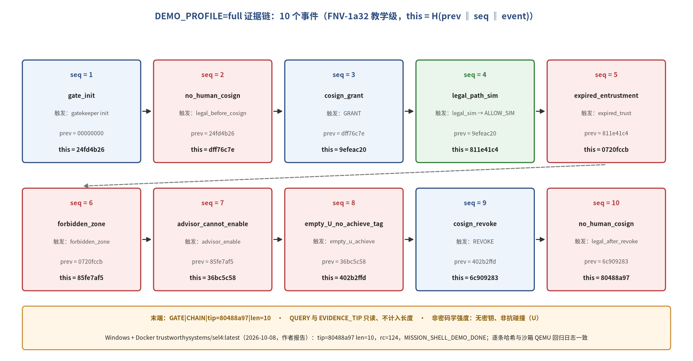

*图 4-3 `DEMO_PROFILE=full` 证据链 10 个事件（FNV-1a32 教学级；哈希取自沙箱 QEMU 回归日志，与作者 2026-10-08 Windows 跑通报告一致）*

#### 4.6.1 逐事件解读：每一行证明了什么、没有证明什么

验收日志的价值不在于“出现了很多行”，而在于每一行都对应一个可以被单独指认的主张。表 4-5 把 `full` 剖面的完整交互逐步展开，对每一步说明它在日志中留下的关键行、它所支持的主张，以及它不能支持的主张。

**表 4-5 `full` 剖面逐步解读**（关键行取自沙箱 QEMU 回归日志 `experiment/runs/box-qemu/legacy_full/r1.log`）

| 步骤 | 客户端请求 | 关键日志行 | 证明了什么 | 没有证明什么 |
|---|---|---|---|---|
| 0 | （门闩初始化） | `GATE\|INFO\|K=cited; …`；`EVIDENCE\|seq=1\|…\|gate_init` | 门闩启动时声明 K 仅引用；链从起点 0 开始；共签初始为 OFF | 不证明内核或门闩实现正确 |
| 1 | `query_cosign` | `GATE\|COSIGN\|STATE=OFF` | 启动后未经任何显式报文，共签确实为 OFF（R1.1） | 只读查询不入链，故此行本身不受链保护 |
| 2 | `legal_before_cosign` | `GATE\|DENY\|no_human_cosign`；seq=2 | 共签 OFF 时合法请求也被拒（R1.2），拒绝已入链 | 不证明请求内容被检查过——此处判决只取决于共签状态 |
| 3 | `cosign_grant` | `GATE\|COSIGN\|GRANT (demo stand-in)`；seq=3 | 共签只能由显式报文开启，开启事件入链（R1.3） | 不证明“人”真的做了共签：共签是演示占位，无身份认证 |
| 4 | `query_cosign` | `GATE\|COSIGN\|STATE=ON` | GRANT 之后状态确为 ON（R1.5） | 同步骤 1，不入链 |
| 5 | `legal_sim` | `GATE\|ALLOW_SIM\|legal_path_sim`；`GATE\|NOTE\|…`；seq=4 | 唯一放行形态为 ALLOW_SIM 且伴随注记（R3.1、R3.2） | 不证明使命达成；ALLOW_SIM 仅表示“仿真中允许继续” |
| 6–9 | 四类假使命 | 四条 `GATE\|DENY\|…`；seq=5–8 | 共签 ON 之后四类假使命仍被拒，理由码各不相同（R2.1–R2.4） | 不证明门闩能识别未见过的假使命：演示门闩按标签判决 |
| 10 | `cosign_revoke` | `GATE\|COSIGN\|REVOKE`；seq=9 | 共签可被撤销，撤销事件入链（R1.4） | 不证明撤销对所有在途请求立即生效（单客户端顺序调用，无并发） |
| 11 | `legal_after_revoke` | `GATE\|DENY\|no_human_cosign`；seq=10 | 撤销之后同类合法请求再次被拒 | 同步骤 2 |
| 12 | `evidence_tip` | `GATE\|CHAIN\|tip=80488a97\|len=10` | 链长与事件表一致；tip 可与独立重算及外部记录比对（R4.3、R4.4） | 不防知道算法者整链重算（T7）；tip 本身未写入外部锚点 |
| 13 | （收尾） | `CLIENT\|INFO\|MISSION_SHELL_DEMO_DONE` | 剖面完整执行到最后一步（R6.3） | 退出码不是通过依据；QEMU 由 timeout 终止 |

从表中可以看出，这份日志支持的主张都是纪律性的：共签默认关闭、只能显式改变、假使命在共签开启之后仍被拒、放行只取弱语义并附注记、每次判定都入链。它不支持的主张则集中在三处：判定内容是否真正经过检查（演示门闩按标签判决）、共签背后是否真有一个人（演示占位）、链是否能抵御有能力的篡改者（教学级哈希）。前一处由第 6 章的字段门闩回应，后两处被明确列入 U。

验收准则因此被写成关键词的合取，而不是单个“成功”标志。SRS §6.2 列出了八项条件：出现 `STATE=OFF` 及随后的 `no_human_cosign` 拒绝；出现 GRANT 与 `STATE=ON`；出现 `ALLOW_SIM|legal_path_sim` 及其注记；四条假使命的拒绝理由齐全；出现 REVOKE 及其后再次的 `no_human_cosign`；出现 `len=10` 的链尾行；出现收尾标记；并规定缺少 `DEMO_PROFILE=full` 声明的旧日志不得作为依据。§6.3 则反过来列出失败条件的例子：假使命变为 ALLOW_SIM、REVOKE 之后合法路径仍被放行、tip/len 与事件数不符，以及在报告中把 ALLOW_SIM 写成“达成”。任何一项通过条件缺失，即使 QEMU 正常启动、其余各行都在，也判为验收失败；反过来，QEMU 因 `timeout` 终止而返回 124 并不影响验收。这种准则把“测过了”从一个模糊的印象变成了一组可以逐项核对的事实。

### 4.7 全生命周期文档包与追溯

S1 配有一套生命周期文档包（v1.0.0，2026-09-23），把示例从“可跑的实现尖刺”补全为传统软件工程全流程产物集（表 4-6）。

**表 4-6 生命周期文档包**

| 编号 | 文件（ASCII 名） | 内容要点 |
|---|---|---|
| 00 | `00-README.md` | 范围、非目标、阅读顺序、验收口径 |
| 01 | `01-SRS.md` | R1 明示托付（R1.1–R1.7）、R2 假使命（R2.1–R2.4）、R3 弱成功、R4 证据链、R5 负面需求、R6 剖面、R7 PD 结构；NFR1–NFR5 |
| 02 | `02-SDD.md` | 两 PD 结构、K/A/M/U、共签状态机、判定表、证据链、剖面切换；设计决策 D1–D7 |
| 03 | `03-implementation.md` | 源码地图、日志契约、Docker 构建、编码纪律 |
| 04 | `04-test-plan.md` | 测试级别 S0/S1-B/S1-I/S1-A/S1-R；TC-FULL-01…07、TC-COSIGN-01、TC-FALSE-01 |
| 05 | `05-test-report-full.md` | `full` 剖面用例全部 PASS；事件表 len=10 |
| 06 | `06-release-repro.md` | 交付物清单、复现步骤、口述脚本、已知陷阱、发布检查单、回滚 |
| 07 | `07-traceability.md` | Req ↔ 设计 ↔ 源文件/符号 ↔ 测试用例 ↔ 串口关键词 |
| 08 | `08-config-change.md` | 配置项 CI-SRC…CI-SDK、基线定义、重大/轻微变更分类 |
| 09 | `09-lifecycle-overview.md` | REQ → RELEASE 一页叙事 |
| — | `GAPS.md` | 已知缺口（Windows 同步、SDK 路径布局、tip hex 未嵌入、`client.c` 副本、S0 细节） |

**表 4-7 追溯矩阵摘录**

| 需求 | 设计 | 源文件 / 符号 | 测试用例 | 串口关键词 |
|---|---|---|---|---|
| R1.1 共签默认 OFF | D2 | `gatekeeper.c`：`human_cosign_ok=0` | TC-FULL-02 | `STATE=OFF` |
| R1.2 无共签则拒 | D2, D3 | `if (!human_cosign_ok) deny("no_human_cosign")` | TC-FULL-02, 05 | `GATE\|DENY\|no_human_cosign` |
| R2.1–R2.4 假使命 | D3 | `REQ_EXPIRED_TRUST` 等分支 | TC-FULL-04, TC-FALSE-01 | 四条 `DENY\|…` |
| R3.1–R3.2 弱放行与注记 | D3 | `allow_sim("legal_path_sim")` | TC-FULL-03 | `sim_only; delivery!=achievement; non-clinical` |
| R4.1–R4.4 证据链 | D4 | `fnv1a_step` / `evidence_append` / `REQ_EVIDENCE_TIP` | TC-FULL-06 | `EVIDENCE\|seq=`；`len=10` |
| R5.1 无写使能 | D1, D7 | 工程无出束/写接口 | 代码扫描 | 无相关符号 |
| R5.4 未知请求拒绝 | D3 | `default: deny("unknown_request")` | 可选负测 | `unknown_request` |

文档包的意义在于证明：使命纪律有生命周期载体，而不只是实现日志中的几行 DENY。但它同样只证明“文档、代码与日志一致”，不证明方法有效——这正是第 5 章对照实验要回答的问题。

#### 4.7.1 从需求到设计再到测试：一条完整的追溯链

追溯矩阵的表格形式便于查找，却不容易看出各条目之间的逻辑。这里按需求组逐一说明它们如何经由设计决策落到实现与测试上。

R1（明示托付）要求共签默认关闭、只能经显式报文改变，并且明确声明共签只是演示占位。它由设计决策 D2（显式状态机、默认 OFF）承接，在实现中落为 `human_cosign_ok` 的初值 0、两个控制面分支与一道总闸；测试计划用 TC-FULL-02 检查默认状态与 OFF 时的拒绝，用 TC-FULL-03 检查 GRANT，用 TC-FULL-05 检查 REVOKE 之后的再次拒绝，并以 `cosign_only` 剖面的 TC-COSIGN-01 单独覆盖共签开关。

R2（仍对准托付）列出四类假使命及其各自的拒绝关键词。它由 D3 承接，在实现中落为第二个 `switch` 中的四个拒绝分支；TC-FULL-04 在 `full` 剖面中检查四条拒绝行，TC-FALSE-01 则在 `false_only` 剖面中单独覆盖假使命集。R3（弱成功语义）要求放行只取 ALLOW_SIM 且必附注记、禁止把放行表述为达成、不提供 ACHIEVE 类成功码，同样由 D3 承接，落为 `allow_sim()` 函数，并由 TC-FULL-03 检查。

R4（检查可证伪）规定证据链的算法、日志格式、tip 查询与 `full` 剖面的期望长度，并声明链只具教学意义。它由 D4 承接，落为 `fnv1a_step()`、`evidence_append()` 与 TIP 分支，由 TC-FULL-06 检查。R5（负面需求）规定不出束、无写使能接口、不重做证明、不实现临床业务、未知请求必须拒绝；它由 D1（K/A/M/U 分层写入架构）与 D7 承接，验证手段包括代码扫描（工程中不存在相关接口符号）与对 `unknown_request` 的可选负测。R6（剖面可切换）由 D5 承接，落为构建变量 `DEMO_PROFILE` 与三个场景源文件，未知剖面在构建时即报错。R7（保护域与通道结构）由 D6 承接，落为 `mission.system` 中的两个保护域与一条 PPC 通道，由 TC-FULL-01 的构建与启动检查覆盖。

贯穿这些追溯链的是设计决策 D7“日志即契约”：每一条需求最终都对应一组稳定的串口关键词，测试与答辩都以这些关键词为指认对象。测试计划为此给出了一份 18 项的关键词检查表，并规定门闩行为的任何变更都必须重跑 TC-FULL-01…07、更新测试报告版本。这样，追溯矩阵的最后一列就不是“见测试报告”这样的间接引用，而是可以在日志中直接搜索到的字符串。

#### 4.7.2 已知缺口及其处理

文档包的 `GAPS.md` 列出了五项已知缺口，它们的性质各不相同，值得分别说明。第 1 项是文档包向作者 Windows 主机的同步，属于交付流程问题，不影响任何技术结论。第 2 项是构建脚本中写死的 SDK 路径与实际目录布局可能不一致，属于配置问题，文档包把它归入配置变更管理，并在实现指南中预先警示。第 3 项是测试报告中未嵌入某一次跑通的具体 tip 十六进制值；这一项如第 4.6 节所述，已由作者 2026-10-08 的 Windows 跑通报告补齐，其 tip 与沙箱回归日志一致。第 4 项说明 `client.c` 与 `scenarios/client_full.c` 内容一致，而构建只编译 `DEMO_PROFILE` 选定的场景文件，这是为了避免读者误以为存在两份可能不一致的客户端。第 5 项说明测试计划只把 S0 列为环境门禁而不展开其步骤，S0 的结果在本文中也仅以开题材料为据。把这些缺口逐条写出而不是略去，本身就是“边界工件”的一种实践：读者可以据此判断哪些结论依赖于尚未核实的环节。

### 4.8 本章小结

S1 使命约束外壳表明，第 3 章的要求可以落到可运行的代码与可检查的日志上：共签默认关闭且只能显式改变；四类假使命在共签开启之后仍被拒绝；唯一的放行形态 `ALLOW_SIM` 必附注记；每次判定都写入教学级 FNV-1a32 证据链。`full` 剖面的验收在沙箱 QEMU 回归与作者 Windows Docker 环境（2026-10-08，作者报告）上得到了一致的结果。但演示门闩按标签判决，文档包也只证明文档、代码与日志彼此一致，二者都不能回答方法是否比传统做法多拦住了什么。这一问题留给第 5 章的对照实验。

---

## 5 对照实验设计

第 4 章的演示只能说明方法“可以被实现”；要追问方法“是否带来了传统做法得不到的东西”，需要一个允许方法失败的对照实验。本章依次给出研究问题、假设、处理条件、语料、指标、证据篡改轨道，以及预注册阈值与可证伪条件，依据为实验方案 `controlled-experiment-design.md`（v0.1，2026-10-07）与冻结的预注册文件 `prereg.md`（v1，2026-10-08）。

### 5.1 研究问题

**表 5-1 研究问题**

| 编号 | 研究问题 |
|---|---|
| RQ1 漏检 | 对“格式合法、角色看似合法、但已不再对准托付”的请求，传统流程会放行多少？使命层能否拦下？拦截是否推广到作者未预见的假使命（留出语料）？ |
| RQ2 误拒 / 代价 | 使命层是否以显著提高误拒为代价？带来多少代码、规格、测试与运行时证据开销？ |
| RQ3 审查与证据可对质性 | 证据链能否让（a）机器检出篡改、（b）人工审查者更快更准地指出“错误放行”？ |
| RQ4 可迁移性（预览） | 假使命分类法与检查谓词能否不改结构地映射到第二个非临床玩具领域？（仅定性） |

记号：语料单元 c 含前置步骤与一个被评分的目标请求；真值 GT(c) ∈ {MUST_DENY, MAY_PERMIT}；判决 V_X(c) ∈ {PERMIT, DENY, INVALID}，B 的 `ALLOW` 与 M 的 `ALLOW_SIM` 均归一为 PERMIT，INVALID 不得计为 DENY。漏检率 FNR_X = P(V_X = PERMIT | GT = MUST_DENY)，误拒率 FPR_X = P(V_X = DENY | GT = MAY_PERMIT)。

四个研究问题的设立各有理由。RQ1 是方法存在的前提：若传统流程本来就能拦下这类请求，或使命层并不比它多拦什么，方法便没有增量可言；而“推广到作者未预见的假使命”这一追问，是为了防止使命层只是把作者心中的例子逐条写成规则。RQ2 是对 RQ1 的必要约束：一个拒绝一切的门闩可以在 RQ1 上取得完美成绩，因此必须同时度量它为此付出的误拒与代码、证据开销。RQ3 针对合取式的第三项：如果证据链既不能让机器比普通日志更好地检出篡改，也不能让人更快更准地指出错误放行，那么“检查可被证伪”就只是一句口号。RQ4 则针对方法的一般性：一套只能在一个领域里成立的分类法与谓词，更像是这个领域的需求清单，而不是一种方法；本阶段只作定性预览。

上述记号中有两点约定需要说明。其一，B 的 `ALLOW` 与 M 的 `ALLOW_SIM` 被统一归为 PERMIT，因为两者在被比较的意义上相同——请求都被放行了；M 的弱成功语义是它的设计特征，但不应使 M 在漏检统计上占便宜。其二，INVALID（日志缺失、判决缺失或重复）不得计为 DENY，否则一个崩溃的门闩会被统计成“全部拦截”；预注册因此要求 INVALID 必须为 0，非零即作废重跑。

### 5.2 假设

- **H1（主，验证性，留出语料 H）**：H1₀：P(b) = P(c)；H1₁：b > c（b = 仅 M 拦，c = 仅 B 拦）。附加门槛：即使拒绝 H1₀，若 FNR_M(H) ≥ 30%，判“推广性不足”。
- **H1′（操纵检查，作者语料 A）**：预测 FNR_M(A) = 0，且在 ≥ 6 个“仅使命可拦”类别（F1、F2、F3、F5、F6、F7、F8、F9）上 FNR_B ≥ 0.9。**不作为方法有效的证据**；失败则先修实现。
- **H2（主，验证性，合法语料 L）**：H2₀：FPR_M − FPR_B ≥ Δ（Δ = 5 个百分点）；配对差 95% 精确上界 < Δ 则拒绝 H2₀。
- **H3a（次要）**：T1–T4 上 M 证据链检出率不高于 B 序号日志（Fisher 精确）。**H3b（探索性，人工审查）**：本阶段推迟。
- **H4（预览）**：不设零假设。

这些假设的安排体现了一个基本取舍：把验证性负荷放在作者无法“预先迎合”的地方。H1 之所以以留出语料 H 为对象，是因为作者语料 A 由作者依据同一份规格生成，在其上 M 的全拦截几乎是必然的；只有由独立标注人在规则冻结之后编写的语料，才能检验使命层是否推广到作者未预见的假使命。H1 的附加门槛（FNR_M(H) ≥ 30% 即判推广性不足）则防止出现“统计上显著、实际上仍漏掉大量假使命”的情形。

H1′ 被明确定位为操纵检查，而非方法证据。它的作用类似于实验心理学中的操纵检查：先确认处理条件确实按设计生效——M 在作者语料上应当全拦截，B 在仅使命可拦的类别上应当几乎全漏——然后才有资格去解释主终点。若 H1′ 不成立，说明实现有缺陷，应先修实现，而不是去解释结果。

H2 采用非劣效而非差异检验的形式，是因为我们希望证明的是“M 的误拒不比 B 显著更高”，而不是“两者有差别”。在非劣效框架下，观察不到误拒并不自动意味着非劣效成立，必须由配对差的精确上界落在界值 Δ 之下来支持；界值取 5 个百分点，是在“任何可察觉的可用性代价都应被发现”与“小样本下上界不可能无限收窄”之间的折中，并在预注册中冻结。H3a 只比较 T1–T4 这四种朴素篡改，因为 T5–T7 的预期在两种日志之间已被预先写明，不宜混入检验。H3b 与 H4 在本阶段分别推迟与仅作预览，因此不设检验。

#### 5.2.1 计划中的三臂需求人工研究（尚未实施）

上述假设检验的都是门闩的行为：给定一份已经写好的规则，门闩能否拦下假使命、是否误拒。它们无法回答第 8.6 节质疑 2 与质疑 5 提出的问题：使用使命方法的工程人员是否更可能写出这些规则，以及这种方法是否优于一份好的常见遗漏检查清单。为此，本文提出一项计划中的三臂人工研究，作为对现有设计的补充；它不属于已冻结的预注册 v1，也尚未实施。

研究设三个组：A 组使用传统需求方法，B 组只使用一份常见遗漏检查清单（清单对照组），C 组使用使命方法，即从托付记录出发、按单点违反规则推导需求与假使命。三组面对同一份业务描述，主要指标为遗漏的关键需求数；次要指标为在留出情境（检查清单未曾列出的情形）上的推广能力。预先声明的预测是：C 相对于 B 的优势应主要出现在检查清单未曾预见的情境上；若 C 在这些情境上并不优于 B，本文的主张即退化为“一份好的检查清单”，这是一个可以接受、并应如实报告的结论。该研究的被试规模、材料、关键需求的判定口径以及伦理备案要求均有待在实施之前另行预注册；它与第 10 章表 10-1 中的分期 S1-E5 对应。

### 5.3 处理条件

**表 5-2 处理条件**

| 条件 | 定义 | 目的 |
|---|---|---|
| **B** 传统流程（公平基线） | B-1 枚举、B-2 取值范围、B-3 工单存在（不查版本/时间/范围）、B-4 角色 ACL、B-5 nonce 去重；普通序号审计日志 `AUDIT\|seq=` | 凡能从接口规格与常规访问控制推导的检查都做；凡需托付记录才能推导的都不做 |
| **B+** 领域规则强化基线 | B + 站点运行窗 [50, 2000] + 站点禁区 {7, 15}；无共签、无版本、无来源、无 U | 区分“多写几条领域规则”与“绑定托付”的增量 |
| **M** 使命流程 | B-1…B-5 + M-1 共签绑定 (ent_id, ver) + M-2 时间 + M-3 禁区 + M-4 范围 + M-5 版本新鲜 + M-6 来源 + M-7 交付≠达成/U 非空 + M-8 FNV-1a32 证据链 | 被检验的方法 |
| **M−cosign** | 去掉 M-1 | 预测 F9 漏检上升 |
| **M−align** | 去掉 M-2…M-5 | 预测 F1/F2/F3/F7/F8 漏检上升 |
| **M−prov** | 去掉 M-6 | 预测 F5 漏检上升 |
| **M−U** | 去掉 M-7 | 预测 F6 漏检上升 |

基线公平性自检：B 必须正确拦截格式错误（M1）、顾问直接使能（F4）与精确重放（X1）。“基线输给使命层的原因必须是缺少托付语义，而不是基线写得差。”消融用作构念效度检查：若去掉某组件后其预测类别漏检**不**上升，说明语料未测到该组件或另一组件意外兜底，须如实报告。

控制变量：两条件共享同一客户端 `client_corpus.c`、同一语料（SHA-256 一致）、同一 SDK/板级/`debug` 配置、同一 QEMU 参数；唯一自变量是门闩的编译期变体。

#### 5.3.1 基线 B 为何是公平的

对照实验最常见的批评是“与稻草人比较”。本文用一条可操作的定义来回应这一批评：凡是能从接口规格（类型、范围、枚举）与常规访问控制推导出的检查，B 都做；凡是需要托付记录才能推导的检查，B 都不做。按这一定义，B 检查请求字段的枚举与取值范围，检查请求引用的工单号是否存在，按角色控制使能类动作，并对 nonce 去重以防精确重放——这些都是一份合格的接口规格与一套常规访问控制会要求的。B 不做的，是查看托付的版本、时间窗、允许区、禁区、强度上限、允许动作、来源与 U 声明，因为这些信息只存在于托付记录之中，而传统规格中通常不存在“托付记录”这一对象。B 对共签报文只记录一行 `cosign_msg_ignored`，原因相同：在传统系统中不存在“人共签托付”这一概念。

这一定义同时给出了一个可检验的推论：B 必须拦下那些仅凭接口规格与访问控制就能拦下的请求，即格式错误（M1）、顾问直接使能（F4）与精确重放（X1）。若 B 在这些类别上漏检，说明基线实现有缺陷，必须先修复。用方案原文的话说，“基线输给使命层的原因必须是缺少托付语义，而不是基线写得差”。实验方案还要求 B 配有一套覆盖 B-1…B-5 每条至少一正一反的功能测试集，并由独立同学评审；其中独立评审目前尚未实施（第 8.3 节）。

#### 5.3.2 为何还需要 B+

即便 B 是公平的，仍有一种重要的替代解释：使命层的增量也许只是“多写了几条领域规则”，而不是“绑定了托付”。例如，一个站点只要规定“任何动作都只能在运行时段内进行”“任何动作都不得指向 7 号与 15 号区”，就能拦下一部分过期托付与禁区请求，而无须引入托付记录的概念。B+ 正是这一替代解释的操作化：它在 B 的基础上加入全局运行窗 [50, 2000] 与站点禁区 {7, 15}，但不引入共签、版本、来源与 U。B+ 所用的全局规则取自托付表本身——运行窗为全表的 [min t_start, max t_end]，站点禁区为每一条托付都禁止的区——因此它代表了“在不区分具体托付的前提下，能从同一份信息中提炼出的最强全局规则”。B+ 能拦下的，是领域规则的贡献；B+ 仍拦不下而 M 能拦下的，才是托付绑定的增量。X-3 据此规定：若 B+ 覆盖 M 所拦 F1–F9 用例的 80% 以上，则判定增量主要来自领域规则。

#### 5.3.3 消融的逻辑

消融条件回答的是构念效度问题：语料中的每一类假使命，是否真的在测它所声称要测的那个使命组件？做法是一次去掉 M 的一个组件，观察漏检在哪些类别上上升。若去掉共签组件后只有 F9 的漏检上升，去掉对准组件后只有 F1、F2、F3、F7、F8 的漏检上升，依此类推，那么“类别—组件”的对应关系就得到了支持。反之，若去掉某组件后其预测类别的漏检并未上升，可能有两种解释：语料并没有真正测到该组件，或者另一个组件意外地兜住了这些用例。预注册要求无论出现哪种情况都如实报告，并且明确规定不得把“漏检未上升”解释为“该组件不必要”。消融只能与 M 组合、一次至多去掉一个组件，这一约束由源码中的 `#error` 强制（第 6.2 节），以保证每个消融条件只改变一个因素。

### 5.4 语料

- **作者语料 A**：生成器 `gen_corpus.py` 以 `random.Random(seed)` 确定性生成；每种子 F1–F9 各 20（共 180）、L1–L5 各 24（共 120）、M1 10、X1 10，合计 320；预注册 5 个种子 20261007…20261011（用于语料重采样，不是运行重复）；用例顺序打乱，`case_id` 不携带类别信息，C 头只含请求字段。
- **留出语料 H（验证性）**：须由独立标注人在规则冻结后仅依据“核心合取式 + 非目标清单”编写，≥ 30 个假使命与 ≥ 10 个合法对照，只运行一次，结果不得用于回改规则。**当前只有作者手写的草稿留出语料（47 例），仅演示流水线，不得用于判定 X-1。**
- **真值**：由规则规格 `rules_spec.md`（18 条按优先级排列的拒绝条款 S-F1…S-U2）与参考判定器 `oracle.py` 给出；oracle 只读 JSON，不导入门闩代码。按方案，规格须由独立标注人审阅签字并独立重写 `oracle.py`，并完成 κ 双标；**目前均为作者草稿**。

假使命 9 类与对照类别的完整定义见附录 D。

#### 5.4.1 用例结构与托付表

每个用例是一个自包含的脚本：以复位开始，随后设置逻辑时钟，再执行若干不评分的前置步骤（共签授予或撤销、前置请求），最后是唯一一个被评分的目标请求。代码 5-1 给出实验方案中的用例结构示意。用例之间复位共签状态与 nonce 历史，但证据链不复位，复位本身作为 `harness_reset` 事件写入链中；这样，用例之间相互独立，而证据链测试仍覆盖整次运行。

**代码 5-1 用例结构**（来源：`mission-se-experiment/controlled-experiment-design.md`，§3.1）

```text
HARNESS_RESET
HARNESS_CLOCK_SET(now)
[COSIGN_GRANT(ent_id, ver) | COSIGN_REVOKE]*      ← 前置步骤（setup，不评分）
[CORPUS_EVAL(step_kind=setup, …)]*                ← 例如重放用例的"原始请求"
CORPUS_EVAL(step_kind=target, …)                  ← 唯一被评分的请求
```

所有种子共用同一份托付表 `entrustments.json`，它共有 11 条记录、8 个托付编号，其中编号 3 与编号 6 各有多个版本，用于构造版本取代类的假使命与对照。表 5-3 列出全部记录。区号与强度都是没有物理含义的仿真字段。

**表 5-3 实验托付表**（来源：`experiment/corpus/entrustments.json`；允许动作中 E = ENABLE_SIM，R = RECOMMEND，Q = QUERY_STATUS）

| 编号 | 版本 | 时间窗 | 允许区 | 禁区 | 强度上限 | 允许动作 | 已被取代 |
|---|---|---|---|---|---|---|---|
| 1 | 1 | [100, 200] | {1, 2, 3} | {7, 15} | 300 | E、R、Q | 否 |
| 2 | 1 | [150, 400] | {4, 5} | {7, 15} | 500 | R | 否 |
| 3 | 1 | [100, 300] | {1, 2, 3, 6} | {7, 8, 15} | 300 | E、R、Q | 是 |
| 3 | 2 | [100, 300] | {1, 2, 3, 6} | {7, 8, 15} | 200 | E、R、Q | 否 |
| 4 | 1 | [500, 900] | {8, 9, 10, 11} | {0, 7, 12, 15} | 800 | E、R、Q | 否 |
| 5 | 1 | [50, 1000] | {0, 1, 2, 3, 4, 5, 6} | {7, 13, 14, 15} | 600 | E、Q | 否 |
| 6 | 1 | [200, 600] | {9, 10, 14} | {7, 11, 15} | 400 | E、R、Q | 是 |
| 6 | 2 | [200, 600] | {9, 10, 14} | {7, 11, 15} | 350 | E、R、Q | 是 |
| 6 | 3 | [200, 600] | {9, 10} | {7, 11, 14, 15} | 250 | E、R、Q | 否 |
| 7 | 1 | [1000, 2000] | {12, 13, 14} | {3, 7, 15} | 900 | E、Q | 否 |
| 8 | 1 | [50, 150] | {2, 4, 6, 8} | {3, 5, 7, 15} | 150 | E、R、Q | 否 |

表中有几处设计值得一提。第一，7 号与 15 号区是每一条托付都禁止的区，B+ 的站点禁区正是由此得出；而 0、3、5、8、11、12、13、14 号区只在部分托付中被禁止，它们构成“托付专属禁区”，只有知道具体托付的门闩才能识别。第二，全表时间窗的并集为 [50, 2000]，这是 B+ 的全局运行窗；但各托付自身的时间窗要窄得多，因此一个落在全局窗之内、却落在具体托付窗之外的请求，B+ 无法识别。第三，编号 3 的两个版本之间只有强度上限不同（300 与 200），编号 6 的三个版本之间强度上限依次降低、允许区也有收窄，这使得“参数取自旧版本”在一部分用例中会表现为一个旧版允许、新版不允许的强度值。

#### 5.4.2 生成器如何构造各类用例

生成器 `gen_corpus.py` 只使用 Python 标准库的 `random.Random(seed)`，因此同一种子总是生成逐字节相同的语料。每一类用例都由一个专门的函数生成，并在类内按序号轮换子型，以保证各子型大致均衡。表 5-4 归纳了各类别的子型及其构造方式。

**表 5-4 作者语料 A 的类别、子型与构造方式**（来源：`experiment/corpus/gen_corpus.py`）

| 类别 | 子型（按序号轮换） | 构造方式 | 预期首个违反条款 |
|---|---|---|---|
| F1 | over_by_1 / over_small / over_large | 逻辑时刻设为 t_end 之后 1、2–20 或 500–5000 | S-T1 |
| F2 | early_by_1 / early_small / early_large | 逻辑时刻设为 t_start 之前 1、2–20 或 21 至 t_start | S-T2 |
| F3 | site_forbidden / entrustment_forbidden | 目标区取自所引用托付的禁区；按该区是否属于站点禁区 {7, 15} 标注子型 | S-Z1 |
| F4 | origin_advisor / origin_operator | 角色为顾问、动作为使能；来源随机取顾问或操作员 | S-R1 |
| F5 | laundered | 角色为操作员、来源为顾问、动作为使能 | S-P1 |
| F6 | claim_u0 / claim_u_nonzero / enable_u0 | 声称达成（U 为 0 或非 0），或使能时 U=0 | S-U1 或 S-U2 |
| F7 | zone / level / action | 目标区既不在允许区也不在禁区；强度超过上限；动作不在允许动作中 | S-S1 / S-S2 / S-S3 |
| F8 | stale_bound / bound_current / both_bound | 请求引用编号 3 或 6 的旧版本；共签分别绑定旧版本、当前版本或二者 | S-V1 / S-C2 / S-V1 |
| F9 | never_granted / after_revoke / bound_other | 从未共签；共签后撤销（指定或全部）；共签绑定到另一托付 | S-C1 / S-C1 / S-C2 |
| L1 | nominal | 时间窗内部、强度低于上限、合法区内的请求 | — |
| L2 | t_start / t_end / level_max / level_zero / zone_min / zone_max | 时间窗两端、强度恰为上限或为零、合法区最小或最大编号 | — |
| L3 | u0 / u_any | 顾问的合法建议（RECOMMEND），每三例中一例 U=0 | — |
| L4 | revoke_specific / revoke_all | 授予旧版本、撤销（指定或全部）、再授予当前版本后按当前版本请求 | — |
| L5 | grants_2 / grants_3 | 同时存在 2–3 个共签绑定时按其中之一请求 | — |
| M1 | 9 个子型 | 非法枚举（动作、角色、来源）、区或强度越界、nonce 为 0、U 越出掩码、版本为 0、未知工单号 | S-F1 / S-F2 / S-F3 |
| X1 | exact_replay | 先发出一个合法前置请求，再以完全相同的字段（含 nonce）作为目标请求 | S-N1 |

这张表有两点需要特别说明。其一，L3 中 U=0 的顾问建议是合法的，因为 S-U1 只约束使能类动作与达成声称；生成器在普通请求中也以一定比例让非使能动作的 U 为 0，用以检验 U 非空检查没有被过度适用。其二，F8 的三个子型虽然都“引用旧版本”，但按规格的固定优先级，它们的首个违反条款并不相同：共签绑定当前版本而请求引用旧版本时，S-C2 排在 S-V1 之前，因此理由码为 `cosign_binding_mismatch`。这一点直接决定了第 7.6 节对 M−align 在 F8 上结果的解释。

每个用例生成之后，生成器都调用草稿 oracle 复核其真值与首个违反条款；若与预期不符，则丢弃重抽，单个用例最多重抽 200 次，否则生成失败。全部用例生成完毕后，生成器把用例顺序随机打乱，再按打乱后的顺序分配 `case_id`，因此用例编号不携带任何类别信息。写入 C 头文件的只有请求字段，真值、类别与子型只保存在 JSON 中，供分析脚本使用；门闩在编译期看到的只是一串无标签的请求。

### 5.5 指标

**表 5-5 指标**

| 指标 | 定义 | 用途 |
|---|---|---|
| 漏检率 FNR | #(PERMIT ∧ MUST_DENY) / #MUST_DENY | RQ1 主指标 |
| 误拒率 FPR | #(DENY ∧ MAY_PERMIT) / #MAY_PERMIT | RQ2 主指标 |
| 原因码正确率 | M 的拒绝理由码是否等于 oracle 首个违反条款 | 可对质性 |
| 无效率 | #INVALID / #cases | 必须为 0 |
| 确定性 | 同条件同语料多次运行 `CASE\|` 行逐字节一致 | 预期 100% |
| 篡改检出率 | T1–T7 × {B, M} | RQ3a |
| 增量成本 | 门闩有效行数、ELF 体积、每被评分请求的门闩相关串口字节 | RQ2 代价（E2，探索性） |

统计方法：配对漏检差异用精确 McNemar（对 b + c 个不一致对做 Binomial(0.5) 检验）；比例区间报告 Wilson 与 Clopper–Pearson；误拒非劣效以 b/n 的 Clopper–Pearson 双侧 95% 上界作保守上界（因 (b − c)/n ≤ b/n）；篡改检出 B vs M 用 Fisher 精确检验；逐类别检验用 Holm 校正；类别层用符号检验。系统是确定性的，p 值描述的是“从生成器定义的变体总体中抽到这批用例”的抽样不确定性，**不得外推为真实世界假使命的发生率**；同一类别内变体高度相关，因此同时报告变体层与类别层。

#### 5.5.1 指标的形式定义

设语料为 C，其中真值为 MUST_DENY 的用例集合为 C⁻，真值为 MAY_PERMIT 的集合为 C⁺。对条件 X，漏检率与误拒率分别定义为：

$$\mathrm{FNR}_X=\frac{\left|\{c\in C^-:\,V_X(c)=\mathrm{PERMIT}\}\right|}{|C^-|},\qquad \mathrm{FPR}_X=\frac{\left|\{c\in C^+:\,V_X(c)=\mathrm{DENY}\}\right|}{|C^+|}$$

原因码一致率在分析脚本中按全部用例计算：一个用例只有在 M 的判决与 oracle 真值一致、且 M 给出的理由码与 oracle 首个违反条款所对应的理由码（合法用例为 `ok`）也一致时，才计为一致。无效率为 INVALID 用例数与总用例数之比，预注册要求为 0。对配对比较，每个类别、每个种子形成一张 2×2 列联表：a 为 B、M 都拒绝，b 为仅 M 拒绝，c 为仅 B 拒绝，d 为都放行。对 MUST_DENY 用例而言，b 是使命层的增量拦截，c 是使命层的“倒退”（预期为 0，出现即须逐例解释），d 是两者共同的漏检。

#### 5.5.2 统计检验与区间

**精确 McNemar 检验。** 配对设计下，a 与 d 不携带两条件差异的信息，检验只依赖不一致对 b 与 c。在零假设下，每个不一致对“偏向 M”与“偏向 B”的概率相等，因此 b 服从 n = b + c、p = 1/2 的二项分布。单侧（H₁：b > c）与双侧 p 值分别为：

$$p_{\mathrm{one}}=\sum_{i=b}^{n}\binom{n}{i}\left(\frac{1}{2}\right)^{n},\qquad p_{\mathrm{two}}=\min\left\{1,\;2\sum_{i=0}^{\min(b,c)}\binom{n}{i}\left(\frac{1}{2}\right)^{n}\right\}$$

这正是 `analysis/stats_exact.py` 中 `mcnemar_exact()` 的计算方式。以第 7.3 节的情形为例，当 b = 100、c = 0 时，双侧 p 值即为 2 × (1/2)¹⁰⁰。Fisher 精确检验假设两组独立，不适用于同一语料上两条件的配对比较，因此只在独立组比较中使用。

**Wilson 区间。** 对 n 次中观察到 x 次的比例 p̂ = x/n，Wilson 得分区间为：

$$\frac{\hat{p}+\frac{z^2}{2n}}{1+\frac{z^2}{n}}\;\pm\;\frac{z\sqrt{\frac{\hat{p}(1-\hat{p})}{n}+\frac{z^2}{4n^2}}}{1+\frac{z^2}{n}},\qquad z\approx 1.96$$

与常见的正态近似区间相比，Wilson 区间在 p̂ 接近 0 或 1、n 较小时仍有合理的覆盖率，不会出现长度为零或越出 [0, 1] 的情况；这对本实验中大量出现的 0/n 与 n/n 结果尤为重要。

**Clopper–Pearson 区间。** 这是基于二项分布本身的精确区间，其下界与上界分别满足

$$P(X\geq x\mid n,p_L)=\frac{\alpha}{2},\qquad P(X\leq x\mid n,p_U)=\frac{\alpha}{2}$$

它在任何 n 下都保证覆盖率不低于名义水平，因而偏保守。实现中用二分法求解上述方程。当 x = 0 时，上界有闭式解：

$$p_U=1-\left(\frac{\alpha}{2}\right)^{1/n}$$

这说明了为什么零误拒的结论也带有一个随 n 增大而收窄的上界：在 n = 120 与 n = 600 时，这一上界分别对应第 7.4 节报告的 3.0% 与 0.6%。

**误拒非劣效。** 设合法用例上仅 M 拒绝的数目为 b、仅 B 拒绝的数目为 c，配对误拒差为 (b − c)/n。由于 (b − c)/n ≤ b/n，以 b/n 的 Clopper–Pearson 双侧 95% 上界作为配对差的保守上界，非劣效判据为：

$$U_{\mathrm{CP}}\!\left(\frac{b}{n}\right)<\Delta,\qquad \Delta=0.05$$

这一做法比专门的配对差区间更保守，其好处是不依赖额外的近似；代价是在 c > 0 时会高估差值，但这只会使判据更难满足。

**Fisher 精确检验。** 对两个独立组的 2×2 表（第一行 a、b，第二行 c、d，行和 r₁、r₂，第一列和 c₁，总数 n），在边际固定的条件下，左上格 X 服从超几何分布：

$$P(X=x)=\frac{\binom{r_1}{x}\binom{r_2}{c_1-x}}{\binom{n}{c_1}}$$

单侧 p 值为 X ≥ a 的概率之和。本文用它比较 B 与 M 在 T1–T4 篡改上的检出率，因为两种日志格式不同、篡改变体按日志独立生成，不构成配对。

**Holm 校正与符号检验。** 逐类别检验共有 m 个 p 值，Holm 逐步法把它们从小到大排序为 p₍₁₎ ≤ … ≤ p₍ₘ₎，并取

$$\tilde{p}_{(i)}=\max_{j\leq i}\;\min\left\{1,\;(m-j+1)\,p_{(j)}\right\}$$

它在控制族错误率的同时比 Bonferroni 校正更有检验力。主终点 P1、P2 已预注册且各自成族，不作校正。类别层的符号检验把每个“仅使命可拦”类别视为一次比较，统计 M 胜与负的类别数，平局剔除，其计算与精确 McNemar 相同；8 个类别全胜时，双侧 p 值为 2 × (1/2)⁸。

**Cohen's κ。** 用于独立标注一致性检查（推迟实施），定义为

$$\kappa=\frac{p_o-p_e}{1-p_e}$$

其中 p_o 为观察一致率，p_e 为按各自边际分布计算的期望一致率；预注册门槛为 κ ≥ 0.90。

#### 5.5.3 为什么小样本可以接受

每个种子只有 320 个用例、每类 20 个，这样的规模能否支撑结论？实验方案给出的理由有四点。第一，预期效应极大：在仅使命可拦的类别上，预测是 B 几乎全漏、M 几乎全拦，精确检验在每类 20 例时就足以检出这样的差异。第二，所用方法都是精确方法，不依赖大样本近似。第三，误拒采用“非劣效 + 上界”的表述，不需要观察到误拒才能下结论。第四，也是最重要的一点：真正的样本瓶颈是类别数与留出语料，而不是变体数。把每类的变体从 20 个增加到 200 个，只会让变体层的区间更窄，却不会提高外部效度，反而容易造成“大 N 假精度”。因此本文同时报告变体层与类别层的结果，并在解释时以类别层为准。

### 5.6 证据篡改轨道 T1–T7

篡改不在 seL4 内进行，而是在主机上对已采集日志副本施加变换，再由 `verify-chain`（M）或 `verify-seq`（B）检测；每种篡改 20 个随机位置变体。

**表 5-6 篡改模型与预注册预期**

| 编号 | 篡改 | 攻击者模型 | B 预期 | M 预期 |
|---|---|---|---|---|
| T1 | 修改某条事件文本（DENY → 放行），不动序号/哈希 | 朴素 | 不检出 | 检出 |
| T2 | 删除中间一条，不重编号 | 朴素 | 检出 | 检出 |
| T3 | 交换相邻两条 | 朴素 | 检出 | 检出 |
| T4 | 插入一条伪造行（M：随机哈希；B：序号取前一条 +1，后续不重编号） | 朴素 | 按本实现的模型检出（方案原文“视序号而定”） | 检出 |
| T5 | 截尾：删除最后 k 条（k ∈ [1, 5]）及结尾 CHAIN/AUDIT_END 行 | 朴素 | 不检出 | 无锚点**不检出**；有外部锚点检出 |
| T6 | 删除中间一条并重新编号、同步更新长度 | 知情 | 不检出 | 检出 |
| T7 | 修改一条事件后重算其后整条 FNV 链并更新 tip | 知情（知道算法，无密钥） | 不检出 | **不检出（U）** |

T5（无锚点）与 T7 在 M 上被预先写成预期失败，属 U：FNV-1a32 无密钥、非抗碰撞，无外部锚点不能防截尾。外部锚点即运行结束时的 `GATE|CHAIN|tip|len`，由实验者另行登记。

两种校验器的检测逻辑决定了上表的预期。M 的链校验从起点 0 出发，按第 4.5 节的递推逐行重算：若某行的序号不是前一行加一，记为序号缺口；若某行的 prev 不等于前一行的 this，记为链接断裂；若重算得到的哈希与该行记录的 this 不符，记为哈希不符；若提供了外部锚点，还会比较最终的 tip 与 len。B 的序号校验只检查序号是否从 1 起连续递增，以及结尾 `AUDIT_END` 行记录的长度是否与实际行数一致。由此不难推出：只改内容不动序号的 T1，B 无从发现，而 M 在重算哈希时必然发现；删除并重新编号、同步更新长度的 T6，对 B 而言天衣无缝，对 M 而言则破坏了链接与哈希；而知道算法、整链重算的 T7，对两者都不可见。T4 的结果则依赖于攻击者模型：本实现中 B 侧插入行的序号取前一条加一而后续不重编号，因此必然与下一行冲突（第 8.4 节）。

### 5.7 预注册阈值与可证伪条件

**表 5-7 预注册阈值（`prereg.md` §1，冻结 v1）**

| 键 | 值 | 含义 |
|---|---|---|
| `delta_fpr_pp` | 5 | 误拒非劣效界值 Δ = 5 个百分点 |
| `holdout_fnr_ceiling` | 0.30 | 留出语料上 M 漏检率上限 30% |
| `bplus_capture_ceiling` | 0.80 | B+ 覆盖 M 所拦 F1–F9 用例比例 ≥ 80% 即触发 X-3 |
| `kappa_min` | 0.90 | 作者手标 vs 独立 oracle 的 Cohen's κ（≥ 40 个随机用例） |
| `holdout_min_must_deny` / `holdout_min_may_permit` | 30 / 10 | 留出语料最小规模 |
| `alpha_primary_one_sided` | 0.025 | 主终点 P1 精确 McNemar 单侧 α |
| `alpha_secondary_two_sided` | 0.05 | 次要检验双侧 α（逐类别再 Holm） |
| `loc_ratio_ceiling` | 3.0 | X-7 的代码增量门槛 |
| `l2_subtype_systematic_fpr` | 0.50 | L2 某边界子型“系统性被拒”的操作定义 |
| `legal_n_per_seed` | 120 | 每种子合法用例数 |

**表 5-8 可证伪条件 X-1…X-7（任一成立即在结论中如实写明）**

| 编号 | 条件（操作化） | 含义 |
|---|---|---|
| X-1 | 独立留出语料 H 上精确 McNemar 单侧 p ≥ 0.025，或 FNR_M(H) ≥ 30% | 使命层只拦住作者预见的假使命，不推广 |
| X-2 | 任一种子或合并的误拒差保守上界 ≥ 5pp，或任一 L2 子型 M 误拒率 ≥ 50% | 以可用性换安全，“不增加误拒”主张失败 |
| X-3 | 首个种子上 F1–F9 中 M 拦截的用例里 B+ 也拦截的比例 ≥ 80% | 增量主要来自领域规则，而非托付绑定 |
| X-4 | 任一 MUST_DENY 类别出现 c > 0（B 拦而 M 放） | 使命层引入回退 |
| X-5 | T1–T4 合并，M 检出率高于 B 的 Fisher 单侧 p ≥ 0.05 | 证据层可证伪性未落地 |
| X-6 | 人工研究中 M 的 F1 中位数不高于 B 且用时更长（推迟） | 人一侧无可对质性收益 |
| X-7 | M/B 门闩有效行数比 > 3 且 X-1 成立 | 代价高且收益不推广 |

预注册同时明确声明：**作者语料 A 上 M 全拦截不计为支持方法的证据**；若只有 A 上结果为正而 X-1 成立，结论写为“使命层在本玩具中未显示推广收益”。

**表 5-9 运行矩阵（`prereg.md` §9）**

| 条件 | 种子 | 重复 | 次数 |
|---|---|---|---|
| B、M | 5 | 3 | 30 |
| B+、M−cosign、M−align、M−prov、M−U | 首个种子 | 1 | 5 |
| B、M 于留出语料 H（当前仅草稿） | — | 3 | 6 |
| `full` 回归 | — | 1 | 1 |

重复只用于确认确定性；同一（条件，种子）的重复在分析中只计一次。

#### 5.7.1 阈值与反证条件的设定理由

阈值的取值本身也需要理由，否则“预先冻结”只是把任意性推到了更早的时刻。留出语料上 30% 的漏检上限，意味着即使使命层在统计上显著优于基线，只要它仍漏掉近三分之一作者未预见的假使命，就判定推广性不足；这是一个刻意偏严的门槛。B+ 覆盖比 80% 的门槛，对应的直觉是：如果五分之四的增量都能被两条全局规则复现，那么“托付绑定”的独特贡献就很难成立。L2 子型 50% 的“系统性被拒”定义，用于捕捉门闩在某一类边界上系统性地矫枉过正——例如把闭区间实现成开区间时，t_start 或 t_end 子型会被成批误拒。代码增量 3 倍的门槛只与 X-1 联合使用：代码多本身不构成反证，“代码多且收益不推广”才构成。

七条反证条件分别对应方法主张的不同侧面：X-1 对应推广性，X-2 对应可用性代价，X-3 对应增量的来源，X-4 对应“不引入回退”，X-5 对应证据层，X-6 对应人一侧的可对质性，X-7 对应成本收益。它们的共同特点是：每一条都可以由明确的观测触发，而一旦触发，结论中必须如实写明，而不是通过事后修改阈值或重新定义类别来回避。预注册还专门规定了一种“负面结论”的措辞：若只有作者语料上的结果为正而 X-1 成立，结论应写为“使命层在本玩具中未显示推广收益”。

### 5.8 本章小结

本实验设计的要点在于让“方法无效”成为可以观察到的结果：公平基线 B 与领域规则强化基线 B+ 防止与稻草人比较，消融检验每个使命组件是否对应其预测类别，篡改轨道检验证据层，X-1…X-7 则预先规定了何种观测将削弱或推翻方法的主张。其中承担验证性负荷的是独立留出语料与人工审查研究；作者语料 A 上的结果按预注册只作操纵检查。下一章说明这一设计如何实现。

---

## 6 实验实施

本章说明第 5 章的设计如何落为可运行的实验装置：先解释为何必须以按字段判决的门闩替代演示门闩（6.1），再介绍变体与编译期剖面（6.2）、流水线与脚本（6.3），以及保证确定性、且不破坏原有验收的措施（6.4）。

### 6.1 为何必须重写门闩：从按标签判决到按字段判决

S1 演示门闩依据请求标签直接 `deny("expired_entrustment")`。若用它做实验，“使命层拦住了过期托付”只不过是“门闩认出了写着‘过期’的标签”，是同义反复，B 与 M 也无法公平比较。因此实验分支新增按字段判决的门闩 `experiment/gatekeeper_field.c`：请求携带结构化字段（action、role、origin、ent_id、ent_ver、zone、sim_level、nonce、u_decl），门闩依据其持有的编译期托付表（由 `entrustments.json` 生成 `gen/entrustments_gen.h`，种子无关）与逻辑时钟 `now` 进行谓词计算，不读取任何揭示真值的标签。`MR_CASE_ID` 只在打印函数 `log_verdict()` 中出现，仅用于日志关联（可用 `rg MR_CASE_ID experiment/gatekeeper_field.c` 核对）。换言之，图 4-1 中的演示门闩 `gatekeeper.c` 按标签判决，而实验分支的 `gatekeeper_field.c` 按字段判决；第 7 章的全部结果只针对后者。

逻辑时钟只能由测试专用报文 `REQ_HARNESS_CLOCK_SET`（32）设置并写入证据/审计，用例复位时归零；时钟可信性属 U。共签为集合语义（容量 4），GRANT/REVOKE 携带 (ent_id, ver)，`REVOKE(0,0)` 撤销全部。nonce 一经出现即记入用例内历史（无论该请求结果）。

请求字段通过 Microkit 的消息寄存器传递。代码 6-1 给出消息寄存器的布局：第 0 号寄存器是用例编号，只用于日志关联；第 1 号区分被评分的目标请求与不评分的前置请求；其后九个寄存器依次承载动作、角色、来源、托付编号、版本、目标区、强度、nonce 与 U 掩码。注释中对两个字段作了明确的边界说明：用例编号“门闩不得据此判决”，来源角色只是“玩具级标注；真实来源签名属 U”。

**代码 6-1 实验协议的消息寄存器布局**（来源：`microkit-mission-shell/experiment/proto_fields.h`，第 24–38 行）

```c
/* ---- 消息寄存器布局（microkit_mr_set / microkit_mr_get） ---- */
enum {
    MR_CASE_ID = 0,   /* 用例编号；仅用于日志关联，门闩不得据此判决 */
    MR_STEP_KIND,     /* 0 = target（评分），1 = setup（不评分） */
    MR_ACTION,        /* 1=ENABLE_SIM, 2=RECOMMEND, 3=QUERY_STATUS, 4=CLAIM_ACHIEVE */
    MR_ROLE,          /* 1=OPERATOR, 2=ADVISOR */
    MR_ORIGIN_ROLE,   /* 来源角色（玩具级标注；真实来源签名属 U） */
    MR_ENT_ID,        /* 托付编号 */
    MR_ENT_VER,       /* 托付版本 */
    MR_ZONE,          /* 目标区 0..15 */
    MR_SIM_LEVEL,     /* 仿真强度 0..1000（无物理含义） */
    MR_NONCE,         /* 非零 */
    MR_U_DECL,        /* 未覆盖项 U 的位掩码；0 = 声称"无未覆盖" */
    MR_COUNT
};
```

门闩持有的托付记录则以代码 6-2 中的结构体表示。允许区、禁区与允许动作都用位掩码表示，时间窗的注释明确写出“闭区间”，禁区的注释写出“优先于 allowed”——规则规格中的两项关键约定由此直接落在数据结构的注释上，便于评审时逐项核对。该结构体的实例由 `entrustments.json` 生成到 `gen/entrustments_gen.h`，与种子无关。

**代码 6-2 门闩持有的托付记录**（来源：`microkit-mission-shell/experiment/proto_fields.h`，第 57–66 行）

```c
/* ---- 门闩持有的托付记录（由 gen/entrustments_gen.h 实例化） ---- */
typedef struct {
    uint16_t id, ver;
    uint32_t t_start, t_end;      /* 逻辑时间，闭区间 [t_start, t_end] */
    uint16_t allowed_zones;       /* 位掩码 */
    uint16_t forbidden_zones;     /* 位掩码，优先于 allowed */
    uint16_t sim_level_max;       /* 托付上限（<= 设备范围 1000） */
    uint8_t  allowed_actions;     /* 位掩码：bit(action) */
    uint8_t  superseded;          /* 1 = 已被更高版本取代 */
} entrustment_t;
```

### 6.2 变体与编译期剖面

同一源文件以编译期宏选择变体：`-DGATE_VARIANT_B | _BPLUS | _M` 三选一；消融 `-DABLATE_COSIGN | ALIGN | PROV | U` 只能与 M 组合且一次至多一个（以 `#error` 强制）。Makefile 仅新增剖面分支：`DEMO_PROFILE=baseline_corpus | baselineplus_corpus | mission_corpus`，消融经 `ABLATE=cosign|align|prov|U` 传入。M 的检查顺序固定为 B-1…B-5 → M-1（`no_human_cosign` / `cosign_binding_mismatch`）→ 版本存在 → M-2 时间 → M-3 禁区 → M-4 范围 → M-5 版本新鲜 → M-6 来源 → M-7 U/达成，首个失败即拒绝，理由码与 `prereg.md` §5 的固定优先级一致（图 6-1，按源码 `decide()` 的实际顺序绘制）。B+ 在 B-5 之后、M 层之前另加全局运行窗 [50, 2000] 与站点禁区 {7, 15} 两项；`handle_eval` 在调用 `decide()` 之前先判定 nonce 是否已在历史中，非零且未重复即记入历史。

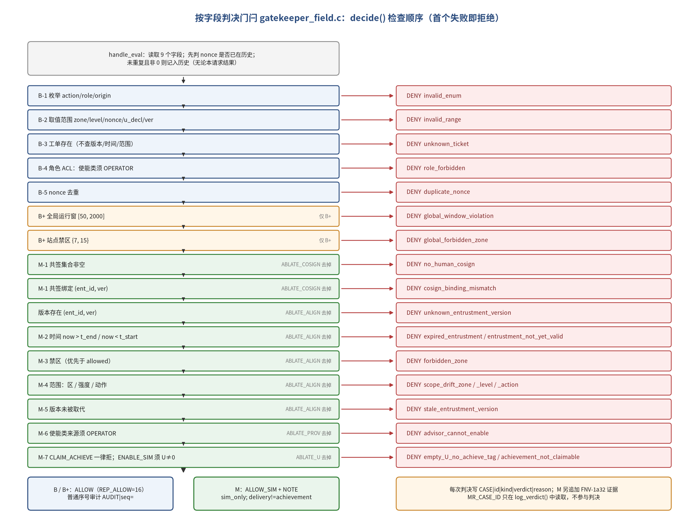

*图 6-1 字段门闩 `gatekeeper_field.c` 的 `decide()` 检查顺序与对应理由码（右侧标注各消融去掉的检查）*

#### 6.2.1 编译期守卫

三个变体与四个消融共用一个源文件，最大的风险是构建出一个“既不是 B 也不是 M”或“同时去掉了两个组件”的门闩，而实验者并未察觉。代码 6-3 中的三条 `#error` 守卫在编译期排除了这些情形：变体必须恰好定义一个；消融一次至多一个；消融只能与 M 组合。任何违反都会使构建失败，而不是悄无声息地产生一个错误的实验条件。

**代码 6-3 变体与消融的编译期守卫**（来源：`microkit-mission-shell/experiment/gatekeeper_field.c`，第 26–34 行）

```c
#if (defined(GATE_VARIANT_B) + defined(GATE_VARIANT_BPLUS) + defined(GATE_VARIANT_M)) != 1
#error "必须且只能定义 GATE_VARIANT_B / GATE_VARIANT_BPLUS / GATE_VARIANT_M 之一"
#endif
#if (defined(ABLATE_COSIGN) + defined(ABLATE_ALIGN) + defined(ABLATE_PROV) + defined(ABLATE_U)) > 1
#error "一次至多消融一个组件"
#endif
#if !defined(GATE_VARIANT_M) && (defined(ABLATE_COSIGN) || defined(ABLATE_ALIGN) || defined(ABLATE_PROV) || defined(ABLATE_U))
#error "ABLATE_* 只能与 GATE_VARIANT_M 组合"
#endif
```

紧随其后的宏定义决定了各变体的“外观”差异：M 使用证据链，放行应答为 `REP_ALLOW_SIM`，日志中的放行词为 `ALLOW_SIM`；B 与 B+ 不使用证据链，而使用普通审计日志，放行应答为 `REP_ALLOW`，放行词为 `ALLOW`。也就是说，B 与 B+ 保留了传统系统“功能性成功”的语义，而只有 M 采用弱成功语义——这正是两类流程在设计上应有的差别。

#### 6.2.2 判决核心 `decide()`

代码 6-4 是字段门闩的判决核心，也是整个实验中被比较的唯一自变量所在。它的结构与图 6-1 一一对应：先执行 B-1…B-5 五项传统检查；若为 B+，再加两项全局规则；若为 M，再依次执行 M-1 共签绑定、版本存在、M-2 时间、M-3 禁区、M-4 范围、M-5 版本新鲜、M-6 来源与 M-7 U/达成检查。每个消融都由一个 `#if !defined(ABLATE_*)` 包围相应的代码块，去掉的恰好是该组件、且只是该组件。函数返回 0 表示放行，否则返回首个失败检查的理由码。

**代码 6-4 字段门闩的判决核心**（来源：`microkit-mission-shell/experiment/gatekeeper_field.c`，第 257–361 行）

```c
/* ---------------- 判决核心 ---------------- */
typedef struct {
    seL4_Word action, role, origin, ent_id, ent_ver, zone, level, nonce, u_decl;
} request_t;

/* 返回 0 表示放行；否则返回拒绝理由码。检查顺序固定，首个失败即拒绝。 */
static const char *decide(const request_t *q, int dup)
{
    const int enable_class = (q->action == ACT_ENABLE_SIM || q->action == ACT_CLAIM_ACHIEVE);

    /* B-1 枚举 */
    if (q->action < ACT_ENABLE_SIM || q->action > ACT_CLAIM_ACHIEVE ||
        (q->role != ROLE_OPERATOR && q->role != ROLE_ADVISOR) ||
        (q->origin != ROLE_OPERATOR && q->origin != ROLE_ADVISOR)) {
        return "invalid_enum";
    }
    /* B-2 取值范围 */
    if (q->zone > ZONE_MAX || q->level > SIM_LEVEL_MAX || q->nonce == 0 ||
        (q->u_decl & ~(seL4_Word)U_MASK_VALID) != 0 || q->ent_ver < ENT_VER_MIN) {
        return "invalid_range";
    }
    /* B-3 工单存在（不检查版本、时间、范围） */
    if (!ticket_exists((uint32_t)q->ent_id)) {
        return "unknown_ticket";
    }
    /* B-4 角色 ACL */
    if (enable_class && q->role != ROLE_OPERATOR) {
        return "role_forbidden";
    }
    /* B-5 nonce 去重 */
    if (dup) {
        return "duplicate_nonce";
    }

#if defined(GATE_VARIANT_BPLUS)
    /* B+：全局领域规则（非按托付） */
    if (logical_now < GLOBAL_T_MIN || logical_now > GLOBAL_T_MAX) {
        return "global_window_violation";
    }
    if (SITE_FORBIDDEN_MASK & BIT(q->zone)) {
        return "global_forbidden_zone";
    }
#endif

#if defined(GATE_VARIANT_M)
#if !defined(ABLATE_COSIGN)
    /* M-1 明示托付：有效共签且绑定到 (ent_id, ent_ver) */
    if (bind_n == 0) {
        return "no_human_cosign";
    }
    if (!is_bound((uint32_t)q->ent_id, (uint32_t)q->ent_ver)) {
        return "cosign_binding_mismatch";
    }
#endif
#if !defined(ABLATE_ALIGN)
    {
        const entrustment_t *e = ent_lookup((uint32_t)q->ent_id, (uint32_t)q->ent_ver);
        if (!e) {
            return "unknown_entrustment_version";
        }
        /* M-2 对准：时间（闭区间） */
        if (logical_now > e->t_end) {
            return "expired_entrustment";
        }
        if (logical_now < e->t_start) {
            return "entrustment_not_yet_valid";
        }
        /* M-3 对准：禁区（优先于 allowed） */
        if (e->forbidden_zones & BIT(q->zone)) {
            return "forbidden_zone";
        }
        /* M-4 对准：范围（CLAIM_ACHIEVE 不是可托付动作，交由 M-7 处理） */
        if (!(e->allowed_zones & BIT(q->zone))) {
            return "scope_drift_zone";
        }
        if (q->level > e->sim_level_max) {
            return "scope_drift_level";
        }
        if (q->action != ACT_CLAIM_ACHIEVE && !(e->allowed_actions & BIT(q->action))) {
            return "scope_drift_action";
        }
        /* M-5 对准：参数新鲜（版本未被取代） */
        if (e->superseded) {
            return "stale_entrustment_version";
        }
    }
#endif
#if !defined(ABLATE_PROV)
    /* M-6 使能类动作的来源必须是操作员（顾问不可使能，包括经转述） */
    if (enable_class && q->origin != ROLE_OPERATOR) {
        return "advisor_cannot_enable";
    }
#endif
#if !defined(ABLATE_U)
    /* M-7 交付 != 达成；U 非空 */
    if (q->action == ACT_CLAIM_ACHIEVE) {
        return q->u_decl == 0 ? "empty_U_no_achieve_tag" : "achievement_not_claimable";
    }
    if (q->action == ACT_ENABLE_SIM && q->u_decl == 0) {
        return "empty_U_no_achieve_tag";
    }
#endif
#endif /* GATE_VARIANT_M */
    return 0;
}
```

阅读这段代码时，有几处细节与第 5 章的设计直接相关。第一，B-1…B-5 在三个变体中完全相同，并且位于所有变体专属检查之前，因此 M 不可能因为“少做了传统检查”而在某些类别上取得不公平的优势，B 也不可能因为“检查顺序不同”而吃亏。第二，B-3 的注释明确写出“不检查版本、时间、范围”，这是第 5.3.1 节公平性定义在代码中的直接体现。第三，M-2 的两个比较（`logical_now > e->t_end` 与 `logical_now < e->t_start`）实现的是闭区间，端点上的请求不会被拒绝；M-3 位于 M-4 之前，实现了“禁区优先于允许区”。第四，M-4 对 `CLAIM_ACHIEVE` 作了显式豁免，把它交给 M-7 处理，因为“声称达成”不是可托付动作，不应以“动作越界”的理由被拒绝，而应以 `achievement_not_claimable` 或 `empty_U_no_achieve_tag` 被拒绝。第五，消融 M−align 去掉的代码块包含了版本存在检查，因此在该消融下，引用不存在版本的请求将不再被 `unknown_entrustment_version` 拦截；按生成器代码，作者语料 A 中的 F 类用例引用的都是托付表中存在的版本（版本为 0 的请求属于 M1，已在 B-2 被拦截），因此这一点不影响第 7 章作者语料上的结果。

#### 6.2.3 请求处理与 nonce 语义

代码 6-5 给出请求处理函数 `handle_eval()`。它先从消息寄存器读出九个请求字段，然后在调用 `decide()` 之前处理 nonce：若 nonce 非零且已在本用例的历史中，标记为重复；若非零且未重复，则记入历史。这一顺序实现了规则规格 §3 的约定——nonce 一经出现即记入历史，无论该请求最终被放行还是被拒绝。判决结果经 `log_verdict()` 写出；若为 M 且放行，还会打印弱成功注记。

**代码 6-5 请求处理函数**（来源：`microkit-mission-shell/experiment/gatekeeper_field.c`，第 392–425 行）

```c
static microkit_msginfo handle_eval(void)
{
    request_t q;
    seL4_Word kind = microkit_mr_get(MR_STEP_KIND);
    const char *why;
    int dup;

    q.action = microkit_mr_get(MR_ACTION);
    q.role = microkit_mr_get(MR_ROLE);
    q.origin = microkit_mr_get(MR_ORIGIN_ROLE);
    q.ent_id = microkit_mr_get(MR_ENT_ID);
    q.ent_ver = microkit_mr_get(MR_ENT_VER);
    q.zone = microkit_mr_get(MR_ZONE);
    q.level = microkit_mr_get(MR_SIM_LEVEL);
    q.nonce = microkit_mr_get(MR_NONCE);
    q.u_decl = microkit_mr_get(MR_U_DECL);

    /* nonce 一经出现即记入历史（无论本请求结果），B-5 针对此前的历史判定 */
    dup = (q.nonce != 0) && nonce_in_history((uint32_t)q.nonce);
    if (q.nonce != 0 && !dup) {
        nonce_remember((uint32_t)q.nonce);
    }

    why = decide(&q, dup);
    if (why) {
        log_verdict(kind, "DENY", why);
        return microkit_msginfo_new(REP_DENY, 0);
    }
    log_verdict(kind, PERMIT_WORD, "ok");
#if defined(GATE_VARIANT_M)
    microkit_dbg_puts("GATE|NOTE|sim_only; delivery!=achievement; non-clinical\n");
#endif
    return microkit_msginfo_new(REP_PERMIT, 0);
}
```

`log_verdict()` 是源文件中唯一读取 `MR_CASE_ID` 的位置（第 363–390 行），它把用例编号写入 `CASE|…` 判决行与证据事件，仅用于日志关联。由于 `decide()` 的参数中根本不包含用例编号，门闩在结构上就不可能依据用例编号判决；`rg MR_CASE_ID` 的核对只是对这一结构性质的再次确认。

#### 6.2.4 共签绑定集合

M 的共签不再是一个布尔变量，而是一个容量为 4 的绑定集合。授予函数（`gatekeeper_field.c` 第 464–482 行）的逻辑是：重复授予同一绑定时只记录事件、不改变集合；集合已满时记录 `cosign_table_full` 并返回拒绝；否则加入集合并记录事件。撤销函数的逻辑与之对称：`REVOKE(0, 0)` 清空集合，指定绑定则移除该项，不存在时记录 `cosign_revoke_nomatch`。对 B 与 B+，共签报文一律只记录 `cosign_msg_ignored`，不产生任何效果。

容量 4 是一个实现约束，而不是使命原则。正是这一约束在草稿留出语料的 H-041 中产生了一次可能违背核心原则的拒绝（第 7.8 节）：人确实共签了第 5 份托付，但由于集合已满，该绑定没有被加入，随后按该托付发出的请求便被 `cosign_binding_mismatch` 拒绝。规格 §3 把超过容量的情形标为未定义，第 8.4 节将其列为待复核的设计决定之一。

### 6.3 流水线与脚本

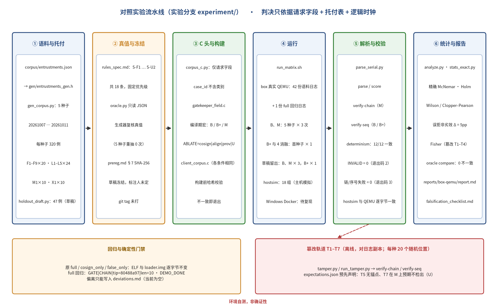

*图 6-2 对照实验流水线（环境自测，非确证性）*

**表 6-1 主要脚本与职责**

| 组件 | 文件 | 职责 |
|---|---|---|
| 语料生成 | `corpus/gen_corpus.py`、`holdout_draft.py`、`corpus_c.py` | 确定性生成作者语料与草稿留出语料；生成器用草稿 oracle 复核真值，不一致即重抽（5 个种子重抽次数均为 0） |
| 真值 | `oracle/rules_spec.md`、`oracle.py`、`kappa.py` | 草稿规格与参考判定器；κ 抽样与评分模板 |
| 门闩 / 客户端 | `gatekeeper_field.c`、`client_corpus.c`、`proto_fields.h` | 按字段判决；语料回放（各条件相同，可分片） |
| 运行 | `docker_corpus_run.sh`、`run_matrix.sh`、`windows/run_all_docker.bat` | 构建前校验语料 SHA-256，不一致即退出；QEMU 超时可配；见 `CORPUS_DONE` 即结束；按预注册矩阵批量运行 |
| 解析与统计 | `analysis/parse_serial.py`、`analyze.py`、`stats_exact.py`、`loc_count.py` | parse / verify-chain / verify-seq / tamper / score / determinism；精确统计仅用标准库；按编译期条件计有效行数 |
| 篡改 | `tamper/tamper.py`、`run_tamper.py`、`expectations.json` | T1–T7 变换、批量检测与冻结的预期 |
| 主机模拟 | `hostsim/`、`tests/run_unit_tests.py` | gcc + microkit 桩；单元测试 28 例 × 3 条件 |

日志行文法以门闩的 `CASE|id=…|kind=target|verdict=…|reason=…` 为判决唯一来源，客户端回执 `CLIENT|REP|case=…` 用于交叉核对。解析退出码：0 通过；2 INVALID（缺 `CORPUS_DONE`、用例缺判决、重复判决、客户端回执不一致）；3 链或序号校验失败。

客户端对三个变体完全相同。代码 6-6 是它的核心：按步骤类型把复位、时钟设置、共签授予或撤销以及评估请求分别编码为不同的报文，评估请求的九个字段逐一写入消息寄存器后经 PPC 发出。客户端不知道任何用例的类别与真值，它只是忠实地回放 C 头文件中的步骤数组；对每个目标请求，它打印一行 `CLIENT|REP|case=…|label=…` 作为回执，供解析器与门闩的判决行交叉核对。

**代码 6-6 语料回放客户端的步骤发送**（来源：`microkit-mission-shell/experiment/client_corpus.c`，第 53–87 行）

```c
static seL4_Word send_step(const corpus_step_t *s)
{
    microkit_msginfo rep;
    switch (s->op) {
    case STEP_OP_RESET:
        rep = microkit_ppcall(GATE_CH, microkit_msginfo_new(REQ_HARNESS_RESET, 0));
        break;
    case STEP_OP_CLOCK:
        microkit_mr_set(MR_CLOCK_NOW, s->now);
        rep = microkit_ppcall(GATE_CH, microkit_msginfo_new(REQ_HARNESS_CLOCK_SET, 1));
        break;
    case STEP_OP_GRANT:
    case STEP_OP_REVOKE:
        microkit_mr_set(MR_ENT_ID, s->ent_id);
        microkit_mr_set(MR_ENT_VER, s->ent_ver);
        rep = microkit_ppcall(GATE_CH, microkit_msginfo_new(
                  s->op == STEP_OP_GRANT ? REQ_HUMAN_COSIGN_GRANT : REQ_HUMAN_COSIGN_REVOKE, MR_COUNT));
        break;
    default: /* STEP_OP_EVAL */
        microkit_mr_set(MR_CASE_ID, s->case_id);
        microkit_mr_set(MR_STEP_KIND, s->kind);
        microkit_mr_set(MR_ACTION, s->action);
        microkit_mr_set(MR_ROLE, s->role);
        microkit_mr_set(MR_ORIGIN_ROLE, s->origin);
        microkit_mr_set(MR_ENT_ID, s->ent_id);
        microkit_mr_set(MR_ENT_VER, s->ent_ver);
        microkit_mr_set(MR_ZONE, s->zone);
        microkit_mr_set(MR_SIM_LEVEL, s->sim_level);
        microkit_mr_set(MR_NONCE, s->nonce);
        microkit_mr_set(MR_U_DECL, s->u_decl);
        rep = microkit_ppcall(GATE_CH, microkit_msginfo_new(REQ_CORPUS_EVAL, MR_COUNT));
        break;
    }
    return microkit_msginfo_get_label(rep);
}
```

在主机一侧，证据链的校验由 `verify_chain()` 完成（代码 6-7）。它从起点 0 出发逐条重算，依次检查序号是否连续、prev 是否等于上一条的链值、重算的哈希是否等于记录的 this；全部通过之后，若日志内存在 `GATE|CHAIN` 行或调用者提供了外部锚点，还会比较最终的 tip 与长度。任何一项失败都会返回失败类型与出错行号，这使得篡改检测的结果不仅是“检出 / 未检出”，还能指出第一处不一致的位置。

**代码 6-7 证据链校验**（来源：`microkit-mission-shell/experiment/analysis/parse_serial.py`，第 151–171 行）

```python
def verify_chain(ev: List[EvidenceLine], anchor: Optional[Tuple[int, int]] = None,
                 log_anchor: Optional[Tuple[int, int]] = None) -> ChainReport:
    """自创世 prev=0 起逐条重算；检查 seq 连续、prev 链接、this 重算一致；
    可选外部锚点 anchor=(tip,len)；log_anchor 为日志内 GATE|CHAIN 行（若存在则一并核对）。"""
    if not ev:
        return ChainReport(False, 0, 0, None, "empty")
    tip, expect_seq = 0, 1
    for e in ev:
        if e.seq != expect_seq:
            return ChainReport(False, expect_seq - 1, tip, e.line_no, "seq_gap")
        if e.prev != tip:
            return ChainReport(False, expect_seq - 1, tip, e.line_no, "prev_link")
        h = fnv1a_step(e.prev, e.seq, e.event)
        if h != e.this:
            return ChainReport(False, expect_seq - 1, tip, e.line_no, "hash_mismatch")
        tip, expect_seq = h, expect_seq + 1
    n = expect_seq - 1
    for a in (log_anchor, anchor):
        if a is not None and (a[0] != tip or a[1] != n):
            return ChainReport(False, n, tip, ev[-1].line_no, "anchor_mismatch")
    return ChainReport(True, n, tip, None, None)
```

与之对应，B 的 `verify_seq()` 只检查审计行的序号是否为 1…n 连续递增，以及结尾 `AUDIT_END` 行记录的长度是否与审计行数一致。两种校验器的能力差异，正是第 7.7 节篡改结果的来源。

### 6.4 确定性与回归保障

1. **回归门禁**：改 Makefile 后重建，原 `full / cosign_only / false_only` 三剖面 ELF 与 `loader.img` 与改动前逐字节一致；`full` 仍得 `GATE|CHAIN|tip=80488a97|len=10` 与 `MISSION_SHELL_DEMO_DONE`。原 `gatekeeper.c`、`mission_proto.h`、`scenarios/`、`mission.system`、`docker_build_run.sh` 语义未改动。
2. **语料冻结**：`prereg.md` §7 列出托付表、5 个种子语料与草稿留出语料的 SHA-256；`docker_corpus_run.sh` 构建前校验，容器内有 python3 时还会重新生成并比对（日志 `RUN|…|regen=verified`）。注意该冻结目前是“草稿冻结”。
3. **确定性**：同一（条件，语料）的多次重复要求 `CASE|` 行逐字节一致。
4. **双实现交叉**：主机模拟（gcc 本机编译同一门闩与客户端源）与真实 QEMU 日志逐字节比对；单元测试在主机模拟上运行（84/84 通过，28 例 × 3 变体）。主机模拟的任何数字都必须标注“主机模拟、非 QEMU 实测”。
5. **偏离纪律**：预注册冻结后的任何修改只能写入 `deviations.md`；截至本文，偏离记录为空。

这些保障措施之所以能够成立，根本原因在于整个装置被刻意设计为确定性的。门闩内部没有任何随机性；时间只来自测试专用的逻辑时钟，而不是真实时钟；语料由固定种子生成并以 SHA-256 冻结；客户端按固定顺序回放步骤。因此，同一（条件，语料）的两次运行如果产生了任何不同的输出，就必然意味着构建、环境或日志采集出了问题，而不是“运行噪声”。这也是第 5.5 节强调 p 值不描述运行噪声的原因：在确定性系统中，重复运行只用于确认确定性，不提供额外的统计信息。

回归门禁的意义则在于保护既有的验收结论。实验分支只新增文件与 Makefile 剖面分支，不修改原有门闩、协议头、场景源文件与系统描述；改动之后，原有三个剖面的 ELF 与 `loader.img` 与改动前逐字节一致，`full` 剖面的链尾值也保持为 `80488a97`。这意味着第 4 章的演示验收结论不会因为实验装置的引入而失效，两者在证据上是相互独立的。

### 6.5 本章小结

实验装置的设计可以概括为两条原则。其一，门闩只依据请求字段、托付表与逻辑时钟判决，不接触任何揭示真值的信息，从而避免同义反复。其二，各条件共享同一客户端、语料与构建配置，唯一自变量是门闩的编译期变体；实现则由语料哈希校验、确定性比对、主机模拟交叉与回归门禁共同约束。下一章报告该装置在沙箱 QEMU 上的自检结果。

---

## 7 结果（环境自测 / 实验管线验证）

本章报告实验装置在沙箱真实 QEMU 上的自检结果，依次为运行完整性与确定性、各条件与各类别的漏检与误拒、配对比较、误拒非劣效、领域规则强化基线 B+、消融、证据篡改轨道、草稿留出语料、oracle 一致性、增量成本，以及可证伪条件的当前状态。阅读本章数字之前，请先注意下面的性质声明。

> **性质声明（再次）**：本章数字来自沙箱 box 上的真实 QEMU 运行（qemu-system-aarch64 10.0.13 + aarch64-linux-gnu-gcc 14.2.0 + Microkit SDK 2.3.1），**不是**作者 Windows 主机上 Docker 镜像 `trustworthysystems/sel4` 的运行；该环境上已复现的只有 S1 原始演示 `full` 验收（2026-10-08，作者报告），本章的语料矩阵尚待复现；语料为作者语料 A，真值为草稿 oracle（作者同时编写规则与语料）；留出语料为作者手写草稿。按 H1′，作者语料上的“使命层全拦截”只用于确认实验装置工作，**不作为方法有效的证据**。主要来源：`experiment/reports/box-qemu/report.md`（由 `analyze.py` 自动生成）。

### 7.1 运行完整性与确定性

**表 7-1 运行完整性**

| 项 | 结果 | 预注册要求 |
|---|---|---|
| 语料运行日志数 | 42（另有 1 份 `full` 回归日志，`runs/box-qemu/` 共 43 份） | — |
| INVALID | 0 | 0 |
| 未篡改日志的链/序号校验失败 | 0 | 0 |
| 确定性：有多次重复的（条件，语料）组 | 12 组，`CASE\|` 行逐字节一致 12/12 | 100% |
| 回归门禁（原 `full` 剖面，同一运行环境） | `GATE\|CHAIN\|tip=80488a97\|len=10`，DEMO_DONE = True → 通过 | 通过 |
| 主机模拟 vs QEMU | 18 组（条件，语料）门闩/客户端输出行逐字节一致；两份自动报告除环境说明、日志数与确定性组数、回归门禁行与构建信息行外，其余各表数字一致 | — |

说明：42 份语料日志 = B、M 各 5 种子 × 3 次（30）+ B、M 于草稿留出语料各 3 次（6）+ B+ 与 4 个消融各 1 次（5）+ B+ 于草稿留出语料 1 次（1，预注册矩阵未列，作补充报告）。运行头 `RUN|…|image=unknown|git=nogit` 表明沙箱运行没有镜像 digest 与 git 版本信息。

表 7-1 的各项结果是解读后续所有数字的前提。INVALID 为 0 意味着每一个被评分的用例都恰好得到了一条判决，没有因日志缺失、判决重复或客户端回执不一致而被排除，因此后续各表的分母都是完整的；未篡改日志的链与序号校验全部通过，说明篡改轨道所用的原始日志本身是自洽的；12 组重复运行逐字节一致，说明在确定性系统中“再跑一次”不会改变任何结论；回归门禁通过，说明实验装置的引入没有破坏原有的演示验收；主机模拟与 QEMU 的逐字节一致，则为“判决逻辑与运行平台无关”提供了一个直接的旁证。需要同时指出的是，运行头中 `image=unknown|git=nogit` 表明沙箱运行没有记录镜像摘要与版本号，这是后续在作者 Windows Docker 环境复现时应当补齐的可追溯信息。

### 7.2 漏检与误拒：各变体、各类别

**表 7-2 作者语料 A 上各类别漏检（F*/M1/X1）与误拒（L*）**（B、M 汇总 5 个种子；B+ 与消融仅首个种子 20261007）

| 条件 | 种子 | F1 | F2 | F3 | F4 | F5 | F6 | F7 | F8 | F9 | M1 | X1 | L1–L5 误拒 |
|---|---|---|---|---|---|---|---|---|---|---|---|---|---|
| B | 5 | 100/100 | 100/100 | 100/100 | 0/100 | 100/100 | 100/100 | 100/100 | 100/100 | 100/100 | 0/50 | 0/50 | 0/600 |
| B+ | 1 | 12/20 | 12/20 | 4/20 | 0/20 | 20/20 | 20/20 | 20/20 | 20/20 | 20/20 | 0/10 | 0/10 | 0/120 |
| M | 5 | 0/100 | 0/100 | 0/100 | 0/100 | 0/100 | 0/100 | 0/100 | 0/100 | 0/100 | 0/50 | 0/50 | 0/600 |
| M−cosign | 1 | 0/20 | 0/20 | 0/20 | 0/20 | 0/20 | 0/20 | 0/20 | 0/20 | 20/20 | 0/10 | 0/10 | 0/120 |
| M−align | 1 | 20/20 | 20/20 | 20/20 | 0/20 | 0/20 | 0/20 | 20/20 | 13/20 | 0/20 | 0/10 | 0/10 | 0/120 |
| M−prov | 1 | 0/20 | 0/20 | 0/20 | 0/20 | 20/20 | 0/20 | 0/20 | 0/20 | 0/20 | 0/10 | 0/10 | 0/120 |
| M−U | 1 | 0/20 | 0/20 | 0/20 | 0/20 | 0/20 | 20/20 | 0/20 | 0/20 | 0/20 | 0/10 | 0/10 | 0/120 |

**表 7-3 汇总：全部 MUST_DENY 漏检率与全部合法用例误拒率**（括号内为 Wilson 与 Clopper–Pearson 95% 区间）

| 条件 | MUST_DENY 漏检 | FNR | 合法误拒 FPR |
|---|---|---|---|
| B | 800/1000 | 80.0% [W 77.4%–82.4%；CP 77.4%–82.4%] | 0.0% [W 0.0%–0.6%；CP 0.0%–0.6%] |
| B+ | 128/200 | 64.0% [W 57.1%–70.3%；CP 56.9%–70.6%] | 0.0% [W 0.0%–3.1%；CP 0.0%–3.0%] |
| M | 0/1000 | 0.0% [W 0.0%–0.4%；CP 0.0%–0.4%] | 0.0% [W 0.0%–0.6%；CP 0.0%–0.6%] |
| M−cosign | 20/200 | 10.0% [W 6.6%–14.9%；CP 6.2%–15.0%] | 0.0% |
| M−align | 93/200 | 46.5% [W 39.7%–53.4%；CP 39.4%–53.7%] | 0.0% |
| M−prov | 20/200 | 10.0% [W 6.6%–14.9%；CP 6.2%–15.0%] | 0.0% |
| M−U | 20/200 | 10.0% [W 6.6%–14.9%；CP 6.2%–15.0%] | 0.0% |

每个种子上 B 的 MUST_DENY 漏检均为 160/200（80.0%），M 均为 0/200；B、M 误拒均为 0/120；M 的判决与理由码与草稿 oracle 一致 320/320（每种子）。

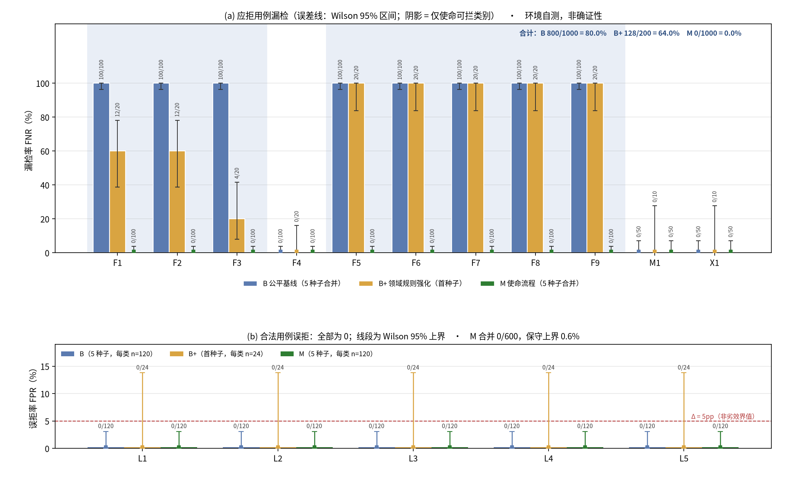

*图 7-1 作者语料 A 上各类别漏检率与合法对照误拒率（Wilson 95% 区间；环境自测，非确证性）*

H1′ 操纵检查：FNR_M(A) = 0 → 成立；FNR_B ≥ 0.9 的“仅使命可拦”类别数 = 8（F1、F2、F3、F5、F6、F7、F8、F9；预测 ≥ 6）→ 成立。基线公平性自检：B 拦截 F4（0/100 漏检）、M1（0/50）、X1（0/50）→ 通过。二者成立只说明装置按设计工作。

#### 7.2.1 逐类别解读

表 7-2 的模式可以完全由各条件的检查集合推出，这本身就是装置按设计工作的一个标志。先看 B。B 在 F4、M1 与 X1 上没有漏检：F4 的请求以顾问角色发起使能，被 B-4 角色 ACL 拒绝；M1 的九个子型分别违反枚举、取值范围或工单存在，被 B-1、B-2 或 B-3 拒绝；X1 的目标请求重复了前置请求的 nonce，被 B-5 拒绝。这三类正是公平性定义要求 B 必须拦下的类别。与此相对，B 在其余八类上全部漏检，原因也很清楚：B-3 只检查工单号是否存在，而不查看时间窗（F1、F2）、禁区（F3）、允许区、强度上限与允许动作（F7）、版本是否被取代（F8）；B 不读取来源字段（F5）与 U 掩码（F6），对共签报文只记录而不生效（F9）。这些请求在 B 看来与合法请求没有任何区别，因此被放行。换言之，B 的失败全部集中在“需要托付记录才能判定”的类别上，没有一处失败源于接口规格层面的疏漏。

M 在全部 MUST_DENY 类别上漏检为 0、在全部合法类别上误拒为 0。漏检为 0 是作者语料的预期结果：语料与门闩依据同一份规格编写，每个假使命都只违反一条规格中写明的条款。误拒为 0 的意义略有不同，它说明 M 的各项检查在 L1–L5 覆盖到的合法情形上没有矫枉过正，尤其是 L2 的六个边界子型——时间窗两端、强度恰为上限或为零、合法区的最小与最大编号——都被正确放行，闭区间与禁区优先等约定在实现中得到了遵守。

B+ 在 F4、M1、X1 上同样没有漏检，因为它包含 B 的全部检查；它在 F1、F2、F3 上有部分拦截，在 F5–F9 上与 B 一样全部漏检。这一模式与 B+ 的定义相符：全局运行窗只能拦下逻辑时刻落在 [50, 2000] 之外的请求，站点禁区只能拦下目标区为 7 或 15 的请求，而来源、U、范围、版本与共签绑定都不在 B+ 的视野之内。第 7.5 节将对 B+ 的部分拦截作进一步分解。

四个消融条件则各自只在预测的类别上出现漏检，其余类别与 M 完全相同。M−cosign 在 F9 上全部漏检，因为去掉共签检查之后，从未共签、撤销之后与共签绑定到另一托付的请求在其余各项检查上都是合法的。M−prov 在 F5 上全部漏检，但 F4 仍为 0，因为 F4 的请求以顾问角色发起，已被 B-4 拦下，与来源检查无关。M−U 在 F6 上全部漏检，包括声称达成且 U 非零的子型——这是因为 M-4 对 `CLAIM_ACHIEVE` 作了豁免，把它完全交给 M-7 处理，去掉 M-7 之后便没有任何检查会拒绝它。M−align 在 F1、F2、F3、F7 上全部漏检，在 F8 上部分漏检，其原因见第 7.6 节。

### 7.3 配对比较 B vs M

在 5 个种子汇总的 MUST_DENY 用例上，8 个“仅使命可拦”类别每类均为 a = 0、b = 100、c = 0、d = 0，精确 McNemar 双侧 p = 1.58 × 10⁻³⁰（Holm 校正后 1.74 × 10⁻²⁹）；F4、M1、X1 为 a = 100 / 50 / 50、b = c = d = 0，p = 1。类别层符号检验：M 胜 8、负 0，双侧 p = 0.00781。全部类别 c 合计为 0。

需要注意：这些 p 值是变体层的，同类别内变体共享违反条款、存在聚类；且语料由作者按同一规格生成。它们只表明“在本生成器定义的用例总体上”差异稳定，不应被读作方法有效性的证据。

从计算上看，这些 p 值没有任何神秘之处。每个仅使命可拦类别在 5 个种子上共有 100 个不一致对，且全部偏向 M（b = 100，c = 0）；在零假设下，100 个不一致对全部偏向同一方的概率极小，双侧 p 值即为 2 × (1/2)¹⁰⁰，这就是表中出现 10⁻³⁰ 量级数字的原因。类别层的符号检验更为直观：8 个类别全部是 M 胜，双侧 p 值为 2 × (1/2)⁸。两个层级的结论方向一致，但类别层的 p 值大得多，这恰好反映了第 5.5.3 节所说的情况——变体层的高精度部分来自同类别内高度相关的变体，并不对应同等程度的外部证据。F4、M1、X1 三类上 b = c = 0，两条件的判决完全相同，因而 p = 1；全部类别 c 合计为 0，说明 M 没有在任何一个用例上放行 B 拦下的请求，这是 X-4 未触发的直接依据。

### 7.4 误拒非劣效

合法语料 L1–L5 上，每个种子 n = 120，b（仅 M 拒）= c（仅 B 拒）= 0，差值 0.0%，保守 95% 上界 3.0%；5 种子合并 n = 600，上界 0.6%，均 < Δ = 5pp。L2 边界子型（level_max、level_zero、t_end、t_start、zone_max、zone_min）的 M 误拒均为 0/20，无系统性被拒子型。

这里的“非劣效成立”需要谨慎理解。它的含义是：在 L1–L5 所覆盖的合法情形上，M 的误拒率比 B 高出 5 个百分点以上的可能性，可以在 95% 的置信水平上被排除。它并不意味着 M 在任何合法情形上都不会误拒——草稿留出语料中的 H-041 就展示了一个可能的反例（第 7.8 节）。上界 3.0% 与 0.6% 完全由样本量决定（第 5.5.2 节的闭式解），因此合并 5 个种子使上界收窄，但这一收窄同样只针对生成器定义的合法用例总体。

### 7.5 领域规则强化基线 B+

**表 7-4 B+ 结果（首个种子 20261007）**

| 项 | 结果 |
|---|---|
| X-3 口径（预注册）：F1–F9 中 M 拦截的用例里 B+ 也拦截的比例 | 52/180 = **28.9%**（门槛 80.0%）→ X-3 未触发 |
| 补充（增量口径，不用于判定）：M 拦而 B 放的用例里 B+ 拦截的比例 | 32/160 = 20.0% |
| B+ 各类别拦截数 | F1 8/20；F2 8/20；F3 16/20；F4 20/20；F5–F9 均 0/20 |
| B+ 误拒（L1–L5） | 0/120 |

B+ 只能拦住全局运行窗与站点禁区覆盖到的那部分时间类与禁区类假使命；来源、U、范围、版本与共签绑定类假使命它完全拦不住。这一结果依赖 B+ 的具体定义（第 8.4 节）。

对首个种子日志中 B+ 的判决理由逐例核对，可以把这些部分拦截与生成器的子型联系起来。B+ 在 F1 与 F2 上拦下的用例全部以 `global_window_violation` 被拒，未拦下的则以 `ok` 放行：只有当具体托付的时间窗边界与全局运行窗边界相距很近（例如编号 7 的托付终点恰为 2000、编号 5 与 8 的托付起点恰为 50），或者越界幅度足够大（over_large、early_large 子型）时，逻辑时刻才会落到全局窗之外；而大量“仅越过具体托付边界一两个时间单位”的请求，仍然落在全局窗之内。B+ 在 F3 上拦下的 16 例全部以 `global_forbidden_zone` 被拒，恰为生成器标为 site_forbidden 的子型（目标区为 7 或 15）；未拦下的 4 例全部是 entrustment_forbidden 子型，即目标区只在所引用的那份托付中被禁止。F4 的拦截来自 B 本身的 B-4。

这一分解说明，B+ 的拦截能力与它所采用的全局规则的“粒度”直接相关：全局规则只能捕捉所有托付共同的边界，凡是因托付而异的边界，它都无能为力。X-3 的 28.9% 因此可以理解为“在本托付表中，有多大比例的假使命恰好也越过了所有托付共同的边界”。这一比例显然依赖于托付表的构成与 B+ 的定义，这正是第 8.4 节把 B+ 的定义列为待复核设计决定的原因。

### 7.6 消融

**表 7-5 消融（构念效度检查，首个种子）**

| 条件 | 预测上升类别 | 观察到的漏检（M → M−k） | 其他 F 类别 | L 误拒 | 预测是否出现 |
|---|---|---|---|---|---|
| M−cosign | F9 | F9 0 → 20/20 | 无变化 | 0 | 是 |
| M−align | F1, F2, F3, F7, F8 | F1、F2、F3、F7 各 0 → 20/20；F8 0 → 13/20 | 无变化 | 0 | 是 |
| M−prov | F5 | F5 0 → 20/20 | 无变化 | 0 | 是 |
| M−U | F6 | F6 0 → 20/20 | 无变化 | 0 | 是 |

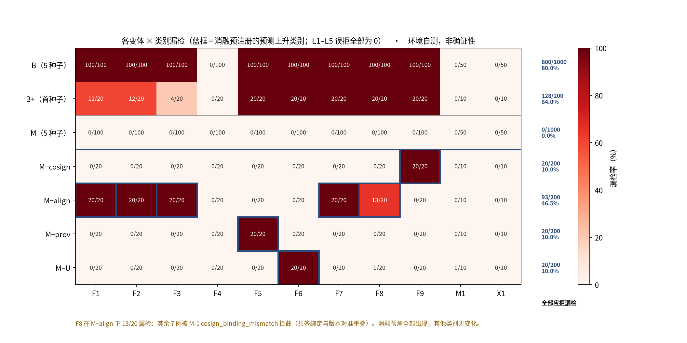

*图 7-2 各变体与消融条件下各类别漏检数（蓝框为预注册预测上升类别；环境自测，非确证性）*

M−align 在 F8 上只漏检 13/20：逐例核对 `runs/box-qemu/M-align/20261007/r1.log` 可见其余 7 例被 `cosign_binding_mismatch` 拒绝——即在 F8 中“共签绑定 v2、请求引用 v1”一类子型上，M-1 共签绑定与版本对准存在重叠拦截。这是按方案要求如实报告的组件重叠，不应解读为“对准组件对 F8 不必要”。

这一重叠可以从生成器代码中得到完整的解释。F8 的 20 个用例按序号轮换三个子型：stale_bound（共签绑定旧版本，请求引用旧版本）、bound_current（共签绑定当前版本，请求引用旧版本）与 both_bound（共签同时绑定新旧两个版本，请求引用旧版本）。按规格的固定优先级，bound_current 子型的首个违反条款是 S-C2（共签绑定不符），而不是 S-V1（版本陈旧），因为 S-C2 排在 S-V1 之前。在 M−align 中，版本新鲜检查被去掉，但 M-1 共签检查仍在，因此 bound_current 子型仍会被 `cosign_binding_mismatch` 拒绝，另外两个子型则因共签确实绑定了所引用的旧版本而被放行。按序号轮换，20 例中 bound_current 子型恰为 7 例，与日志中被 `cosign_binding_mismatch` 拒绝的 7 例吻合；逐例核对首个种子的语料与日志，这 7 例的子型也确实都是 bound_current。

这一结果有两层含义。其一，它说明消融确实测到了它要测的东西：M−align 去掉的是对准检查，F8 中依赖对准检查才能拦下的两个子型确实漏检了。其二，它暴露了合取式中两个组件在 F8 上的重叠：当共签绑定与请求引用的版本不一致时，明示托付检查本身就足以拦下请求。这种重叠不是缺陷，而是两个组件从不同角度约束同一份托付的自然结果；但它提醒我们，在解释消融结果时不能简单地把“漏检数”等同于“该组件的贡献”。

### 7.7 证据篡改轨道

**表 7-6 篡改检出（每种 20 个随机位置变体）**

| 篡改 | B 序号日志检出 | M FNV 链检出 | 预注册预期（B / M） | 是否符合 |
|---|---|---|---|---|
| T1 | 0/20 | 20/20 | 不检出 / 检出 | 是 |
| T2 | 20/20 | 20/20 | 检出 / 检出 | 是 |
| T3 | 20/20 | 20/20 | 检出 / 检出 | 是 |
| T4 | 20/20 | 20/20 | 按本实现模型检出（方案原文“视序号而定”）/ 检出 | 是 |
| T5 | 0/20 | 无锚点 0/20；外部锚点 20/20 | 不检出 / 无锚点不检出、有锚点检出 | 是 |
| T6 | 0/20 | 20/20 | 不检出 / 检出 | 是 |
| T7 | 0/20 | 0/20 | 不检出 / 不检出 | 是 |

T1–T4 合并：M 80/80 vs B 60/80，Fisher 精确单侧 p（M 更高）= 2.46 × 10⁻⁷，双侧 p = 4.91 × 10⁻⁷。T5（无锚点）与 T7 在 M 上不检出是预先声明的预期失败，属 U（教学级 FNV-1a32 无密钥、无外部锚点不能防截尾），不是待修复缺陷。

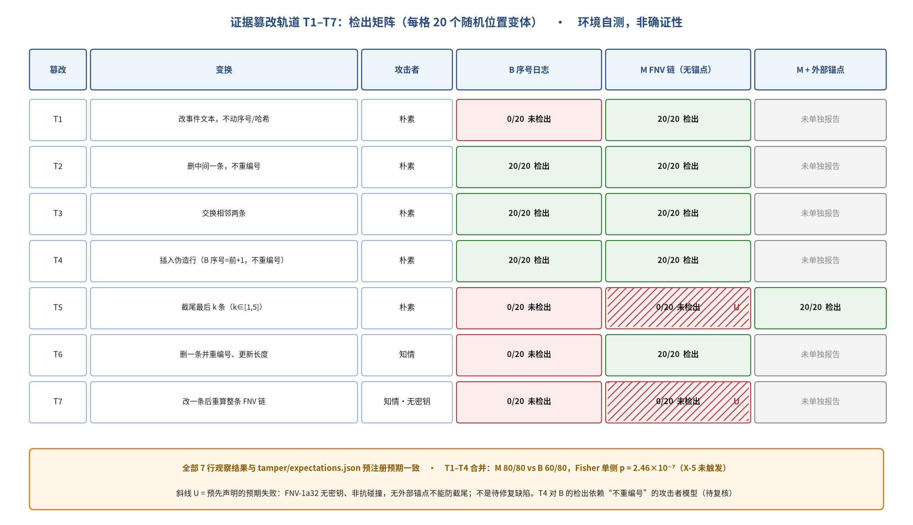

*图 7-3 证据篡改轨道 T1–T7 检出矩阵（斜线为预先声明的 U；环境自测，非确证性）*

逐行看，表 7-6 的每一个结果都可以由两种校验器的检测逻辑（第 5.6 节、第 6.3 节）直接推出。T1 只改动事件文本，B 的序号依然连续，因此 B 完全无法察觉；M 在重算该行哈希时发现与记录不符。T2 删除中间一行而不重编号，两种日志都会出现序号缺口。T3 交换相邻两行，两种日志的序号顺序都被打乱。T4 插入一行伪造记录，在本实现的攻击者模型下，B 侧的伪造序号与下一行冲突，M 侧的随机哈希与重算结果不符。T5 截去链尾若干行及结尾的 CHAIN 或 AUDIT_END 行，剩余部分在两种日志中都自洽，只有与外部登记的 tip/len 比对，M 才能发现缺失。T6 删除一行并重新编号、同步更新长度，B 的序号检查全部通过，而 M 的链接与哈希均被破坏。T7 修改一条记录并重算其后整条链，链在内部完全自洽，M 与 B 都无法发现。

由此可见，FNV-1a32 链相对于普通序号日志的增量，恰好集中在 T1 与 T6 这两种“保持序号自洽”的篡改上；而在 T5（无锚点）与 T7 上，链与序号日志同样无能为力。T1–T4 合并的 Fisher 检验反映的主要是 T1 上的差异，因为 T2–T4 上两者都全部检出。T6 不在 X-5 的检验范围内，但它是“知情攻击者不能重算哈希”时链的价值最直观的体现；T7 则标出了这一价值的边界。

### 7.8 草稿留出语料（仅演示流水线）

草稿留出语料由作者手写：47 例（MUST_DENY 34，MAY_PERMIT 13，其中 2 例标为 spec_gap 单列）。真值为作者依核心原则的草稿判断。**不计入确证性结论，不得用于判定 X-1。**

**表 7-7 草稿留出语料结果**

| 条件 | FNR（非 spec_gap 的 MUST_DENY） | FPR（非 spec_gap 的 MAY_PERMIT） |
|---|---|---|
| B | 27/34 = 79.4% [W 63.2%–89.7%；CP 62.1%–91.3%] | 0/11 = 0.0% [W 0.0%–25.9%；CP 0.0%–28.5%] |
| B+ | 23/34 = 67.6% [W 50.8%–80.9%；CP 49.5%–82.6%] | 0/11 = 0.0% |
| M | 0/34 = 0.0% [W 0.0%–10.2%；CP 0.0%–10.3%] | 0/11 = 0.0% |

配对（MUST_DENY）：a = 7、b = 27、c = 0、d = 0，精确 McNemar 单侧 p = 7.45 × 10⁻⁹（仅演示计算路径）。

**表 7-8 spec_gap 条目（单列）**

| 用例 | 草稿真值 | oracle 条文判定 | B | B+ | M | 说明 |
|---|---|---|---|---|---|---|
| H-036 托付即将到期时连发合法请求“抢跑” | MAY_PERMIT | MAY_PERMIT / ok | PERMIT | PERMIT | PERMIT（ok） | 规格不含速率限制；依原则逐条合法；标注人可能改判 |
| H-041 第 5 个共签（超出实现容量 4）后按其请求 | MAY_PERMIT | MUST_DENY / `cosign_binding_mismatch` | PERMIT | PERMIT | DENY（`cosign_binding_mismatch`） | 人确已共签该托付；容量是实现约束而非使命原则；规格 §3 未定义 |

H-041 是一个值得注意的信号：在规格未定义处，M 的实现约束（共签容量）产生了一次可能违背核心原则的拒绝。正式留出语料中此类情形的处理正是 X-1 要检验的推广性问题的一部分。

草稿留出语料的结果在模式上与作者语料 A 相似：B 漏掉了大部分假使命，B+ 只多拦下少数，M 全部拦下且无误拒。但这种相似性恰恰说明了它为什么不能用于判定 X-1：草稿留出语料与规则规格出自同一作者，作者在编写用例时很难不受规格条文的影响，因此 M 在其上的全拦截与在作者语料 A 上的全拦截性质相同，仍然属于装置自检。它真正的价值在于两点：一是证明了留出语料的完整流水线（编写、生成、运行、解析、评分、单列 spec_gap）可以端到端运行；二是发现了 H-036 与 H-041 两个规格未定义的情形，为独立标注人复核规格提供了具体的切入点。

### 7.9 草稿 oracle 与门闩 M 的一致性

5 个作者语料种子（各 320 例）与草稿留出语料（47 例，按 oracle 条文真值）上，M 与草稿 oracle 的判决与理由码逐条一致，不一致 0 条（即 100% 一致）。oracle 只读 JSON、与门闩代码无共享逻辑；但二者出自同一作者、依据同一份规格，这一一致是预期结果，只说明实现与规格条文相符，不说明规格本身正确。

### 7.10 代码与证据增量成本（E2，探索性）

**表 7-9 门闩成本**

| 条件 | 门闩有效行数 | gatekeeper ELF text（字节） | 门闩相关串口字节 / 被评分请求 |
|---|---|---|---|
| B | 247 | 6411 | 186.8 |
| B+ | 253 | 6523 | 190.6 |
| M | 403 | 8947 | 362.4 |
| M−cosign / M−align / M−prov / M−U | 387 / 366 / 400 / 397 | — | — |

有效行数按 `gatekeeper_field.c` 编译期条件展开统计（非空非注释，含预处理指令行）。LOC 比 M/B = 403/247 = 1.63（X-7 门槛 3.0）。三个条件的 client ELF 相同（text = 48959）。

从成本的角度看，M 相对于 B 的增量主要来自三部分：共签绑定集合的管理、按托付查表并逐项比对的对准检查，以及证据链的哈希计算与输出。门闩相关的串口字节约为 B 的两倍，主要是因为 M 的每条记录都携带 prev 与 this 两个十六进制哈希，且每次放行都打印弱成功注记。四个消融条件的有效行数介于 B 与 M 之间，其中 M−align 最少，因为对准检查是 M 中代码量最大的部分。LOC 比远低于 X-7 的门槛，但需要强调，X-7 只有在 X-1 同时成立时才构成反证；在 X-1 未判定的情况下，成本数字只能作为探索性描述。

### 7.11 可证伪条件状态

**表 7-10 反证条件 X-1…X-7 的当前状态（装置自检口径）**

| 编号 | 条件 | 当前状态 | 依据 |
|---|---|---|---|
| X-1 | 留出语料 H 上 McNemar 不显著或 FNR_M(H) ≥ 30% | **未判定**（尚无独立标注人编写的留出语料） | 草稿留出语料仅演示：单侧 p = 7.45 × 10⁻⁹，FNR_M = 0.0%，n_deny = 34（不计入） |
| X-2 | 误拒非劣效不成立或 L2 子型系统性被拒 | 未触发（装置自检） | 合并上界 0.6%；无系统性被拒子型 |
| X-3 | B+ 拦截 M 所拦 F1–F9 的 ≥ 80% | 未触发（装置自检） | 28.9% |
| X-4 | M 出现 c > 0 | 未触发 | 全部 MUST_DENY 类别 c 合计 = 0 |
| X-5 | T1–T4 上链检出率不高于序号日志 | 未触发 | Fisher 单侧 p = 2.46 × 10⁻⁷ |
| X-6 | 人工研究 M 的 F1 中位数不高于 B 且更慢 | **未判定**（人工审查研究推迟） | — |
| X-7 | LOC > 3 倍基线且 X-1 成立 | 未触发（LOC 比未超门槛） | 1.63 |

“未触发”仅在装置自检口径下成立；两个承担验证性负荷的条件（X-1、X-6）均未判定。

把七条反证条件的状态放在一起看，可以得到一个清晰的图景：凡是能在作者语料与草稿真值上判定的条件（X-2、X-3、X-4、X-5、X-7），在装置自检口径下都未触发；凡是需要独立语料或人工研究才能判定的条件（X-1、X-6），都尚未判定。这个图景本身就说明了本文结果的性质——前一类条件检验的是装置与设计的内部一致性，后一类条件才检验方法的推广性与对人的价值。因此，“五条未触发”不应被读作“方法通过了五项检验”，而应被读作“装置在五个方面没有暴露出与设计不符的问题”。

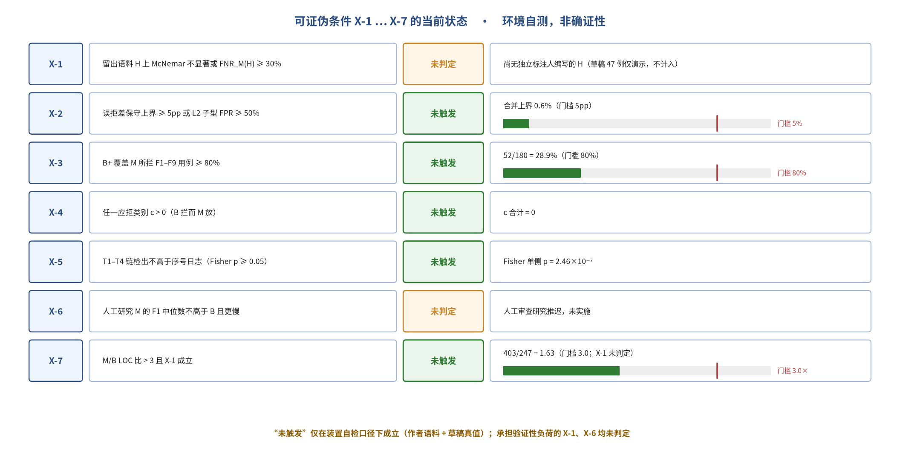

*图 7-4 可证伪条件 X-1…X-7 的当前状态（条形为观测值与门槛之比；环境自测，非确证性）*

### 7.12 结果小结

在作者语料与草稿真值上，实验装置按设计工作：B 的公平性自检通过；M 在 8 个仅使命可拦类别上全拦截且无误拒；B+ 仅覆盖时间与禁区的一部分；每个消融只在其预测类别上失效；篡改轨道的检出与不检出均与预注册预期一致；运行确定、可回归，主机模拟与 QEMU 一致。**这些结果确认了实验管线，而非方法。**它们能与不能说明什么，留待第 8 章讨论。

---

## 8 讨论

第 7 章的数字需要放在正确的解释框架中阅读。本章先分别列出结果能说明与不能说明的内容（8.1、8.2），再系统梳理效度威胁及其当前缓解状态（8.3），随后列出须在独立标注人介入之前复核的设计决定及其备选方案（8.4），总结经验与教训（8.5），再记录一次针对本文主张的两轮反方质疑与正方回应（8.6），最后小结（8.7）。

### 8.1 结果能说明什么

1. **管线可用**：从语料生成、哈希校验、构建、QEMU 运行、解析、篡改到统计与反证清单，整条流水线可端到端运行，INVALID = 0，确定性 12/12，主机模拟与 QEMU 逐字节一致，原 `full` 剖面未受影响。
2. **基线不是稻草人**：B 正确拦截了它在定义上应能拦截的 F4、M1、X1；B 的失败集中在需要托付记录才能判定的类别上。这与“传统 / 使命”边界的可操作定义一致。
3. **组件与类别的对应关系可观察**：消融显示每个使命组件对应其预测的假使命类别，且发现了一处真实的组件重叠（F8 上共签绑定与版本对准）。
4. **领域规则与托付绑定可以区分**：在本 B+ 定义下，全局规则只覆盖 28.9% 的 M 拦截用例。
5. **证据层的预期失败可以被预先声明并被观察到**：T5（无锚点）与 T7 的不检出与预注册一致，说明 U 的标注是可检验的而非修辞。

### 8.2 结果不能说明什么

1. **不能说明方法有效**。作者语料上的全拦截近乎同义反复（H1′），oracle 与 M 的 100% 一致是同一作者、同一规格的预期结果。
2. **不能说明推广性**。X-1 未判定；草稿留出语料由作者手写，按方案不得用于判定 X-1。
3. **不能说明人能更好地审查**。X-6 未判定，人工审查研究推迟。
4. **不能说明作者 Windows 环境上的实验结果**。所有实验数字来自沙箱 QEMU，语料矩阵尚未在 `trustworthysystems/sel4` 镜像上复现；该镜像上 2026-10-08 跑通的只是 S1 原始演示 `full` 验收（按标签判决的演示门闩，非实验对象）。
5. **不能外推到真实系统**。p 值描述的是生成器定义的用例总体；变体层存在聚类；样本瓶颈是类别数与留出语料，而非变体数。
6. **不能说明任何临床或安全性质**，也不构成 seL4 级应用保证；甚至不能说明本案例运行的内核配置已被验证——Microkit 所用的 MCS 配置据手册仍在验证之中（第 2.5 节）。

### 8.3 效度威胁

**表 8-1 效度威胁与当前缓解状态**

| 类型 | 威胁 | 方案中的缓解 | 当前状态 |
|---|---|---|---|
| 内部 | 规则、语料、oracle 出自同一作者（自证循环） | 独立标注人审阅签字规格、独立重写 oracle、κ ≥ 0.9、独立编写留出语料 | **未实施**：标注人未指定 |
| 内部 | 门闩按标签判决（同义反复） | 按字段判决；`MR_CASE_ID` 仅用于打印 | 已实施 |
| 内部 | 基线写得差（稻草人） | 可操作定义；B 须拦 M1/F4/X1；B+ 条件；B 测试集由独立同学评审 | 前三项已实施；独立评审未实施 |
| 内部 | 日志缺失被当作 DENY | INVALID 单列，非零即重跑 | 已实施（INVALID = 0） |
| 内部 | 研究者自由度（事后改阈值） | 预注册冻结；`deviations.md`；git 标签 | 文件已冻结；**git 标签未打**，冻结仅以文件内容与日期为凭 |
| 构念 | “漏检”实为“基线缺需求”，是否只是在比较两份需求文档 | 承认并主张：方法的作用正是系统性地诱导出托付相关需求；B+ 分离领域规则 | 如实承认；结论依赖 B+ 定义 |
| 构念 | 自报字段（ORIGIN_ROLE、U_DECL）可伪造；共签为占位；FNV 非密码学 | 明确为 U；T7 预期失败 | 已声明 |
| 构念 | 消融未出现预测漏检 | 如实报告为“语料未测到” | 预测均出现；F8 重叠已报告 |
| 外部 | 玩具领域、两 PD、单客户端、逻辑时钟 | 结论限定于显式托付门闩场景；RQ4 仅定性预览 | RQ4 未实施 |
| 外部 | QEMU 而非真硬件 | 判决逻辑与硬件无关；不作性能/时序结论 | 已声明 |
| 构念 | 把 Microkit 构建读作“已验证内核”，从而高估 K 层 | K 仅引用；注明 seL4 证明只适用于特定配置，Microkit 所用 MCS 配置的代码级验证尚未完成；该状态列入 U | 已声明 |
| 外部 | 运行环境不同于作者主机 | Windows Docker 复现 | 原始演示 `full` 验收已复现（2026-10-08，作者报告）；语料矩阵复现**未完成** |
| 结论 | 把变体层 p 值当作真实世界推断 | 同时报告类别层；明说推断对象 | 已在报告中声明 |
| 构念 | 处理条件把“方法”与“需求清单的完整性”混在一起：B 与 M 只差规则是否写出 | 作者语料 A 只作操纵检查；留出语料 H 与 X-1、B+ 与 X-3 检验推广与增量来源；三臂人工研究检验“是否更可能写出规则” | 已声明；人工研究为**计划** |
| 构念 | 托付记录本身错误，门闩以全部检查通过的形式放行错误动作（假绿灯） | 记录可评审、可版本化、可与审批记录比对；证据链追溯放行所依据的版本；外部锚点核对 | 已列为显式 U 风险；外部锚点为**计划** |
| 内部 | 假使命推导依赖作者手艺（F1–F9 分类、规则优先级、理由码均为作者决定） | 单点违反的机械规则；留出语料 H 与 κ ≥ 0.9；两名独立工程人员的类别重合度检验 | 已声明；重合度检验为**计划** |
| 构念 | “不提供达成成功码”只覆盖门闩接口，下游可能把 ALLOW_SIM 误读为达成 | 措辞限定为“外壳本身从不产生达成并强制附注记”；结构化结论强度字段列入路线图 | 限定已写入；扩展为**计划** |

表 8-1 中各类威胁的分量并不相同，值得逐类说明。

内部效度方面，最根本的威胁是自证循环：规则规格、语料生成器、草稿 oracle 与门闩都出自作者本人，并且依据同一份规格。在这种情况下，M 与 oracle 的一致、M 在作者语料上的全拦截，都只能说明“实现忠实于规格”，而无法说明“规格捕获了托付”。方案为此设计了一整套隔离措施——独立标注人审阅签字规格、不看门闩源码独立重写 oracle、κ 双标、独立编写留出语料——但这些措施目前都未实施，因此本文所有涉及“方法有效”的问题都必须暂时悬置。相比之下，“门闩按标签判决”这一威胁已经通过字段门闩得到了结构性的消除，“日志缺失被当作 DENY”也已由 INVALID 单列而排除。研究者自由度方面，预注册文件已经冻结，偏离记录为空，但 git 标签尚未打，冻结目前只能以文件内容与日期为凭，其可审计性弱于标签。

构念效度方面，最值得认真对待的批评是：所谓“漏检”，是否只是“基线缺少需求”？换言之，B 与 M 的比较，是否只是在比较两份需求文档？本文的回答是承认这一点，并把它作为方法主张的一部分：使命软件工程的作用，正是系统性地诱导出那些在传统规格中常被省略的托付相关需求；实验测量的是这一纪律的后果，而不是某种运行时机制的魔力。B+ 则进一步把“多写领域规则”与“绑定托付”分开，使这一主张可以被部分检验。另一类构念威胁来自玩具化的字段与占位机制——来源与 U 掩码是自报的，共签是占位，哈希不是密码学的——本文的处理方式是把它们全部列入 U，并把实验结论限定为“若这些字段可信，检查是否到位”。

外部效度方面，玩具领域、两个保护域、单一客户端、逻辑时钟与 QEMU 平台，都限制了结论向真实系统的推广。判决逻辑与硬件无关，这使 QEMU 平台本身不是主要问题；更大的限制在于领域与规模，本文因此把结论措辞限定在“此类显式托付的门闩场景”之内。运行环境方面，S1 原始演示验收已在作者 Windows Docker 环境上复现，但语料矩阵尚未复现，第 7 章的结果目前只在沙箱环境中成立。

表 8-1 末尾四行是第 8.6 节的辩论新增的威胁。其中前两项分量最重。第一项承认，在当前设计中，M 相对于 B 的优势可以完全由“M 的规则清单更完整”来解释，实验本身无法区分“方法帮助人写出了更完整的清单”与“作者恰好写出了更完整的清单”；只有人工研究才能检验前者。第二项则指出，门闩把“系统是否做对了”转化为“托付记录是否写对了”，失败点被移动而没有被消除，而一份错误的记录产生的假绿灯比没有门闩更危险。第三项与第四项分别限定了“系统推导”与“交付 ≠ 达成”这两项主张的强度：前者在类别重合度检验完成之前只能视为作者的设计决定，后者只在门闩接口上成立。

结论效度方面，主要风险是把变体层的极小 p 值当作对真实世界的推断。本文在每一处报告 p 值的地方都说明了推断对象，并同时报告类别层结果；读者应当以类别层与反证条件的状态为主要依据，而不是以 10⁻³⁰ 量级的数字为依据。

### 8.4 待作者复核的设计决定

以下决定直接影响判决、理由码或反证条件的判定，须在独立标注人介入前由作者复核，并在修改时记入 `deviations.md`：

1. **规则优先级与 A-F8-002 的理由码**。`prereg.md` §5 固定优先级为 S-F1 → … → S-C1 → S-C2 → S-E0 → S-T1 → … → S-V1 → S-P1 → S-U1 → S-U2。由此，方案附录 A 中 A-F8-002（撤销后改授 v2、按 v1 请求）的理由码被固定为 `cosign_binding_mismatch`，而方案附录 A 原表对该例列出的期望是 `stale_entrustment_version`。只有“共签仍绑定旧版本 v1 且按 v1 请求”时理由码才为 `stale_entrustment_version`。这一选择影响原因码正确率口径与 F8 的消融解释（第 7.6 节）。
2. **共签适用范围**。S-C1/S-C2 适用于全部四种动作，包括 RECOMMEND 与 QUERY_STATUS（“任何请求都必须挂靠在一份被人明示共签的托付下”）。若认为只读查询不应要求共签，L3 等对照的定义与 F9 的边界都会变化。
3. nonce 消耗语义。nonce 一经出现即记入用例内历史，无论该请求是否被拒。这使“被拒请求的重试必须换 nonce”，可能影响留出语料中的合法重试类用例。
4. **B+ 的定义（驱动 X-3）**。当前 B+ 的全局运行窗取全表 [min t_start, max t_end] = [50, 2000]，站点禁区取每条托付都禁止的区 {7, 15}。X-3 的 28.9% 直接取决于这一定义；更激进的全局规则（例如更窄的窗口或更大的禁区并集）可能提高覆盖比，但也可能引入误拒。B+ 的“合理强度”需要独立评审。
5. **T4 的攻击者模型**。本实现中 B 侧插入行的序号取前一条 +1 且后续不重编号，因而必然产生序号冲突而被检出（`detected_under_our_model`）；方案原文写作“视序号而定”。若攻击者在插入后重编号，T4 对 B 将退化为类似 T6 的不检出情形，T1–T4 合并的 Fisher 检验（X-5）随之改变。
6. **共签容量与 spec_gap**。共签集合容量 4 是实现约束；H-041 显示超出容量时 M 会拒绝一个已被人共签的请求。规格 §3 将其标为未定义，需决定是作为规格条款、实现限制写入 U，还是修改实现。

上述六项决定各有备选方案，表 8-2 把当前选择与主要备选方案并列，说明各自的利弊。需要强调的是，本文不在此替作者作出选择；列出利弊的目的，是让复核者清楚地看到每项决定会如何影响判决与反证条件。

**表 8-2 待复核设计决定的备选方案比较**

| 决定 | 当前选择 | 主要备选 | 当前选择之利 | 当前选择之弊或风险 |
|---|---|---|---|---|
| ① 规则优先级 | 共签检查（S-C1/S-C2）先于版本与对准检查 | 版本陈旧（S-V1）先于共签绑定 | 优先级简单一致：“有没有托付”先于“托付是否仍有效”；理由码唯一 | A-F8-002 的理由码与方案附录 A 原表不一致；F8 消融出现重叠，解释需额外说明 |
| ② 共签适用范围 | 四种动作均需共签 | 只读查询（QUERY_STATUS）或建议（RECOMMEND）免共签 | 原则统一：任何请求都挂靠在被明示共签的托付下 | 可能过严；L3 与 F9 的边界依赖这一选择 |
| ③ nonce 消耗 | 无论结果如何，nonce 一经出现即记入历史 | 仅放行的请求消耗 nonce | 防止攻击者用被拒请求探测后重放同一 nonce；实现简单 | 被拒请求的合法重试必须更换 nonce，可能与某些留出用例的直觉冲突 |
| ④ B+ 定义 | 全表时间窗并集 [50, 2000]，所有托付共同禁区 {7, 15} | 更窄的窗口、禁区并集等更激进的全局规则 | 由同一份托付表机械导出，不引入作者额外判断；不产生误拒 | X-3 的覆盖比直接依赖这一定义；更强的全局规则可能提高覆盖比，也可能引入误拒 |
| ⑤ T4 攻击者模型 | B 侧插入行序号取前一条 +1，后续不重编号 | 插入后重编号 | 对应“朴素攻击者”这一预注册模型，结果可复现 | 若采用重编号模型，T4 对 B 将退化为不检出，X-5 的 Fisher 检验结果随之改变 |
| ⑥ 共签容量 | 实现容量 4，超出时拒绝授予 | 写入规格条款；作为实现限制列入 U；扩大或取消容量 | 实现简单，内存占用固定 | H-041 显示可能拒绝一个已被人共签的请求，与核心原则存在张力 |

这六项决定有一个共同特点：它们都位于规格的“缝隙”之中——方案原文没有写明、或写明得不够精确的地方。在这些地方，实现者不得不作出选择，而选择本身又会反过来影响实验结论。这正是方案要求在独立标注人介入之前由作者复核、并把任何修改记入偏离记录的原因：一旦这些选择在看到结果之后被悄悄调整，预注册就失去了意义。

### 8.5 经验与教训

回顾从 S1 演示到对照实验装置的整个过程，可以总结出若干对后续工作乃至对类似研究有参考价值的经验。

第一，演示与实验必须分开。S1 演示门闩按标签判决，对演示纪律而言完全足够，但一旦把它当作实验对象，所有结果都会沦为同义反复。这一点在实验设计阶段被明确识别出来，并促成了字段门闩的重写。更一般地说，一个用于“展示可行”的原型，往往不能直接用于“检验有效”，两者对被测对象的要求不同。

第二，基线的公平性需要可操作的定义，而不只是善意。“B 不是稻草人”如果只是一句声明，就无法被检验；把它写成“凡能从接口规格与常规访问控制推导的检查都做”，并据此推出“B 必须拦下 M1、F4、X1”这一可检验的推论，才使公平性成为一个可以失败的命题。

第三，预先声明的失败比事后的解释更有说服力。T5（无锚点）与 T7 在 M 上不检出，如果是在结果出来之后才被解释为“教学级哈希的固有局限”，读者有理由怀疑这是在为失败开脱；而由于它们在预注册中被写成预期失败，其“失败”反而成为 U 的标注可检验的证据。

第四，规格的缝隙会在实现中暴露出来。共签容量、nonce 消耗语义、规则优先级等问题，在方案文本中都没有被精确规定，直到实现与语料生成时才浮现出来。草稿留出语料中的 spec_gap 条目，正是这类缝隙的具体体现。对后续工作而言，这意味着独立标注人复核规格时，应当特别关注那些“实现者不得不作出选择”的地方。

第五，确定性是可审计性的基础。由于整个装置被设计为确定性的，任何两次运行之间的差异都可以被精确定位，主机模拟与 QEMU 之间的逐字节比较也才有意义。如果装置中混入了真实时钟或随机性，许多交叉校验都将无从进行。

第六，环境差异需要被如实记录。本文的实验数字全部来自沙箱 QEMU，而作者的目标环境是 Windows 上的 Docker 镜像；两者的差异在每一处相关位置都被标明，S1 演示的 Windows 复现结果也以“作者报告”为据单独陈述。这种区分看似琐碎，却是避免把“在某处跑通”误读为“在所有地方都成立”的必要纪律。

### 8.6 反方质疑与正方回应

为检验本文主张的稳健性，作者组织了一次两轮的对抗性辩论：反方针对“使命软件工程”提出质疑，正方逐条回应。本节以结构化的方式记录这次辩论的实质内容。它不是新的经验证据，而是对本文论证本身的一次压力测试；其中凡是标为“计划”的内容，均尚未实施。

#### 8.6.1 第一轮

**质疑 1：一切都可以归约为已有的需求类型。** 反方指出，本文的每一项检查都能在已有的工程概念中找到对应：带有效期的访问控制；职责分离与最小特权（Saltzer & Schroeder, 1975）；验证与确认；需求追溯（Gotel & Finkelstein, 1994）；运行时验证以及策略执行点与策略决策点分离的策略执行架构（Leucker & Schallhart, 2009）；良好需求应可验证的一般原则；以及负面用例与误用用例测试。既然如此，所谓“使命”不过是旧概念的重新命名。

**回应。** 正方接受逻辑上的可归约性，但否认它意味着“没有新东西”，理由有四。第一，这些失败共享同一种结构，却分属不同领域与角色：时间窗属于运维，角色属于安全，范围属于需求，结论措辞属于评审，每一方都倾向于把它当作别人的事故。使命视角把它们收拢到同一个一等对象（托付记录）与同一个执行点（门闩）之上。一个可以类比的例子是安全需求：它们在逻辑上同样可以归约为普通约束，但危险分析为这类约束提供了一个系统化的生成器，这正是其价值所在。第二，托付不同于授权记录，也不同于需求基线：授权记录的生命周期跟随账户，需求基线的生命周期跟随发布，而托付的生命周期跟随一位具名的人在某一时刻给出的、有时限且可撤销的意图。第三，运行时验证假定待检查的性质已经给定且正确；使命层则要求这些性质由托付推导而来，并与托付保持同一版本、同一有效期。第四，两者的证伪对象不同：“需求应可验证”针对的是逐条需求，而使命方法从托付结构出发系统地推导假使命，这有可能暴露需求清单本身的遗漏——情境一中的有效期需求不在任何一份清单之中，因此逐条核对需求永远不会发现它。此外，“交付 ≠ 达成”被从一条评审原则转化成了一个接口约束（不提供达成成功码）。

**质疑 2：实验的构念效度。** 反方指出，B 与 M 在操作上的差别仅仅在于是否写了那些规则；如果把这些规则写进 B，B 就等于 M。因此，B 与 M 的比较并不能检验“方法”，而只是在比较“写了规则”与“没写规则”。

**回应。** 正方完全接受这一点，并指出这正是作者语料 A 上的结果只被当作操纵检查的原因（第 5.2 节 H1′）。真正需要检验的是两件事：使用使命方法的工程人员是否更可能写出这些规则，以及门闩的拦截是否能推广到未被预见的情形。前者需要人工研究，后者由独立留出语料 H 与 X-1、领域规则强化基线 B+ 与 X-3 检验；人工研究目前推迟，本文建议提高其优先级（第 10 章）。消融结果显示每个组件各自承担一类假使命、彼此没有冗余，这支持“最小内核”的主张，但本文并不据此宣称各组件之间存在超加性。相应地，第 8.3 节的效度威胁中增加了一条：“处理条件把方法与需求清单的完整性混在了一起”。

**质疑 3：命名的代价。** 反方认为，为一组检查另起一个名字，会制造概念负担；除非有充分理由，否则不应命名。

**回应。** 正方接受三种可以成立的命名理由：其一，它定义了一个新的需求类别；其二，它是一种能系统地发现遗漏、且效果可度量的方法；其三，它是一种能降低遗漏率的组织方式。就目前的证据而言，本文至多只看到了第三种理由的端倪，前两种都尚未得到支持。因此，本文采用一种更窄的表述：使命软件工程是“一种可证伪的候选工程方法”。

#### 8.6.2 第二轮

**质疑 4：“同一结构”的说法是否不可证伪？** 反方指出，如果任何失败都可以被解释为“托付不再被对准”，那么“这些失败共享同一结构”就是一个无法被反驳的说法。

**回应。** 正方承认这一质疑成立，并给出一个适用边界：方法只对同时满足以下三个条件的缺陷作出预测——（1）存在一位具名的人在某一时刻给出的、有边界的委托；（2）委托之后，系统行为或委托本身发生了变化（到期、范围变更、撤销等）；（3）此后的每一个动作在形式上仍然是合规的。不在适用范围之内的包括：缓冲区溢出等纯实现错误（它们违反的是规格，而不是委托）；没有委托基线可以参照的一般性配置漂移；报告口径定义本身的错误。正方同时提出一项计划：收集反例，即满足上述三个条件、却无法通过托付记录检出的缺陷。若这类反例大量存在，方法的适用边界就需要收缩。

**质疑 5：为什么比一份好的十项检查清单更好？** 反方指出，一份列出常见遗漏（有效期、来源、版本、结论措辞等）的检查清单，也许就能达到同样的效果。

**回应。** 正方承认，当前设计中没有检查清单对照组，因此无法回答这一问题。为此提出一项计划中的三臂人工研究：A 组使用传统需求方法；B 组只使用一份常见遗漏检查清单；C 组使用使命方法，即从托付记录出发推导需求。指标为在同一份业务描述上遗漏的关键需求数，以及在留出情境上的推广能力。预先声明的预测是：C 相对于 B 的优势应主要出现在检查清单未曾预见的情境上；如果 C 在这些情境上并不优于 B，本文的主张就退化为“一份好的检查清单”，这是一个可以接受的结论。该研究目前只是计划，尚未实施。

**质疑 6：托付记录本身的正确性由谁审计？** 反方指出，门闩只是把“系统是否做对了”换成了“托付记录是否写对了”，问题并没有消失。

**回应。** 正方承认，失败点只是被移动了，而没有被消除；更严重的是，一份错误的托付记录会让门闩放行一个错误的动作，产生“假绿灯”，这比没有门闩更危险，必须作为显式风险列出（第 3.5 节、第 8.3 节）。移动失败点的价值在于：失败点被集中到一份有限、可以评审的记录上；这份记录本身是可检查的——它可以被评审、被版本化、与审批记录比对，而证据链可以追溯是哪一个版本导致了某次放行；此外，还可以引入外部锚点，例如把有效期与调度配置核对、把范围与审批流程核对。这些外部锚点目前属于 U 与后续工作。

**质疑 7：推导依赖作者的手艺。** 反方指出，F1–F9 的分类、规则优先级与理由码都出自作者之手，“系统推导”可能只是作者手艺的另一种说法。

**回应。** 正方承认，当前的 F1–F9 分类、规则优先级与理由码都是作者的决定；独立留出语料 H 与 κ ≥ 0.9 的一致性检查将对此作出检验。正方同时给出一条机械的生成规则，即“单点违反”：对托付的每一个要素（时间、范围、问责、版本、证据）各违反一次，其余要素保持合法（第 3.4.1 节）。由此可以作出一个预测：独立的工程人员从同一托付结构出发推导，所得的类别应当一致，差别只应出现在子型与边界上。计划中的检验是：由两名独立工程人员分别推导类别，测量其重合度；若重合度很低，则说明推导依赖的是手艺而不是方法。

**质疑 8：“不提供达成成功码”的约束被夸大了。** 反方指出，门闩不产生“达成”，并不能阻止下游把 ALLOW_SIM 读成“达成”。

**回应。** 正方承认这一约束只覆盖门闩接口。报告的措辞应当是：外壳本身从不产生“达成”，并强制附带注记；下游的误读属于 U（第 1.1.4 节、第 9 章）。一个可能的扩展是在应答中加入结构化的“结论强度”字段，要求报告模板必须引用它，并对报告生成施加类似的检查；这一扩展只列入路线图，尚未实施。

**质疑 9：降级是否被接受到了“没有什么能证伪它”的地步？** 反方指出，本文一再收缩自己的主张，最终可能收缩到任何结果都无法证伪的程度。

**回应。** 正方以三级放弃条件作答，并主张这些条件应在看到结果之前写入预注册：（i）放弃“使命”作为一个独立方向：X-1 被触发（留出语料上 FNR_M ≥ 30%，或精确 McNemar 单侧 p ≥ 0.025），并且人工研究显示 C 组在未预见情境上并不优于 B 组；（ii）收缩为“一种架构模式”而非“一种方法”：类别重合度低（推导是手艺），但门闩在留出语料上仍然有效；（iii）只修复实现：仅操纵检查失败。需要说明的是，现行预注册中的 X-1…X-7 尚未包含这些条件。由于预注册的 git 标签尚未创建，本文建议把三级放弃条件作为一项拟议修订，在打标签之前写入 `prereg.md`，并在 `deviations.md` 中记录其时间与理由；已冻结的 X-1…X-7 及其阈值不作追溯修改。该修订目前尚未执行。

#### 8.6.3 辩论的结果

表 8-3 汇总了九项质疑、本文的立场，以及它们在本文中引起的改动与状态。

**表 8-3 反方质疑、本文立场与相应改动**

| 质疑 | 立场 | 本文中的改动 | 状态 |
|---|---|---|---|
| 1 可归约为已有需求类型 | 部分接受（接受可归约，否认无新意） | 第 1.1 节以托付记录重写三情境并导出 MR-1…MR-10；本节给出四点区分 | 已写入正文 |
| 2 构念效度：B 与 M 只差规则是否写出 | 接受 | 第 8.3 节增列“方法与需求清单完整性混淆”；提高人工研究优先级 | 威胁已写入；人工研究为计划 |
| 3 命名代价 | 部分接受 | 采用“可证伪的候选工程方法”这一更窄表述 | 已写入正文 |
| 4 “同一结构”不可证伪 | 接受 | 第 1.4 节与第 9 章写入三条件适用边界及范围外缺陷类别 | 边界已写入；反例收集为计划 |
| 5 不比好的检查清单更好 | 接受（当前无法回答） | 第 5.2.1 节与第 10 章加入三臂人工研究（含清单对照组） | 计划 |
| 6 托付记录的正确性 | 接受 | 第 3.5 节与第 8.3 节列为显式风险（假绿灯）；外部锚点列入后续工作 | 风险已写入；锚点为计划 |
| 7 推导依赖作者手艺 | 接受 | 第 3.4.1 节明确单点违反规则；第 8.3 节增列威胁；第 10 章加入类别重合度检验 | 威胁已写入；检验为计划 |
| 8 无达成码约束被夸大 | 接受 | 第 1.1.4 节、第 8.3 节与第 9 章限定为仅覆盖门闩接口；结论强度字段列入路线图 | 限定已写入；扩展为计划 |
| 9 降级是否导致不可证伪 | 反驳（给出三级放弃条件） | 本节与第 10 章写入三级放弃条件；拟在打标签前修订预注册 | 条件已写入正文；预注册修订为计划 |

总体而言，这次辩论没有改变第 7 章的任何结果，但改变了本文对这些结果的定位方式：它迫使本文把方法的适用边界、失败点的转移以及放弃方法的条件写成明确的命题，而这些命题本身也是可以被证伪的。

### 8.7 本章小结

综合而言，当前结果的价值在于表明：实验管线可用，基线并非稻草人，组件与类别的对应关系可以被观察，证据层的预期失败可以预先声明并被观察到。其局限在于：规则、语料与真值均出自作者本人，承担验证性负荷的 X-1 与 X-6 尚未判定，语料矩阵也尚未在作者 Windows Docker 环境复现。第 8.4 节所列的设计决定会直接影响判决与反证条件的判定，是后续工作的第一道关口；第 8.5 节总结的经验则提示，演示与实验的区分、基线公平性的可操作定义、预先声明的失败以及装置的确定性，是这类研究得以被检验的前提。第 8.6 节的辩论没有改变任何结果，却把方法的适用边界、托付记录错误导致的假绿灯风险、与检查清单相比的增量问题以及放弃方法的条件写成了明确、可证伪的命题；其中所需的人工研究、类别重合度检验与预注册修订均为计划。

---

## 9 边界与非目标

为避免任何结果被越界解读，本章集中列出本文的边界与非目标，并给出本实验的显式未覆盖集 U。这些边界在前文各处均已出现，此处汇总以便核对。

**表 9-1 边界与非目标**

| 编号 | 边界 / 非目标 | 说明 |
|---|---|---|
| N1 | 非临床 | 无出束、无厂商写使能、无设备写接口、无注册材料、无真实剂量或联锁逻辑；字段中的“区”“强度”无物理含义 |
| N2 | 不宣称 seL4 级应用证明 | seL4/Microkit 属 K 层，仅引用；门闩与客户端属 A 层演示代码，未经形式化验证；形式化方法只作条件保证 P 并伴随 U；Microkit 所用 MCS 配置的代码级验证尚未完成，构建不等于已验证内核 |
| N3 | 交付 ≠ 达成 | `ALLOW_SIM` / `ALLOW` 都只是一行日志；任何结果不得表述为“使命达成”；“不提供达成成功码”只约束门闩接口，下游误读属 U |
| N4 | 共签为演示占位 | 不是电子签名或法规意义上的共签系统 |
| N5 | 证据链为教学级 | FNV-1a32 无密钥、非抗碰撞；T5（无锚点）与 T7 预期不检出 |
| N6 | 学尚未形成 | 本文不宣称使命软件工程已成学；单案不成学 |
| N7 | 结论范围 | 仅限“由本生成器与规格定义的用例总体”及类似的显式托付门闩场景 |
| N8 | MRTDS | 本外壳不是 MRTDS 成品；MRTDS 轨道立项只承诺 A→B，排除 C/D |
| N9 | 方法适用边界 | 只对同时满足三条件的缺陷作预测：具名的人给出有边界的委托；委托后行为或委托本身变化；此后动作形式上仍合规。纯实现错误、无委托基线的一般配置漂移、报告口径定义错误不在范围内 |

本实验的显式未覆盖集 U：真实来源认证与签名、真实身份认证、真实时钟与时间源可信性、密码学强度的证据、真硬件与时序、多客户端并发、恶意保护域、人在真实压力下的审查行为、第二领域的定量结论；此外还包括托付记录本身的正确性（错误记录导致假绿灯）、共签是否伴随真实审议、U 声明内容的正确性与完整性（门闩只检查其非空），以及下游系统或报告对 `ALLOW_SIM` 的误读；还包括 Microkit 所用 seL4 MCS 内核配置的代码级验证（据 Microkit 手册，RISC-V 计划于 2026 年、AArch64 计划于 2027 年完成）。

上述边界并非出于措辞上的谨慎，而是各有其理由。N1 之所以排在首位，是因为本课题的更广背景涉及放射治疗一类高风险领域，任何可能被误读为“可用于临床”的表述都会造成实质性的风险；因此本文不仅不实现任何临床业务逻辑，而且在字段层面就把“区”“强度”定义为没有物理含义的仿真量。N2 与 K/A/M/U 分层直接相关：seL4 的证明对象是内核及其假设，把它延伸为对用户态门闩的保证，正是本文所批评的“绿但错”的一种形态；而且 seL4 的证明只适用于特定的内核配置，Microkit 所用的 MCS 配置据手册仍在验证之中，因此连“本案例运行在已验证内核之上”这一较弱的说法也不成立。N3 是方法本身的原则，它在接口层面通过取消达成成功码来落实，在文本层面则要求任何结果都不得被表述为“使命达成”。

N4 与 N5 针对两个容易被高估的机制。共签之所以只能是演示占位，是因为真实的共签涉及身份认证、不可否认性与法规要求，这些都远超本课题的范围；证据链之所以只能是教学级，是因为 FNV-1a32 是公开、无密钥的非密码学哈希，32 位输出空间也不提供抗碰撞意义上的保证。把它们称为“占位”与“教学级”，并在实验中预先声明其失败情形，是为了防止读者把演示意义上的机制误解为工程意义上的保证。

N6 与 N7 则约束结论的一般性。一种工程方法要“成学”，至少需要多个独立案例、独立研究者的复现以及经过同行检验的理论框架，而本文只有一个由作者本人完成的案例与一次装置自检。结论范围被限定在“由本生成器与规格定义的用例总体”，是因为 p 值的推断对象正是这一总体，任何超出它的推广都需要新的证据。N8 则把本文的外壳与 MRTDS 旗舰案例明确区分开来，避免读者把方法演示误读为旗舰案例的成品。

N9 是第 8.6 节辩论的直接产物，它回应的是“同一结构”之说可能不可证伪的质疑。三个条件共同刻画了方法能够发挥作用的那一类缺陷：没有具名的委托，就没有可以对准的对象；委托之后没有任何变化，传统的规格符合性检查通常已经足够；而若后续动作在形式上已经违规，常规的输入校验、访问控制或测试就能发现它。相应地，缓冲区溢出等纯实现错误违反的是规格而不是委托，没有委托基线的配置漂移缺少可以比对的参照，报告口径定义本身的错误则发生在托付之前，它们都不在本方法的适用范围之内。这一边界本身也是可以被证伪的：本文计划收集反例，即满足三个条件、却无法通过托付记录检出的缺陷；若这类反例大量存在，适用边界就需要收缩。反例收集目前只是计划，尚未开始。

显式未覆盖集 U 中的每一项，也都在前文有其具体落点：来源认证对应于自报的来源字段，时钟可信性对应于测试专用的逻辑时钟，密码学强度对应于 T7，真硬件与时序对应于 QEMU 平台，多客户端与恶意保护域对应于单客户端的两保护域结构，人在真实压力下的审查行为对应于推迟的人工研究，第二领域的定量结论对应于仅作预览的 RQ4。把 U 写成一个具体的、与设计一一对应的集合，而不是一句笼统的“本研究存在局限”，正是方法对“边界工件”的要求。

---

## 10 结论与后续工作

本章总结全文论证，界定当前结论的适用范围，并按依赖顺序给出使结论具备验证性所需的后续工作与分期路线。

### 10.1 结论

本文把使命软件工程陈述为一种可证伪的工程方法：以“明示托付 ∧ 当前动作仍对准该托付 ∧ 检查可被证伪”为核心合取式，坚持“交付 ≠ 达成”，在不替代传统软件工程生命周期的前提下逐阶段叠加可机检约束，并以 K/A/M/U 分层把形式化保证限定为条件保证 P 与显式未覆盖集 U。案例系统表明，这一纪律可以在 seL4 Microkit 用户态以两保护域外壳的形式运行，并有完整的需求、设计、实现、测试、发布与追溯载体。

在此基础上，本文设计并实现了一个以“方法可能无效”为可观察结果的预注册对照实验。沙箱真实 QEMU 上的装置自检显示：管线确定、可回归；公平基线 B 在需要托付语义的类别上漏检（总体 80.0%），M 在作者语料上 0 漏检、0 误拒；B+ 覆盖比 28.9%，X-3 未触发；消融与篡改结果均与预注册预期一致。

**但这些结果是环境自测 / 实验管线验证，不是确证性结论。**作者 Windows Docker 环境上目前只复现了 S1 原始演示验收（2026-10-08，`tip=80488a97`，`len=10`），对照实验语料矩阵尚未在该环境复现；规则、语料与 oracle 均出自作者本人，尚无独立标注人；承担验证性负荷的 X-1（独立留出语料）与 X-6（人工审查）均未判定；预注册 git 标签尚未打；此外，案例所用 Microkit 始终采用 seL4 的 MCS 配置，据手册其代码级验证尚在进行中，因此 K 层只能作引用，不能被读作已验证内核。在这些步骤完成之前，本文对方法有效性不作任何肯定性主张。

### 10.2 后续工作（按依赖顺序）

1. **对照实验语料矩阵的 Windows Docker 复现**（S1 原始演示 `full` 验收已于 2026-10-08 复现，此项指第 5–7 章的语料矩阵）：在 `<REPO_ROOT>\mission-shell` 运行 `experiment\windows\run_all_docker.bat`（记录镜像 digest），生成 `experiment\reports\docker\report.md`，并与 box-qemu 报告逐项对比；任何差异记入 `deviations.md`。
2. **git 版本化与预注册标签**：将 `experiment/` 纳入 git，执行 `git add experiment && git commit -m "prereg v1" && git tag prereg-v1`。**打标签之前**，先把第 8.6 节提出的三级放弃条件作为拟议修订写入 `prereg.md`，并在 `deviations.md` 中记录修订时间与理由；已冻结的 X-1…X-7 及其阈值不作追溯修改（计划，尚未执行）。
3. **复核第 8.4 节的设计决定**，必要的修改走偏离记录。
4. **独立标注**：指定独立标注人；审阅签字 `rules_spec.md`；不看门闩源码独立重写 `oracle.py`（保持 `evaluate_case(case, book)` 接口）；作者用 `kappa.py` 抽 ≥ 40 例盲标，κ ≥ 0.9。
5. **正式留出语料 H**：标注人仅依据核心合取式与非目标清单编写 ≥ 30 应拒、≥ 10 可放行（`case_id` 建议从 9001 起），H 只运行一次；随后更新 `prereg.md` §7 哈希，再运行确证性矩阵并判定 X-1、X-7。
6. **人工审查研究（RQ3b/E1/X-6）**：6–10 名非作者学生，被试内 AB/BA 交叉、拉丁方配对材料，测量 F1、用时、步骤数与信心；1 名试点不计入；必要时先确认伦理备案要求。鉴于第 8.6 节质疑 2 指出作者语料无法区分“方法”与“清单完整性”，本文建议提高人工研究的整体优先级。
7. **第二领域迁移（RQ4）**：在一个非临床玩具领域上报告分类法覆盖率与新增谓词数（仅定性）。
8. **三臂需求人工研究（计划，S1-E5）**：传统需求方法（A 组）、常见遗漏检查清单（B 组）与使命方法（C 组）在同一业务描述上比较遗漏的关键需求数及在留出情境上的推广能力（第 5.2.1 节）；须在实施前另行预注册。
9. **类别重合度检验（计划，S1-E5）**：由两名独立工程人员从同一托付结构出发分别推导假使命类别，测量其重合度；重合度低则说明推导依赖作者手艺而非方法（第 8.6 节质疑 7）。
10. **托付记录的锚定与核对，以及结构化结论强度字段（计划，路线图）**：把托付记录的有效期与调度配置核对、把范围与审批流程核对，以降低假绿灯风险；在应答中加入结构化的“结论强度”字段，要求报告模板引用它，并对报告生成施加检查。二者目前均未实施。
11. **跟踪 K 层的验证状态（计划）**：跟踪 seL4 MCS 配置的验证进展；在其覆盖本案例所用的 AArch64 平台与相应配置之前，任何文本都不得把本案例的构建称为“已验证内核”；若后续需要更强的 K 层陈述，须先核对 seL4 官方列出的已验证配置。

上述工作完成之后，本文主张的去留按预先写明的三级放弃条件判定（第 8.6 节质疑 9）：（i）若 X-1 被触发，且三臂研究显示 C 组在未预见情境上不优于 B 组，则放弃“使命”作为独立方向；（ii）若类别重合度低、但门闩在留出语料上仍然有效，则收缩为一种架构模式；（iii）若仅操纵检查失败，则只修复实现。这些条件须在看到相应结果之前写入预注册。

### 10.3 分期路线

**表 10-1 分期路线（状态截至 2026-10-08）**

| 分期 | 内容 | 门禁 | 状态 |
|---|---|---|---|
| S0 | sel4test（Docker + QEMU） | `All is well in the universe` | 已完成（123 项通过） |
| S1 | Microkit 使命约束外壳 + 生命周期文档包 | `full` 关键词契约；len = 10 | 已完成 |
| S1-W | S1 原始演示 `full` 验收在作者 Windows Docker 复现 | `tip=80488a97`，`len=10`，`MISSION_SHELL_DEMO_DONE`，`rc=124` 可接受 | 已完成（2026-10-08，作者报告） |
| S1-E0 | 实验装置自检（沙箱 QEMU，作者语料，草稿真值） | INVALID = 0；`full` 回归；H1′ | 已完成（本文第 7 章） |
| S1-E1 | 语料矩阵 Windows Docker 复现 + git 预注册标签 | 报告与 box-qemu 一致或偏离已记录 | **未完成** |
| S1-E2 | 独立标注 + 正式留出语料 + 确证性矩阵 | κ ≥ 0.9；X-1、X-7 判定 | **未开始** |
| S1-E3 | 人工审查研究 | 知情同意齐全；X-6 判定 | **推迟** |
| S1-E4 | 第二领域预览（RQ4） | 覆盖率与新增谓词数 | **未开始** |
| S1-E5 | 三臂需求人工研究（含清单对照组）+ 类别重合度检验 | 研究协议另行预注册；三级放弃条件须在打标签前写入 | **计划**（未开始） |
| 远期参照 | MRTDS 轨道 A→B（方法演示） | 轨道立项包门禁 | 仅作方法参照，不属本文范围 |

实验方案原定 W1–W6 约 6 周实施计划；时间紧时的裁剪顺序为先砍 RQ4、再砍消融（保留 B+）、再把人工研究降为 3 人试点，留出语料 H 与误拒非劣效不可砍，否则实验失去验证性。新增的 S1-E5 不属于原 W1–W6 计划；它承担的是“方法是否优于检查清单”这一问题，若被裁剪，第 8.6 节的放弃条件（i）将无法判定，结论中必须如实写明。

为了使后续工作可以被逐步检查，表 10-2 为尚未完成的各分期给出进入条件、退出条件与交付物。进入条件说明一个分期在什么前提下才可以开始，退出条件说明在什么情况下可以认为它已经完成，交付物则是退出时必须留下的可检查工件。

**表 10-2 后续分期的进入条件、退出条件与交付物**

| 分期 | 进入条件 | 退出条件 | 交付物 |
|---|---|---|---|
| S1-E1 | 实验分支已同步到作者 Windows 主机；S1-W 已完成 | Docker 报告与 box-qemu 报告逐项一致，或差异已记入 `deviations.md`；`experiment/` 已纳入 git 并打 `prereg-v1` 标签 | `reports/docker/report.md`；镜像 digest 记录；git 标签 |
| S1-E2 | S1-E1 完成；第 8.4 节设计决定已复核；独立标注人已指定 | 规格已审阅签字；独立 oracle 已重写；κ ≥ 0.9；正式留出语料 H 满足最小规模并只运行一次；X-1、X-7 已判定 | 签字版 `rules_spec.md`；独立 `oracle.py`；κ 记录；留出语料 H 及其哈希；确证性报告 |
| S1-E3 | S1-E2 完成或至少规格已冻结；伦理备案要求已确认；材料已按拉丁方配对 | 知情同意齐全；试点完成且不计入；X-6 已判定 | 研究协议；匿名化原始数据；每位被试的原始结果；分析报告 |
| S1-E4 | 第二个非临床玩具领域已选定 | 分类法覆盖率与新增谓词数已报告（仅定性） | 领域映射表；新增谓词清单；定性讨论 |
| S1-E5 | 三级放弃条件已写入预注册；研究协议另行预注册；伦理备案要求已确认；两名独立工程人员已指定 | 三臂研究与类别重合度检验完成，结果按放弃条件判读 | 研究协议；三组推导结果与关键需求判定记录；重合度报告；放弃条件判读记录 |

这一顺序本身就体现了实验的逻辑依赖。S1-E1 必须最先完成，因为在没有 git 标签的情况下，后续任何“规则冻结之后”的主张都缺乏可审计的时间锚点；S1-E2 必须先于 S1-E3，因为人工审查研究所用的材料应当基于已经冻结、并经独立复核的规格；S1-E4 与其他分期相对独立，但由于它只提供定性预览，在时间紧张时可以最先裁剪。S1-E5 依赖 S1-E1 中写入预注册的放弃条件，并且与 S1-E2 共同决定放弃条件（i）能否判定。只有在 S1-E2 的退出条件满足、且 X-1 未被触发之后，本文才有资格对“方法在本类场景中是否带来推广收益”作出第一次验证性的陈述；在此之前，本文的全部结论都停留在装置自检的层面。

---

## 附录 A 复现命令

### A.1 S1 `full` 剖面验收（Windows，cmd）

```bat
docker run --rm -e DEMO_PROFILE=full -v <REPO_ROOT>:/work -w /work/mission-shell trustworthysystems/sel4:latest bash /work/mission-shell/docker_build_run.sh
```

期望：`DEMO_PROFILE=full`、完整共签/假使命序列、`GATE|CHAIN|tip=…|len=10`、`CLIENT|INFO|MISSION_SHELL_DEMO_DONE`；`=== QEMU done rc=124 ===` 可接受。其他剖面：`-e DEMO_PROFILE=cosign_only` / `false_only`。

### A.2 对照实验完整矩阵（Windows 一键）

```bat
cd /d <REPO_ROOT>\mission-shell
experiment\windows\run_all_docker.bat
```

该脚本记录镜像 digest，运行 `experiment/run_matrix.sh`（B、M × 5 种子 × 3 次 + B+ + 4 个消融 + 草稿留出语料 + full 回归），再运行 `analyze.py`，报告写入 `experiment\reports\docker\report.md`。

等价的分步命令：

```bat
docker run --rm -e RUNS_DIR=/work/mission-shell/experiment/runs/docker -e QEMU_TIMEOUT=120 -v <REPO_ROOT>:/work -w /work/mission-shell trustworthysystems/sel4:latest bash /work/mission-shell/experiment/run_matrix.sh

docker run --rm -v <REPO_ROOT>:/work -w /work/mission-shell trustworthysystems/sel4:latest python3 experiment/analysis/analyze.py --runs-dir experiment/runs/docker --out-dir experiment/reports/docker --env-label "Docker trustworthysystems/sel4 + QEMU (Windows host)"
```

### A.3 单个剖面示例

```bat
docker run --rm -e DEMO_PROFILE=mission_corpus -e CORPUS_SEED=20261007 -e QEMU_TIMEOUT=120 -v <REPO_ROOT>:/work -w /work/mission-shell trustworthysystems/sel4:latest bash /work/mission-shell/docker_corpus_run.sh > experiment\runs\docker\M_20261007_r1.log
```

`DEMO_PROFILE` 可取 `baseline_corpus | baselineplus_corpus | mission_corpus`；消融加 `-e ABLATE=cosign|align|prov|U`；草稿留出语料加 `-e CORPUS_SET=holdout_draft`。

### A.4 Linux / 沙箱与主机模拟

```bash
RUNS_DIR=$PWD/experiment/runs/local ./experiment/run_matrix.sh
python3 experiment/analysis/analyze.py --runs-dir experiment/runs/local --out-dir experiment/reports/local --env-label "..."
bash experiment/hostsim/run_hostsim.sh          # 主机模拟、非 QEMU 实测
python3 experiment/tests/run_unit_tests.py      # 28 例 × 3 条件
```

---

## 附录 B 工件清单与路径

**表 B-1 工件清单**（Windows 路径为作者主机约定位置；沙箱路径为本文核对所用镜像）

| 工件 | Windows 路径 | 沙箱路径 |
|---|---|---|
| 源码树（mission-shell） | `<REPO_ROOT>\mission-shell\` | `/workspace/microkit-mission-shell/` |
| 门闩 / 协议 / 系统描述 | `…\mission-shell\gatekeeper.c`、`mission_proto.h`、`mission.system` | 同上目录 |
| 场景客户端 | `…\mission-shell\scenarios\client_full.c` 等 | `scenarios/` |
| 构建脚本 | `…\mission-shell\Makefile`、`docker_build_run.sh`、`docker_corpus_run.sh` | 同上目录 |
| 实验分支 | `…\mission-shell\experiment\` | `/workspace/microkit-mission-shell/experiment/` |
| 预注册 / 偏离 | `…\experiment\prereg.md`、`deviations.md` | 同上 |
| 规则规格 / oracle | `…\experiment\oracle\rules_spec.md`、`oracle.py`、`kappa.py` | 同上 |
| 主结果报告 | `…\experiment\reports\box-qemu\report.md`（Windows 复现后另生成 `reports\docker\report.md`） | 同上 |
| 主机模拟报告 | `…\experiment\reports\hostsim\report.md` | 同上 |
| 运行日志 | `…\experiment\runs\box-qemu\`（43 份）、`runs\hostsim\`（18 组） | 同上 |
| 篡改预期 | `…\experiment\tamper\expectations.json` | 同上 |
| Windows 一键脚本 | `…\experiment\windows\run_all_docker.bat` | 同上 |
| 生命周期文档包 | `docs/lifecycle/` | `/workspace/mission-shell-lifecycle/` |
| PU 边界 | `…\mission-shell\docs\PU_BOUNDARY.md` | `docs/PU_BOUNDARY.md` |
| 传统 SE 纳入说明 | `…\mission-shell\docs\traditional-SE-embedded-in-mission-shell.md` | `/workspace/traditional-SE-embedded-in-mission-shell.md` |
| 实验方案 | 未在源材料中给出 Windows 位置 | `/workspace/mission-se-experiment/controlled-experiment-design.md` |
| 开题报告 | `<WORKDIR>\` 下题目 1 开题（文件名以本机为准） | `/workspace/开题报告-题目1-基于Microkit的使命约束外壳.md` |
| 本综合报告 | 待复制 | `/workspace/mission-se-integrated/` |

说明：S1 原始演示所需文件已在 Windows 主机上可用（2026-10-08 `full` 验收跑通，作者报告）；实验分支 `experiment/` 是否已同步到 Windows 主机，源材料中没有记录；`run_all_docker.bat` 假定其位于上表路径。

---

## 附录 C 术语表

**表 C-1 术语表**

| 术语 | 含义 |
|---|---|
| 使命软件工程 | 本文提出的、尚在发展中的可证伪工程方法；学尚未形成 |
| 托付 | 人对系统在一定时间、范围与强度内执行某类动作的授权；本文要求其显式、有时限、可撤销 |
| 明示托付 | 人经显式通道（共签 GRANT）给出、可撤销、默认关闭的托付；实验中绑定到 (ent_id, ver) |
| 仍对准 | 当前动作仍落在托付的时间窗、允许区、强度与动作范围内，未触禁区，版本未被取代，来源合规 |
| 可证伪 | 判定写入可查询证据并有稳定日志，且方法主张附有预注册的反证条件 |
| 交付 ≠ 达成 | 交付、测试通过、仿真放行都不等于使命达成；系统不设达成成功码 |
| 假使命 | 格式合法、角色看似合法、但已不再对准托付的请求 |
| 交付而未达成（绿但错） | 系统按规格交付、指标全绿，但人所托付之事并未在被正确地做的状态 |
| 人共签（共签） | 人经显式消息（GRANT / REVOKE）给出或撤回托付的通道；默认关闭；本文中为演示占位 |
| 门闩 | 所有敏感请求必经的判定保护域 `gatekeeper`；演示门闩 `gatekeeper.c` 按请求标签判决，字段门闩 `experiment/gatekeeper_field.c` 按请求字段判决 |
| 证据链 | 每次判定追加的 `EVIDENCE\|seq\|prev\|this\|event` 记录，以 FNV-1a32 顺序联结，可经 tip/len 查询并离线校验 |
| tip / len | 证据链末端哈希 / 事件条数 |
| ALLOW_SIM | M 的唯一放行形态：仿真弱放行，附 `sim_only; delivery!=achievement; non-clinical` |
| K / A / M / U | 引用的内核底座 / 应用演示代码 / 使命纪律 / 显式未覆盖集；K 仅引用，Microkit 所用 MCS 配置不等同于已验证内核 |
| P | 条件保证（在假设与证明范围内） |
| PD / PPC | Microkit 保护域 / 受保护过程调用 |
| DEMO_PROFILE | 构建期剖面选择器（`full`、`cosign_only`、`false_only` 及实验剖面） |
| B / B+ / M / M−k | 传统流程公平基线 / 领域规则强化基线 / 使命流程 / 去掉组件 k 的消融 |
| MUST_DENY / MAY_PERMIT | 真值：必须拒绝 / 在仿真中可放行 |
| FNR / FPR | 漏检率 / 误拒率 |
| oracle | 依据规则规格独立给出真值的参考判定器（当前为作者草稿） |
| spec_gap | 规格未覆盖或与核心原则冲突的用例，单列分析 |
| 作者语料 A | 由作者的生成器 `gen_corpus.py` 按预注册种子生成的语料；仅用于操纵检查 |
| 留出语料 H | 规则冻结后由独立标注人编写、只运行一次的验证性语料 |
| 草稿留出语料 | 作者手写的留出语料，仅用于演示流水线，不得用于判定 X-1 |
| 消融 | 从 M 中去掉一个使命组件得到的变体 M−k，用于构念效度检查 |
| 装置自检（环境自测 / 实验管线验证，setup check） | 只确认实验装置按设计工作、不作为方法有效证据的检查 |
| 外部锚点 | 运行结束时另行登记的 `tip/len`，用于检出截尾 |
| FNV-1a32 | 32 位 FNV-1a 哈希；此处仅作教学级顺序联结 |
| 保证案例 / GSN | 以“主张—论证—证据—假设”组织的系统性质论证 / 其常用图示记法（目标结构表示法） |
| 运行时验证 | 检查系统实际执行是否满足给定正确性性质的轻量验证技术 |
| 完全仲裁 / 权限分离 | 每次访问都须经权限检查 / 关键操作须多个独立条件同时满足才放行 |
| 双人规则 | 关键操作须由两名有权者共同确认的工程惯例；本文的人共签在精神上与之接近 |
| 单点违反 | 只违反托付的一个要素（时间、范围、问责、版本、证据之一）、其余要素全部合法的请求构造方式；假使命测试的基本单元与推导假使命类别的机械规则 |
| 首个失败原则 | 违反多条条款时，以优先级最高的条款作为判定理由；保证理由码唯一 |
| 共签绑定集合 | 字段门闩中的共签状态：由 (ent_id, ver) 组成、容量为 4 的集合 |
| 逻辑时钟 | 由测试专用报文设置的时刻 now；用例复位时归零；时钟可信性属 U |
| 操纵检查 | 确认处理条件按设计生效的检查（本文 H1′）；不作为方法有效的证据 |
| 非劣效 | 证明“不比对照差出界值 Δ 以上”的检验框架；本文用于误拒比较 |
| 精确 McNemar 检验 | 配对二分类数据上基于不一致对的二项检验 |
| Wilson / Clopper–Pearson 区间 | 比例的得分区间 / 基于二项分布的精确区间 |
| Holm 校正 | 控制族错误率的逐步多重比较校正 |
| 回归门禁 | 实验装置引入后，原有剖面构建产物逐字节不变且 `full` 验收仍通过的要求 |
| 偏离记录 | `deviations.md`；预注册冻结后的任何修改只能写入此处 |
| 托付记录 | 把一次托付写成的机器可读对象：托付人、受托方、对象与范围、动作、有效期与版本、禁区；门闩判定的前提 |
| MR 编号 | 第 1.1 节由假设情境导出的使命需求 MR-1…MR-10（方法层面）；不同于 SRS 的 R1–R7（案例系统层面） |
| 假绿灯 | 托付记录本身写错，门闩以全部检查通过的形式放行错误动作；显式 U 风险 |
| 清单对照组 | 三臂人工研究中只使用常见遗漏检查清单的 B 组，用于检验使命方法是否优于“一份好的检查清单”（计划） |
| 使命工程（Mission Engineering） | 美国国防部、INCOSE 与国内国防系统工程界所称的体系层使命分析与设计；与本文的使命软件工程同名不同义 |
| MCS 配置 | seL4 的 MCS 内核配置；Microkit 始终使用该配置，据 Microkit 手册其代码级验证仍在进行（RISC-V 计划 2026 年，AArch64 计划 2027 年） |
| 意图证书 | Zhu 与 Wang（2026）为智能体工具调用签发的授权凭证，含请求哈希、主体绑定、动作类别、资源与效应边界、置信度、到期与撤销 |
| 委托令牌 | South 等（2025）认证委托框架中由用户签发的凭证，含范围、到期与撤销端点及审计地址 |
| 废止因子 | Assurance 2.0 等保证论证中可能推翻某一主张的因素；要求显式列出 |
| 核验状态标记【V】/【S】 | 参考文献的核验状态：【V】检索时已打开原始页面核验；【S】仅见于检索结果 |
| 放弃条件 | 预先写明的、判定放弃或收缩方法主张的三级条件（第 8.6 节）；拟在预注册打标签前写入（计划） |

---

## 附录 D 假使命与对照类别表

**表 D-1 请求级假使命 F1–F9**

| 类别 | 名称 | 定义（违反核心合取式的哪一项） | 生成维度 | M 理由码 | B 预期 | M 预期 |
|---|---|---|---|---|---|---|
| F1 | expired_entrustment | 托付时间窗已过：now > t_end | 超出量、托付编号；区/强度在范围内随机 | `expired_entrustment` | 放行（漏） | 拒 |
| F2 | entrustment_not_yet_valid | 托付尚未生效：now < t_start | 提前量等 | `entrustment_not_yet_valid` | 放行（漏） | 拒 |
| F3 | forbidden_zone | 目标区在该托付禁区内（区号合法） | 禁区位置、托付、强度 | `forbidden_zone` | 放行（漏） | 拒 |
| F4 | advisor_direct_enable | ROLE = ADVISOR 直接请求 ENABLE_SIM | 字段随机 | `role_forbidden` | **拒（B-4）** | 拒 |
| F5 | advisor_laundered | ROLE = OPERATOR 但 ORIGIN = ADVISOR 的使能 | 字段随机 | `advisor_cannot_enable` | 放行（漏） | 拒 |
| F6 | empty_U_achieve | CLAIM_ACHIEVE（任何 U），或 ENABLE_SIM 且 U_DECL = 0 | 两子型各半 | `empty_U_no_achieve_tag` / `achievement_not_claimable` | 放行（漏） | 拒 |
| F7 | scope_drift | 设备范围内但超出托付范围：区 / 强度 / 动作 | 三子型均分 | `scope_drift_zone` / `_level` / `_action` | 放行（漏） | 拒 |
| F8 | stale_parameter_replay | 新 nonce，但参数取自已被取代的版本 v1 | 版本差、参数差 | `cosign_binding_mismatch` 或 `stale_entrustment_version`（按固定优先级） | 放行（漏） | 拒 |
| F9 | silent_default_enable | 未经明示共签的使能：从未 GRANT / REVOKE 之后 / 共签绑定另一托付 | 三子型均分 | `no_human_cosign` / `cosign_binding_mismatch` | 放行（漏） | 拒 |

**表 D-2 对照类别**

| 类别 | 名称 | 定义 | GT | B 预期 | M 预期 |
|---|---|---|---|---|---|
| L1 | legal_nominal | 共签绑定当前版本、时间窗内、允许区、强度 ≤ 上限、U_DECL ≠ 0 | MAY_PERMIT | 放行 | ALLOW_SIM |
| L2 | legal_boundary | 边界值：now = t_start 或 t_end；强度 = 上限；允许区最高/最低位 | MAY_PERMIT | 放行 | ALLOW_SIM |
| L3 | legal_advisor_recommend | 顾问的 RECOMMEND（非使能动作），托付内 | MAY_PERMIT | 放行 | ALLOW_SIM |
| L4 | legal_regrant | REVOKE → 新版本 v2 GRANT → 按 v2 请求 | MAY_PERMIT | 放行 | ALLOW_SIM |
| L5 | legal_multi_entrustment | 多托付并存，请求对准其中有效的一个 | MAY_PERMIT | 放行 | ALLOW_SIM |
| M1 | malformed | 枚举 / 范围 / nonce = 0 违例 | MUST_DENY | 拒 | 拒 |
| X1 | exact_replay | 同一用例内原样重放此前已放行的请求 | MUST_DENY | 拒（B-5） | 拒 |

**表 D-3 S1 演示假使命与实验类别的映射**

| S1 假使命（R2） | 实验类别 |
|---|---|
| R2.1 `expired_trust` → `expired_entrustment` | F1 |
| R2.2 `forbidden_zone` → `forbidden_zone` | F3 |
| R2.3 `advisor_enable` → `advisor_cannot_enable` | F4 / F5 |
| R2.4 `empty_u_achieve` → `empty_U_no_achieve_tag` | F6 |

---

## 附录 E S1 `full` 剖面 Windows 跑通摘录

**来源与性质。**本附录记录作者于 2026-10-08 在本人 Windows 主机上以 Docker 镜像 `trustworthysystems/sel4:latest` 运行 `DEMO_PROFILE=full`（命令见附录 A.1）的结果。Windows 串口日志原件未放入本文核对所用的沙箱，因此表 E-1 以作者报告为据；表 E-2 的逐行内容取自沙箱 QEMU 回归日志 `experiment/runs/box-qemu/legacy_full/r1.log`，作者报告的 Windows 运行 10 条 EVIDENCE 哈希及末端 tip 与之逐条一致。该验收针对按标签判决的原始演示门闩 `gatekeeper.c`，属演示级关键词契约验收，**不是**对照实验的组成部分。

**表 E-1 Windows 跑通的作者报告要点**

| 检查项 | 作者报告的观察 | 准则（SRS §6.2 / 测试计划 04） |
|---|---|---|
| 运行环境 | Windows + Docker，`trustworthysystems/sel4:latest`，`DEMO_PROFILE=full` | 须声明剖面 |
| 共签顺序 | `ALLOW_SIM` 只出现在共签 GRANT 之后，并伴随 `GATE\|NOTE\|sim_only; delivery!=achievement; non-clinical` | 共签 OFF 时不得放行；放行必附 NOTE |
| 假使命 | 4 个假使命（过期托付、禁区、顾问使能、空 U 贴达成）全部 DENY | 全部 DENY |
| 撤销 | REVOKE 之后再次 DENY（沙箱日志中理由码为 `no_human_cosign`） | 撤销后须再拒 |
| 证据链末端 | `GATE\|CHAIN\|tip=80488a97\|len=10` | len = 10 |
| 结束标记 | `CLIENT\|INFO\|MISSION_SHELL_DEMO_DONE` | 必须出现 |
| QEMU 退出码 | `rc=124`（`timeout` 终止） | 可接受，非失败 |

**表 E-2 关键串口行（沙箱 QEMU 回归日志；EVIDENCE 哈希与 Windows 报告一致）**

```text
EVIDENCE|seq=1|prev=00000000|this=24fd4b26|gate_init
GATE|COSIGN|STATE=OFF
GATE|DENY|no_human_cosign
EVIDENCE|seq=2|prev=24fd4b26|this=dff76c7e|no_human_cosign
GATE|COSIGN|GRANT (demo stand-in)
EVIDENCE|seq=3|prev=dff76c7e|this=9efeac20|cosign_grant
GATE|COSIGN|STATE=ON
GATE|ALLOW_SIM|legal_path_sim
GATE|NOTE|sim_only; delivery!=achievement; non-clinical
EVIDENCE|seq=4|prev=9efeac20|this=811e41c4|legal_path_sim
GATE|DENY|expired_entrustment
EVIDENCE|seq=5|prev=811e41c4|this=0720fccb|expired_entrustment
GATE|DENY|forbidden_zone
EVIDENCE|seq=6|prev=0720fccb|this=85fe7af5|forbidden_zone
GATE|DENY|advisor_cannot_enable
EVIDENCE|seq=7|prev=85fe7af5|this=36bc5c58|advisor_cannot_enable
GATE|DENY|empty_U_no_achieve_tag
EVIDENCE|seq=8|prev=36bc5c58|this=402b2ffd|empty_U_no_achieve_tag
GATE|COSIGN|REVOKE
EVIDENCE|seq=9|prev=402b2ffd|this=6c909283|cosign_revoke
GATE|DENY|no_human_cosign
EVIDENCE|seq=10|prev=6c909283|this=80488a97|no_human_cosign
GATE|CHAIN|tip=80488a97|len=10
CLIENT|INFO|MISSION_SHELL_DEMO_DONE
```

（省略了 `CLIENT|REQ` / `CLIENT|REP` 等客户端回显行。）

**结论。**S1 原始演示验收在作者 Windows Docker 环境上的复现已完成，`GAPS.md` 第 3 条（tip 十六进制值未嵌入）可据此关闭，建议把本附录要点回填到测试报告 05。对照实验语料矩阵（附录 A.2）在 Windows Docker 上的复现仍待进行。

---

## 附录 F 协议与日志标签速查

本附录汇总演示门闩与字段门闩所用的报文标签、应答标签与日志行前缀，便于对照源码与串口日志。

**表 F-1 报文与应答标签**（来源：`mission_proto.h`、`experiment/proto_fields.h`）

| 标签 | 值 | 方向 | 使用者 | 含义 |
|---|---|---|---|---|
| `REQ_LEGAL_ENABLE` | 1 | 客户端 → 门闩 | 演示 | 合法仿真使能 |
| `REQ_EXPIRED_TRUST` | 2 | 客户端 → 门闩 | 演示 | 过期托付（标签即含义） |
| `REQ_FORBIDDEN_ZONE` | 3 | 客户端 → 门闩 | 演示 | 禁区 |
| `REQ_ADVISOR_ENABLE` | 4 | 客户端 → 门闩 | 演示 | 顾问妄图使能 |
| `REQ_EMPTY_U_ACHIEVE` | 5 | 客户端 → 门闩 | 演示 | 空 U 贴达成 |
| `REQ_HUMAN_COSIGN_GRANT` / `REVOKE` / `QUERY` | 20 / 21 / 22 | 客户端 → 门闩 | 演示与实验 | 共签授予 / 撤销 / 查询；实验中 GRANT/REVOKE 携带 (ent_id, ver)，REVOKE(0,0) 撤销全部 |
| `REQ_EVIDENCE_TIP` | 23 | 客户端 → 门闩 | 演示与实验 | 查询链尾（M 输出 CHAIN 行，B/B+ 输出 AUDIT_END 行） |
| `REQ_CORPUS_EVAL` | 30 | 客户端 → 门闩 | 实验 | 被评分的目标请求或前置请求 |
| `REQ_HARNESS_RESET` | 31 | 客户端 → 门闩 | 实验 | 用例间复位共签绑定、nonce 表与逻辑时钟；证据链不复位 |
| `REQ_HARNESS_CLOCK_SET` | 32 | 客户端 → 门闩 | 实验 | 设置逻辑时钟（测试专用，写入证据/审计） |
| `REQ_CORPUS_DONE` | 33 | 客户端 → 门闩 | 实验 | 语料结束 |
| `REP_ALLOW_SIM` | 10 | 门闩 → 客户端 | 演示与 M | 仿真弱放行 |
| `REP_DENY` | 11 | 门闩 → 客户端 | 全部 | 拒绝 |
| `REP_OK` | 12 | 门闩 → 客户端 | 全部 | 控制面报文成功 |
| `REP_COSIGN_ON` / `REP_COSIGN_OFF` | 13 / 14 | 门闩 → 客户端 | 演示与 M | 共签查询结果 |
| `REP_EVIDENCE_TIP` | 15 | 门闩 → 客户端 | 全部 | 链尾查询应答 |
| `REP_ALLOW` | 16 | 门闩 → 客户端 | B、B+ | 功能性放行 |

**表 F-2 日志行前缀**

| 前缀 | 产生者 | 含义 |
|---|---|---|
| `GATE\|INFO\|…` | 门闩 | 启动声明（K 仅引用、变体名、证据类型等） |
| `GATE\|COSIGN\|…` | 演示门闩 | 共签授予、撤销与状态 |
| `GATE\|DENY\|<理由>` / `GATE\|ALLOW_SIM\|<理由>` | 演示门闩 | 判定结果 |
| `GATE\|NOTE\|sim_only; delivery!=achievement; non-clinical` | 演示门闩与 M | 弱成功注记，每次放行必出现 |
| `CASE\|id=…\|kind=target\|verdict=…\|reason=…` | 字段门闩 | 目标请求的判决（判决唯一来源） |
| `SETUP\|id=…\|kind=setup\|…` | 字段门闩 | 前置请求的判决（不评分） |
| `EVIDENCE\|seq=…\|prev=…\|this=…\|<事件>` | 演示门闩与 M | 证据链记录 |
| `AUDIT\|seq=…\|<事件>` | B、B+ | 普通审计记录（无哈希） |
| `GATE\|CHAIN\|tip=…\|len=…` | 演示门闩与 M | 链尾值与长度 |
| `GATE\|AUDIT_END\|len=…` | B、B+ | 审计日志长度 |
| `CLIENT\|REP\|case=…\|label=…` | 语料客户端 | 目标请求的应答回执（交叉核对用） |
| `CLIENT\|INFO\|MISSION_SHELL_DEMO_DONE` / `CLIENT\|INFO\|CORPUS_DONE\|n=…` | 客户端 | 剖面或语料完成标记 |
| `RUN\|…` | 运行脚本 | 运行头（条件、语料、镜像、版本、再生成校验等） |

---

## 附录 G 规则规格条款摘要

本附录摘录草稿规则规格 `experiment/oracle/rules_spec.md` §4 的 18 条拒绝条款。一个目标请求违反任一条款即为 MUST_DENY；违反多条时，判定理由取排在最前的条款（“首个失败”原则）。该规格为作者草稿，待独立标注人复核，不计入确证性结论。

**表 G-1 拒绝条款（按优先级排列）**

| 优先级 | 条款 | 违反条件 | 理由码 |
|---|---|---|---|
| 1 | S-F1 枚举 | 动作、角色或来源不在合法枚举中 | `invalid_enum` |
| 2 | S-F2 取值范围 | 区 > 15、强度 > 1000、nonce = 0、U 含低 8 位以外的位，或版本 < 1 | `invalid_range` |
| 3 | S-F3 托付存在 | 托付表中不存在该编号的任何版本 | `unknown_ticket` |
| 4 | S-R1 角色权限 | 使能类动作且角色不是操作员 | `role_forbidden` |
| 5 | S-N1 重放 | nonce 已在本用例先前的历史中 | `duplicate_nonce` |
| 6 | S-C1 无共签 | 共签绑定集合为空 | `no_human_cosign` |
| 7 | S-C2 共签绑定不符 | 集合非空，但不含 (ent_id, ent_ver) | `cosign_binding_mismatch` |
| 8 | S-E0 版本不存在 | 托付表中不存在 (ent_id, ent_ver) 这一版本 | `unknown_entrustment_version` |
| 9 | S-T1 已过期 | now > t_end | `expired_entrustment` |
| 10 | S-T2 未生效 | now < t_start | `entrustment_not_yet_valid` |
| 11 | S-Z1 禁区 | 区属于禁区 | `forbidden_zone` |
| 12 | S-S1 区越界 | 区不属于允许区 | `scope_drift_zone` |
| 13 | S-S2 强度越界 | 强度 > 托付上限 | `scope_drift_level` |
| 14 | S-S3 动作越界 | 可托付动作且不在允许动作中（达成声称不适用） | `scope_drift_action` |
| 15 | S-V1 版本陈旧 | 所引用版本已被取代 | `stale_entrustment_version` |
| 16 | S-P1 顾问来源使能 | 使能类动作且来源不是操作员 | `advisor_cannot_enable` |
| 17 | S-U1 U 为空 | 声称达成或使能，且 U = 0 | `empty_U_no_achieve_tag` |
| 18 | S-U2 达成不可声称 | 声称达成（且 U ≠ 0） | `achievement_not_claimable` |

规格还给出若干补充约定：使能类动作指 ENABLE_SIM 与 CLAIM_ACHIEVE，可托付动作指 ENABLE_SIM、RECOMMEND 与 QUERY_STATUS；时间窗为闭区间；若 S-E0 违反，则 S-T1…S-V1 视为不可评估，不列入违反集合；S-C1/S-C2 适用于全部四种动作；共签授予时不校验所引用托付是否存在或有效，有效性在请求时判定；nonce 无论请求结果如何均记入历史。规格未定义或与核心原则冲突的情形标记为 spec_gap，单列分析。

---

## 附录 H 复现演练

本附录以叙述方式说明从零开始复现本文两类结果的步骤与检查点，命令本身见附录 A。

**H.1 S1 演示验收。** 第一步，确认 Docker 可用，且本机已有 `trustworthysystems/sel4:latest` 镜像；确认源码树位于约定目录，并且 SDK 路径与构建脚本的期望一致（`GAPS.md` 第 2 条）。第二步，以显式设置 `DEMO_PROFILE=full` 的命令运行构建与 QEMU（附录 A.1）；Windows 下卷挂载应使用正斜杠形式的路径。第三步，保存完整的终端输出作为跑通记录，并按 SRS §6.2 的八项条件逐项核对：`STATE=OFF` 与随后的拒绝、GRANT 与 `STATE=ON`、ALLOW_SIM 及其注记、四条假使命拒绝、REVOKE 与再次拒绝、`len=10` 的链尾行、收尾标记，以及记录中包含剖面声明。第四步，核对链尾值是否为 `80488a97`；若需要更强的核对，可用主机上的 Python 实现对 10 个事件逐条重算。QEMU 被 `timeout` 终止而返回 124 是预期的收工方式，不应被判为失败；若验收失败，发布手册要求不得“调宽”门闩蒙混，而应记录失败关键词、回到上次基线后重跑。

**H.2 对照实验矩阵。** 第一步，确认 `experiment/` 已同步到目标主机，并运行语料生成器的校验模式，确认重新生成的语料与 `SHA256SUMS` 一致。第二步，运行一键脚本或分步命令（附录 A.2），脚本会记录镜像 digest，按预注册矩阵依次构建并运行各条件，每次构建前都校验语料哈希。第三步，运行分析脚本生成报告，并首先检查运行完整性：INVALID 是否为 0、未篡改日志的链与序号校验是否全部通过、重复运行是否逐字节一致、`full` 回归是否通过。第四步，把新报告与 box-qemu 报告逐表比对；由于装置是确定性的，判决与理由码层面的任何差异都意味着环境或构建出了问题，应当查明原因并记入 `deviations.md`，而不是挑选其中一份报告使用。第五步，可选地运行主机模拟与单元测试作为交叉校验，但主机模拟的数字必须标注“主机模拟、非 QEMU 实测”。

**H.3 常见陷阱。** 生命周期文档包的发布手册列出了若干已知陷阱：未显式声明剖面导致记录无效；Windows 卷挂载路径写法错误；中文路径在打包时损坏文件名（文档包因此同时提供 ASCII 文件名副本）；SDK 路径不一致导致找不到板级配置；把 `rc=124` 误判为失败；把 ALLOW_SIM 写成“达成”；修改门闩之后未同步更新追溯矩阵。对照实验另需注意：语料哈希不一致时运行脚本会直接退出，此时应重新生成语料而不是跳过校验；分片运行时需合并各片日志后再分析。

## 参考文献

[1] Klein G, Elphinstone K, Heiser G, et al. seL4: Formal verification of an OS kernel. Proceedings of the 22nd ACM Symposium on Operating Systems Principles (SOSP), 2009: 207–220. 【S】

[2] Leroy X. Formal verification of a realistic compiler. Communications of the ACM, 2009, 52(7): 107–115. 【S】

[3] Gotel O C Z, Finkelstein A C W. An analysis of the requirements traceability problem. Proceedings of the First International Conference on Requirements Engineering (ICRE), 1994: 94–101. 【S】

[4] Kelly T, Weaver R. The Goal Structuring Notation – A Safety Argument Notation. Proceedings of the Dependable Systems and Networks 2004 Workshop on Assurance Cases, 2004. 【S】

[5] Leucker M, Schallhart C. A brief account of runtime verification. The Journal of Logic and Algebraic Programming, 2009, 78(5): 293–303. 【S】

[6] Saltzer J H, Schroeder M D. The protection of information in computer systems. Proceedings of the IEEE, 1975, 63(9): 1278–1308. 【S】

[7] 陈鹏. 对照实验方案：使命流程 vs 传统流程（v0.1，预注册草案）. 2026-10-07. 课题内部文档 `controlled-experiment-design.md`.

[8] 陈鹏. 预注册文件 `prereg.md`（冻结版 v1）. 2026-10-08. 课题内部文档.

[9] 陈鹏. Microkit 使命约束外壳——软件工程生命周期文档包 v1.0.0. 2026-09-23. 课题内部文档.

[10] 陈鹏. 本科毕业设计开题报告：基于 seL4 Microkit 的使命软件约束外壳设计与仿真演示. 2026-09-23. 课题内部文档.

[11] seL4 Foundation. *seL4 Microkit Manual*（v2.3.1, latest）. https://docs.sel4.systems/projects/microkit/manual/latest/ 【V】

[12] van Lamsweerde, A. "Goal-Oriented Requirements Engineering: A Guided Tour". RE 2001. https://webperso.info.ucl.ac.be/~avl/files/RE01.pdf 【S】

[13] van Lamsweerde, A.; Letier, E. "Handling Obstacles in Goal-Oriented Requirements Engineering". *IEEE TSE* 26(10), 2000. https://dl.acm.org/doi/10.1109/32.879820 【S】

[14] Bresciani, P.; Perini, A.; Giorgini, P.; Giunchiglia, F.; Mylopoulos, J. "Tropos: An Agent-Oriented Software Development Methodology". *JAAMAS* 8, 2004. https://dl.acm.org/doi/abs/10.1023/B:AGNT.0000018806.20944.EF 【S】

[15] Giorgini, P.; Massacci, F.; Mylopoulos, J.; Zannone, N. "Modeling Security Requirements Through Ownership, Permission and Delegation". RE 2005. http://www.dit.unitn.it/~massacci/Publications/GIOR-MASS-MYLO-ZANN-05-RE-Paper.pdf 【S】

[16] Fickas, S.; Feather, M. S. "Requirements Monitoring in Dynamic Environments". RE 1995. https://researchr.org/publication/FickasF95 【S】

[17] Whittle, J.; Sawyer, P.; Bencomo, N.; Cheng, B. H. C.; Bruel, J.-M. "RELAX: Incorporating Uncertainty into the Specification of Self-Adaptive Systems". RE 2009. https://cse.msu.edu/~mckinley/Pubs/files/Whittle.RELAX.2009.pdf 【S】

[18] Bloomfield, R.; Rushby, J. "Assurance 2.0: A Manifesto". arXiv:2004.10474, 2020. https://arxiv.org/abs/2004.10474 【V】

[19] Goodenough, J. B.; Weinstock, C. B.; Klein, A. Z. "Eliminative induction: A basis for arguing system confidence". ICSE 2013 (NIER). https://dl.acm.org/doi/abs/10.5555/2486788.2486950 【S】

[20] Denney, E.; Pai, G.; Habli, I. "Dynamic Safety Cases for Through-Life Safety Assurance". ICSE 2015 (NIER). https://ntrs.nasa.gov/citations/20150011054 【V】

[21] Schneider, D.; Trapp, M. "Conditional Safety Certification of Open Adaptive Systems". *ACM TAAS* 8(2), 2013. https://dl.acm.org/doi/abs/10.1145/2491465.2491467 【S】

[22] Sorokin, L.; Bouchekir, R.; Beyene, T. A.; Liao, B.; Molin, A. "Towards Continuous Assurance Case Creation for ADS with the Evidential Tool Bus". arXiv:2403.01918, 2024. https://arxiv.org/abs/2403.01918 【V】

[23] UL. UL 4600 *Standard for Evaluation of Autonomous Products*（第3版 2023）; Koopman, P. 相关解读, 2023. https://users.ece.cmu.edu/~koopman/pubs/Koopman2023_UL4600_Safety_Case.pdf 【S】

[24] Leveson, N. G. *Engineering a Safer World*. MIT Press, 2012. https://mitpress.mit.edu/9780262297301/engineering-a-safer-world/ 【S】

[25] Schneider, F. B. "Enforceable Security Policies". *ACM TISSEC* 3(1), 2000. https://dl.acm.org/doi/10.1145/353323.353382 【S】

[26] Ligatti, J.; Bauer, L.; Walker, D. "Edit automata: enforcement mechanisms for run-time security policies". *Int. J. Information Security* 4, 2005. https://link.springer.com/article/10.1007/s10207-004-0046-8 【S】

[27] Sha, L. "Using Simplicity to Control Complexity". *IEEE Software* 18(4), 2001. https://doi.org/10.1109/MS.2001.936213 【S】

[28] Alshiekh, M.; Bloem, R.; Ehlers, R.; Könighofer, B.; Niekum, S.; Topcu, U. "Safe Reinforcement Learning via Shielding". AAAI 2018. https://ojs.aaai.org/index.php/AAAI/article/view/11797 【S】

[29] Mitsch, S.; Platzer, A. "ModelPlex: verified runtime validation of verified cyber-physical system models". *Formal Methods in System Design* 49, 2016. https://link.springer.com/article/10.1007/s10703-016-0241-z 【S】

[30] Dennis, J. B.; Van Horn, E. C. "Programming Semantics for Multiprogrammed Computations". *CACM* 9(3), 1966. https://dl.acm.org/doi/10.1145/365230.365252 【S】

[31] Hardy, N. "The Confused Deputy". *ACM SIGOPS OSR* 22(4), 1988. https://dl.acm.org/doi/10.1145/54289.871709 【S】

[32] Lampson, B.; Abadi, M.; Burrows, M.; Wobber, E. "Authentication in Distributed Systems: Theory and Practice". *ACM TOCS* 10(4), 1992. https://dl.acm.org/doi/10.1145/138873.138874 【S】

[33] Park, J.; Sandhu, R. "The UCON_ABC Usage Control Model". *ACM TISSEC* 7(1), 2004. https://dl.acm.org/doi/10.1145/984334.984339 【S】

[34] Birgisson, A.; Politz, J. G.; Erlingsson, Ú.; Taly, A.; Vrable, M.; Lentczner, M. "Macaroons: Cookies with Contextual Caveats for Decentralized Authorization in the Cloud". NDSS 2014. https://www.ndss-symposium.org/ndss2014/programme/macaroons-cookies-contextual-caveats-decentralized-authorization-cloud/ 【S】

[35] Byun, J.-W.; Li, N. "Purpose based access control for privacy protection in relational database systems". *VLDB Journal*（Crossref 记录 2006 年在线发表）. https://doi.org/10.1007/s00778-006-0023-0 【S】

[36] Santoni de Sio, F.; van den Hoven, J. "Meaningful Human Control over Autonomous Systems: A Philosophical Account". *Frontiers in Robotics and AI* 5, 2018. https://www.frontiersin.org/articles/10.3389/frobt.2018.00015/full 【S】

[37] European Union. Regulation (EU) 2024/1689 (AI Act), Article 14 "Human oversight"（AI Act Service Desk 汇编文本）. https://ai-act-service-desk.ec.europa.eu/en/ai-act/article-14 【V】

[38] OUSD(R&E). *Mission Engineering Guide*, Version 2.0. U.S. DoD, 2023. https://ac.cto.mil/wp-content/uploads/2023/11/MEG_2_Oct2023.pdf 【S】

[39] Dahmann, J.（主笔）等. "Mission Engineering". *SEBoK* (Guide to the Systems Engineering Body of Knowledge), 2026 年在线版. https://sebokwiki.org/wiki/Mission_Engineering 【V】

[40] Dahmann, J.; Parasidis, G. "Mission Engineering: A Technical Perspective". *ITEA Journal of Test and Evaluation* 45(3), 2024. https://itea.org/journals/volume-45-3/mission-engineering/ 【S】

[41] Klein, G. 等. "Comprehensive Formal Verification of an OS Microkernel". *ACM TOCS* 32(1), 2014. https://dl.acm.org/doi/10.1145/2560537 【S】

[42] Heiser, G. 等. "Fast, Secure, Adaptable: LionsOS Design, Implementation and Performance". arXiv:2501.06234, 2025. https://arxiv.org/abs/2501.06234 【S】

[43] Fisher, K.; Launchbury, J.; Richards, R. "The HACMS program: using formal methods to eliminate exploitable bugs". *Phil. Trans. R. Soc. A* 375, 2017. https://pmc.ncbi.nlm.nih.gov/articles/PMC5597724/ 【S】（访问返回 403）

[44] Schneier, B.; Kelsey, J. "Secure Audit Logs to Support Computer Forensics". *ACM TISSEC* 2(2), 1999. https://dl.acm.org/doi/10.1145/317087.317089 【S】

[45] Torres-Arias, S. 等. "in-toto: Providing farm-to-table guarantees for bits and bytes". USENIX Security 2019. https://www.usenix.org/conference/usenixsecurity19/presentation/torres-arias 【S】

[46] Sindre, G.; Opdahl, A. L. "Eliciting security requirements with misuse cases". *Requirements Engineering* 10, 2005（2004 年在线）. https://link.springer.com/article/10.1007/s00766-004-0194-4 【S】

[47] Martin, E.; Xie, T.; Yu, T. "Defining and Measuring Policy Coverage in Testing Access Control Policies". ICICS 2006. https://link.springer.com/chapter/10.1007/11935308_11 【S】

[48] Krakovna, V. 等. "Specification gaming: the flip side of AI ingenuity". DeepMind Blog, 2020. https://deepmind.google/discover/blog/specification-gaming-the-flip-side-of-ai-ingenuity/ 【S】

[49] Langosco, L. 等. "Goal Misgeneralization in Deep Reinforcement Learning". ICML 2022. https://proceedings.mlr.press/v162/langosco22a.html 【S】

[50] Greshake, K. 等. "Not what you've signed up for: Compromising Real-World LLM-Integrated Applications with Indirect Prompt Injection". AISec 2023. https://arxiv.org/abs/2302.12173 【S】

[51] South, T. 等. "Authenticated Delegation and Authorized AI Agents". arXiv:2501.09674, 2025. https://arxiv.org/abs/2501.09674 【V】

[52] Debenedetti, E. 等. "Defeating Prompt Injections by Design"（CaMeL）. arXiv:2503.18813, 2025. https://arxiv.org/abs/2503.18813 【V】

[53] Shi, T. 等. "Progent: Securing AI Agents with Privilege Control"（arXiv 现行标题）. arXiv:2504.11703, 2025. https://arxiv.org/abs/2504.11703 【S】

[54] Cai, R. 等（北京大学）. "AgentSentry: ... task-centric access control for computer-use agents". SaTS 2025, DOI 10.1145/3733824.3764872; arXiv:2510.26212. https://arxiv.org/abs/2510.26212 【V】

[55] Zhu; Wang（Accentrust）. "Intent-Governed Tool Authorization for AI Agents". arXiv:2606.22916, 2026. https://arxiv.org/abs/2606.22916 【V】

[56] Leveson, N. G.; Turner, C. S. "An Investigation of the Therac-25 Accidents". *IEEE Computer* 26(7), 1993. https://doi.org/10.1109/MC.1993.274940 【S】

[57] IEC 62304:2006+AMD1:2015 *Medical device software — Software life cycle processes*. https://webstore.iec.ch/en/publication/22794 【S】

[58] IEC 60601-2-1:2020 *Particular requirements for basic safety and essential performance of electron accelerators*. https://webstore.iec.ch/ （具体产品页链接失效，需在 IEC Webstore 检索） 【S】

[59] Huq, M. S. 等. "The report of Task Group 100 of the AAPM: Application of risk analysis methods to radiation therapy quality management". *Medical Physics* 43(7), 2016. https://pmc.ncbi.nlm.nih.gov/articles/PMC4985013/ 【S】

[60] Jacky, J.; Patrick, M.; Unger, J. 中子治疗机控制软件的 Z 形式规约（Clinical Neutron Therapy System 相关报告/论文，1990 年代）. https://staff.washington.edu/jon/cnts/iccr.html 【S】（原页面超时）

[61] 何积丰 等. "可信软件基础研究"重大研究计划结题综述. 《中国科学基金》, 2018. https://www.sciengine.com/ 【S】（PDF 访问超时）

[62] 陈泽众, 邓玉欣. 运行时验证相关论文. 《软件学报》, 2024. https://www.jos.org.cn/josen/article/abstract/7126 【V】

[63] 卜磊, 董威, 单云霄. 智能系统可信验证相关综述. 《前瞻科技》, 2023. https://www.castjournals.com/ 【V】

[64] 王林尧. 《使命工程研究综述》. 体系工程学术会议论文, 2024. https://www.aconf.cn/ 【V】

[65] 王林尧, 蒙涛, 孙书剑, 李任飞. 基于 MBSE 的使命工程方法. 《系统工程与电子技术》, 2026. https://www.sys-ele.com/ 【V】

[66] 刘成科, 葛燕. 《走向"有意义的人类控制"》. 期刊 ISSN 1008-7699, 2023 年第 1 期, DOI 10.16452/j.cnki.sdkjsk.2023.01.006. https://doi.org/10.16452/j.cnki.sdkjsk.2023.01.006 【V】

[67] YY/T 0664-2020《医疗器械软件 软件生存周期过程》. https://std.samr.gov.cn/ 【S】

[68] Anduril Industries. "Mission Software Engineer" 招聘页, 2026. https://boards.greenhouse.io/andurilindustries/jobs/5226925007 【S】

[69] Varda Space Industries. "Mission Software Engineer" 招聘页, 2026. https://job-boards.greenhouse.io/vardaspace/jobs/7846477003 【S】

[70] ERT. "Mission-Oriented Software Engineering Services". https://www.environmental-expert.com/services/mission-oriented-software-engineering-services-256304 【S】

注：[1]–[6] 与 [11]–[70] 为公开文献，[7]–[10] 为课题内部文档；为保持既有交叉引用不变，内部文档保留原编号，新增文献自 [11] 起按正文首次引用的顺序编号。[1]–[6] 在正文中多以“作者，年份”形式引用，新增文献则以编号引用。每条公开文献末尾的标记表示核验状态：【V】表示检索时已打开原始页面核验，【S】表示仅见于检索结果（包括已打开页面中的参考文献列表）；[1]–[6] 沿用此前版本的著录信息，其核验状态按文献综述中对应条目记为【S】。[11] 起各条的著录信息与网址均照录课题文献综述 `mission-se-related-work.md`（作者 Windows 主机路径 `docs/survey/mission-se-related-work.md`），未补充综述之外的任何细节；作者列表中的“等”表示未逐一核实其余作者。该综述共收录 117 条有效条目（【V】16 条，【S】101 条），其中 40 条的 DOI 已于 2026-10-09 经 Crossref 元数据核对标题与年份；本文只列出正文实际讨论的条目，完整清单见该文件。

---

*非临床 · 仅仿真 · 无写使能 · 不宣称 seL4 级应用证明 · 交付 ≠ 达成 · 学尚未形成。*
