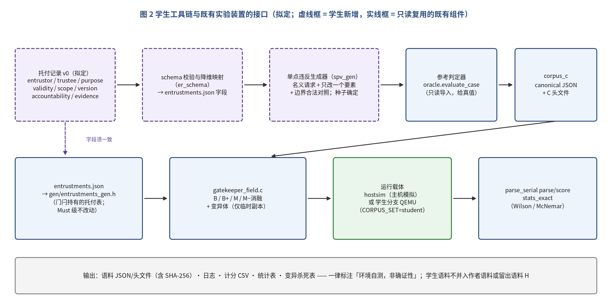
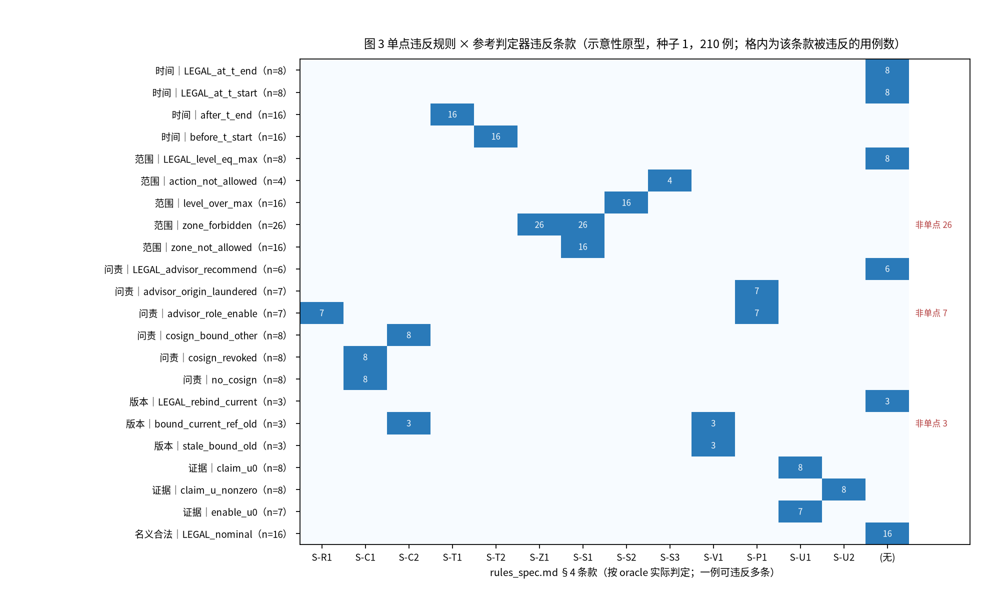
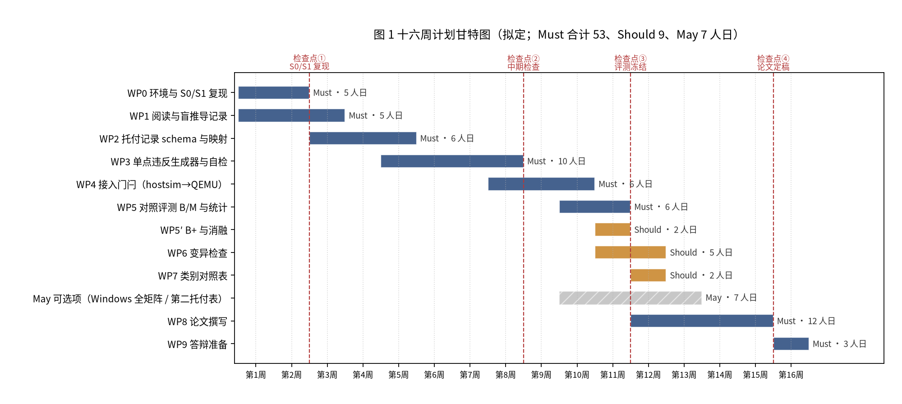

# 托付记录驱动的假使命测试生成与对照评测

> **仓库化说明（v0.1.0）**：本文为项目过程中的历史文档，按原文收录，仅做去个人化处理：作者本机路径已替换为 `<REPO_ROOT>`（= 本仓库克隆目录，内含 `mission-shell/` 与 `microkit-sdk-2.3.1/`）、`<WORKDIR>`（作者文档目录）或仓库内相对路径；形如 `/workspace/...` 的路径是作者沙箱（box）上的历史路径，在本仓库中分别对应 `mission-shell/`（原 `/workspace/microkit-mission-shell/`）与 `docs/`。文中命令含占位符，**不能直接复制执行**；可直接执行的命令见仓库根目录 `README.md` 与 `docs/REPRODUCE.md`。


**——本科毕业设计任务要求与内容说明（指导方案草案 v0.1）**

| 项 | 内容 |
|---|---|
| 文档名称 | 本科毕业设计任务要求与内容说明：托付记录驱动的假使命测试生成与对照评测 |
| 英文题目 | Entrustment-Record-Driven Generation of False-Mission Tests and Their Controlled Evaluation |
| 文档版本 | v0.1（指导方案草案） |
| 日期 | 2026-10-09（Asia/Shanghai） |
| 指导方案拟定人 | 陈鹏（chen peng） |
| 指导教师 | 【待填】 |
| 学生姓名 / 学号 | 【待填】 / 【待填】 |
| 所属课题 | 使命软件工程学（Mission Software Engineering）· 毕设题目 1 / S0→S1 及对照实验延伸 |
| 审阅状态 | **草案**（未经指导教师与院系审定；学校、院系的毕业设计管理规定优先于本文档的任何条款） |
| 证据状态 | 本文引用的全部实验数字均为**环境自测 / 实验管线验证，非确证性**；对照实验语料矩阵的 Windows Docker 复现尚未完成，独立标注人尚未指定，正式留出语料 H 尚未编写 |
| 硬约束 | 非临床 · 仅仿真 · 无出束 / 厂商写使能 · 不宣称 seL4 或 CompCert 级应用证明 · K 层仅引用 · Microkit（MCS 配置）构建 ≠ 已验证内核 · 共签为演示占位 · FNV-1a32 证据链为教学级 · ALLOW_SIM ≠ 达成 |

---

## 目录

- 文档控制与阅读约定
  - 版本记录
  - 标签约定
  - 与题目 1 材料的关系（摘要）
- 1 选题概述
  - 1.1 题目
  - 1.2 选题背景
  - 1.3 与既有工作的关系
  - 1.4 选题理由与备选方案
  - 1.5 创新点与局限
- 2 目标与范围
  - 2.1 总目标
  - 2.2 任务清单
  - 2.3 非目标与硬边界
  - 2.4 与综合报告未决事项的关系
- 3 技术路线
  - 3.1 总体思路
  - 3.2 托付记录 schema 草案
  - 3.3 单点违反矩阵
  - 3.4 输出格式与接口契约
  - 3.5 接入运行：hostsim 与学生分支上的 QEMU
  - 3.6 对照评测与统计
  - 3.7 变异检查
  - 3.8 运行环境与命令
  - 3.9 目录结构（拟定）
  - 3.10 可行性核验（示意性原型）
- 4 进度计划
  - 4.1 工作包与人日估算
  - 4.2 检查点
  - 4.3 风险与应对
- 5 验收标准
- 6 论文撰写要求
  - 6.1 章节模板（建议）
  - 6.2 篇幅与图表
  - 6.3 引用规则
  - 6.4 诚实标签与措辞规范
  - 6.5 学术诚信与 AI 辅助工具使用（占位）
- 7 交付物清单
- 8 评分建议
- 9 指导与过程管理
- 10 先修知识与学习路径
  - 10.1 先修知识
  - 10.2 学习资源与建议顺序
- 11 既有材料之间的不一致及本文的处理
- 附录 A 毕业设计任务书（一页版，拟定）
- 附录 B 逐周计划表（拟定）
- 附录 C 验收核对单
  - C.1 工程与环境
  - C.2 语料与评测
  - C.3 诚实标签（论文与答辩材料逐条核对）
- 附录 D 托付记录 schema 示例（示例，拟定）
- 附录 E 单点违反矩阵（完整，示意性原型种子 1 的实际生成数）
- 附录 F 常见问题
- 附录 G 与综合报告未决事项的映射
- 附录 H 示意性原型说明
- 参考文献

---

## 文档控制与阅读约定

### 版本记录

**表 0-1 版本记录**

| 版本 | 日期 | 修改人 | 修改内容 | 审阅状态 |
|---|---|---|---|---|
| v0.1 | 2026-10-09 | 陈鹏 | 初稿：从综合报告抽取毕业设计工作块，形成任务要求、技术路线、计划、验收、写作要求与附录；附示意性原型的可行性核验结果 | 草案 |
| 【待填】 | 【待填】 | 指导教师 | 审定意见 | 【待填】 |

### 标签约定

本文所有技术事实、数字、命令、路径与规则都应能追溯到课题已有的源文件。为了让读者区分“已有的事实”与“本文新提出的安排”，正文使用三种标注。凡是**取自源文件**的内容，在句中或表注中给出来源，例如“综合报告 §5.4”“`experiment/corpus/gen_corpus.py`”；凡是本文**新拟定**的字段、计划、阈值或流程，标注「拟定」；凡是本文只给出参考意见、最终应由指导教师或学校规定决定的内容，例如评分权重、篇幅，标注「建议」。示意性原型产生的数字一律附带“示意性原型；主机模拟、非 QEMU 实测；非确证性”的说明。

本文所说的“综合报告”指课题内部文档《使命软件工程：一种可证伪的工程方法及其在 seL4 Microkit 使命约束外壳上的实验管线验证——项目与实验综合报告》（v1.0，`/workspace/mission-se-integrated/mission-se-integrated-report.md`）。所说的“实验树”指 `/workspace/microkit-mission-shell/experiment/`，在作者 Windows 主机上对应 `<REPO_ROOT>\mission-shell\experiment\`（综合报告附录 A）。所说的“题目 1 材料”指开题报告 [10]、任务书 `thesis-task-topic1-S0S1.md`、`microkit-PU-BOUNDARY.md` 与答辩演示稿 `defense-topic1-microkit-mission-shell.pptx`。

### 与题目 1 材料的关系（摘要）

本文档在题目 1 材料的基础上细化与延伸，不废止它们。S0 与 S1 在题目 1 材料中是毕业设计的主体工作，而作者已于开题时完成这两期（开题报告 §12；综合报告表 10-1）。因此在本毕业设计中，S0/S1 被**复用**为入门与环境准入环节，不再作为创新工作计分。毕业设计的新工作是托付记录 schema、单点违反生成器、在学生语料上的对照评测与变异检查，这些内容**扩展**了综合报告第 5–7 章的实验装置。题目 1 材料中“对照实验”一词的含义（共签前后、假使命与合法路径的判定差异）由本文的 B/M 对照评测**替代**为更严格的定义，两种含义的区别见第 11 章。

---

## 1 选题概述

### 1.1 题目

**中文题目：** 托付记录驱动的假使命测试生成与对照评测

**英文题目：** Entrustment-Record-Driven Generation of False-Mission Tests and Their Controlled Evaluation

**副标题（可选，拟定）：** 以 seL4 Microkit 使命约束外壳的字段门闩为评测对象

### 1.2 选题背景

综合报告提出的“使命软件工程”把一项被托付的软件工作是否仍在正当进行，表述为一个可以机检的合取式：存在明示的托付，当前动作仍对准该托付，并且对此的检查可以被证伪（综合报告 §3.1）。在这一框架下，“假使命”是指表面合法、实际上已经偏离托付的请求，例如托付已过期、目标区落在禁区、顾问越权使能、引用了已被取代的托付版本，或在显式未覆盖集 U 为空时声称达成（综合报告 §3.4、附录 D）。综合报告第 5–7 章为此搭建了一套对照实验装置：同一语料分别交给只做传统检查的基线门闩 B 和执行使命检查的门闩 M 判决，比较二者的漏检率与误拒率，并用精确统计方法报告（综合报告 §5.3、§5.5）。

这套装置目前有一个被综合报告自己点明的根本局限：规则规格、语料生成器、草稿参考判定器与门闩 M 都出自作者一人，并依据同一份规格编写，因此 M 在作者语料上的全部拦截只能说明“实现忠实于规格”，不能说明“规格捕获了托付”（综合报告 §8.3 内部效度）。作者语料 A 的 9 类假使命 F1–F9 是作者按经验枚举出来的，综合报告 §8.6 的质疑 7 与 §10.2 第 9 项因此提出了“类别重合度检验”：让独立的工程人员从同一托付结构出发自行推导假使命类别，看是否与作者的分类重合。

本毕业设计抽取的正是这一环节中最适合单名本科生在一个学期内完成、又能产出可度量结果的部分：**不按经验枚举假使命，而是从机器可读的托付记录出发，对托付的每个要素（时间、范围、问责、版本、证据）系统地做单点违反，自动派生假使命及其合法对照，再用既有装置对学生语料做 B/M 对照评测，并以变异检查衡量所生成语料对规则缺陷的检出能力。** 背景的详细论述请直接引用综合报告第 1、3、5 章，论文中不必重复。

### 1.3 与既有工作的关系

**表 1-1 本毕业设计对既有工作的复用、扩展与替代**

| 既有工作 | 来源 | 本毕业设计中的处理 | 说明 |
|---|---|---|---|
| S0：sel4test 在 Docker + QEMU 中跑通 | 开题报告 §3.1、§12；综合报告表 10-1 | **复用**（入门准入） | 作者已完成（123 项通过）；学生复现，作为环境准入检查点，不计创新 |
| S1：Microkit 使命约束外壳 `full` 剖面 | 开题报告 §3.1、§12；综合报告 §4.6、附录 A.1 | **复用**（入门准入） | 学生复现 `tip=80488a97`、`len=10` 与 `MISSION_SHELL_DEMO_DONE`；`rc=124` 可接受 |
| 字段门闩 `gatekeeper_field.c` 与 B/B+/M/消融变体 | 综合报告第 6 章 | **复用**（只读，作为评测对象） | Must 级任务不得修改门闩源码；变异检查只作用于临时副本 |
| 托付表 `entrustments.json`（11 条记录） | 综合报告表 5-3 | **扩展** | 学生设计托付记录 schema v0，降维映射回该表的字段；新增字段（托付人、受托人、目的等）不被门闩执行 |
| 语料生成器 `gen_corpus.py`（F1–F9、L1–L5、M1、X1） | 综合报告 §5.4 | **对照**，不替代 | 学生生成器独立于作者的类别清单，从托付要素出发派生；二者的类别对照作为一项分析结果 |
| 参考判定器 `oracle.py` 与规则规格 `rules_spec.md` | 综合报告 §6.3、附录 G | **复用**（只读，作为真值来源） | 学生语料的真值由 `oracle.evaluate_case` 给出；学生不修改规格 |
| 计分与统计脚本 `parse_serial.py`、`stats_exact.py` | 综合报告 §6.3 | **复用** | `analyze.py` 的报告模板面向预注册种子，学生语料宜直接调用 `parse`/`score` 与统计函数 |
| 预注册 `prereg.md`（X-1…X-7 冻结） | 综合报告 §5.7 | **不触及** | 学生语料不是预注册实验的一部分，不得用于判定 X-1…X-7 |
| 题目 1 中“对照实验”（共签前后差异） | 开题报告 §3.2 | **替代**（术语） | 本文的“对照评测”专指 B/M 在同一语料上的配对比较，见第 11 章 |

### 1.4 选题理由与备选方案

综合报告中可以抽出的毕业设计工作块不止一个。除推荐方案外，本文还比较了两个备选方案。

**备选方案 A：跨平台锚定的证据链校验器。** 在既有 FNV-1a32 教学级链（综合报告 §4.5）与篡改轨道 T1–T7（综合报告 §5.6）的基础上，实现一个主机端校验器，把链尾值锚定到外部记录，研究“知道算法者整链重算”（T7）等攻击在何种锚定条件下可被发现。它的工作边界清晰，但其核心问题属于审计日志与密码学工程（参考文献 [44]、[45]），与“托付是否仍被对准”的使命问题关系较远；而且一旦涉及更强的哈希或签名，就必须回答密码学强度问题，而这在本课题中属于显式未覆盖集 U。

**备选方案 B：共签状态机与操作界面。** 为人共签通道（综合报告 §4.3）实现一个 CLI 或图形界面，并对共签的授予、撤销与版本绑定做状态机建模与测试。它最贴近“人在环”的主题，但真正的价值在于人因评估，需要被试与伦理备案（综合报告 §10.2 第 6 项），单名本科生在一个学期内难以完成；如果没有人因评估，它又容易退化为界面开发，而界面上的共签仍然只是演示占位。

**表 1-2 候选毕业设计工作块比较**（工作量为「建议」口径的粗估）

| 维度 | 推荐：托付记录驱动的假使命生成与对照评测 | 备选 A：跨平台锚定的证据链校验器 | 备选 B：共签状态机与 UI/CLI |
|---|---|---|---|
| 与课题核心问题的距离 | 近：直接针对“规格是否捕获托付”的同源局限（§8.3、§8.6 质疑 7） | 中：针对证据层，不涉及托付对准 | 中：针对明示托付，但核心价值在人因 |
| 可度量产出 | 漏检率 / 误拒率、单点纯度、变异杀死率、类别对照表 | 篡改检出率（依赖锚定假设） | 状态机测试覆盖；人因指标需被试 |
| 主要风险 | 自证循环（学生语料的真值仍来自作者 oracle）；工具链环境 | 被迫回答密码学强度问题（属 U） | 人因研究需伦理备案；无被试则价值低 |
| 对既有装置的依赖 | 高，但只读复用即可；Must 级不改门闩 | 中 | 中，需要改动共签协议 |
| 工作量（人日，粗估） | 约 62（Must + Should），见第 4 章 | 约 55–65 | 约 60–75（不含人因研究） |
| 新颖性（诚实评估） | 中：生成方法本身属常规测试设计；新意在于以托付要素为生成轴并接到使命门闩上评测 | 中低：锚定方案已有成熟文献 | 中低：工程实现为主 |
| 单人一学期可行性 | 高（原型已在 box 上跑通，见 §3.10） | 中高 | 中（若含人因研究则低） |
| 硬边界风险 | 低：只生成仿真语料 | 中：易越界到密码学声明 | 中：易被误读为“真签名” |

综合以上比较，本文推荐采用“托付记录驱动的假使命测试生成与对照评测”作为毕业设计题目，理由有四。第一，它直接回应综合报告指出的最根本的效度威胁，即作者语料的类别是否只是作者的手艺。第二，它的每一项产出都可以用既有脚本客观计量，验收标准容易写成通过 / 不通过的形式。第三，它对既有装置只做只读复用，不会污染预注册实验，也不需要学生修改 seL4 或 Microkit 相关代码。第四，指导方案拟定人已在 box 上用一个示意性原型验证了格式兼容、确定性与 hostsim 接入（§3.10），技术风险较低。

### 1.5 创新点与局限

本毕业设计可以诚实主张的贡献是工程性的，主要有三点。第一，把综合报告 MR-1 所要求的“托付作为一等对象，至少记录托付人、范围、动作、有效期与版本”（综合报告 §1.1）落实为一份机器可读的托付记录 schema 草案，并说明其中哪些字段被门闩执行、哪些只用于追溯。第二，提出并实现按托付要素做单点违反的语料派生方法，给出“单点纯度”这一可计量的结构性质，并与作者语料 A 的经验类别 F1–F9 做对照。第三，在学生语料上复用既有装置完成 B/M 对照评测，并用变异检查度量语料对规则缺陷的检出能力。

本毕业设计**不能**主张以下各点，论文中必须写明。其一，学生语料的真值仍由作者的草稿参考判定器给出，因此 M 在学生语料上的表现仍处在自证循环之内，不能作为“方法有效”的证据。其二，学生不是预注册留出语料的独立标注人，除非指导教师另行决定并按综合报告 §10.2 第 4–5 项的程序执行。其三，单点违反属于常规的测试设计思路，本课题的新意只在于生成轴的选择与评测对象，不应夸大为新的测试理论。其四，所有结果均为环境自测，非确证性。

---

## 2 目标与范围

### 2.1 总目标

学生应在约 16 周内完成以下工作：在 Windows + Docker 环境下复现 S0/S1；设计托付记录 schema 草案并实现单点违反语料生成器；把生成的学生语料接入既有门闩，完成 B/M（可选 B+ 与消融）对照评测和统计；可选地完成变异检查；最终撰写一篇如实标注证据强度的毕业论文。

### 2.2 任务清单

**表 2-1 任务清单（Must / Should / May，拟定）**

| 编号 | 级别 | 任务 | 完成标志 |
|---|---|---|---|
| T-M1 | Must | 复现 S0：sel4test 在 Docker + QEMU 中跑通 | 完整日志含 `All is well in the universe` |
| T-M2 | Must | 复现 S1：`DEMO_PROFILE=full` | 完整日志含 `DEMO_PROFILE=full`、`GATE\|CHAIN\|tip=80488a97\|len=10`、`CLIENT\|INFO\|MISSION_SHELL_DEMO_DONE` |
| T-M3 | Must | 阅读与盲推导：在阅读作者类别表之前，先独立写下从托付要素推导出的假使命类别，封存备查 | 封存记录带日期，经指导教师确认 |
| T-M4 | Must | 托付记录 schema v0 设计、结构校验器与降维映射 | 映射结果与 `entrustments.json` 的 11 条记录逐字段一致；校验器单元测试通过 |
| T-M5 | Must | 单点违反生成器：五要素单点违反 + 合法对照，输出 `mission-se-corpus/v1` JSON 与 C 头文件 | 同一种子逐字节相同；全部用例可被 `oracle.evaluate_case` 回放；意图条款与 oracle 首条款一致 |
| T-M6 | Must | 接入门闩：先 hostsim，后在学生分支上用 QEMU 运行 | INVALID = 0；hostsim 与 QEMU 的 `CASE\|` 行一致 |
| T-M7 | Must | B/M 对照评测与精确统计 | 漏检率、误拒率及区间，精确 McNemar，按要素分解；可由脚本一键重算 |
| T-M8 | Must | 毕业论文与答辩 | 按第 6 章要求完成 |
| T-S1 | Should | B+ 与四个消融条件 | 结果表与第 7.5–7.6 节作者结果并列对照（只作描述性比较） |
| T-S2 | Should | 变异检查：对门闩副本注入规则缺陷，统计判决层与理由码层的杀死情况 | 变异算子表、杀死表、等价变异分析 |
| T-S3 | Should | 类别对照表：学生推导的类别与 F1–F9 的对应 | 对照表与差异讨论 |
| T-Y1 | May | 在 Windows Docker 上运行学生语料的完整矩阵 | 与 box 或 hostsim 结果逐字节比对 |
| T-Y2 | May | 第二份托付表：在学生分支上自建托付表并重新生成门闩头文件 | 新表通过 `entrustments_header` 的断言；评测结果单列 |

### 2.3 非目标与硬边界

下列边界是硬约束，任何一项被突破，相应的工作都不计入成绩，并须在论文中如实说明。

1. **非临床。** 本课题的一切用例、区号与强度都是没有物理含义的仿真字段（综合报告 §5.4）；论文不得出现任何临床有效性、治疗安全性或注册申报方面的主张。
2. **无出束、无厂商写使能。** 任何代码、配置与文档都不得触及真实设备的写使能或出束通路。
3. **不宣称 seL4 / CompCert 级应用证明。** 本课题不做形式化证明；论文不得把门闩、生成器或评测结果称为“经形式化验证”。
4. **K 层仅引用。** seL4 与 Microkit 作为底座只被引用。按 Microkit 用户手册（v2.3.1）[11]，Microkit 总是使用 seL4 的 MCS 配置，而该配置仍在验证之中（计划 2026 年完成 RISC-V、2027 年完成 AArch64）；本案例运行于 AArch64，因此 **Microkit（MCS 配置）构建不等于已验证内核**（综合报告 §1.3、§3.5）。
5. **共签是演示占位。** `GRANT`/`REVOKE` 只是显式报文，没有身份认证或电子签名（综合报告 §4.3）。
6. **FNV-1a32 是教学级。** 证据链只演示顺序完整性，不作抗碰撞或密码学声明（综合报告 §4.5）。
7. **ALLOW_SIM 不等于达成。** M 的唯一放行形态是 ALLOW_SIM，含义是“仿真中允许继续”，不是使命完成（综合报告 §3.2）。
8. **不触及预注册实验。** 学生不得修改实验树中的 `prereg.md`、`SHA256SUMS`、`entrustments.json`、`rules_spec.md`、`oracle.py` 与门闩源码；学生语料不得并入作者语料 A 或留出语料，也不得用于判定 X-1…X-7。
9. **学生不是独立标注人。** 除非指导教师另行决定并按综合报告 §10.2 第 4–5 项执行，学生不担任预注册留出语料 H 的独立标注人。原因很直接：本毕业设计要求学生阅读 `rules_spec.md`、`oracle.py` 与门闩源码，这与“不看门闩源码独立重写 oracle”的独立性要求相冲突（实验 README §6；综合报告 §10.2）。

### 2.4 与综合报告未决事项的关系

本毕业设计与综合报告的若干未决事项相关，但不能替代其中任何一项。与类别重合度检验（综合报告 §10.2 第 9 项、S1-E5）的关系最近：该检验要求两名独立工程人员从同一托付结构出发分别推导假使命类别。学生按 T-M3 所做的盲推导，可以作为这一检验的**预备材料或试点**，但只有一名推导者，而且学生事先读过综合报告的方法章节，所以不满足该检验的独立性与人数要求。论文只能把它报告为“单人试点、非独立”。

与正式留出语料 H（综合报告 §10.2 第 5 项、S1-E2）的关系是：学生语料的格式与留出语料相同（`mission-se-corpus/v1`），但用途完全不同。留出语料必须由独立标注人仅依据核心合取式与非目标清单编写、只运行一次；学生语料由生成器机械派生、真值来自作者 oracle，二者不得互换，也不得合并统计。附录 G 给出完整映射。

---

## 3 技术路线

### 3.1 总体思路

本毕业设计的工具链由三个学生新增组件和若干只读复用的既有组件组成（图 2）。学生先设计一份比实验托付表更完整的托付记录 schema，用一个校验与映射程序把它降维成实验托付表的字段；再由单点违反生成器以每条当前有效的托付记录为锚，构造一个对该记录合法的名义请求，然后每次只改动一个托付要素，得到一条假使命，同时生成边界上的合法对照。每条用例的真值不由生成器自己声明，而是交给实验树中的参考判定器 `oracle.evaluate_case` 回放得到；生成器声明的“意图条款”只用于自检。最后用 `corpus_c` 把语料写成规范化 JSON 和 C 头文件，接到既有门闩上运行，并用既有的计分与统计脚本得到结果。



*图 2 学生工具链与既有实验装置的接口（拟定）*

这一路线有一个必须事先讲清的性质：由于真值来自作者的 oracle，而门闩 M 与 oracle 依据同一份规格编写，**M 在学生语料上漏检为 0、误拒为 0 几乎是可以预见的**（示意性原型的结果也是如此，见 §3.10）。因此，本毕业设计的信息量不在于“M 是否全拦”，而在于以下几类量：B 与 B+ 在各托付要素上漏检的分布，消融条件的漏检模式是否与预测一致，生成语料的单点纯度，以及变异检查中语料对规则缺陷的检出能力。论文的研究问题应当围绕这些量来写（§6.1）。

### 3.2 托付记录 schema 草案

实验托付表 `entrustments.json`（schema `mission-se-entrustments/v1`）的每条记录只含门闩执行判定所需的九个字段：`id`、`ver`、`t_start`、`t_end`、`allowed_zones`、`forbidden_zones`、`sim_level_max`、`allowed_actions` 与 `superseded`（综合报告表 5-3；`proto_fields.h` 中的 `entrustment_t`）。综合报告 MR-1 要求托付记录“至少记录托付人、范围、动作、有效期与版本”，其中“托付人”在实验托付表中并无对应字段。学生应设计一份 schema 草案，把托付作为一等对象完整记录下来，同时明确区分被门闩执行的字段与只用于追溯的字段。表 3-1 给出一份「拟定」的字段方案，学生可以修改，但修改须在论文中说明理由。

**表 3-1 托付记录 schema v0 字段草案（拟定）及其与既有工件的对应**

| 要素 | v0 字段（拟定） | 映射到 `entrustments.json` | `entrustment_t`（`proto_fields.h`） | 门闩检查（`gatekeeper_field.c`） | 是否被门闩执行 |
|---|---|---|---|---|---|
| 标识 | `id` | `id` | `uint16_t id` | `ent_lookup`；B-3 只查编号存在 | 是 |
| 版本 | `version.ver` | `ver` | `uint16_t ver` | `ent_lookup(id, ver)`；不存在则 `unknown_entrustment_version` | 是 |
| 版本 | `version.superseded` | `superseded` | `uint8_t superseded` | M-5 `stale_entrustment_version` | 是 |
| 版本 | `version.supersedes` | 无 | 无 | 无 | 否（追溯用） |
| 时间 | `validity.t_start`、`validity.t_end` | `t_start`、`t_end` | `uint32_t t_start, t_end`（闭区间） | M-2 `expired_entrustment` / `entrustment_not_yet_valid` | 是 |
| 时间 | `validity.clock`（取值 `logical`） | 无 | 无 | 逻辑时钟由 `CLOCK` 步设定 | 否（说明性） |
| 范围 | `scope.allowed_zones` | `allowed_zones` | `uint16_t allowed_zones`（位掩码） | M-4 `scope_drift_zone` | 是 |
| 范围 | `scope.forbidden_zones` | `forbidden_zones` | `uint16_t forbidden_zones`（优先于 allowed） | M-3 `forbidden_zone` | 是 |
| 范围 | `scope.sim_level_max` | `sim_level_max` | `uint16_t sim_level_max` | M-4 `scope_drift_level` | 是 |
| 范围 | `scope.allowed_actions` | `allowed_actions` | `uint8_t allowed_actions`（bit(action)） | M-4 `scope_drift_action`（CLAIM_ACHIEVE 除外） | 是 |
| 问责 | `entrustor`（托付人） | 无 | 无 | 无 | 否（MR-1 要求记录，门闩不验证身份） |
| 问责 | `trustee`（受托人） | 无 | 无 | 无 | 否 |
| 问责 | `accountability.cosign_required`、`cosign_binds` | 无（全局规则） | 无 | M-1 `no_human_cosign` / `cosign_binding_mismatch` | 是，但作为全局规则，不按记录配置 |
| 问责 | `accountability.enable_requires_role`、`enable_requires_origin` | 无（全局规则） | 无 | B-4 `role_forbidden`；M-6 `advisor_cannot_enable` | 是，但作为全局规则 |
| 证据 | `evidence.u_decl_required_nonempty_for`、`claim_achieve` | 无（全局规则） | 无 | M-7 `empty_U_no_achieve_tag` / `achievement_not_claimable` | 是，但作为全局规则 |
| 目的 | `purpose`（自然语言） | 无 | 无 | 无 | 否（进入 U） |

表中“全局规则”一栏值得在论文中专门讨论。在实验装置中，共签绑定、使能来源与 U 非空这三类约束对所有托付一律适用，并不随记录变化；把它们写进记录，是为了让每份托付都显式声明自己依赖哪些全局约束，而校验器应当拒绝与全局规则矛盾的取值（例如把使能来源写成 `ADVISOR`）。附录 D 给出示例记录，以及它与实验托付表的逐字段对应和差异。

schema 校验器应至少检查以下各项（拟定）：`(id, ver)` 不重复；`t_start ≤ t_end`；区号位于 0…15；`allowed_zones` 与 `forbidden_zones` 不相交；`allowed_actions` 不含 `CLAIM_ACHIEVE`（交付 ≠ 达成）；使能来源必须为 `OPERATOR`。其中“不相交”一条比门闩的语义更严：门闩规定禁区优先于允许区（`proto_fields.h` 注释），所以二者相交并不会造成错判，但会使“禁区”类违反与“允许区”类违反无法区分，因此 schema 层面要求显式不相交。降维映射还须满足 `corpus_c.entrustments_header` 的两条断言：站点运行窗等于全表 `[min t_start, max t_end]`，站点禁区被每条记录禁止。

### 3.3 单点违反矩阵

单点违反的含义是：以一条名义合法的请求为起点，只改变一个托付要素的取值，使请求恰好在这一要素上偏离托付。表 3-2 给出五个要素下的违反规则、期望违反的 `rules_spec.md` §4 条款，以及它们在作者语料 A 中最接近的类别。

**表 3-2 单点违反矩阵（拟定；条款与理由码取自 `oracle/rules_spec.md` §4）**

| 要素 | 违反规则（拟定名） | 构造方法 | 期望首条款 / 理由码 | 合法对照 | 作者语料 A 中最接近的类别 |
|---|---|---|---|---|---|
| 时间 | `after_t_end` | `now = t_end + d`，`d ≥ 1` | S-T1 `expired_entrustment` | `now = t_end` | F1 |
| 时间 | `before_t_start` | `now = t_start − d` | S-T2 `entrustment_not_yet_valid` | `now = t_start` | F2 |
| 范围 | `zone_forbidden` | 目标区取记录禁区 | S-Z1 `forbidden_zone` | — | F3 |
| 范围 | `zone_not_allowed` | 目标区既非允许区也非禁区 | S-S1 `scope_drift_zone` | — | F7（zone） |
| 范围 | `level_over_max` | `level = sim_level_max + k` | S-S2 `scope_drift_level` | `level = sim_level_max` | F7（level） |
| 范围 | `action_not_allowed` | 可托付动作不在 `allowed_actions` 中 | S-S3 `scope_drift_action` | — | F7（action） |
| 问责 | `advisor_role_enable` | 顾问角色发起使能 | S-R1 `role_forbidden` | — | F4 |
| 问责 | `advisor_origin_laundered` | 操作员角色转述顾问来源的使能 | S-P1 `advisor_cannot_enable` | 顾问发起 RECOMMEND | F5 |
| 问责 | `no_cosign` | 不做 GRANT | S-C1 `no_human_cosign` | — | F9（never_granted） |
| 问责 | `cosign_revoked` | GRANT 后 REVOKE | S-C1 `no_human_cosign` | — | F9（after_revoke） |
| 问责 | `cosign_bound_other` | 共签绑定到另一托付 | S-C2 `cosign_binding_mismatch` | — | F9（bound_other） |
| 版本 | `stale_bound_old` | 共签与请求都指向已被取代的版本 | S-V1 `stale_entrustment_version` | 撤销旧版、共签新版后请求新版 | F8（stale_bound） |
| 版本 | `bound_current_ref_old` | 共签新版，请求引用旧版 | S-C2 `cosign_binding_mismatch` | 同上 | F8（bound_current） |
| 证据 | `enable_u0` | 使能且 `u_decl = 0` | S-U1 `empty_U_no_achieve_tag` | — | F6（enable_u0） |
| 证据 | `claim_u0` | 声称达成且 `u_decl = 0` | S-U1 `empty_U_no_achieve_tag` | — | F6（claim_u0） |
| 证据 | `claim_u_nonzero` | 声称达成且 `u_decl ≠ 0` | S-U2 `achievement_not_claimable` | — | F6（claim_u_nonzero） |
| （名义） | `LEGAL_nominal` | 对记录完全合法的请求 | 无（MAY_PERMIT） | — | L1 等 |

单点违反并不保证只违反一条规格条款。原因在于规格条款之间存在结构性的依赖：禁区不在允许区内，所以“目标区落入禁区”必然同时违反 S-Z1 与 S-S1；顾问角色发起的使能，若来源字段也是顾问，就同时违反 S-R1 与 S-P1；共签新版而请求旧版，既违反 S-C2 又违反 S-V1。本文把“目标请求恰好违反一条条款”定义为**单点纯度**（拟定），作为生成语料的一个可计量的结构性质。纯度不足不是错误，但必须报告，因为它决定了按理由码归因时的可解释性。图 3 展示了示意性原型在一个种子上的实际结果。



*图 3 单点违反规则 × 参考判定器违反条款（示意性原型，种子 1，210 例；主机模拟口径的生成结果，非确证性）*

### 3.4 输出格式与接口契约

学生生成器的输出必须与作者生成器 `gen_corpus.py` 的输出在格式上兼容，这样才能直接复用 `corpus_c`、`client_corpus.c`、门闩与计分脚本。以下契约取自源文件，凡标「拟定」者为本文新增要求。

1. **顶层文档。** `schema` 取 `"mission-se-corpus/v1"`；须含 `corpus_id`、`corpus_set`、`generator`、`entrustments_sha256`、`draft_notice` 与 `cases`；种子语料另含 `seed`（`gen_corpus.py`）。作者生成器另有 `plan` 与 `redraws` 两个键，下游计分脚本并不读取，学生可以省略。学生语料的 `corpus_set` 不得取 `author_A` 或 `holdout_draft`（拟定），建议取 `student_spv`。
2. **用例。** 每条用例至少含 `case_id`（整数）、`name`、`category`、`subtype`、`steps`、`gt`、`oracle_clause`、`oracle_reason` 与 `oracle_all_clauses`，因为 `parse_serial.py score` 读取这些键；可选的 `spec_gap` 缺省按假处理。学生可以增加 `element`、`intended_clause`、`single_point_pure` 等键（拟定），下游脚本会忽略它们。
3. **步骤序列。** 每条用例以 `RESET` 与 `CLOCK{now}` 开始，随后是若干前置步骤，最后恰好一个 `kind = "target"` 的 `EVAL`；`GRANT`、`REVOKE` 携带 `ent` 与 `ver`，`REVOKE(0, 0)` 表示撤销全部绑定（`gen_corpus.py`；`oracle.py` 中的 `CaseState.apply`）。`EVAL` 的字段为 `action`、`role`、`origin`、`ent`、`ver`、`zone`、`level`、`nonce`、`u`，其取值范围见 `proto_fields.h`：区 0…15、强度 0…1000、`nonce` 非零、`u` 只用低 8 位、`ent_ver ≥ 1`。
4. **容量。** 门闩的 nonce 历史容量为 32、共签绑定容量为 4（`gatekeeper_field.c` 中的 `NONCE_CAP 32u`、`BIND_CAP 4u`；oracle 的 `CaseState.CAPACITY = 4`，超出时记为 spec_gap）。生成器应保证每条用例不超过这两项容量（拟定）。
5. **用例编号。** 作者语料的 `case_id` 为 1…N，留出语料从 9001 起（实验 README §5）；学生语料建议从 5001 起（拟定），以免在合并日志或误用时发生混淆。
6. **规范化与哈希。** JSON 用 `corpus_c.canonical_json_bytes` 序列化（排序键、`indent=1`、ASCII 转义、结尾换行），SHA-256 基于这一字节串计算；头文件用 `corpus_c.corpus_header(doc, json_sha)` 生成。头文件只携带请求字段，不携带类别、真值或理由码。一个小的已知瑕疵是：头文件首行注释把生成器路径写成 `experiment/corpus/<generator>`，学生语料的这一行注释因此不反映真实路径，应在论文中注明，或在学生分支中修改注释格式（不影响判决）。
7. **托付表一致性。** 门闩持有的托付表是由 `entrustments.json` 生成的 `gen/entrustments_gen.h`，并通过源码中的 `#include "gen/entrustments_gen.h"` 引入。学生生成器计算真值所用的托付表必须与门闩编译所用的托付表完全相同，并把其 SHA-256 写入 `entrustments_sha256`。Must 级任务一律使用实验托付表本身；自建托付表属于 May 级任务 T-Y2，必须在学生分支中重新生成门闩头文件。
8. **确定性。** 生成器只能使用以种子初始化的 `random.Random(seed)`，不得依赖系统时间、字典的非确定顺序或文件系统遍历顺序；同一种子两次生成的 JSON 与头文件必须逐字节相同（与 `gen_corpus.py` 的要求一致，综合报告 §5.4）。

### 3.5 接入运行：hostsim 与学生分支上的 QEMU

接入分两步。第一步用主机模拟 hostsim：它用本机 gcc 把 `gatekeeper_field.c`、`client_corpus.c` 与 `hostsim/hostsim.c` 链接进同一个进程，输出与 QEMU 串口格式相同的日志行，不需要交叉编译器、SDK 或 QEMU（`experiment/hostsim/run_hostsim.sh`）。实验 README 记载，hostsim 在 18 个（条件，语料）组合上与 QEMU 日志逐字节一致；但其数字仍必须标注“主机模拟、非 QEMU 实测”。由于 `run_hostsim.sh` 把种子语料与草稿留出语料的路径写在脚本里，学生应仿照其编译方式另写一个脚本，把学生语料头文件复制为临时目录中的 `corpus_active.h` 后编译运行，而不要修改实验树中的脚本。

第二步在 QEMU 中运行。这里存在一个必须处理的约束：实验树的 `Makefile` 只接受 `CORPUS_SET=seed` 或 `holdout_draft`，其他取值直接报错；`docker_corpus_run.sh` 则把非 `seed` 的取值一律当作 `holdout_draft`，并在构建前按 `experiment/corpus/out/SHA256SUMS` 校验语料哈希，不一致即以 `RUN|ERROR|corpus_hash_mismatch` 退出。因此，学生必须在**自己的分支或副本**上增加一个 `CORPUS_SET=student` 分支，并为学生语料维护独立的哈希清单（拟定，例如 `student/out/SHA256SUMS`），而不能改动作者的冻结清单。这些改动记入学生自己的变更记录，不写入作者的 `deviations.md`，因为它们不属于预注册实验。改动之后须做回归检查：原 `full` 剖面仍得 `GATE|CHAIN|tip=80488a97|len=10`，作者种子语料在学生分支上的 `CASE|` 行与作者 box-qemu 日志逐字节一致（参照综合报告 §6.4 的回归门禁）。

### 3.6 对照评测与统计

对照评测沿用综合报告第 5 章的条件定义与指标口径，但只作描述性与探索性报告。条件至少包括 B 与 M，Should 级任务另加 B+ 与 M−cosign、M−align、M−prov、M−U 四个消融（综合报告 §5.3）。主要指标是 MUST_DENY 用例上的漏检率 FNR 与 MAY_PERMIT 用例上的误拒率 FPR，区间用 `stats_exact.py` 中的 Wilson 与 Clopper–Pearson 方法；B 与 M 在 MUST_DENY 用例上的配对差异用精确 McNemar 检验（`mcnemar_exact(b, c)` 返回双侧与单侧 p 值）；误拒的非劣效比较沿用 Δ = 5 个百分点的口径（综合报告 §5.5、§7.4）。INVALID 运行必须单列，不得计作 DENY（综合报告 §5.5 要求无效率为 0，§8.3 说明 INVALID 单列的理由）。

计分建议直接调用 `parse_serial.py parse` 与 `parse_serial.py score`，前者在日志缺少 `CORPUS_DONE`、客户端回执与门闩判决不一致或用例缺失时判定 INVALID（退出码 2），后者按 `gt` 输出 TP/FN/FP/TN。`analyze.py` 的报告模板是为预注册种子与草稿留出语料编写的，按 `<runs-dir>/<condition>/<corpus>/r<k>.log` 的布局读取，并引用 `prereg.md` 中的阈值；学生若使用它，必须确认其输出中关于 X-1…X-7 的段落不被误读为对学生语料的判定。更稳妥的做法是另写一个汇总脚本（拟定），只导入统计函数。

论文中的统计表述必须包含三点说明：其一，学生语料由生成器按同一份规格机械派生，p 值只说明“在本生成器定义的用例总体上”差异稳定，不是方法有效性的证据（同综合报告 §7.3 的提醒）；其二，同一规则派生的用例共享违反条款，存在聚类，变体层的 p 值会夸大证据强度；其三，全部结果属于环境自测，非确证性。

### 3.7 变异检查

变异检查回答的问题是：如果门闩的某条规则实现有缺陷，学生语料能否把它暴露出来。做法是把 `gatekeeper_field.c` 复制到临时目录，用简单的文本替换注入一个缺陷，以 M 变体编译运行，再把判决与未变异的 M 逐例比较。只要有一条用例的判决不同，就称该变异体在**判决层被杀死**；只要有一条用例的理由码不同，就称其在**理由码层被杀死**。变异检查是成熟的测试充分性评估技术（[T1]），在访问控制策略测试中也有直接先例（[T2]）；本课题只把它当作度量生成语料的工具，不主张方法上的新意。

**表 3-3 建议的变异算子（拟定；替换只作用于临时副本）**

| 变异体 | 替换内容（`gatekeeper_field.c`） | 预期由哪类用例杀死 |
|---|---|---|
| `t_end_open` | `logical_now > e->t_end` → `>=` | `LEGAL_at_t_end`（闭区间端点） |
| `t_start_open` | `logical_now < e->t_start` → `<=` | `LEGAL_at_t_start` |
| `level_ge` | `q->level > e->sim_level_max` → `>=` | `LEGAL_level_eq_max` |
| `no_forbidden` | 删去 M-3 禁区检查 | 判决层预计杀不死（见下文），理由码层可杀死 |
| `no_superseded` | 删去 M-5 版本陈旧检查 | `stale_bound_old` |
| `no_binding` | 删去 M-1 绑定一致检查 | `cosign_bound_other` |
| `no_origin` | 删去 M-6 来源检查 | `advisor_origin_laundered` |
| `enable_u_skip` | 删去 ENABLE_SIM 的 U 非空检查 | `enable_u0` |
| `action_scope` | 删去 M-4 动作范围检查 | `action_not_allowed` |

`no_forbidden` 是一个有教学价值的例子。由于托付表中禁区与允许区不相交，删去禁区检查之后，落入禁区的请求会被随后的允许区检查以 `scope_drift_zone` 拒绝，判决不变，只是理由码改变。这样的变异体在判决层是“等价变异体”，只有理由码层的比较才能把它区分出来。它同时说明，门闩中的禁区检查在当前托付表下对判决是冗余的，其作用在于给出更准确的拒绝理由。学生应在论文中分别报告判决层与理由码层的杀死率，并对每个未被杀死的变异体说明它是语料不足还是等价变异。

### 3.8 运行环境与命令

学生的主要环境为 Windows 笔记本加 Docker，镜像为 `trustworthysystems/sel4:latest`；目标板为 `qemu_virt_aarch64`，Microkit SDK 2.3.1，配置 `debug`（`docker_corpus_run.sh`）。SDK 路径须与脚本一致：`docker_build_run.sh` 写死 `SDK=/work/microkit-sdk-2.3.1`，即与 `microkit_work` 挂载根并列（生命周期文档包 `GAPS.md` 第 2 条）。S1 验收与语料运行的命令取自综合报告附录 A，在 Windows `cmd` 中执行：

```bat
docker run --rm -e DEMO_PROFILE=full -v <REPO_ROOT>:/work -w /work/mission-shell trustworthysystems/sel4:latest bash /work/mission-shell/docker_build_run.sh

docker run --rm -e DEMO_PROFILE=mission_corpus -e CORPUS_SEED=20261007 -e QEMU_TIMEOUT=120 -v <REPO_ROOT>:/work -w /work/mission-shell trustworthysystems/sel4:latest bash /work/mission-shell/docker_corpus_run.sh > experiment\runs\docker\M_20261007_r1.log
```

`DEMO_PROFILE` 可取 `baseline_corpus | baselineplus_corpus | mission_corpus`，消融加 `-e ABLATE=cosign|align|prov|U`（综合报告附录 A.3）。学生机器上的挂载路径可以不同于作者的 `<REPO_ROOT>`，但必须使用正斜杠形式（生命周期文档包发布手册 §4）。Linux 或 box 上的主机模拟与单元测试命令为：

```bash
bash experiment/hostsim/run_hostsim.sh          # 主机模拟、非 QEMU 实测
python3 experiment/tests/run_unit_tests.py      # 28 例 × 3 条件
PYTHONDONTWRITEBYTECODE=1 python3 experiment/corpus/gen_corpus.py --check
```

S0 的 sel4test 步骤在课题源文件中没有展开（`GAPS.md` 第 5 条），学生应按 seL4 官方文档的 sel4test 页面与 Docker 页面操作（§10.2 列出链接）；官方文档写明，运行结束时出现 `All is well in the universe` 表示成功。

### 3.9 目录结构（拟定）

学生仓库建议采用以下结构。实验树以只读方式引用（例如作为 git 子模块或只读副本），学生代码不得写入其中。

```text
student-spv/
├── README.md                 # 复现步骤；所有数字的证据口径
├── schema/
│   ├── entrustment-record-v0.schema.json   # 结构定义（JSON Schema 或等价描述）
│   ├── records.example.json               # 示例记录
│   └── er_schema.py                       # 校验与降维映射
├── gen/
│   ├── spv_gen.py                         # 单点违反生成器
│   └── rules.md                           # 违反规则与意图条款表
├── out/                                   # 生成的语料 JSON/.h 与 SHA256SUMS（学生自己的清单）
├── run/
│   ├── run_hostsim_student.sh             # hostsim 接入
│   └── patches/                           # 学生分支对 Makefile / docker_corpus_run.sh 的改动
├── mutate/                                # 变异算子与运行脚本（只作用于临时副本）
├── analysis/                              # 汇总脚本（导入 stats_exact）
├── tests/                                 # 单元测试
├── runs/  reports/                        # 日志与结果（标注环境口径）
├── CHANGES.md                             # 学生变更记录
└── thesis/                                # 论文源文件
```

### 3.10 可行性核验（示意性原型）

为了确认上述路线可行，指导方案拟定人在 box 上编写了一个最小原型，放在 `thesis/prototype/`（作者沙箱原路径 `/workspace/mission-se-thesis/prototype/`）。它**只是示意**，不属于实验树，不参与预注册实验，其数字只是可行性自测。原型只读导入实验树的 `corpus_c`、`oracle` 与 `stats_exact`，按 hostsim 的方式编译实验树中的门闩与客户端源码，变异只作用于临时副本，运行时禁止写入 `__pycache__`；运行前后实验树中的文件没有变化，`gen_corpus.py --check` 仍然通过。核验结果如下。

1. **schema 映射。** 示例记录共 11 条，经 `er_schema.py` 校验无错误，降维映射的结果与 `entrustments.json` 的 11 条记录逐字段相同。
2. **格式兼容。** 生成器输出 210 条用例（种子 1），JSON 与头文件分别由 `corpus_c.canonical_json_bytes` 与 `corpus_c.corpus_header` 写出；头文件在 `-Wall -Werror` 下与 `proto_fields.h`、`client_corpus.c` 一起编译通过。
3. **真值与自检。** 全部用例都能被 `oracle.evaluate_case` 回放；生成器声明的意图条款与 oracle 首条款的不一致数为 0；有 36 条用例违反不止一条条款，分布为 `zone_forbidden` 26 条（S-Z1 + S-S1）、`advisor_role_enable` 7 条（S-R1 + S-P1）、`bound_current_ref_old` 3 条（S-C2 + S-V1），均属 §3.3 所说的结构性非单点。
4. **确定性。** 种子 1 与种子 2 各自两次生成的 JSON 与头文件逐字节相同（种子 1 的 JSON SHA-256 为 `cf7175631d5615a32b2f946da9f1f6672bfd3dd3f44e3aca82c1c2deb5e49839`）。
5. **接入与计分。** B、B+、M、四个消融与九个变异体在 hostsim 下全部运行完毕，`parse_serial.py parse` 未判任何 INVALID。

**表 3-4 示意性原型的评测结果**（种子 1，210 例，其中 MUST_DENY 161、MAY_PERMIT 49；示意性原型；主机模拟、非 QEMU 实测；作者自建语料，非独立，非确证性）

| 条件 | 漏检 FN | FNR [Wilson 95%] | 误拒 FP | FPR [Wilson 95%] | INVALID |
|---|---|---|---|---|---|
| B | 154 | 95.7% [91.3, 97.9] | 0 | 0.0% [0.0, 7.3] | 0 |
| B+ | 132 | 82.0% [75.3, 87.2] | 0 | 0.0% [0.0, 7.3] | 0 |
| M | 0 | 0.0% [0.0, 2.3] | 0 | 0.0% [0.0, 7.3] | 0 |
| M−cosign | 24 | 14.9% [10.2, 21.2] | 0 | 0.0% [0.0, 7.3] | 0 |
| M−align | 97 | 60.2% [52.5, 67.5] | 0 | 0.0% [0.0, 7.3] | 0 |
| M−prov | 7 | 4.3% [2.1, 8.7] | 0 | 0.0% [0.0, 7.3] | 0 |
| M−U | 23 | 14.3% [9.7, 20.5] | 0 | 0.0% [0.0, 7.3] | 0 |

B 在 161 条 MUST_DENY 用例中只拦下 7 条，即 `advisor_role_enable`，由 B-4 角色 ACL 拒绝；其余全部漏检。这与作者语料上 B 的 80.0% 漏检（综合报告表 7-3）方向一致但数值不同，原因在于学生语料不含 M1 畸形输入与 X1 重放这两类 B 能拦的“基线公平性”用例。两个数字分别来自不同的生成器，不应合并比较。B 与 M 在 MUST_DENY 用例上的不一致对为 154 比 0，精确 McNemar 双侧 p 约为 8.8 × 10⁻⁴⁷；这一数字只说明生成器定义的总体上差异稳定，不说明方法有效（§3.6）。

**表 3-5 示意性原型的变异检查结果**（相对未变异 M；示意性原型；主机模拟、非 QEMU 实测）

| 变异体 | 判决层杀死（用例数） | 理由码层杀死（用例数） | 判决层的杀死用例 |
|---|---|---|---|
| `t_end_open` | 是（8） | 是（8） | `LEGAL_at_t_end` |
| `t_start_open` | 是（8） | 是（9） | `LEGAL_at_t_start` |
| `level_ge` | 是（8） | 是（8） | `LEGAL_level_eq_max` |
| `no_forbidden` | **否（0）** | 是（26） | — |
| `no_superseded` | 是（3） | 是（3） | `stale_bound_old` |
| `no_binding` | 是（8） | 是（11） | `cosign_bound_other` |
| `no_origin` | 是（7） | 是（7） | `advisor_origin_laundered` |
| `enable_u_skip` | 是（7） | 是（7） | `enable_u0` |
| `action_scope` | 是（4） | 是（4） | `action_not_allowed` |

九个变异体中有八个在判决层被杀死，九个全部在理由码层被杀死；`no_forbidden` 在判决层等价，原因见 §3.7。三个边界变异体（`t_end_open`、`t_start_open`、`level_ge`）只能被合法对照用例杀死，这说明生成边界合法对照不是可有可无的点缀，而是语料检出能力的必要组成部分。原型核验的结论是：学生路线在格式、确定性、接入与计分各环节上都可行，主要工作量在于 schema 的论证、生成规则的系统化、学生分支上的 QEMU 接入以及论文中对证据强度的如实表述。原型的复跑命令见附录 H。是否把原型提供给学生，由指导教师决定；若提供，学生的新增工作须在原型之外另行说明，评分不计原型已实现的部分。

---

## 4 进度计划

### 4.1 工作包与人日估算

表 4-1 把全部工作分解为十个工作包，并给出人日估算。估算基于一个「拟定」假设：学生在毕业设计学期内每周可投入约 4 个有效工作日，16 周共约 64 人日。按此估算，Must 级工作合计 53 人日，Must 与 Should 合计 62 人日，余量约 2 人日；May 级的 7 人日只能在进度提前时启用。换言之，16 周计划在只做 Must 与 Should 的前提下是可行的，但余量很薄，任何一个检查点延误超过一周，都应先裁剪 May 级任务，再裁剪 Should 级任务中的 T-S3、T-S1，最后才考虑压缩 T-S2。

**表 4-1 工作包、人日估算与依赖（拟定）**

| 工作包 | 内容 | 对应任务 | 级别 | 人日 | 周次 | 前置依赖 |
|---|---|---|---|---|---|---|
| WP0 | 环境搭建，S0/S1 复现 | T-M1、T-M2 | Must | 5 | 1–2 | 无 |
| WP1 | 阅读综合报告第 1、3、5–7 章与规则规格；盲推导记录 | T-M3 | Must | 5 | 1–3 | 无（盲推导须在阅读附录 D 与 `gen_corpus.py` 之前完成） |
| WP2 | 托付记录 schema v0、校验器、降维映射与单元测试 | T-M4 | Must | 6 | 3–5 | WP1 |
| WP3 | 单点违反生成器、确定性、自检与单元测试 | T-M5 | Must | 10 | 5–8 | WP2 |
| WP4 | hostsim 接入；学生分支 QEMU 接入与回归检查 | T-M6 | Must | 6 | 8–10 | WP0、WP3 |
| WP5 | B/M 对照评测、统计与结果表 | T-M7 | Must | 6 | 10–11 | WP4 |
| WP5′ | B+ 与四个消融 | T-S1 | Should | 2 | 11 | WP5 |
| WP6 | 变异检查 | T-S2 | Should | 5 | 11–12 | WP4 |
| WP7 | 学生类别与 F1–F9 的对照表 | T-S3 | Should | 2 | 12 | WP1、WP3 |
| WP-May | Windows Docker 全矩阵；第二份托付表 | T-Y1、T-Y2 | May | 7 | 10–13（仅在提前时） | WP4 |
| WP8 | 论文撰写 | T-M8 | Must | 12 | 12–15 | WP5（初稿可提前起草第 1–3 章） |
| WP9 | 答辩准备 | T-M8 | Must | 3 | 16 | WP8 |
| 合计 | | | | Must 53；Should 9；May 7 | | |



*图 1 十六周计划甘特图（拟定）*

### 4.2 检查点

计划设四个检查点（拟定），每个检查点都有明确的进入条件与退出条件。逐周安排见附录 B。

**表 4-2 检查点（拟定）**

| 检查点 | 时间 | 进入条件 | 退出条件（全部满足才算通过） | 未通过时的处理 |
|---|---|---|---|---|
| ① 环境准入 | 第 2 周末 | Docker 可用；镜像已拉取；源码树就位 | S0 日志含 `All is well in the universe`；S1 `full` 日志满足 §5 的 A-1、A-2；盲推导记录已封存 | 延长一周；仍不通过则改用 box 或实验室 Linux 主机完成 S0/S1，并在论文中如实记录 |
| ② 中期检查 | 第 8 周末 | WP2、WP3 已提交 | schema 校验与映射通过（A-3）；生成器确定性通过（A-4）；全部用例可被 oracle 回放、意图条款不一致数为 0 或逐条解释（A-5）；单元测试通过（A-8） | 裁剪 May 级任务；必要时把 QEMU 接入降为 hostsim + 抽样 QEMU 核对 |
| ③ 评测冻结 | 第 11 周末 | WP4、WP5 已完成 | INVALID = 0（A-6）；hostsim 与 QEMU 一致（A-7）；统计表可由脚本一键重算（A-9）；生成器与语料的 SHA-256 已登记，此后不再修改 | 冻结后若发现缺陷，修复须记入 `CHANGES.md` 并重跑全部评测，不得只替换部分结果 |
| ④ 论文定稿 | 第 15 周末 | WP8 完成 | 论文满足第 6 章要求；诚实标签核对单（附录 C 第三部分）全部勾选 | 按指导教师意见修改 |

### 4.3 风险与应对

**表 4-3 风险登记（拟定）**

| 编号 | 风险 | 来源或依据 | 可能的表现 | 应对 |
|---|---|---|---|---|
| R-1 | Docker 环境问题 | 综合报告附录 H.1；发布手册 §4 | 镜像拉取慢；卷挂载找不到 `/work/mission-shell`；SDK 路径不一致导致找不到板级配置 | 尽早完成 WP0；挂载路径用 `D:/…` 正斜杠形式；SDK 放在 `/work/microkit-sdk-2.3.1`；必要时退回 box 或 Linux 主机 |
| R-2 | 把 `rc=124` 当作失败 | 发布手册 §4；综合报告 §4.6 | S1 验收被误判为失败 | `rc=124` 是 `timeout` 终止 QEMU 的预期收工方式；验收以关键词合取为准 |
| R-3 | CRLF 换行导致 bash 脚本失败 | 一般工程常识（「拟定」提醒；课题源文件只记载 `run_all_docker.bat` 为 CRLF） | 在 Windows 上编辑或经 git 自动转换后，`.sh` 文件在容器中报 `$'\r': command not found` 之类错误 | `.sh`、`.py`、`Makefile` 保持 LF；可在仓库中用 `.gitattributes` 固定换行；提交前检查 |
| R-4 | 中文路径损坏文件名 | 发布手册 §4 | 打包或解包后文件名乱码 | 工作目录与产物文件名使用 ASCII；tar 使用 UTF-8；需要中文名的文档另备 ASCII 副本 |
| R-5 | 学生被误当作独立标注人 | 本文 §2.3 第 9 条；实验 README §6 | 学生语料被并入留出语料，或被用来判定 X-1、X-7 | 在论文、仓库 README 与每份结果表中写明“非独立、非预注册”；任何改变须由指导教师书面决定 |
| R-6 | 自证循环被读作方法有效 | 综合报告 §8.3 | 论文把 M 的 0 漏检写成“方法有效” | 按第 6.4 节的措辞规范写作；答辩材料同样标注 |
| R-7 | 修改了实验树或冻结清单 | 实验 README §5 | 作者的预注册实验失去可审计性 | 实验树只读引用；学生改动只在自己的分支；提交前用哈希核对实验树 |
| R-8 | QEMU 接入超期 | 本文 §3.5 | 第 10 周仍未在 QEMU 中跑通学生语料 | 先以 hostsim 完成评测并标注口径，再对抽样语料做 QEMU 核对；论文如实说明 |
| R-9 | 生成器非确定 | 本文 §3.4 第 8 条 | 同一种子两次输出不同 | 只用 `random.Random(seed)`；对集合与字典排序后再迭代；把确定性检查放进单元测试 |
| R-10 | 进度整体延误 | 本文 §4.1 | 余量只有约 2 人日 | 按 §4.1 的顺序裁剪；中期检查时重估 |

---

## 5 验收标准

每一项验收都写成可判定的通过 / 不通过规则。所有验收都以学生提交的原始日志与脚本输出为依据，不以截图或口头说明为依据。

**表 5-1 验收标准（拟定）**

| 编号 | 验收项 | 检查方法 | 通过条件 | 不通过的情形 |
|---|---|---|---|---|
| A-1 | S0 复现 | 检查完整日志 | 含 `All is well in the universe` | 日志不完整，或只有截图 |
| A-2 | S1 `full` 复现 | 按综合报告 §4.6 / SRS §6.2 的关键词合取逐项核对完整日志 | 含 `DEMO_PROFILE=full`；`STATE=OFF` 后有 `no_human_cosign` 拒绝；GRANT 与 `STATE=ON`；`ALLOW_SIM\|legal_path_sim` 及注记；四条假使命拒绝；REVOKE 后再次 `no_human_cosign`；`GATE\|CHAIN\|tip=80488a97\|len=10`；`CLIENT\|INFO\|MISSION_SHELL_DEMO_DONE`。`rc=124` 可接受 | 缺任一关键词；缺剖面声明；tip 或 len 不符 |
| A-3 | schema 校验与映射 | 运行校验器与映射程序 | 示例记录校验无错误；映射结果与 `entrustments.json` 记录逐字段相同；反例记录（每条校验规则至少一条）均被拒绝 | 任一不符 |
| A-4 | 生成器确定性 | 同一种子在两个独立进程中各生成一次，比较 SHA-256 | 至少 3 个种子上 JSON 与头文件均逐字节相同 | 任一种子不同 |
| A-5 | 语料合法性 | 全部用例经 `oracle.evaluate_case` 回放；头文件编译 | 回放无异常；意图条款与 oracle 首条款的不一致数为 0，或每条不一致都有书面解释；头文件在 `-Wall -Werror` 下编译通过；用例不超过 nonce 与共签绑定容量 | 回放异常；无解释的不一致；编译失败 |
| A-6 | 运行完整性 | `parse_serial.py parse` | 每个（条件，语料）组合的 INVALID = 0；未篡改日志的链与序号校验通过（M 变体） | 任一 INVALID 未查明原因即被计入结果 |
| A-7 | hostsim 与 QEMU 一致 | 比较两者日志中的 `CASE\|` 行 | 至少在 B 与 M 两个条件上逐字节一致 | 不一致且未查明原因 |
| A-8 | 单元测试 | 运行学生的测试套件；运行 `experiment/tests/run_unit_tests.py` | 全部通过；学生测试至少覆盖每条校验规则与每条违反规则 | 任一失败 |
| A-9 | 统计可重算 | 在干净目录中按 README 一键重算 | 结果表与论文中的数字完全一致 | 任一数字不一致 |
| A-10 | 只读复用 | 比较实验树关键文件的哈希 | `SHA256SUMS`、`entrustments.json`、`rules_spec.md`、`oracle.py`、`gatekeeper_field.c`、`prereg.md` 未被修改；`gen_corpus.py --check` 通过 | 任一被修改 |
| A-11 | 诚实标签 | 按附录 C 第三部分逐条核对论文与答辩材料 | 全部满足 | 任一缺失 |
| A-12（Should） | 变异检查 | 运行变异脚本 | 每个变异体都有判决层与理由码层的结果；未被杀死者均有分析 | 结果缺失或无分析 |

---

## 6 论文撰写要求

### 6.1 章节模板（建议）

论文的章节安排建议如下。具体格式、封面、摘要字数与装订要求以学校和院系的规定为准，本文不作规定。

1. **绪论。** 问题背景（引用综合报告第 1、3 章，不复述）；本课题要回答的研究问题；论文结构。研究问题建议写成可检验的形式（拟定），例如：RQ1，从托付记录要素出发的单点违反生成，能否覆盖作者语料 A 的全部类别，又产生了哪些作者语料没有的子型；RQ2，生成语料的单点纯度如何，非单点用例集中在哪些要素；RQ3，在学生语料上 B、B+、M 及各消融的漏检模式是否与条件定义的预测一致；RQ4（Should），生成语料对规则缺陷的检出能力如何，判决层与理由码层有何差别。
2. **相关工作。** 引用综合报告 §2.7 的现状矩阵与参考文献，补充测试生成与变异检查方面的文献（如 [T1]、[T2]）；明确本课题与作者语料生成器的差别。
3. **背景与装置。** S0/S1 与字段门闩的简述，标明“复用”；K/A/M/U 分层与 MCS 说明。
4. **托付记录 schema 设计。** 字段、执行与不执行的区分、校验规则、映射与差异。
5. **单点违反生成方法。** 违反矩阵、合法对照、单点纯度、确定性、接口契约。
6. **实现与接入。** 生成器、hostsim 接入、学生分支 QEMU 接入与回归检查。
7. **评测。** 实验设置、结果、统计；Should 级的变异检查与类别对照。
8. **讨论与效度威胁。** 自证循环、聚类、非独立、非确证性；与综合报告未决事项的关系。
9. **结论与展望。**

附录建议包括：复现命令、schema 全文、违反规则全表、原始结果表、学生变更记录。

### 6.2 篇幅与图表

篇幅以学校和院系的规定为准，本文不给出字数要求。图表方面建议（建议）至少包含工具链架构图、单点违反矩阵图与评测结果表各一份；每张图表都要有编号、标题与数据来源说明，凡来自 hostsim 的数字须在图注或表注中注明“主机模拟、非 QEMU 实测”。代码摘录必须逐字取自源文件，并注明文件路径。

### 6.3 引用规则

引用综合报告与题目 1 材料时，按课题内部文档引用，并注明版本与章节。可以引用综合报告参考文献 [1]–[70] 中与论文内容相关的条目，但须核对原文，不得转引未读过的文献。新增文献必须是学生本人查阅并核实存在的文献；本文参考文献中的 [T1]、[T2] 已由指导方案拟定人于 2026-10-09 核对书目信息。任何数字都不得引用而不注明出处，也不得把作者语料上的结果当作学生语料上的结果引用。

### 6.4 诚实标签与措辞规范

论文与答辩材料必须遵守以下措辞规范。

1. 所有评测结果标注“环境自测，非确证性”；hostsim 结果另加“主机模拟、非 QEMU 实测”。
2. 学生语料必须称为“学生生成语料”或“自建语料”，不得称为“独立语料”或“留出语料”；不得与作者语料 A 或草稿留出语料合并统计。
3. 不得把 M 在学生语料上的 0 漏检写成“方法有效”或“使命被保证”；应写明这是 M 与 oracle 依据同一份规格编写的预期结果。
4. 不得把 ALLOW_SIM 写成“达成”“成功完成任务”；不得把共签写成“签名”或“身份认证”；不得把 FNV-1a32 写成“安全哈希”。
5. 不得把 Microkit 构建称为“已验证内核”；K 层只能写“引用”。
6. 学生的盲推导只能称为“单人试点、非独立”，不得称为“类别重合度检验已完成”。
7. 对作者材料中“对照实验”一词的两种含义要加以区分（第 11 章）。

### 6.5 学术诚信与 AI 辅助工具使用（占位）

本节只作占位，**不构成规定**。学术诚信与生成式人工智能工具的使用，以学校和院系届时有效的规定为准；本文不复述、不推测任何具体规定的内容。指导教师应在开题时向学生说明适用的规定，并在本节填写：

- 适用规定的名称与版本：【待填】
- 允许与禁止的使用方式：【待填】
- 使用情况的披露方式与位置：【待填】
- 本课题既有材料（包括本文档与示意性原型）中由 AI 辅助生成的部分如何标注：【待填】

---

## 7 交付物清单

**表 7-1 交付物清单（拟定）**

| 编号 | 交付物 | 形式 | 截止 | 对应验收 |
|---|---|---|---|---|
| D-1 | S0 与 S1 完整日志及环境记录（镜像 digest、主机系统、挂载路径） | 文本日志 + README 段落 | 第 2 周 | A-1、A-2 |
| D-2 | 盲推导封存记录 | 带日期的文档，提交给指导教师 | 第 3 周 | — |
| D-3 | 托付记录 schema v0、示例、校验器与映射程序 | 源码 + 文档 | 第 5 周 | A-3 |
| D-4 | 单点违反生成器、规则表与单元测试 | 源码 + 文档 | 第 8 周 | A-4、A-5、A-8 |
| D-5 | 学生语料（JSON、头文件、SHA256SUMS） | 数据文件 | 第 8 周（第 11 周冻结） | A-4、A-5 |
| D-6 | 接入脚本与学生分支改动（含回归检查记录） | 源码 + `CHANGES.md` | 第 10 周 | A-6、A-7 |
| D-7 | 运行日志、计分 CSV、统计表与汇总脚本 | 数据 + 源码 | 第 11 周 | A-6、A-9 |
| D-8（Should） | 变异算子、变异运行脚本与杀死表 | 源码 + 数据 | 第 12 周 | A-12 |
| D-9（Should） | 类别对照表 | 文档 | 第 12 周 | — |
| D-10 | 中期检查报告 | 文档 | 第 8 周 | — |
| D-11 | 毕业论文 | 按学校格式 | 第 15 周 | A-11 |
| D-12 | 答辩演示材料 | 演示文稿 | 第 16 周 | A-11 |
| D-13 | 复现包（仓库快照、README、一键脚本） | 压缩包（ASCII 文件名） | 第 15 周 | A-9、A-10 |
| D-14 | 周报（每周一份） | 文档 | 每周 | — |

---

## 8 评分建议

本章为**建议，应以学校规定为准**。学校或院系若对毕业设计的评分项目与权重另有规定，一律以其为准；本章只供指导教师在规定允许的范围内参考。

**表 8-1 评分建议（建议，应以学校规定为准）**

| 维度 | 建议权重 | 主要依据 | 优秀的表现（示例） |
|---|---|---|---|
| 环境复现与工程规范 | 10% | A-1、A-2、A-10；仓库结构与 README | 一次性跑通；环境记录完整；实验树零改动 |
| schema 设计与论证 | 15% | A-3；论文第 4 章 | 字段取舍有据；执行与不执行字段区分清楚；与 MR-1 的对应完整 |
| 生成器设计与实现 | 25% | A-4、A-5、A-8；论文第 5–6 章 | 规则系统、确定性可靠、单点纯度分析深入 |
| 评测与统计 | 20% | A-6、A-7、A-9；论文第 7 章 | 结果可一键重算；统计口径正确；对聚类与自证循环有清醒讨论 |
| 变异检查与类别对照（Should） | 10% | A-12；D-9 | 等价变异分析到位；类别差异解释有据 |
| 论文质量与证据诚实 | 15% | A-11；论文全文 | 结构清晰、措辞严谨、诚实标签无遗漏 |
| 过程表现 | 5% | 周报、中期检查 | 按时、主动报告问题 |

一票否决情形（建议）：伪造或挑选性报告数据；把学生语料称为独立语料或留出语料；修改作者的冻结清单或预注册文件；越过第 2.3 节的任何硬边界。

---

## 9 指导与过程管理

**周报。** 学生每周提交一份周报（拟定格式）：本周完成事项、遇到的问题、下周计划、与计划的偏差及原因，并附上本周新增的日志或脚本路径。周报中的数字同样要标注证据口径。

**会议与检查。** 建议每周或每两周与指导教师会面一次；第 2、8、11、15 周的检查点按表 4-2 执行，中期检查须形成书面报告（D-10）。

**角色分工（拟定）。**

**表 9-1 角色分工（拟定）**

| 角色 | 人员 | 职责 |
|---|---|---|
| 指导教师 | 【待填】 | 审定任务书与本文档；主持检查点；决定是否提供示意性原型；决定学生是否担任任何独立性角色 |
| 指导方案拟定人 / 课题作者 | 陈鹏 | 提供既有材料与实验树的说明；回答装置的技术问题；**不**代写学生代码或论文；不评定学生成绩（除非学校规定另有安排） |
| 学生 | 【待填】 | 完成第 2.2 节的任务；独立撰写论文；如实报告结果与问题 |
| 独立标注人（若将来指定） | 【待填】 | 与本毕业设计无关；学生不得担任，除非指导教师书面决定 |

**独立性与可复现性要求。** 学生的盲推导记录须在阅读作者类别表之前封存，并由指导教师确认日期；学生在任何阶段都不得看到或使用未来正式留出语料 H 的内容（目前 H 尚未编写）。所有结果必须可以从仓库快照一键重算；结果冻结后（第 11 周）的任何修改都要记入 `CHANGES.md` 并全部重跑。

---

## 10 先修知识与学习路径

### 10.1 先修知识

学生应具备 C 语言、Python 与 Linux 命令行的基础，能使用 git 与 Docker，并了解基本的概率统计知识（二项分布与置信区间）。不要求具备形式化验证或操作系统内核开发的经验。

### 10.2 学习资源与建议顺序

以下资源均为课题内部文档或经核实存在的官方文档。官方文档链接于 2026-10-09 访问核实。

**表 10-1 学习路径（建议）**

| 顺序 | 资源 | 用途 | 建议用时 |
|---|---|---|---|
| 1 | 综合报告第 1 章、第 3 章（特别是 §3.1、§3.2、§3.4、§3.5） | 理解核心合取式、交付 ≠ 达成、假使命与 K/A/M/U | 第 1 周 |
| 2 | seL4 文档：Using Docker for seL4, Microkit, and CAmkES（https://docs.sel4.systems/projects/dockerfiles/） | 搭建 Docker 环境 | 第 1 周 |
| 3 | seL4 文档：seL4Test（https://docs.sel4.systems/projects/sel4test/） | 完成 S0 | 第 1–2 周 |
| 4 | seL4 Microkit Manual v2.3.1 [11]（https://docs.sel4.systems/projects/microkit/manual/latest/） | 了解保护域、PPC 与 SDK；了解 MCS 配置的验证状态 | 第 2 周 |
| 5 | 综合报告第 4 章与附录 A、E、H | 完成 S1 并理解验收关键词 | 第 2 周 |
| 6 | 盲推导（此时**尚不**阅读综合报告附录 D、表 7-2 与 `gen_corpus.py`） | 形成独立的类别推导记录 | 第 3 周初 |
| 7 | 综合报告第 5、6 章；`oracle/rules_spec.md`；`proto_fields.h`；`corpus/entrustments.json` | 理解条件、指标、规格条款与数据结构 | 第 3–4 周 |
| 8 | `corpus/gen_corpus.py`、`corpus/corpus_c.py`、`oracle/oracle.py`；综合报告附录 D | 理解作者生成器与接口 | 第 4–5 周 |
| 9 | 综合报告第 7–9 章；`analysis/parse_serial.py`、`analysis/stats_exact.py` | 理解结果口径、效度威胁与边界 | 第 9–10 周 |
| 10 | [T1]、[T2] | 变异检查的背景 | 第 10–11 周 |

---

## 11 既有材料之间的不一致及本文的处理

在整理题目 1 材料与综合报告时，发现以下不一致或需要澄清之处。它们不影响综合报告的结论，但会影响毕业设计的定位与论文写法，本文的处理方式一并列出。

**表 11-1 不一致与处理**

| 编号 | 不一致之处 | 出处 | 本文的处理 |
|---|---|---|---|
| I-1 | 题目 1 把 S0/S1 作为毕业设计的主体工作，但开题报告 §12 与答辩演示稿第 11 页均写明 S0（123 项通过）与 S1 `full` 已由作者完成；开题报告 §6 的 16 周计划中第 5–11 周用于实现 S1 的外壳、共签、假使命与证据链 | 开题报告 §6、§12；答辩演示稿第 11 页；综合报告表 10-1 | 本毕业设计把 S0/S1 降为第 1–2 周的复现准入，不计创新 |
| I-2 | “对照实验”一词含义不同：开题报告指共签前后、假使命与合法路径的判定差异“可观察”；综合报告第 5 章指 B 与 M 在同一语料上的预注册配对比较 | 开题报告 §3.2；综合报告第 5 章 | 本文的“对照评测”只取后一含义，并在论文中区分两者 |
| I-3 | `microkit-PU-BOUNDARY.md`、开题报告与答辩演示稿只写“K 仅引用”，没有 MCS 配置的说明；综合报告已补充：Microkit 总是使用 MCS 配置，该配置仍在验证之中，构建不等于已验证内核 | `microkit-PU-BOUNDARY.md`；开题报告 §9；答辩演示稿第 4 页；综合报告 §1.3、§3.5 | 本文第 2.3 节第 4 条采用综合报告的表述；建议日后修订题目 1 材料时同步补充 |
| I-4 | 开题报告称其“补这一方法—工程接口层”，创新表述强于综合报告 §2.7 的新颖性陈述 | 开题报告 §2；综合报告 §2.7 | 本文第 1.5 节采用更保守的表述 |
| I-5 | 答辩演示稿第 8 页称“无 DEMO_PROFILE 的旧日志会一上来 ALLOW”；生命周期文档包发布手册只写“可能默认为 full，但旧记录缺失声明 → 验收无效”；综合报告只写缺少剖面声明的旧日志不得作为验收依据 | 答辩演示稿第 8 页；发布手册 §4；综合报告 §4.6 | 本文不采用“一上来 ALLOW”的说法（未在源文件中找到相应日志），只要求验收日志必须含剖面声明 |
| I-6 | S1 演示门闩按请求标签判决，题目 1 材料把四类假使命拒绝视为对照证据；综合报告 §6.1 指出按标签判决的门闩不能用于对照实验，因而重写了字段门闩 | 开题报告 §3.1；综合报告 §6.1 | 本毕业设计的评测对象是字段门闩 `gatekeeper_field.c`，不是演示门闩 `gatekeeper.c` |
| I-7 | 实验托付表没有“托付人”字段，而 MR-1 要求托付记录至少记录托付人 | 综合报告 §1.1、表 5-3 | 学生 schema 增加 `entrustor` 字段，并说明它不被门闩执行（表 3-1） |
| I-8 | 题目 1 材料写“FNV-1a 32 位”或“FNV-1a 32-bit”，综合报告写“FNV-1a32” | 开题报告 §3.1；答辩演示稿第 7 页；综合报告 §4.5 | 含义一致；本文统一写作“FNV-1a32” |

---

## 附录 A 毕业设计任务书（一页版，拟定）

**表 A-1 毕业设计任务书**

| 项 | 内容 |
|---|---|
| 题目 | 托付记录驱动的假使命测试生成与对照评测（Entrustment-Record-Driven Generation of False-Mission Tests and Their Controlled Evaluation） |
| 学生 / 学号 | 【待填】 / 【待填】 |
| 指导教师 | 【待填】 |
| 指导方案拟定人 | 陈鹏 |
| 起止时间 | 【待填】（约 16 周） |
| 任务目标 | 复现 S0/S1；设计托付记录 schema v0；实现按托付要素（时间、范围、问责、版本、证据）单点违反的假使命语料生成器及合法对照；在既有字段门闩上完成 B/M（可选 B+ 与消融）对照评测与精确统计；可选完成变异检查；撰写论文 |
| 主要输入 | 综合报告 v1.0；实验树 `experiment/`（只读）；题目 1 材料；seL4 / Microkit 官方文档 |
| 主要交付 | D-1…D-14（第 7 章），其中核心为 schema 与校验器、生成器、学生语料、评测结果、论文与复现包 |
| 验收标准 | A-1…A-11 全部通过（Should 级另加 A-12），见第 5 章 |
| 硬边界 | 非临床；无出束 / 写使能；不宣称形式化证明；K 仅引用；Microkit（MCS 配置）构建 ≠ 已验证内核；共签为演示占位；FNV-1a32 为教学级；ALLOW_SIM ≠ 达成；不修改实验树与预注册文件；学生不是独立标注人（除非指导教师书面决定） |
| 证据口径 | 全部结果为环境自测，非确证性；hostsim 结果另注“主机模拟、非 QEMU 实测” |
| 检查点 | 第 2 周环境准入；第 8 周中期检查；第 11 周评测冻结；第 15 周论文定稿 |
| 签字 | 学生：【待填】　指导教师：【待填】　日期：【待填】（以学校模板为准） |

---

## 附录 B 逐周计划表（拟定）

**表 B-1 逐周计划**

| 周 | 主要工作 | 本周产出 | 检查点 / 进入与退出 |
|---|---|---|---|
| 1 | 安装 Docker 与镜像；阅读综合报告第 1、3 章；开始 S0 | 环境记录；阅读笔记 | — |
| 2 | 完成 S0；完成 S1 `full`；核对关键词 | D-1 | **① 环境准入**：A-1、A-2 通过 |
| 3 | 盲推导并封存；随后阅读规则规格、`proto_fields.h`、托付表 | D-2；阅读笔记 | 盲推导封存须早于阅读附录 D |
| 4 | schema v0 字段设计；与 MR-1、表 5-3 对照 | schema 草稿 | — |
| 5 | 校验器与映射程序；单元测试 | D-3 | A-3 自测通过 |
| 6 | 生成器框架：名义请求、时间与范围规则 | 生成器初版 | — |
| 7 | 问责、版本与证据规则；合法对照；oracle 回放与自检 | 生成器完整版 | — |
| 8 | 确定性测试；单点纯度统计；中期报告 | D-4、D-5、D-10 | **② 中期检查**：A-3、A-4、A-5、A-8 通过 |
| 9 | hostsim 接入；B、M 跑通；计分 | hostsim 日志与计分 | A-6（hostsim）通过 |
| 10 | 学生分支 QEMU 接入；回归检查；hostsim 与 QEMU 比对 | D-6 | A-7 通过 |
| 11 | B/M 统计；B+ 与消融（Should）；冻结生成器与语料 | D-7 | **③ 评测冻结**：A-6、A-7、A-9 通过 |
| 12 | 变异检查（Should）；类别对照表（Should）；论文第 1–3 章 | D-8、D-9 | A-12（Should） |
| 13 | 论文第 4–6 章 | 论文初稿（部分） | — |
| 14 | 论文第 7–9 章；全文统稿 | 论文完整初稿 | 提交指导教师审阅 |
| 15 | 按意见修改；复现包；诚实标签核对 | D-11、D-13 | **④ 论文定稿**：A-10、A-11 通过 |
| 16 | 答辩材料与预演 | D-12 | 答辩 |

---

## 附录 C 验收核对单

### C.1 工程与环境

- [ ] S0 完整日志含 `All is well in the universe`（A-1）
- [ ] S1 完整日志含 `DEMO_PROFILE=full`、`GATE|CHAIN|tip=80488a97|len=10`、`CLIENT|INFO|MISSION_SHELL_DEMO_DONE` 及 SRS §6.2 其余关键词；`rc=124` 已注明为预期收工方式（A-2）
- [ ] 镜像 digest、主机系统与挂载路径已记录
- [ ] `.sh`、`.py` 与 `Makefile` 为 LF 换行；产物文件名为 ASCII
- [ ] 实验树关键文件哈希未变；`gen_corpus.py --check` 通过（A-10）

### C.2 语料与评测

- [ ] schema 示例校验通过；映射与 `entrustments.json` 逐字段一致；每条校验规则都有反例（A-3）
- [ ] 至少 3 个种子上 JSON 与头文件逐字节相同（A-4）
- [ ] 全部用例可被 oracle 回放；意图条款不一致数为 0 或逐条解释；头文件 `-Wall -Werror` 编译通过；不超过容量（A-5）
- [ ] 每个（条件，语料）组合 INVALID = 0（A-6）
- [ ] B 与 M 的 hostsim 与 QEMU `CASE|` 行逐字节一致（A-7）
- [ ] 学生测试与 `run_unit_tests.py` 全部通过（A-8）
- [ ] 结果表可一键重算且与论文一致（A-9）
- [ ] （Should）每个变异体都有判决层与理由码层结果，未杀死者有分析（A-12）

### C.3 诚实标签（论文与答辩材料逐条核对）

- [ ] 所有评测结果标注“环境自测，非确证性”；hostsim 结果标注“主机模拟、非 QEMU 实测”
- [ ] 学生语料称为“学生生成语料 / 自建语料”，未称为“独立语料”或“留出语料”，未与作者语料合并统计
- [ ] 写明 M 的 0 漏检是与 oracle 同源规格的预期结果，不是方法有效的证据
- [ ] 写明学生不是独立标注人；盲推导写作“单人试点、非独立”
- [ ] 未把 ALLOW_SIM 写作达成；未把共签写作签名；未把 FNV-1a32 写作安全哈希
- [ ] 未把 Microkit 构建写作已验证内核；K 层只写“引用”
- [ ] 对“对照实验”的两种含义作了区分
- [ ] 代码摘录逐字取自源文件并注明路径；所有数字注明出处
- [ ] 学术诚信与 AI 辅助工具使用按学校规定披露

---

## 附录 D 托付记录 schema 示例（示例，拟定）

下面是一条示例记录，对应实验托付表中已被取代的 3 号托付第 1 版。它取自示意性原型的 `prototype/entrustment_records_v0.example.json`，**仅为示例**。其中被门闩执行的字段取值逐字取自 `experiment/corpus/entrustments.json`；`entrustor`、`trustee`、`purpose` 的取值是占位，`accountability` 与 `evidence` 两组字段只是把全局规则显式写进记录。

```json
{
 "id": 3,
 "entrustor": {"role": "SUPERVISING_HUMAN", "name": "（示例占位）"},
 "trustee": {"role": "OPERATOR", "via_client_pd": "client"},
 "purpose": "（示例占位：仿真内的有限任务描述，自然语言，不被门闩执行）",
 "version": {"ver": 1, "superseded": true, "supersedes": null},
 "validity": {"t_start": 100, "t_end": 300, "clock": "logical"},
 "scope": {"allowed_zones": [1, 2, 3, 6], "forbidden_zones": [7, 8, 15],
           "sim_level_max": 300, "allowed_actions": ["ENABLE_SIM", "RECOMMEND", "QUERY_STATUS"]},
 "accountability": {"cosign_required": true, "cosign_binds": "id+ver",
                    "enable_requires_role": "OPERATOR", "enable_requires_origin": "OPERATOR"},
 "evidence": {"u_decl_required_nonempty_for": ["ENABLE_SIM", "CLAIM_ACHIEVE"],
              "claim_achieve": "never_permitted", "chain": "FNV-1a32 (teaching-grade)"}
}
```

（为便于阅读，上例把原型文件中逐行展开的数组压缩到了同一行，字段与取值不变。）

实验托付表中对应的记录为：

```json
{"id": 3, "ver": 1, "t_start": 100, "t_end": 300, "allowed_zones": [1, 2, 3, 6],
 "forbidden_zones": [7, 8, 15], "sim_level_max": 300,
 "allowed_actions": ["ENABLE_SIM", "RECOMMEND", "QUERY_STATUS"], "superseded": true}
```

**表 D-1 示例记录与实验托付表记录的对应与差异**

| 方面 | 示例记录（v0 草案） | 实验托付表（v1） | 差异说明 |
|---|---|---|---|
| 结构 | 按要素分组的嵌套对象 | 扁平的九个字段 | 降维映射见表 3-1 |
| 被执行字段 | 九个字段，取值相同 | 九个字段 | 无差异（原型核验 11 条全部一致） |
| 托付人 / 受托人 / 目的 | 有（占位） | 无 | 新增，回应 MR-1；门闩不执行，进入 U |
| 版本关系 | `supersedes` 显式记录前一版本 | 只有 `superseded` 布尔量 | 新增，追溯用 |
| 全局规则 | 在每条记录中显式声明 | 写在门闩代码与规格中 | 只是显式化；校验器拒绝与全局规则矛盾的取值 |
| 时钟 | `clock = logical` | 隐含为逻辑时钟 | 说明性字段 |
| 区间约定 | 闭区间，在文档中声明 | 闭区间（`proto_fields.h` 注释；`rules_spec.md` §4 补充约定） | 一致 |

---

## 附录 E 单点违反矩阵（完整，示意性原型种子 1 的实际生成数）

表 E-1 列出示意性原型在种子 1 上对每条托付记录生成的用例数。已被取代的版本（3v1、6v1、6v2）不作为名义请求的锚，只出现在版本类规则中；2 号托付只允许 RECOMMEND，因此不生成以使能为前提的问责与证据规则。学生可以采用不同的生成规模，但应以类似的表格报告自己的生成分布。

**表 E-1 每条托付记录 × 违反规则的生成数**（示意性原型，种子 1；“—”表示该规则对该记录不适用）

| 规则 | 1v1 | 2v1 | 3v1 | 3v2 | 4v1 | 5v1 | 6v1 | 6v2 | 6v3 | 7v1 | 8v1 |
|---|---|---|---|---|---|---|---|---|---|---|---|
| after_t_end | 2 | 2 | — | 2 | 2 | 2 | — | — | 2 | 2 | 2 |
| before_t_start | 2 | 2 | — | 2 | 2 | 2 | — | — | 2 | 2 | 2 |
| LEGAL_at_t_start | 1 | 1 | — | 1 | 1 | 1 | — | — | 1 | 1 | 1 |
| LEGAL_at_t_end | 1 | 1 | — | 1 | 1 | 1 | — | — | 1 | 1 | 1 |
| zone_forbidden | 2 | 2 | — | 3 | 4 | 4 | — | — | 4 | 3 | 4 |
| zone_not_allowed | 2 | 2 | — | 2 | 2 | 2 | — | — | 2 | 2 | 2 |
| level_over_max | 2 | 2 | — | 2 | 2 | 2 | — | — | 2 | 2 | 2 |
| LEGAL_level_eq_max | 1 | 1 | — | 1 | 1 | 1 | — | — | 1 | 1 | 1 |
| action_not_allowed | — | 2 | — | — | — | 1 | — | — | — | 1 | — |
| advisor_role_enable | 1 | — | — | 1 | 1 | 1 | — | — | 1 | 1 | 1 |
| advisor_origin_laundered | 1 | — | — | 1 | 1 | 1 | — | — | 1 | 1 | 1 |
| LEGAL_advisor_recommend | 1 | 1 | — | 1 | 1 | — | — | — | 1 | — | 1 |
| no_cosign | 1 | 1 | — | 1 | 1 | 1 | — | — | 1 | 1 | 1 |
| cosign_revoked | 1 | 1 | — | 1 | 1 | 1 | — | — | 1 | 1 | 1 |
| cosign_bound_other | 1 | 1 | — | 1 | 1 | 1 | — | — | 1 | 1 | 1 |
| stale_bound_old | — | — | 1 | — | — | — | 1 | 1 | — | — | — |
| bound_current_ref_old | — | — | 1 | — | — | — | 1 | 1 | — | — | — |
| LEGAL_rebind_current | — | — | — | 1 | — | — | — | — | 2 | — | — |
| enable_u0 | 1 | — | — | 1 | 1 | 1 | — | — | 1 | 1 | 1 |
| claim_u0 | 1 | 1 | — | 1 | 1 | 1 | — | — | 1 | 1 | 1 |
| claim_u_nonzero | 1 | 1 | — | 1 | 1 | 1 | — | — | 1 | 1 | 1 |
| LEGAL_nominal | 2 | 2 | — | 2 | 2 | 2 | — | — | 2 | 2 | 2 |

合计 210 例：MUST_DENY 161 例（时间 32、范围 62、问责 38、版本 6、证据 23），MAY_PERMIT 49 例。与作者语料 A 相比，学生路线多出了几类作者语料中没有单独成类的子型，例如“共签后撤销再请求”和“共签新版、请求旧版”在作者语料中分属 F9 与 F8 的子型，在学生路线中则由问责与版本要素系统地派生；反过来，作者语料中的 M1 畸形输入与 X1 重放属于基线公平性检查，不是托付要素的违反，学生路线不生成它们。论文中的类别对照表（T-S3）应当正面讨论这些差异。

---

## 附录 F 常见问题

**问：M 在学生语料上漏检为 0，是不是说明使命方法有效？** 不是。学生语料的真值来自作者的 oracle，而 M 与 oracle 依据同一份规格编写，0 漏检是可以预见的结果。它说明实现与规格一致，以及学生生成器没有制造出规格之外的用例，但不说明规格捕获了托付（综合报告 §8.3）。

**问：那么这个毕业设计的结果有什么意义？** 有意义的量是 B 与 B+ 在各要素上的漏检分布、消融模式是否与预测一致、生成语料的单点纯度，以及变异检查中的杀死率，尤其是判决层与理由码层的差别。这些量回答的是“这样生成的语料作为测试集有多好”，而不是“方法是否有效”。

**问：学生能不能顺便担任留出语料的独立标注人？** 默认不能。独立标注人须不看门闩源码独立重写 oracle（实验 README §6），而本毕业设计要求学生阅读门闩源码与规格。是否另作安排，由指导教师书面决定。

**问：学生的盲推导能不能算作类别重合度检验？** 不能。该检验要求两名独立工程人员（综合报告 §10.2 第 9 项）。学生的盲推导只能作为单人试点。

**问：QEMU 运行结束时显示 `rc=124`，是失败吗？** 不是。这是 `timeout` 终止 QEMU 的预期收工方式，验收以日志关键词为准（发布手册 §4）。

**问：为什么不能直接把学生语料放进 `experiment/corpus/out/` 运行？** 因为该目录的 `SHA256SUMS` 是预注册冻结清单，构建脚本会校验它；改动它会破坏作者预注册实验的可审计性。学生应在自己的分支增加 `CORPUS_SET=student` 并维护独立的哈希清单（§3.5）。

**问：生成器可以调用 oracle 吗？这样会不会循环？** 可以，而且必须用 oracle 给真值，这是与作者生成器一致的做法（`gen_corpus.py` 中的 `build()`）。循环的问题客观存在，应在论文的效度威胁中如实讨论，而不是通过让生成器自己声明真值来回避。

**问：Windows 下脚本报 `$'\r': command not found`，怎么办？** 这通常是 `.sh` 文件被转换成了 CRLF 换行。把文件改回 LF，并在仓库中固定换行规则（表 4-3 R-3）。

**问：可以使用 hostsim 代替 QEMU 吗？** 可以用于开发与预跑，但 Must 级要求至少在 B 与 M 两个条件上完成 QEMU 运行并与 hostsim 比对（A-7）。若 QEMU 接入确实失败，须在论文中如实说明，并按风险 R-8 处理。

**问：可以修改门闩来让结果更好看吗？** 不可以。Must 级任务不修改门闩；变异检查只作用于临时副本。

---

## 附录 G 与综合报告未决事项的映射

**表 G-1 本毕业设计与综合报告未决事项的关系**

| 综合报告未决事项 | 出处 | 本毕业设计的关系 | 能否替代 |
|---|---|---|---|
| S1-E1：语料矩阵的 Windows Docker 复现与 git 预注册标签 | §10.2 第 1–2 项；表 10-1 | May 级 T-Y1 在学生语料上运行 Windows Docker 矩阵，可以积累环境经验；学生不执行作者的预注册打标签 | 不能 |
| 第 8.4 节设计决定的复核 | §10.2 第 3 项 | 学生在阅读规格时发现的问题，可以作为意见提交作者，不由学生决定 | 不能 |
| S1-E2：独立标注与正式留出语料 H | §10.2 第 4–5 项 | 学生语料与 H 格式相同、用途不同；学生默认不担任独立标注人 | 不能 |
| S1-E3：人工审查研究 | §10.2 第 6 项 | 无直接关系 | 不能 |
| S1-E4：第二领域迁移 | §10.2 第 7 项 | May 级 T-Y2（第二份托付表）只是同一领域内换一份托付表，不是第二领域 | 不能 |
| S1-E5：三臂需求人工研究 | §10.2 第 8 项 | 无直接关系 | 不能 |
| S1-E5：类别重合度检验 | §10.2 第 9 项；§8.6 质疑 7 | 学生盲推导与类别对照表（T-M3、T-S3）可作为单人试点与预备材料 | 不能（人数与独立性不满足） |
| 托付记录的锚定与核对 | §10.2 第 10 项 | 学生 schema 为日后的锚定提供了字段基础（如 `entrustor`、`supersedes`），但不实现锚定 | 不能 |
| 跟踪 K 层验证状态 | §10.2 第 11 项 | 论文遵守 MCS 表述（§2.3 第 4 条） | 不适用 |

---

## 附录 H 示意性原型说明

示意性原型位于 `thesis/prototype/`（作者沙箱原路径 `/workspace/mission-se-thesis/prototype/`），只用于评估可行性，不属于实验树，不参与预注册实验。复跑命令如下（在 box 上，实验树位于 `/workspace/microkit-mission-shell/experiment/`；可用环境变量 `MISSION_EXP` 指向其他位置）：

```bash
cd thesis/prototype
python3 er_schema.py                       # schema 校验 + 与 entrustments.json 逐字段比对
python3 spv_gen.py --seed 1 --determinism  # 同种子两次生成逐字节比较
bash run_proto_hostsim.sh                  # 生成语料；hostsim 运行 B/Bplus/M/消融/变异体；计分与汇总
```

**表 H-1 原型文件**

| 文件 | 作用 |
|---|---|
| `entrustment_records_v0.example.json` | schema v0 示例（11 条，被执行字段取自实验托付表） |
| `er_schema.py` | 结构校验与降维映射 |
| `spv_gen.py` | 单点违反生成器（`mission-se-corpus/v1` JSON + 头文件；`case_id` 从 5001 起） |
| `run_proto_hostsim.sh` | hostsim 运行与九个变异体（只改临时副本） |
| `summarize.py` | FNR / FPR（Wilson）、精确 McNemar、按要素漏检、变异杀死表 |
| `out/summary.txt` | 本文表 3-4、表 3-5 的原始输出 |

原型运行环境为 box 上的 gcc 14.2.0 与 Python 3.13.5。原型禁止在实验树中写入 `__pycache__`；首次试运行时曾在实验树的 `analysis/` 与 `oracle/` 目录下生成过两个 `__pycache__` 目录，已于发现后删除，并改为禁止写入；此后核对实验树中没有任何新文件，`gen_corpus.py --check` 通过。

---

## 参考文献

本文档沿用综合报告的参考文献编号；下列只列出本文档实际引用的条目，书目信息逐字取自综合报告。[T1]、[T2] 为本文档新增，由指导方案拟定人于 2026-10-09 经 Crossref 元数据与原始页面（[T1] 为 Mutation Testing Repository 的书目页，[T2] 为 WWW 2007 会议论文集目录页）核对标题、作者、卷期与页码。

[1] Klein G, Elphinstone K, Heiser G, et al. seL4: Formal verification of an OS kernel. Proceedings of the 22nd ACM Symposium on Operating Systems Principles (SOSP), 2009: 207–220. 【S】

[2] Leroy X. Formal verification of a realistic compiler. Communications of the ACM, 2009, 52(7): 107–115. 【S】

[7] 陈鹏. 对照实验方案：使命流程 vs 传统流程（v0.1，预注册草案）. 2026-10-07. 课题内部文档 `controlled-experiment-design.md`.

[8] 陈鹏. 预注册文件 `prereg.md`（冻结版 v1）. 2026-10-08. 课题内部文档.

[9] 陈鹏. Microkit 使命约束外壳——软件工程生命周期文档包 v1.0.0. 2026-09-23. 课题内部文档.

[10] 陈鹏. 本科毕业设计开题报告：基于 seL4 Microkit 的使命软件约束外壳设计与仿真演示. 2026-09-23. 课题内部文档.

[11] seL4 Foundation. *seL4 Microkit Manual*（v2.3.1, latest）. https://docs.sel4.systems/projects/microkit/manual/latest/ 【V】

[44] Schneier, B.; Kelsey, J. "Secure Audit Logs to Support Computer Forensics". *ACM TISSEC* 2(2), 1999. https://dl.acm.org/doi/10.1145/317087.317089 【S】

[45] Torres-Arias, S. 等. "in-toto: Providing farm-to-table guarantees for bits and bytes". USENIX Security 2019. https://www.usenix.org/conference/usenixsecurity19/presentation/torres-arias 【S】

[T1] Jia, Y.; Harman, M. "An Analysis and Survey of the Development of Mutation Testing". *IEEE Transactions on Software Engineering* 37(5): 649–678, 2011. DOI 10.1109/TSE.2010.62. 【V】

[T2] Martin, E.; Xie, T. "A Fault Model and Mutation Testing of Access Control Policies". Proceedings of WWW 2007: 667–676. DOI 10.1145/1242572.1242663. 【V】

课题内部文档另有：《使命软件工程：项目与实验综合报告》v1.0（2026-10-08，本文简称“综合报告”）；任务书 `thesis-task-topic1-S0S1.md`；`microkit-PU-BOUNDARY.md`；答辩演示稿 `defense-topic1-microkit-mission-shell.pptx`；实验树 `experiment/README.md`。

注：【S】、【V】沿用综合报告的标记含义：【V】表示检索时已打开原始页面核验，【S】表示仅见于检索结果。

---

*非临床 · 仅仿真 · 无写使能 · 不宣称形式化证明 · K 仅引用 · Microkit（MCS 配置）构建 ≠ 已验证内核 · 交付 ≠ 达成 · 环境自测，非确证性。*
